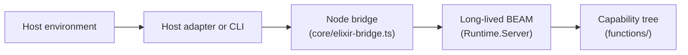

# Alchemist

Alchemist is a host-independent Elixir capability registry. Hosts expose a fixed
four-operation JSON protocol; capabilities live in an Elixir source tree under
`functions/`, each entry implemented by an `AgentFn.*` module with `run/1`.

## Architecture



The registry protocol operations are `define`, `load`, `find`, and `call`. The Node
bridge keeps one local BEAM process running so compiled entry modules stay loaded
across operations. Model-facing harness tools in the Cursor adapter map one-to-one
to those operations; other hosts can call the same operations through
`scripts/registry-cli.mjs` or a thin wrapper.

## Quick start

Prerequisites: Node 22.13+ (Cursor adapter only) and Elixir 1.14+.

```bash
mix local.hex --force && mix local.rebar --force
(cd runtime && mix deps.get)
npm ci
npm run check
node scripts/registry-cli.mjs '{"op":"call","name":"echo","args":{"hello":"world"}}'
```

Optional Cursor development:

```bash
npx @grok/agent-sdk dev
```

## Documentation

- [Documentation index](docs/index.md) — goal-oriented reading paths
- [Using the harness](docs/guides/usage.md) — setup, harness tools, and registry workflows
- [Domain language](docs/concepts/domain-language.md) — canonical product and implementation terms
- [Host adapters](docs/reference/hosts.md) — integrating Cursor, CLI, and other hosts

## Security

`define` accepts arbitrary Elixir source and executes with the privileges of the
long-lived BEAM process on the host. Restrict registry access to trusted users and inputs.

## License

MIT
