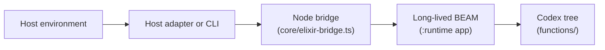

# Alchemist

Alchemist is a host-independent agent harness.
The codex is its capability layer: an Elixir source tree under `functions/`, its metadata, and the operations `define`, `load`, `find`, and `call`.
Each entry is an `AgentFn.*` module with `run/1`.
Hosts share that layer.
Memory and the long-lived runtime sit beside it.

## Architecture



The codex protocol operations are `define`, `load`, `find`, and `call`.
A long-lived BEAM (`elixir --no-halt`) runs the runtime application as permanent.
Compiled entry modules stay loaded across operations.
`Runtime.Application` supervises connection tasks, a compile serializer, and a permanent acceptor.
Live node files (`port`, `pid`, and the bridge's `stamp`) are under `runtime/.alchemist/` unless `ALCHEMIST_STATE_DIR` is set.
Model-facing codex tools in the Cursor adapter and the Claude Agent SDK host map one-to-one to those operations.
Other hosts call the same operations through `scripts/cli.mjs` or a thin wrapper.

## Quick start

Prerequisites: Node 24+ (Cursor adapter and Claude host) and Elixir 1.20+.

```bash
mix local.hex --force && mix local.rebar --force
(cd runtime && mix deps.get)
npm ci
npm run check
node scripts/cli.mjs '{"op":"call","name":"echo","args":{"hello":"world"}}'
```

Optional Cursor development:

```bash
npm run dev
```

Optional Claude Agent SDK host:

```bash
npm run chat:claude
npm run eval:claude
```

Optional terminal UI for the hosts:

```bash
npm run tui
```

## Documentation

- [Documentation index](docs/README.md) — goal-oriented reading paths
- [Getting started](docs/guides/getting-started.md) — install, validate, first call
- [Terminal UI](docs/guides/tui.md) — run a host in the terminal with streamed output and usage stats
- [Architecture](docs/architecture.md) — components, lifecycle, composition
- [Memory](docs/runtime/design/memory.md) — MiniGraf memory and bi-temporal queries
- [Codex protocol](docs/codex-protocol/interfaces/codex-protocol.md) — operation contracts
- [nshde host](hosts/nshde/README.md) — agent sidecar, component entries, and the service gateway

## Security

`define` accepts arbitrary Elixir source and executes with the privileges of the long-lived BEAM process on the host.
Restrict codex access to trusted users and inputs.
See [Security boundary](docs/security.md).

## License

MIT
