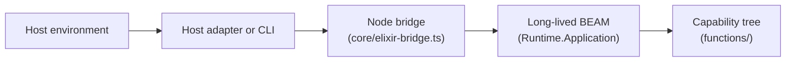
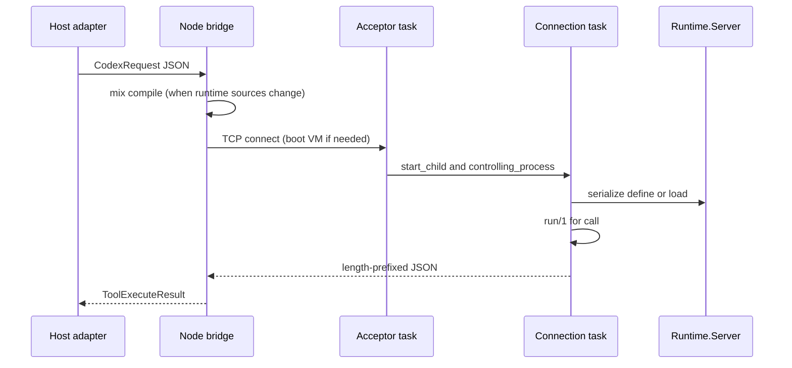
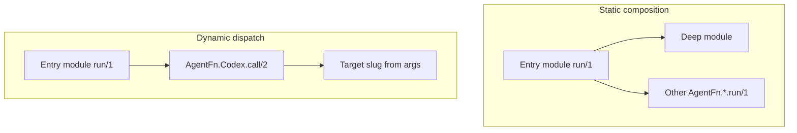

# Architecture

| Sub-document | Content |
| --- | --- |
| [crucible/alchemist/architecture/domain-language](architecture/domain-language.md) | Canonical product and implementation terms |
| [crucible/alchemist/architecture/host-adapters](architecture/host-adapters.md) | How a host environment maps to the codex protocol |
| [crucible/alchemist/architecture/nshde-deployment](architecture/nshde-deployment.md) | Planned: codex overlay, repository sync and sidecar hardening for nshde |

Alchemist separates **hosts** (environments that run agents) from the **codex**
(capability source, metadata, and the four-operation JSON contract). Capability
implementation and composition live in Elixir under `functions/`; hosts never grow
an open-ended tool surface beyond the fixed codex operations.

## Component boundaries

| Component | Location | Role |
| --- | --- | --- |
| Host | Cursor playground, CI, custom agent loop | Supplies inference, channels, and user session |
| Host adapter | `hosts/cursor/bot/tools/*.ts` (Cursor), `hosts/claude/codex.ts` (Claude), or `scripts/cli.mjs` | Maps codex tool calls to codex JSON requests |
| Node bridge | `core/elixir-bridge.ts` | Compiles `runtime/` when needed, boots BEAM, TCP RPC |
| Runtime | `:runtime` application (`Runtime.Server`, `Runtime.Engine`, `Runtime.Memory`, ...) built from `runtime/` | Validates slugs, compiles sources into the live BEAM, discovers metadata, invokes `run/1`, and owns memory |
| Capability tree | `functions/` | Codex entries (`tool.ex`, deep modules, `meta.json`) |

The Cursor Agent SDK adapter in this repository is one host integration. The same
codex tree can be driven by any host that can reach the bridge or speak the same
JSON protocol to `Runtime.Server`.

## Request lifecycle

A **long-lived BEAM** serves codex operations. The Node bridge starts or reuses
that VM and sends each operation as a TCP request.

## Supervision

`Runtime.Application` is a named `one_for_one` supervisor (3 restarts in 5
seconds). Children start in this order:

| Child | Restart | Role |
| --- | --- | --- |
| `Runtime.Memory` | permanent GenServer | Owns memory through one Node process |
| `Runtime.TaskSupervisor` | permanent supervisor | Temporary task per accepted socket |
| `Runtime.Server` | permanent GenServer | Serializes `define` and `load`. Does not own a socket |
| `Runtime.CodexWarmup` | permanent GenServer | Compiles every codex entry before the acceptor listens |
| `Runtime.Acceptor` | permanent `Task` | Owns the loopback listen socket and accepts |
| `Runtime.ServiceGateway` | permanent supervisor | Second loopback listener that only runs `call` on published `services.*` entries (see the [nshde host](../hosts/nshde/README.md)) |

The acceptor hands each client to `Task.Supervisor.start_child/2`, then
`:gen_tcp.controlling_process/2` so the task owns the socket. The task reads one
4-byte length-prefixed JSON frame, dispatches it, and closes the socket. `call`
runs `run/1` in that task. `define` and `load` compile inside `Runtime.Server` so
`Code.require_file/2` stays single-threaded.

An acceptor crash restarts under the supervisor. Repeated accept failures stop
the application instead of looping in the acceptor. The bridge starts the
application with `Application.ensure_all_started(:runtime, :permanent)`, so a
supervisor that gives up exits the VM. The next codex call boots a new one.
A connection crash closes that socket and leaves the acceptor and serializer
running.

Shutdown stops children in reverse: the service gateway closes, then the listen socket, then the
serializer, then in-flight connection tasks, and memory stops last.

Implications:

- `load` and `define` compile inside the **running** BEAM.
  At startup, `Runtime.CodexWarmup` compiles every entry under `functions/` so
  `call` can invoke `run/1` without per-slug discovery loads.
  Modules stay loaded until the VM restarts (for example after `runtime/` source
  changes or bridge recovery).
- `meta.json` records such as `"loaded": true` reflect the **last successful**
  validation on disk, not a substitute for inspecting live code in the VM.
- The **filesystem tree** under `functions/` is the source of truth for entry
  source and discovery metadata.
- The memory file survives a BEAM restart. `Runtime.Memory` opens it
  on the next start. See [Memory](runtime/design/memory.md).

`call` auto-invokes `load` when the entry module is not yet compiled in the current
BEAM.

## Composition models

Codex entries should express multi-step work in Elixir rather than through
repeated codex `call` operations from the host.

| Style | When | Mechanism |
| --- | --- | --- |
| Static composition | The dependency slug is known at authoring time | `alias` and direct `OtherModule.run(args)` |
| Dynamic dispatch | The slug comes from runtime data | `AgentFn.Codex.call/2` |

## Related reading

- [Codex protocol reference](codex-protocol/interfaces/codex-protocol.md)
- [Authoring codex entries](guides/authoring-entries.md)
- [Host adapters](architecture/host-adapters.md)
- [Memory](runtime/design/memory.md)
- [Runtime notes](../runtime/README.md)
