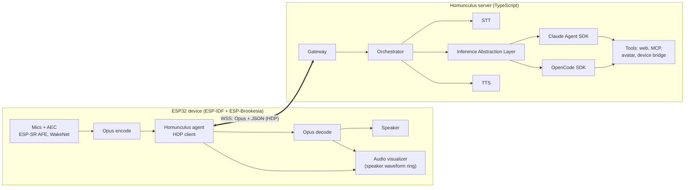
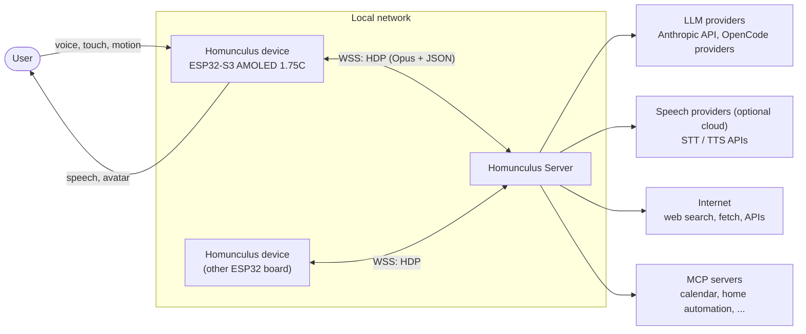
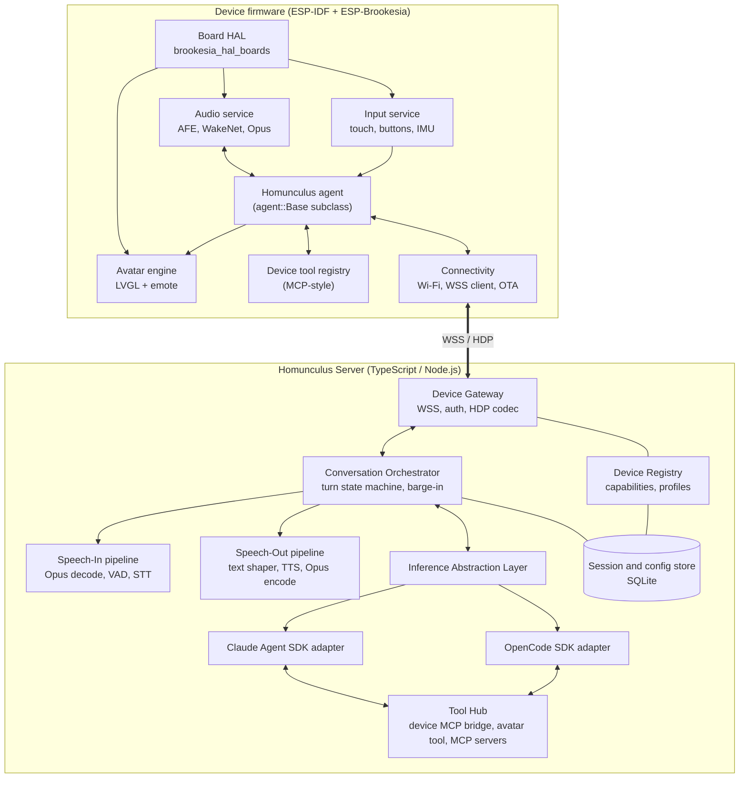
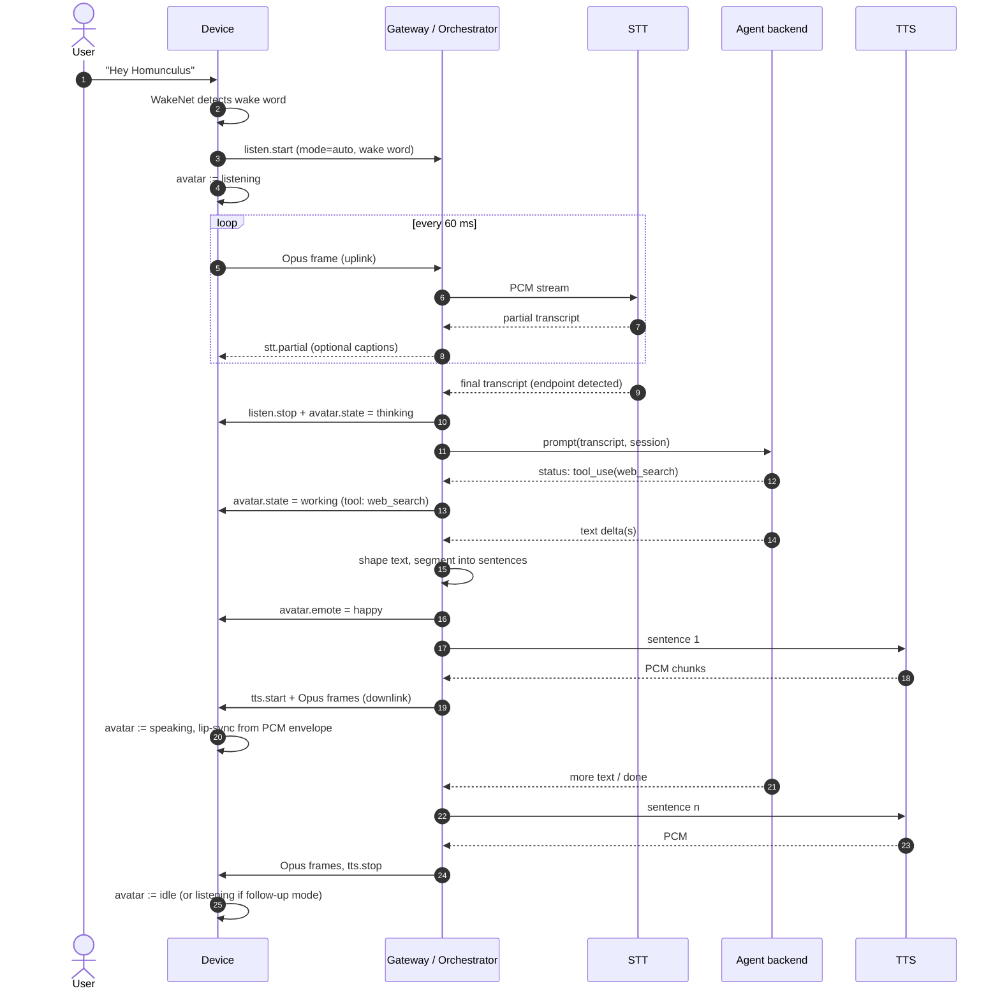
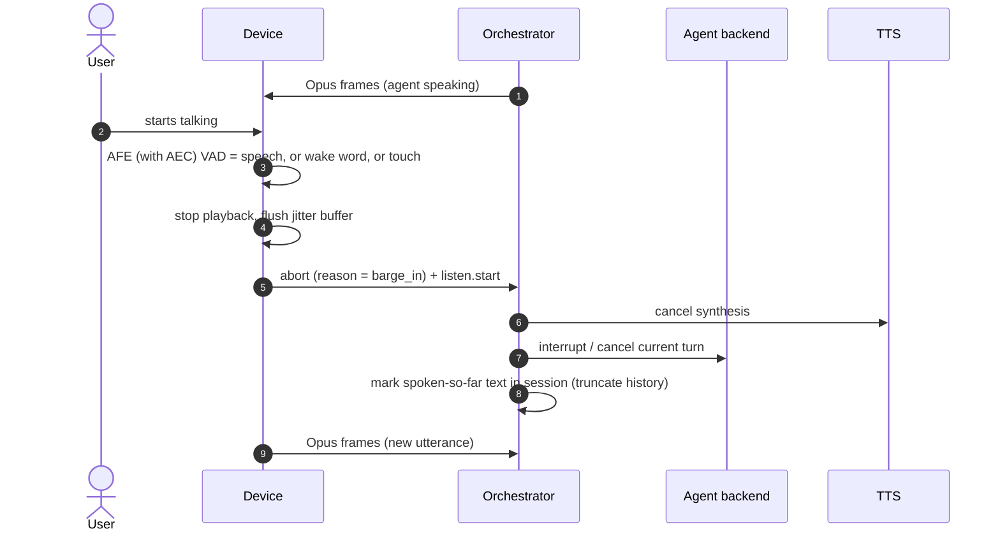
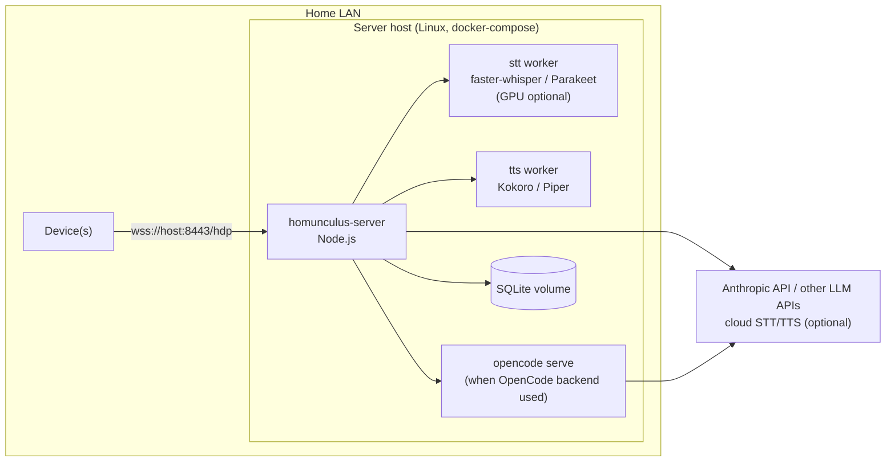

# Architecture

| Sub-document | Content |
| --- | --- |
| [crucible/homunculus/architecture/phases-and-risks](architecture/phases-and-risks.md) | Repository layout, phases and their state, risks, measurements |
| [crucible/homunculus/architecture/research-notes](architecture/research-notes.md) | Background research on Brookesia, XiaoZhi, Agent SDKs, speech |

## Architecture at a glance

## 1 System context

## 2 Responsibility split

| Concern | Device | Server |
| --- | --- | --- |
| Audio capture, AEC, NS, AGC | yes (ESP-SR AFE, hardware echo reference) | - |
| Wake word | yes (WakeNet, local, privacy-preserving) | optional verification |
| Voice activity detection | yes coarse (AFE VAD for barge-in / end-of-speech hint) | yes authoritative (Silero VAD / STT endpointing) |
| Audio encoding | yes Opus encode (uplink) / decode (downlink) | yes Opus decode / encode |
| Speech-to-text | - | yes |
| Agent reasoning, tools, internet, memory | - | yes |
| Speech-friendly text shaping, sentence segmentation | - | yes |
| Text-to-speech | - | yes |
| Emotion selection | - | yes (agent tool + heuristics) |
| Avatar rendering, lip-sync, idle behaviours | yes | - |
| Local tools (volume, brightness, display text/QR, sensors) | yes executes | yes exposes to agent via MCP bridge |
| Provisioning, OTA | yes client | yes server |

Rationale: the ESP32-S3 has ~ 8 MB PSRAM and two 240 MHz cores - sufficient for real-time audio DSP, Opus and 2D animation, insufficient for any useful language model. Keeping the device protocol-thin makes adding new boards cheap.

## 3 Container view

## 4 End-to-end turn sequence

## 5 Barge-in sequence

The spoken-so-far bookkeeping matters: the agent must know which part of its answer the user actually heard. The orchestrator records the last sentence fully played (device reports `tts.played` with the sentence id) and appends a note to the agent context on the next turn.

## 6 Deployment view

- Speech workers are optional sidecars; cloud providers can replace them by configuration.
- mDNS (`_homunculus._tcp`) advertisement allows devices to discover the server on the LAN; a fixed URL can be provisioned for remote servers.

## 7 Architectural decisions (summary)

| ID | Decision | Rationale | Alternatives considered |
| --- | --- | --- | --- |
| AD-01 | Device is a thin real-time terminal; all AI on server | MCU resources; provider flexibility | On-device STT (ESP-SR MultiNet: command words only - insufficient) |
| AD-02 | ESP-IDF 6.x + ESP-Brookesia 0.8.x (componentised) as firmware base | Official board definition exists for the reference device; agent manager, AFE, emote and HAL are reusable | Vendored brookesia_core 0.6 (end of maintenance); xiaozhi-esp32 fork (no 1.75C board, different architecture) |
| AD-03 | WebSocket (WSS) transport, Opus audio, JSON control | Proven by XiaoZhi ecosystem; works through NAT/proxies; one connection | MQTT + UDP (more moving parts), WebRTC (heavy on MCU) |
| AD-04 | Cascaded pipeline STT -> agent -> TTS | Agent SDK harnesses are text-based; needed for tools and provider choice | Speech-to-speech realtime models (no agent harness/tools parity) - possible future backend |
| AD-05 | Server in TypeScript (Node.js >= 22) | Both Claude Agent SDK and OpenCode SDK are first-class in TypeScript | Python (Claude SDK yes, OpenCode SDK no) |
| AD-06 | Emotions selected by the agent via a dedicated tool, complemented by orchestrator heuristics | Explicit, testable, provider-independent | Inline markup tags in text; sentiment classifier |
| AD-07 | Capability negotiation in `hello` for multi-device support | New boards need only a board definition + capability descriptor | Per-board server code |
