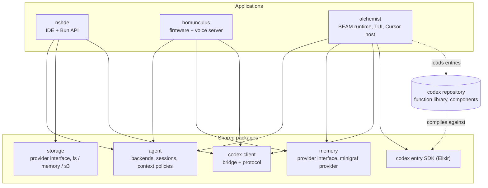

# Crucible - Architecture

Crucible is one monorepo: three applications (alchemist, homunculus, nshde) built on a set of shared packages and talking to each other over defined channels. This document is the summary and index of the system architecture; each part is a sub-document, listed in reading order.

| Sub-document | Content |
| --- | --- |
| [crucible/architecture/system-architecture](architecture/system-architecture.md) | Context, building blocks, dependency rules, processes, current-to-target mapping |
| [crucible/architecture/shared-packages](architecture/shared-packages.md) | `memory`, `agent`, `codex-client`, `storage`, codex entry SDK: responsibilities and interfaces |
| [crucible/architecture/integration](architecture/integration.md) | How nshde, alchemist and homunculus talk to each other |
| [crucible/architecture/repository-and-migration](architecture/repository-and-migration.md) | Monorepo layout, codex repository, tooling, documentation migration, planned work |

## Architecture at a glance

