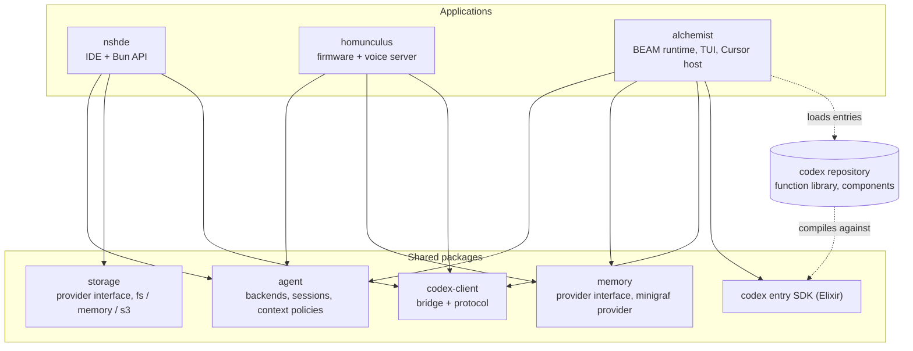

# Crucible - Architecture

System manifest (profile `system`). The documents are listed in reading order; the Type column repeats the `type` from each document's front matter.

| Id | Type | Document | Content |
| --- | --- | --- | --- |
| crucible/REQ | `REQ` | [Requirements](REQ-requirements.md) | Purpose, scope, the three projects today, goals, constraints, terminology |
| crucible/ARCH | `ARCH` | [Architecture](ARCH-architecture.md) | Context, building blocks, dependency rules, processes, current-to-target mapping |
| crucible/ARCH-shared-packages | `ARCH` | [Shared Packages](ARCH-shared-packages.md) | `memory`, `agent`, `codex-client`, `storage`, codex entry SDK: responsibilities and interfaces |
| crucible/ARCH-integration | `ARCH` | [Integration](ARCH-integration.md) | How nshde, alchemist and homunculus talk to each other |
| crucible/ARCH-repository-and-migration | `ARCH` | [Repository and Migration](ARCH-repository-and-migration.md) | Monorepo layout, codex repository, tooling, documentation migration, phases |
| crucible/AD | `AD` | [Decisions](AD-decisions.md) | Architectural decisions `crucible/AD-NN` |
| crucible/OI | `OI` | [Open Items](OI-open-items.md) | Open questions `crucible/OI-NN` and things not yet verified |

## Architecture at a glance

