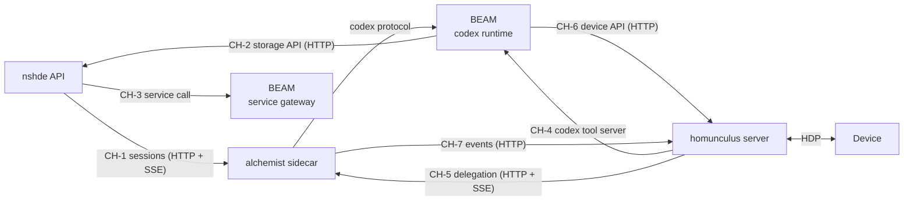

# Integration

## 1 Channels

| ID | From -> To | Transport | Purpose | Status |
| --- | --- | --- | --- | --- |
| CH-1 | nshde -> alchemist sidecar | HTTP `POST /sessions`, SSE | Agent turns for the IDE | Implemented |
| CH-2 | codex entries -> nshde | HTTP storage API | Read and write workspace files (`AgentLib.Storage` remote adapter; today `AgentLib.Nshde`) | Implemented as `nshde.component.*`; generalisation planned |
| CH-3 | nshde -> service gateway | Framed TCP, call-only | Components call published services | Implemented |
| CH-4 | homunculus -> BEAM | `codex-client` (loopback TCP) | Voice agent finds and calls codex entries | Planned |
| CH-5 | homunculus -> alchemist agent | In-process `packages/agent` session, or sidecar HTTP + SSE | Delegate long tasks | Planned |
| CH-6 | codex entries -> homunculus | HTTP device API | Speak, show, call device tools | Planned |
| CH-7 | alchemist -> homunculus | HTTP event API | Push an event into a device's voice session | Planned; depends on crucible/OI-10 |

## 2 Homunculus -> alchemist

### CH-4 Codex tool server

| Item | Value |
| --- | --- |
| Mechanism | `SessionContext.servers.codex` = codex tool server from `codex-client` |
| `find`, `call`, `load` | Policy `allow` |
| `define` | Off by default; when enabled, policy `ask` (on-device confirmation) because of crucible/C-01 (crucible/OI-11) |
| Voice | Codex tool calls follow the existing filler / `working` avatar rules |

### CH-5 Delegation

| Item | Value |
| --- | --- |
| Trigger | The voice agent calls a `delegate` tool with a task description |
| Execution | A separate agent session with the alchemist prompt and codex tools; not on the voice turn path (crucible/C-04) |
| Reply | The voice agent acknowledges immediately; the result returns over crucible/CH-7 |

## 3 Alchemist -> homunculus

### CH-6 Device entries

| Entry | Effect |
| --- | --- |
| `homunculus.say` | Speak a text on a device |
| `homunculus.show` | Show text / QR / image |
| `homunculus.device.call` | Call a device tool announced in `hello.tools` |
| `homunculus.devices` | List devices and their capabilities |

Entries call a new HTTP API on the homunculus server, which reuses the existing device bridge. Authentication: crucible/OI-12.

### CH-7 Events

| Item | Value |
| --- | --- |
| Mechanism | `AgentInput { kind: "event", name, data }` pushed into the device's session |
| Effect | The voice agent decides whether and how to speak it |
| Dependency | Server-initiated speech, deferred in homunculus (HOM OI-14, D-26) |

## 4 Memory

Applications share the memory **package**, not memory content (crucible/AD-05). Cross-application access to remembered content goes through crucible/CH-4 (homunculus calls alchemist's `memory.*` entries) or a homunculus API; neither is planned yet.

## 5 Security boundaries

| Boundary | Rule |
| --- | --- |
| BEAM | Loopback only; `define` restricted to trusted callers (crucible/C-01) |
| Service gateway | Call-only, published slugs, source hash check, scoped tokens (implemented) |
| Sidecar | Bearer token when not on loopback (planned, existing alchemist deployment plan) |
| Storage | Access only inside configured mounts |
| Homunculus device API | Authenticated; not exposed without a token (crucible/OI-12) |
| Voice-triggered side effects | `ask` policy with on-device confirmation |

## 6 Order of introduction

| Step | Channel | Reason |
| --- | --- | --- |
| 1 | crucible/CH-4 | Smallest change; `SessionContext.servers` already exists |
| 2 | crucible/CH-6 | Needs the device HTTP API only |
| 3 | crucible/CH-5 + crucible/CH-7 | Delegation is useful only once results can be spoken back |
