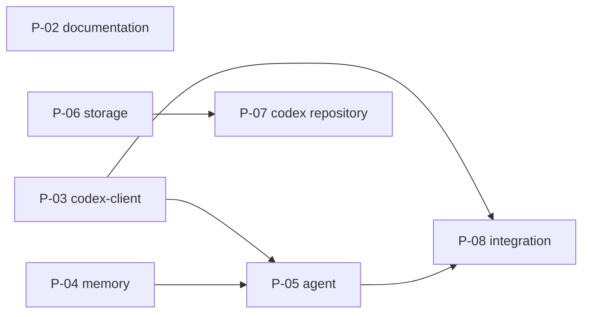

# Repository and Migration

## 1 Monorepo layout

Follows the [Formulary workspace layout](https://github.com/0x1d/formulary#workspace-layout).

```text
crucible/
├── docs/                          # cross-project only
│   ├── README.md                  # system manifest and index
│   ├── requirements.md  architecture.md  decisions.md  open-items.md
│   └── architecture/              # sub-documents of architecture.md, this one among them
├── projects/
│   ├── alchemist/
│   │   ├── docs/                  # alchemist components, codex protocol, guides
│   │   ├── runtime/               # BEAM codex runtime (Mix)
│   │   ├── sdk/                   # codex entry SDK (Mix)
│   │   ├── functions/             # kernel entries only
│   │   ├── hosts/<name>/          # Cursor, ACP, ... hosts
│   │   ├── sidecar/               # HTTP + SSE front-end (athanor, delegation)
│   │   └── tui/
│   ├── homunculus/
│   │   ├── docs/                  # homunculus components, HDP
│   │   ├── firmware/
│   │   ├── server/
│   │   ├── protocol/              # HDP
│   │   └── tools/simulator/
│   └── athanor/
│       ├── docs/                  # athanor components
│       ├── ide/                   # today: App.tsx, src/client, src/nshde
│       └── api/                   # today: src/server.ts, src/lib
├── packages/                      # each with its own docs/
│   ├── agent/
│   ├── memory/
│   ├── storage/
│   └── codex-client/
├── tools/                         # workspace scripts
├── .github/workflows/ci.yml
├── AGENTS.md
├── flake.nix                      # dev shells for all projects
├── package.json                   # root scripts, pnpm pin
├── pnpm-lock.yaml
└── pnpm-workspace.yaml
```

## 2 Codex repository

| Item | Value |
| --- | --- |
| Content | `functions/` (function library and agent-written entries), `components/` (athanor components), `services.json` (published-services manifest) |
| Stays in the monorepo | Kernel entries: `memory.*`, `codex.*`, `runtime.*`, `echo` |
| Moves out | General library: `fs`, `git`, `http`, `md`, `json`, `data`, `docker`, `github`, `text`, `sys`, `util`, `env`, `explore`, ...; `services/*`; `nshde/*` (split line: crucible/OI-01) |
| Loading | Overlay root (`AGENT_CODEX_DIR`): lookup overlay first, then the kernel root; `define` writes to the overlay; shadowing a kernel entry is refused |
| Sync | `codex.sync` entry: clone / pull, commit, push (from the existing alchemist deployment plan) |
| Contract | Depends on the codex entry SDK as a git dependency |
| Tests | Entry tests move with the entries; CI checks out crucible for the runtime |

## 3 Tooling

| Item | Value |
| --- | --- |
| JS workspace | Root `pnpm-workspace.yaml` with the members `packages/*`, `projects/alchemist`, `projects/homunculus/{protocol,server,tools/*}`; one `pnpm-lock.yaml` at the root. Workspace-wide settings (`packageExtensions`) live in the root file |
| Package manager | pnpm 10, pinned by `packageManager` in the root `package.json`. npm lockfiles are not kept |
| Root scripts | `pnpm typecheck` and `pnpm test` run the script of that name in every member; `pnpm check:docs` runs Formulary's `check-docs.py` |
| athanor | Keeps Bun and `bun.lock`; not a workspace member until it consumes a package (crucible/OI-06). The NSH CLI is installed per machine, outside Nix |
| Node | 24 for all Node projects, stated in `engines` |
| Elixir | `alchemist/runtime` as a Mix project; Elixir 1.20 |
| Nix | Root `flake.nix`, built on the project flakes, which stay usable on their own. Shells: `default` (Node 24, pnpm, Elixir, Erlang, Python for the docs check), `athanor` (Bun, Node 24), `firmware` and `homunculus-server` (the homunculus shells) |
| Git LFS | Path-scoped patterns for `homunculus/**` binaries in the root `.gitattributes` |
| Commits | Conventional Commits, scope = project or package (`feat(homunculus): ...`) |

### 3.1 Continuous integration

`.github/workflows/ci.yml` runs on every push to `main` and on every pull request. Each job runs inside a root Nix shell, so CI uses the toolchain of the dev shells.

| Job | Shell | Steps |
| --- | --- | --- |
| `docs` | none | Formulary's `check-docs.py` on the workspace, from the `formulary` submodule at its pinned commit |
| `workspace` | `default` | `pnpm install --frozen-lockfile`, `pnpm typecheck`, `pnpm test` (alchemist: Mix runtime and functions suites, docs-check, TUI, core and host tests; homunculus: protocol, server and simulator) |
| `athanor` | `athanor` | `bun install --frozen-lockfile`, `bun run lint`, `bun test src` |

The firmware is not built in CI: the ESP-IDF toolchain is built locally (`make fw-build` in `projects/homunculus`).

## 4 History import

| Step | Detail | State |
| --- | --- | --- |
| 1 | Merge or drop unmerged remote branches (`alchemist`: `feat/acp-host`, `ccr-42861548-wocrlg`; `athanor`: `ccr-42861548-wocrlg`, `claude/*`) (crucible/OI-13) | Done |
| 2 | Import each repository under `projects/<name>/` with history (`git subtree add`) | Done |
| 3 | Fetch homunculus LFS objects before the import; rewrite `.gitattributes` to path-scoped patterns | Done |
| 4 | Archive the three source repositories (read-only): `0x1d/alchemist`, `0x1d/homunculus`, `0x1d/athanor` | Done |

## 5 Documentation migration

Each project keeps its documents under `projects/<project>/docs/`, restructured per the [Formulary standard](https://github.com/0x1d/formulary). `docs/` keeps only the system documents.

Components and their [profiles](https://github.com/0x1d/formulary/blob/main/profiles.md):

| Component | Profile | Docs |
| --- | --- | --- |
| `crucible` | system | `docs/` |
| `crucible/homunculus/firmware` | device | `projects/homunculus/docs/firmware/` |
| `crucible/homunculus/server` | service | `projects/homunculus/docs/server/` |
| `crucible/homunculus/hdp` | protocol | `projects/homunculus/docs/hdp/` |
| `crucible/athanor/ide` | app | `projects/athanor/docs/ide/` |
| `crucible/athanor/api` | service | `projects/athanor/docs/api/` |
| `crucible/alchemist/runtime` | service | `projects/alchemist/docs/runtime/` |
| `crucible/alchemist/tui` | app | `projects/alchemist/docs/tui/` |
| `crucible/alchemist/host-<name>` (code `hosts/<name>/`) | integration | `projects/alchemist/docs/host-<name>/` |
| `crucible/alchemist/codex-protocol` | protocol | `projects/alchemist/docs/codex-protocol/` |
| `crucible/packages/<name>`: `agent`, `memory`, `storage`, `codex-client` | library | `packages/<name>/docs/` |

Moves:

| Source | Target |
| --- | --- |
| `homunculus/docs/specification/*` | `projects/homunculus/docs/{firmware,server,hdp}/`; decisions `D-NN` and open items keep their ids, prefixed `HOM-` |
| `homunculus/docs/devices/` | `projects/homunculus/docs/firmware/hardware/<board>.md` |
| `alchemist/docs/{concepts,reference}` | `projects/alchemist/docs/{runtime,codex-protocol}/` |
| `alchemist/docs/guides` | `projects/alchemist/docs/guides/` |
| `alchemist/docs/internal/{plans,specs}` - implemented | Content folded into the component documents; files removed |
| `alchemist/docs/internal/{plans,specs}` - proposed / planned | A **Planned** section in the component document, with an id and its dependencies; files removed |
| `athanor/docs/internal/plans/001-006` (done) | `projects/athanor/docs/ide/`; files removed |
| `athanor/docs/internal/plans/007-009`, crucible/alchemist/architecture/athanor-deployment | `projects/athanor/docs/api/` deployment and access-control sections marked **Planned**; cross-project decisions to `crucible/decisions` |
| `docs/architecture/shared-packages.md` interface details | `packages/<package>/docs/interfaces.md`; `crucible/architecture/shared-packages` keeps responsibilities and links |
| `AGENTS.md` per project | One root `AGENTS.md` plus short per-project files |

Removed files remain in git history.

## 6 Planned work

The migration is a set of planned changes that form a dependency graph ([Formulary](https://github.com/0x1d/formulary#planned-work)). The dependencies are declared under `planned` in this document's front matter; the graph and the table are a view of them. There are no dates and no fixed order: a change may start when everything it depends on is done.



| Id | Content | Depends on | Behaviour change | State |
| --- | --- | --- | --- | --- |
| P-02 | Documentation restructure (section 5) | - | None | ready |
| P-03 | `packages/codex-client` | - | None | ready |
| P-04 | `packages/memory`: interface, minigraf provider; alchemist and homunculus switched | - | Homunculus may keep the interim provider | ready |
| P-05 | `packages/agent`: interfaces, Claude backend, context policies; sidecar, TUI and homunculus switched; ACP backend | crucible/P-03, crucible/P-04 | None intended | blocked |
| P-06 | `packages/storage` + `AgentLib.Storage`; `fs.*` on mounts | entry SDK | `fs.*` restricted to mounts | blocked |
| P-07 | Codex repository split, overlay, `codex.sync` | crucible/P-06, entry SDK | Functions load from the overlay | blocked |
| P-08 | Integration crucible/CH-4, crucible/CH-6, then crucible/CH-5 + crucible/CH-7 | crucible/P-03, crucible/P-05 | New features | blocked |

crucible/P-07 may be needed early, if the athanor deployment requires it.
