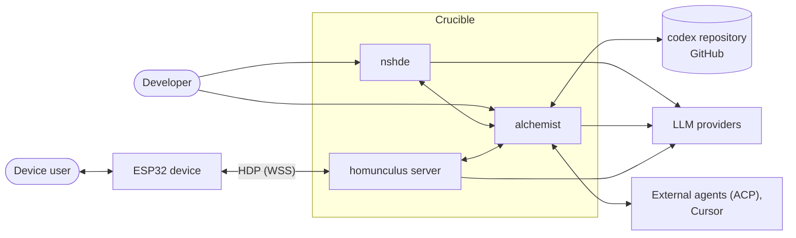
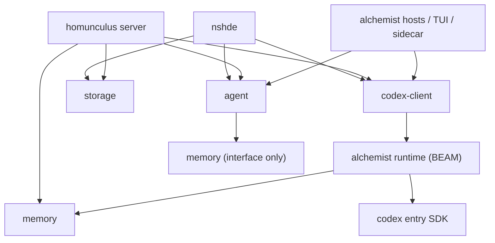

# Crucible - System Architecture

## 1 System context

## 2 Building blocks

| Block | Kind | Responsibility |
| --- | --- | --- |
| nshde | Application | IDE shell, Bun API, preview sandbox, service tokens, storage HTTP API |
| homunculus | Application | Firmware; server: device gateway, orchestrator, speech pipeline, device tool bridge, pairing, OTA |
| alchemist | Application | Codex runtime (BEAM): compile, discover, call entries; service gateway; kernel entries; TUI; Cursor host; nshde sidecar |
| `packages/agent` | Shared package | Agent backend abstraction, session and event model, tool and permission model, context policies |
| `packages/memory` | Shared package | Memory provider interface, minigraf provider, schema profiles, wiki |
| `packages/storage` | Shared package | Storage provider interface, backends, mounts |
| `packages/codex-client` | Shared package | Node bridge to the BEAM, codex protocol types, codex operations as a tool server |
| Codex entry SDK | Shared (Elixir) | Behaviours and helpers entries compile and test against |
| Codex repository | External repository | Function library, agent-written entries, nshde components, published-services manifest |

## 3 Dependency rules

| Rule | Statement |
| --- | --- |
| R-01 | Applications depend on packages; packages never depend on applications |
| R-02 | Applications do not import each other's code; they talk over the channels in [crucible/architecture/integration](integration.md) |
| R-03 | `agent` knows the memory **interface**, not a provider |
| R-04 | TypeScript reaches the BEAM only through `codex-client`; the BEAM reaches applications only through their HTTP APIs |
| R-05 | Codex entries reach files only through `AgentLib.Storage`, never `File.*` directly |
| R-06 | A package exists only when it has two consumers |

## 4 Processes

| Process | Runtime | Owns | Started by |
| --- | --- | --- | --- |
| nshde API | Bun | Storage providers, service tokens, storage HTTP API | user / deployment |
| nshde sidecar | Node | Agent sessions for nshde (HTTP + SSE) | user / sandbox controller |
| Long-lived BEAM | Elixir | Compiled entries, service gateway, `Runtime.Memory` | `codex-client` bridge on first use |
| Alchemist memory child | Node | Alchemist's graph file (crucible/C-02) | `Runtime.Memory` |
| homunculus server | Node | Device connections, voice sessions, homunculus's memory spaces (in-process or child) | user / deployment |
| TUI, Cursor host | Node | Terminal / Cursor sessions | user |
| Device firmware | ESP-IDF | Audio, avatar, device tools | - |

Each application owns its own memory store (crucible/AD-05). No memory process is shared.

## 5 Current-to-target mapping

| Today | Target |
| --- | --- |
| `alchemist/core/elixir-bridge.ts`, `protocol.ts` | `packages/codex-client` |
| `alchemist/hosts/shared/codex-tools.ts`, `alchemist-mcp-tools.ts` | `packages/codex-client` (codex tool server) |
| `alchemist/core/minigraf-memory.ts`, `minigraf-server.ts` | `packages/memory` (minigraf provider, stdio entry point) |
| `homunculus/server/src/memory/*` | `packages/memory` (prepare / finalize, sampler, wiki, spaces); temporal-reasoning client as interim provider |
| `homunculus/server/src/inference/*` | `packages/agent` (interfaces, Claude backend) |
| `alchemist/hosts/claude/codex.ts`, `session-hook.ts` | `packages/agent` Claude backend options + codex tool server |
| `alchemist/hosts/acp/*` | `packages/agent` ACP backend |
| `alchemist/hosts/cursor/bot/lib/{host-flags,handoff,result-digest,cap-tool-result,explore-gate,...}` | `packages/agent` context policies |
| `alchemist/hosts/nshde/*` | alchemist sidecar, built on `packages/agent` |
| `alchemist/hosts/cursor/*` | stays in alchemist (crucible/C-06), imports context policies from `packages/agent` |
| `alchemist/runtime/` | stays: alchemist codex runtime |
| `AgentFn.Tool`, `AgentFn.Codex`, `Runtime.Result`, `functions/test_helper.exs` | codex entry SDK |
| `alchemist/functions/{memory,codex,runtime,echo}` | kernel entries, stay in the monorepo |
| `alchemist/functions/` (everything else) | codex repository (crucible/OI-01) |
| `nshde/src/lib/storage/*` | `packages/storage` |
| `alchemist/functions/fs/*` `File.*` calls | `AgentLib.Storage` (entry SDK) |
| `homunculus/protocol` (HDP) | stays in homunculus (one consumer) |
| `homunculus/server/src/speech` | stays in homunculus until a second consumer exists |
