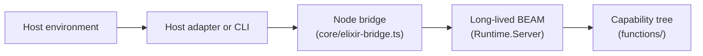
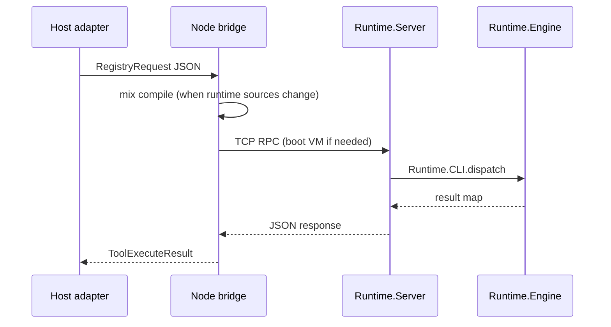
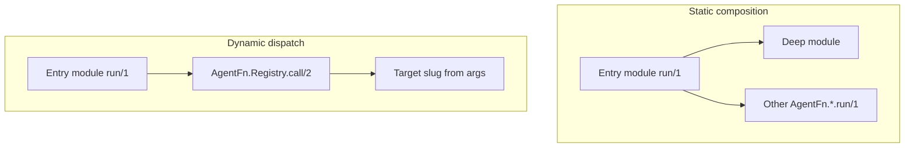

# Architecture

Alchemist separates **hosts** (environments that run agents) from the **registry**
(capability source, metadata, and the four-operation JSON contract). Capability
implementation and composition live in Elixir under `functions/`; hosts never grow
an open-ended tool surface beyond the fixed harness operations.

## Component boundaries

| Component | Location | Role |
| --- | --- | --- |
| Host | Cursor playground, CI, custom agent loop | Supplies inference, channels, and user session |
| Host adapter | `bot/tools/*.ts` (Cursor) or `scripts/registry-cli.mjs` | Maps host tool calls to registry JSON requests |
| Node bridge | `core/elixir-bridge.ts` | Compiles `runtime/` when needed, boots BEAM, TCP RPC |
| Mix control plane | `runtime/` (`Runtime.Server`, `Runtime.Engine`, …) | Validates slugs, compiles sources, discovers metadata, invokes `run/1` |
| Capability tree | `functions/` | Registry entries (`tool.ex`, deep modules, `meta.json`) |

The Cursor Agent SDK adapter in this repository is one host integration. The same
registry tree can be driven by any host that can reach the bridge or speak the same
JSON protocol to `Runtime.Server`.

## Request lifecycle

A **long-lived BEAM** serves registry operations. The Node bridge starts or reuses
that VM and sends each operation as a TCP request.

Implications:

- `load` and `define` compile inside the **running** BEAM; modules stay loaded until
  the VM restarts (for example after `runtime/` source changes or bridge recovery).
- `meta.json` records such as `"loaded": true` reflect the **last successful**
  validation on disk, not a substitute for inspecting live code in the VM.
- The **filesystem tree** under `functions/` is the source of truth for entry
  source and discovery metadata.

`call` auto-invokes `load` when the entry module is not yet compiled in the current
BEAM.

## Composition models

Registry entries should express multi-step work in Elixir rather than through
repeated harness `call` operations from the host.

| Style | When | Mechanism |
| --- | --- | --- |
| Static composition | The dependency slug is known at authoring time | `alias` and direct `OtherModule.run(args)` |
| Dynamic dispatch | The slug comes from runtime data | `AgentFn.Registry.call/2` |

## Related reading

- [Registry protocol reference](../reference/protocol.md)
- [Authoring registry entries](../guides/authoring-entries.md)
- [Host adapters](../reference/hosts.md)
- [Mix control-plane notes](../../runtime/README.md)
