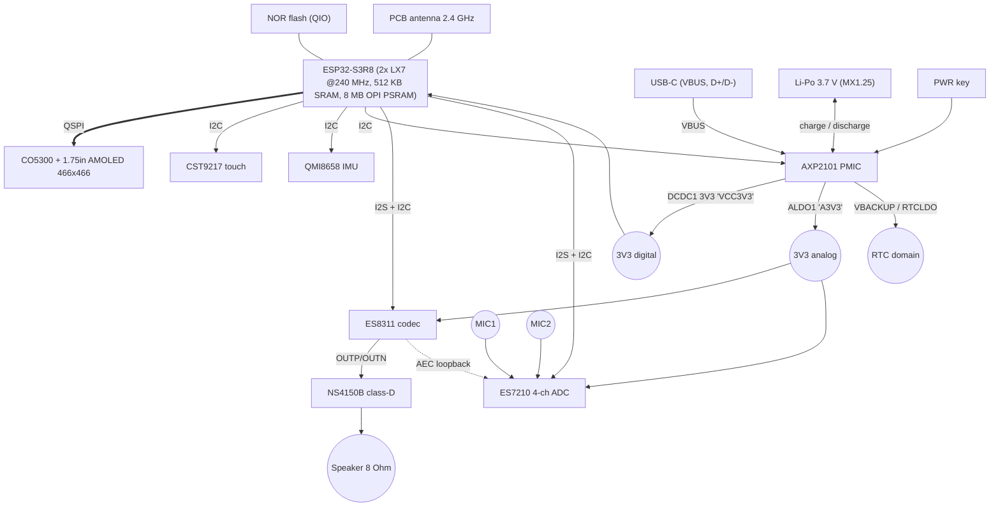
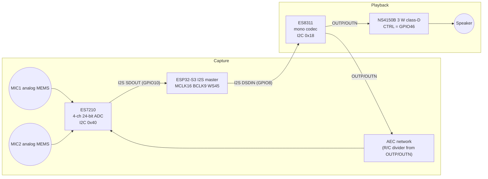

# Hardware Description — ESP32-S3-Touch-AMOLED-1.75C

Derived from the vendor schematic ([schematics/ESP32-S3-Touch-AMOLED-1.75C-schematic.pdf](schematics/ESP32-S3-Touch-AMOLED-1.75C-schematic.pdf), 3 pages: circuit, PCB top, PCB bottom), the vendor BSP and component datasheets in [datasheets/](datasheets/).

## 1. Block diagram



## 2. Processor and memory

| Item | Detail |
| --- | --- |
| SoC | ESP32-S3R8 (QFN56): 2 × Xtensa LX7 up to 240 MHz, ULP-RISC-V + ULP-FSM co-processors |
| SRAM | 512 KB (shared IRAM/DRAM) + 16 KB RTC SRAM |
| PSRAM | 8 MB Octal SPI, in-package, 80 MHz (`CONFIG_SPIRAM_MODE_OCT`) |
| Flash | External quad SPI NOR (see flash size caveat in [README.md](README.md)) |
| Clock | 40 MHz crystal X1 |
| AI acceleration | 128-bit SIMD (PIE) used by ESP-SR / ESP-NN / ESP-DSP |
| Security | Secure Boot v2, flash encryption, HMAC, digital signature peripheral, eFuse |

Memory budget implications for Homunculus:

- One full 466 × 466 RGB565 frame = **434,312 bytes** → frame/draw buffers must be in PSRAM; internal SRAM is reserved for Wi-Fi/LWIP, DMA descriptors and the audio front end.
- ESP-SR AFE (AEC + NS + VAD + WakeNet) typically consumes ~ 1–1.5 MB PSRAM + ~ 50–100 KB internal RAM and ~ 1 core-equivalent at 16 kHz in high-perf mode.
- Opus encoder (16 kHz, mono, 60 ms frames) requires ~ 20–30 KB stack in its task and ~ 10–20 % of one core.

## 3. Power subsystem — AXP2101

| Rail / function | AXP2101 output | Board net | Consumers |
| --- | --- | --- | --- |
| Main 3.3 V | DCDC1 | VCC3V3 | ESP32-S3, flash, touch, IMU, logic |
| Analog 3.3 V | ALDO1 | A3V3 | ES8311, ES7210, mic bias |
| RTC backup | RTCLDO / VBACKUP | VCC-RTC / VBAT2 | AXP2101 RTC domain, IRQ pull-up |
| Charger | VBUS → BAT | VBAT | Li-Po via J1 (MX1.25) |
| Power key | PWRON | PWRON | Key2 (PWR) |
| Reset out | PWROK | CHIP_PU (via RC) | ESP32-S3 enable |

Other AXP2101 outputs (DCDC2–4, ALDO2–4, BLDO1–2, CPUSLDO, DLDO) are not used on this board (schematic table lists their default capabilities only).

Notes:
- The AXP2101 **IRQ pin is not routed to an ESP32-S3 GPIO** (pulled up to VCC-RTC only). Battery/charger/PWR-key events must be **polled over I²C** (e.g. every 500 ms–1 s).
- Battery telemetry (voltage, percentage, charge state, VBUS presence, die temperature) is available via the AXP2101 fuel gauge — see vendor example `01_AXP2101` (XPowersLib port) and Brookesia `BROOKESIA_HAL_ADAPTOR_POWER_BATTERY_IMPL_AXP2101`.
- The battery TS (thermistor) input is configured via the schematic network; charge current should be limited to the battery's 0.5 C rating in firmware.

## 4. Display subsystem — CO5300 AMOLED

| Item | Detail |
| --- | --- |
| Panel | 1.75" round AMOLED, 466 × 466 |
| Driver IC | CO5300 (Chipone), on-panel, QSPI (4-line data) — datasheet [datasheets/Co5300_Datasheet.pdf](datasheets/Co5300_Datasheet.pdf) |
| Pixel format | RGB565 (16 bpp) via COLMOD 0x55; driver supports up to 24 bpp |
| Connector | J3, 31-pin 0.3 mm FPC (display + touch) |
| Brightness | Software, DCS command 0x51 (0–255). No backlight; black pixels draw ~ zero power |
| Tearing effect | TE output on GPIO13 |
| Driver component | `espressif/esp_lcd_co5300` |

Initialisation sequence used by the vendor BSP (CO5300 vendor commands, then standard DCS):

```text
FE 20 ; 19 10 ; 1C A0       // page 0x20 vendor settings
FE 00 ; C4 80 ; 3A 55        // page 0, SPI mode, COLMOD = RGB565
35 00 ; 53 20 ; 51 FF ; 63 FF   // TE on, brightness control, max brightness
2A 00 06 01 D7 ; 2B 00 00 01 D1  // column 6..471, row 0..465
11 (wait 600 ms) ; 29              // sleep out, display on
```

Throughput estimate: QSPI at 40–80 MHz → 20–40 MB/s theoretical, ~ 50 % effective → 25–45 full-frame updates/s. Avatar rendering should use partial (dirty-rect) updates; most of the avatar canvas can remain static black.

## 5. Touch subsystem — CST9217

| Item | Detail |
| --- | --- |
| Controller | Hynitron CST9217, single-touch with gesture reporting |
| Interface | I²C 0x5A, INT → GPIO11, RST → GPIO2 |
| Coordinates | 466 × 466, mirrored X and Y relative to display |
| Driver component | `waveshare/esp_lcd_touch_cst9217` |
| Datasheet | Not publicly available (vendor component is the reference) |

## 6. Audio subsystem

### 6.1 Signal chain



### 6.2 Components

| Component | Role | Key parameters |
| --- | --- | --- |
| ES7210 | Quad-channel audio ADC | 24-bit, up to 4 ch (TDM), 102 dB SNR, PGA 0–37.5 dB, mic bias; MIC1/MIC2 voice, MIC3 echo reference |
| ES8311 | Low-power mono codec | 24-bit DAC (110 dB SNR), headphone/line driver; only DAC path used on this board (its ADC is unused) |
| NS4150B | Class-D mono amplifier | Up to 3 W into 4 Ω (5 V), filterless; enable/standby via CTRL (GPIO46); BSP sets PA gain model 5 V / 6 dB |
| Microphones | 2 × analog MEMS | Differential into ES7210 MIC1P/N and MIC2P/N, located at opposite edges of the left side of the PCB |

### 6.3 I²S configuration

- Single I²S controller in **full duplex**, ESP32-S3 is master, shared MCLK/BCLK/WS for both codecs.
- Vendor BSP default: Philips standard, 16-bit, mono, 22.05 kHz.
- Brookesia board config: 48 kHz, 16-bit data, stereo slots, MCLK = 256 × Fs for playback; recorder captured at 16 kHz / 32-bit / 2 ch (mic + reference) and resampled as needed.
- **Recommended for Homunculus**: capture 16 kHz (ESP-SR native rate), playback 16 kHz or 24 kHz; avoid run-time sample-rate switching while the AFE is running because the codecs share clocks.

### 6.4 Acoustic echo cancellation

The board routes the amplifier input signal back into ES7210 MIC3 through an attenuating RC network ("AEC" block on the schematic). This gives a **sample-synchronous hardware echo reference**, which is the prerequisite for ESP-SR's AEC and therefore for **barge-in** (interrupting the companion while it talks).

## 7. Motion sensor — QMI8658

| Item | Detail |
| --- | --- |
| Type | 6-axis: 3-axis accelerometer (±2/4/8/16 g), 3-axis gyroscope (±16…±2048 dps) |
| Interface | I²C 0x6B (SA0 = GND), INT1 → GPIO21 (INT2 not connected to MCU) |
| Features | Motion detect, tap/double-tap, pedometer, any/no-motion, wake-on-motion, FIFO |
| Orientation | Axis orientation printed on PCB silkscreen (X up, Y left, Z out of top side) |
| Homunculus use | Pick-up-to-wake, shake to dismiss/cancel, tilt-reactive avatar gaze, orientation |

## 8. Wireless

- 2.4 GHz Wi-Fi 4 (802.11 b/g/n, 20/40 MHz, up to 150 Mbps PHY), WPA3, Bluetooth 5 LE (2M PHY, Coded PHY long range).
- PCB antenna with π-matching network (L1/L2/C9); the aluminium enclosure is **open at the antenna edge** — avoid metal mounting surfaces near it.
- Realistic sustained throughput for Homunculus traffic (≤ 64 kbps audio each way + control) is far below limits; latency and power save mode (`WIFI_PS_MIN_MODEM`) are the relevant concerns.

## 9. Mechanical

- Round PCB with cut-outs for USB-C (bottom), PWR (upper right), BOOT (lower right); battery bay behind the PCB.
- Speaker soldered to SPK +/− pads (bottom side, left).
- Dimensions drawing: [images/ESP32-S3-Touch-AMOLED-1.75C-details-size.webp](images/ESP32-S3-Touch-AMOLED-1.75C-details-size.webp); component overview: [images/ESP32-S3-Touch-AMOLED-1.75C-details-intro.webp](images/ESP32-S3-Touch-AMOLED-1.75C-details-intro.webp).

## 10. Component reference

| Ref | Part | Datasheet |
| --- | --- | --- |
| U1 | ESP32-S3R8 | [esp32-s3_datasheet_en.pdf](datasheets/esp32-s3_datasheet_en.pdf), [TRM](datasheets/esp32-s3_technical_reference_manual_en.pdf) |
| U2 | Quad SPI NOR flash | — |
| U3 | QMI8658 | [QMI8658C.pdf](datasheets/QMI8658C.pdf) |
| U6 | ES8311 | [ES8311.DS.pdf](datasheets/ES8311.DS.pdf), [ES8311.user.Guide.pdf](datasheets/ES8311.user.Guide.pdf) |
| U7 | NS4150B | (generic, not included) |
| U8 | ES7210 | [ES7210_DS.pdf](datasheets/ES7210_DS.pdf) |
| UP1 | AXP2101 | [X-power-AXP2101_SWcharge_V1.0.pdf](datasheets/X-power-AXP2101_SWcharge_V1.0.pdf) |
| (panel) | CO5300 | [Co5300_Datasheet.pdf](datasheets/Co5300_Datasheet.pdf) |
| (panel) | CST9217 | not publicly available |
