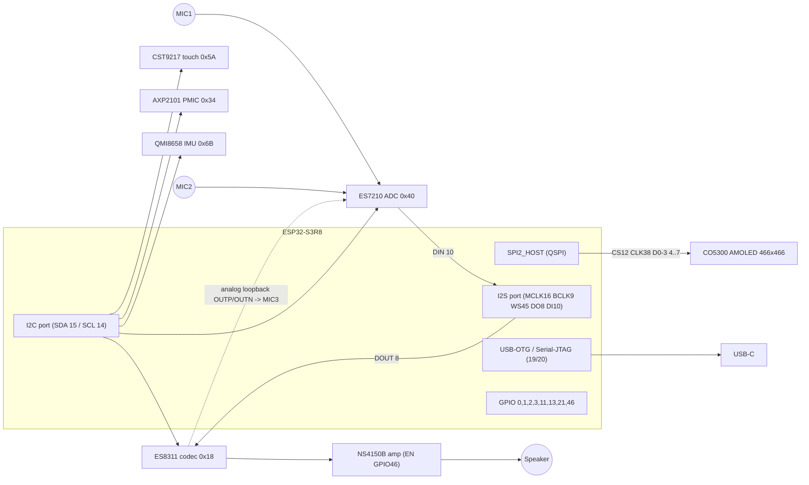

# Pinout — ESP32-S3-Touch-AMOLED-1.75C

Sources: vendor schematic GPIO allocation table ([schematics/gpio-allocation-table.png](schematics/gpio-allocation-table.png)), BSP `waveshare/esp32_s3_touch_amoled_1_75c` v3.0.0 ([reference/](reference/bsp-esp32_s3_touch_amoled_1_75c-3.0.0/include/bsp/esp32_s3_touch_amoled_1_75c.h)) and upstream ESP-Brookesia board YAML ([reference/brookesia-board-config/](reference/brookesia-board-config/)). All three agree.

## 1. GPIO allocation

| GPIO | Net name (schematic) | Function | Direction | Peripheral / notes |
| ---: | --- | --- | --- | --- |
| 0 | GPIO0 | BOOT button (Key1) | In | 10 kΩ pull-up, 100 nF; strapping pin (low at reset → download mode) |
| 1 | LCD_RESET | Display reset | Out | CO5300 RESX |
| 2 | TP_RESET | Touch reset | Out | CST9217 RST |
| 3 | SYS_OUT | PWR-key state | In | PWR key (Key2) drives AXP2101 PWRON and, via BSS138 (T1), pulls GPIO3 low; 10 kΩ pull-up. Strapping pin (JTAG source select) |
| 4 | QSPI_SIO0 | Display data 0 | IO | SPI2 MOSI / D0 |
| 5 | QSPI_SI1 | Display data 1 | IO | SPI2 MISO / D1 |
| 6 | QSPI_SI2 | Display data 2 | IO | SPI2 WP / D2 |
| 7 | QSPI_SI3 | Display data 3 | IO | SPI2 HD / D3 |
| 8 | I2S_DSDIN | I²S data out (ESP → ES8311) | Out | `BSP_I2S_DOUT` |
| 9 | I2S_SCLK | I²S bit clock | Out | `BSP_I2S_SCLK` (BCLK), shared ES8311 / ES7210 |
| 10 | I2S_ASDOUT | I²S data in (ES7210 → ESP) | In | `BSP_I2S_DSIN` (ES7210 SDOUT1/TDMOUT) |
| 11 | TP_INT | Touch interrupt | In | CST9217 INT |
| 12 | LCD_CS | Display chip select | Out | CO5300 CSX |
| 13 | LCD_TE | Display tearing effect | In | CO5300 TE (not used by vendor BSP; usable for tear-free sync) |
| 14 | ESP32_SCL / TP_SCL | I²C SCL | Out | Shared system I²C bus, 400 kHz, 2.2 kΩ pull-ups |
| 15 | ESP32_SDA / TP_SDA | I²C SDA | IO | Shared system I²C bus |
| 16 | I2S_MCLK | I²S master clock | Out | MCLK = 256 × Fs |
| 17 | GPIO17 | Free | — | Test pad TP13 |
| 18 | GPIO18 | Free | — | Test pad TP14 |
| 19 | USB_N | USB D− | — | Native USB (USB-Serial/JTAG / TinyUSB) |
| 20 | USB_P | USB D+ | — | Native USB |
| 21 | QMI_INT1 | IMU interrupt 1 | In | QMI8658 INT1 (INT2 not routed to MCU) |
| 38 | QSPI_SCL | Display clock | Out | SPI2 SCLK |
| 39 | GPIO39 | Free | — | Test pad TP15 (also MTCK — JTAG) |
| 40 | GPIO40 | Free | — | Test pad TP16 (MTDO) |
| 41 | GPIO41 | Free | — | Test pad TP9 (MTDI) |
| 42 | GPIO42 | Free | — | Test pad TP10 (MTMS) |
| 43 | U0TXD | UART0 TX | Out | Test pad TP6 |
| 44 | U0RXD | UART0 RX | In | Test pad TP5 |
| 45 | I2S_LRCK | I²S word select | Out | `BSP_I2S_LCLK`; strapping pin (VDD_SPI voltage) — keep default |
| 46 | PA_CTRL | Speaker amplifier enable | Out | NS4150B CTRL, active high; strapping pin |

GPIOs 26–37 are consumed by the in-package Octal PSRAM and flash and are not available.

## 2. Bus summary

## 3. I²C address map (single bus, SDA = GPIO15, SCL = GPIO14)

| Device | 7-bit address | 8-bit (W) | Function | Source |
| --- | --- | --- | --- | --- |
| ES8311 | 0x18 | 0x30 | Audio codec (DAC path) | BSP `ES8311_CODEC_DEFAULT_ADDR`, Brookesia YAML `0x30` |
| AXP2101 | 0x34 | 0x68 | PMIC | Brookesia YAML `i2c_addr: 0x34` |
| ES7210 | 0x40 | 0x80 | 4-ch audio ADC (A0 = A1 = 0) | BSP `ES7210_CODEC_DEFAULT_ADDR`, YAML `0x80` |
| CST9217 | 0x5A | 0xB4 | Touch controller | YAML `i2c_addr: [0xb4]` |
| QMI8658 | 0x6B | 0xD6 | IMU (SA0 = GND per schematic label "0X6B") | Schematic |

Bus speed: 400 kHz (BSP `CONFIG_BSP_I2C_CLK_SPEED_HZ`). The vendor BSP uses I²C port 1 by default (`CONFIG_BSP_I2C_NUM=1`), Brookesia uses port 0 — irrelevant electrically, but only one driver instance may own the bus.

## 4. Audio channel mapping

| ES7210 input | Source | Use |
| --- | --- | --- |
| MIC1 | MEMS mic MIC1 (board edge, upper left) | Voice |
| MIC2 | MEMS mic MIC2 (board edge, lower left) | Voice (second element; ~30 mm spacing) |
| MIC3 | ES8311 OUTP/OUTN through RC divider ("AEC" block) | Echo reference for AEC |
| MIC4 | — | Unused |

Brookesia's board config labels the ADC channels `['NA', 'RE', 'FR', 'FL']` with mask `0111` and a recorder layout `"RMNN"` (reference + one mic) at 16 kHz / 32-bit / 2 ch.

## 5. Display interface parameters

| Parameter | Value |
| --- | --- |
| Bus | SPI2_HOST, quad mode, SPI mode 0, 32-bit command phase (`CO5300_PANEL_IO_QSPI_CONFIG`) |
| Resolution | 466 × 466, RGB565 (`COLMOD 0x3A = 0x55`), RGB order |
| Column gap | 6 (`CASET 0x0006–0x01D7`, `RASET 0x0000–0x01D1`) |
| Brightness | DCS `0x51` (0x00–0xFF), no backlight GPIO (AMOLED) |
| Max transfer | BSP: full frame (466 × 466 × 2 B); Brookesia: 9320 B (10 lines) |
| TE | GPIO13 (available, unused by default) |

## 6. Test pads (bottom side)

| Pad | Signal | Pad | Signal |
| --- | --- | --- | --- |
| TP2 | VBUS | TP10 | GPIO42 |
| TP17 / TP19 / TP3 / TP21 | GND | TP9 | GPIO41 |
| TP8 | I²C SDA | TP16 | GPIO40 |
| TP7 | I²C SCL | TP15 | GPIO39 |
| TP6 | U0TXD (GPIO43) | TP14 | GPIO18 |
| TP5 | U0RXD (GPIO44) | TP13 | GPIO17 |
| TP4 / TP18 | 3V3 | P1 / P2 | USB DN / DP |

Front-side test points TP1 (GND) and TP11 (RST/CHIP_PU) allow forcing a reset. See [schematics/schematic-p3-pcb-bottom.png](schematics/schematic-p3-pcb-bottom.png).

## 7. Buttons

| Button | Electrical | Firmware access |
| --- | --- | --- |
| BOOT (Key1) | GPIO0 to GND, 10 kΩ pull-up | `gpio_get_level(GPIO_NUM_0)`; hold at power-up for ROM download mode |
| PWR (Key2) | AXP2101 PWRON + BSS138 → GPIO3 (SYS_OUT, active low) | Short press readable on GPIO3 and via AXP2101 IRQ status (PKEY short/long press). Long press = hardware power-off (AXP2101 config) |
