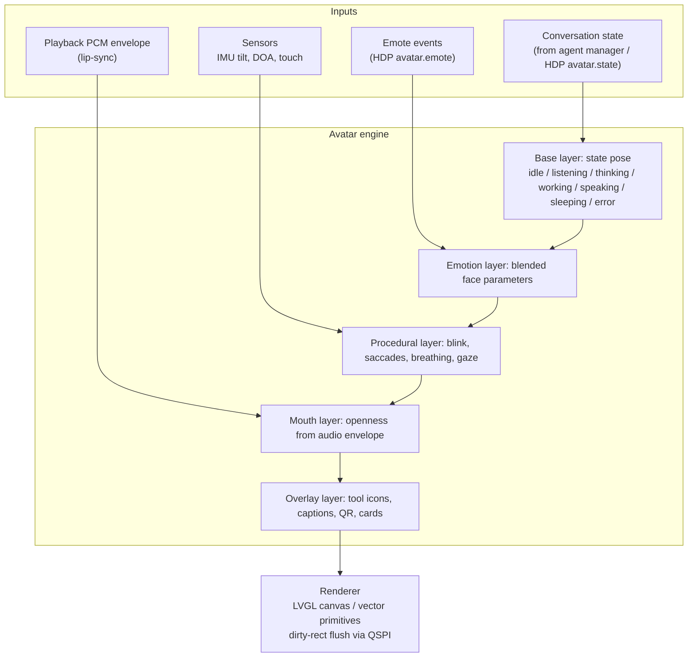
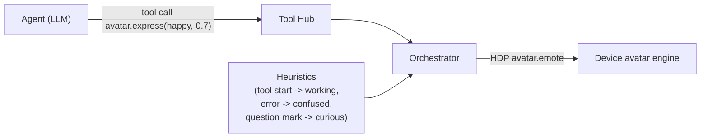

# Avatar Face

**Planned** P-01. Deferred by crucible/homunculus/D-20; the circular audio visualizer is built instead.

| | |
| --- | --- |
| State | **Deferred** (2026-11-08, crucible/homunculus/D-20). Not part of Phase 2; Phase 2 is the circular audio visualizer ([crucible/homunculus/firmware/design/avatar](avatar.md)). Content unchanged from Draft 0.1. |

## 1 Design goals

- Communicate **conversation state** at a glance (is it listening? thinking? speaking?).
- Express **emotion** chosen by the agent.
- Feel **alive** when idle (blinks, micro-saccades, breathing, gaze following tilt/voice).
- Render at >= 20 fps on the ESP32-S3 with headroom for audio DSP.
- Exploit AMOLED: black background (zero power per pixel), saturated accents.
- Scale to other display sizes and shapes (round / square / rectangular).

## 2 Layered model

## 3 Rendering approach

Two techniques were evaluated:

| Approach | Description | Pros | Cons |
| --- | --- | --- | --- |
| A. Pre-rendered animations | Brookesia `expression_emote` / `esp_emote_expression`, frame sequences in flash (mmap assets) | Artist-friendly, rich visuals, existing service (`SetEmoji`, `SetAnimation`, `InsertAnimation`) | Discrete clips, no continuous blending, lip-sync hard, large flash footprint at 4662 |
| B. Procedural parametric face | Face defined by ~ 12 parameters (eye openness, eye shape curvature, pupil position, brow angle, mouth width/openness/curve, cheek glow, colour) rendered with vector primitives | Continuous blending between emotions, natural lip-sync and gaze, tiny footprint, resolution-independent | Requires custom engine; visual style is simpler |

**Decision (crucible/homunculus/AD-08): procedural parametric face (B) as the primary avatar; Brookesia emote assets (A) for special one-shot animations** (boot, pairing, celebrations) and for overlays (QR, event messages). The face parameters are interpolated with critically damped springs, which gives smooth, organic transitions at low cost.

### 3.1 Face parameter vector

| Parameter | Range | Notes |
| --- | --- | --- |
| `eye_open_l`, `eye_open_r` | 0-1 | Blink, sleepy, wink |
| `eye_curve` | -1...1 | Happy "^ ^" (-) <-> sad droop (+) |
| `eye_size` | 0.5-1.5 | Surprise up |
| `pupil_x`, `pupil_y` | -1...1 | Gaze |
| `brow_angle` | -1...1 | Concerned / angry |
| `brow_height` | 0-1 | Surprise up |
| `mouth_open` | 0-1 | Lip-sync driven |
| `mouth_curve` | -1...1 | Smile <-> frown |
| `mouth_width` | 0.5-1.5 | |
| `hue`, `glow` | - | Accent colour / ambient glow per state |

Each emote is a target vector; the engine blends `state pose + emote x intensity + procedural offsets + mouth`.

### 3.2 Performance plan (reference device)

- Render only the face's bounding regions (eyes, mouth, glow ring) into small PSRAM canvases; flush dirty rectangles only. Typical dirty area per frame < 20 % of the screen -> 30 fps feasible.
- Use the CO5300 TE signal (GPIO13) for tear-free updates if tearing is visible.
- LVGL task on core 0 at low priority; audio tasks on core 1 always pre-empt.
- Two LVGL draw units (`CONFIG_LV_DRAW_SW_DRAW_UNIT_CNT=2`) as in the vendor example.

## 4 States

| State | Trigger | Visual |
| --- | --- | --- |
| `idle` | Default | Neutral face, slow blinks, gaze wanders / follows tilt, dim |
| `listening` | `listen.start` | Eyes wide, pupils centred, pulsing ring proportional to mic level |
| `thinking` | Endpoint / agent started | Eyes look up-side, slow "orbit" dots |
| `working` | `agent.status phase=tool` | Thinking pose + tool icon overlay (web, calendar, home, code); icon derived from tool name |
| `speaking` | `tts.start` | Mouth driven by audio envelope, emote applied |
| `confirming` | `confirm.request` | Concerned face + approve/deny buttons |
| `sleeping` | Power policy | Closed eyes, "z" animation, very dim |
| `offline` | Connection lost | Slightly sad face + Wi-Fi glyph |
| `error` | Error event | Confused face, short shake |

## 5 Emotion vocabulary

The agent selects emotions through the `avatar.express` tool. The vocabulary is fixed and small so that every device can render it; devices advertise supported emotes in `hello.capabilities.avatar.emotes`.

| Emote | Typical use |
| --- | --- |
| `neutral` | Default |
| `happy` | Good news, greetings |
| `excited` | Very good news, celebrations |
| `curious` | Asking a clarifying question |
| `surprised` | Unexpected information |
| `concerned` | Bad news, warnings, confirmations |
| `sad` | Sympathy |
| `confused` | Did not understand |
| `sleepy` | Late hour, going to sleep |
| `love` | Thanks, affection |
| `angry` | (rare) playful indignation |

### 5.1 How emotions are produced

- **Primary**: the system prompt instructs the agent to call `avatar.express` at the start of a response that has an emotional tone. The tool returns immediately (fire-and-forget) to avoid latency.
- **Secondary heuristics** in the orchestrator fill gaps (state-derived emotes, lightweight cues).
- **Timing**: emotes are queued against TTS segment ids so the face changes when the corresponding sentence starts playing, not when it was generated.

## 6 Lip-sync

- Device computes RMS envelope of decoded PCM in 20 ms windows -> `mouth_open = clamp((dB - floor)/range)` with attack/release smoothing. No server involvement; works with any TTS.
- Optional upgrade: TTS providers exposing viseme/phoneme timings -> server sends `avatar.visemes` alongside audio for shape-accurate mouths.

## 7 Captions and overlays

- Optional captions (user transcript, agent sentence) rendered along the lower arc of the round display.
- Cards (`device.show_text`), QR codes (`device.show_qr`) and images overlay the face; the face shrinks/moves up to stay visible.
