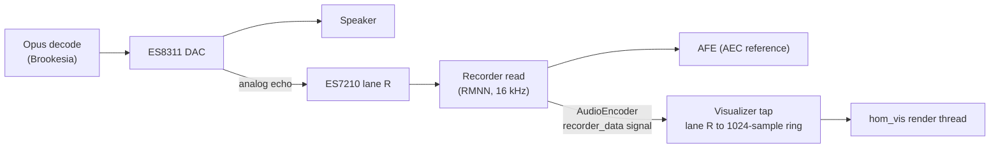

# Avatar

| | |
| --- | --- |
| State | 1.0 (2026-11-08), Phase 2 closed |
| Supersedes | Procedural face for Phase 2 (crucible/homunculus/D-20); face spec kept as [crucible/homunculus/firmware/design/avatar-face](avatar-face.md) |

## 1 Scope

| In scope | Out of scope (deferred) |
| --- | --- |
| Ring waveform of the device's audio output (speaker) | Procedural face, emotes, `avatar.express` rendering |
| Colour per UI state (Offline, Idle, Listening, Thinking, Speaking) | Microphone input visualisation |
| Direct panel rendering, no LVGL | Captions, overlays, cards, QR codes |
| | HDP `avatar{emote}` handling; `hello.capabilities.avatar` is not sent |

Visual reference: the circular spectrum of `lv_demo_music` in the Waveshare 1.75 MusicPlayer firmware (`firmware/brookesia/components/MusicPlayer/gui_music/lv_demo_music_main.c`, mirrored radial bars, colour stops by radius). That example uses LVGL and precomputed spectrum tables; Homunculus renders a live waveform without LVGL.

## 2 Signal source

| Item | Value |
| --- | --- |
| Source | DAC echo lane of the raw recorder data (the AEC reference): the speaker signal after volume, in time with the speaker |
| Access | `service::AudioEncoder::get_instance(0)->connect_recorder_data()`; published only while the encoder runs (always, for WakeNet) |
| Format | 16 kHz; per sample frame `BITS / 16 x CHANNELS` int16 lanes (1.75C: 32 bit x 2 ch = 4 lanes, layout `RMNN`) |
| Lane | Index of `R` in `CONFIG_BROOKESIA_HAL_ADAPTOR_AUDIO_CODEC_RECORDER_MIC_LAYOUT`; no `R` -> flat ring |
| Tap cost | Copy of one lane into a 1024-sample ring buffer in the recorder task |

## 3 Rendering

### 3.1 Geometry and signal mapping

| Parameter | Value |
| --- | --- |
| Base radius | 0.24 x min(w, h) (1.75C: 112 px) |
| Full-scale deflection | +/- 0.13 x min(w, h) (+/- 61 px) |
| Points | 96 per half circle, top to bottom; left half mirrored (closed, seamless, symmetric) |
| Window | Last 480 samples (30 ms), DC removed; point k = mean of samples 5k...5k+4 |
| Normalisation | Divide by a peak envelope: instant attack, x0.967 per frame release (~1 s at 30 fps), floor 1500 (int16) |
| Smoothing per point | Attack 0.6, release 0.25 per frame |
| Silence gate | RMS < `HOMUNCULUS_VIS_GATE_DBFS` (-55 dBFS): targets 0; below 0.01 deflection the ring snaps flat |
| Line | Soft round stamp, radius 3 px (solid core 1 px, falloff), every 1.5 px along each segment, max-blend |
| Colour index | 8 levels by \|deflection\| x 8 (base ring -> largest deflection), interpolated along segments |

### 3.2 State palettes

Three colour stops (base -> mid -> peak deflection), scaled by brightness and by stamp intensity (64 levels).

| UI state | Stops (RGB) | Brightness |
| --- | --- | --- |
| Offline | `303030` -> `606060` -> `909090` | 0.6 |
| Idle | `00a050` -> `40e080` -> `c0ffd0` | 0.45 |
| Listening | `00c060` -> `60ff90` -> `e0ffe0` | 1.0 |
| Thinking | `1040e0` -> `30a0ff` -> `c0e8ff` | 1.0 |
| Speaking | `c020e0` -> `6f8af6` -> `e9dbfc` (mid/peak from `lv_demo_music`) | 1.0 |

The waveform is drawn in every state whenever the reference lane is above the gate (e.g. a late tail of speech after barge-in shows in the Listening palette).

### 3.3 Rasterisation and flush

- Only the right half is rasterised; stamps crossing the vertical axis are reflected.
- Per band of 10 rows: intensity plane and colour-index plane (233 x 10 B each, PSRAM). The band's changed columns (union of this frame's and the previous frame's drawn columns) are converted through an 8 x 64 LUT into byte-swapped RGB565 in a full framebuffer (466 x 466 x 2 B, PSRAM). Bands with neither are skipped.
- Flush: each changed band is copied into one internal DMA buffer (10 rows x 466 px x 2 B = 9320 B, the Brookesia max transfer) and sent full width with `draw_bitmap_sync` (100 ms timeout). Full width keeps x start and width even (CO5300).
- Rejected: a single `draw_bitmap_sync` straight from the PSRAM framebuffer timed out at the first full-screen transfer, then `spi_device_release_bus` asserted (boot loop). Per-band rectangles of the changed columns only (1-2 per band, ~60 per speech frame): fixed cost per transfer dominated, 0.9 ms each at prio 3.
- Frame rate cap `HOMUNCULUS_VIS_FPS` (20) while the ring is deflected or the state changed; otherwise the thread polls every 50 ms without drawing.
- Host measurement (`test/host/run.sh`, synthetic speech): 393 changed rows per speech frame.
- Device measurement (1.75C, idle agent, development console `v` test tone, 180 / 720 / 2100 Hz):

| Variant | Frame | Flush | Frame rate |
| --- | --- | --- | --- |
| Rectangles, prio 3, `-Og` | 103 ms | 56 ms (60 rects) | ~10 fps |
| Rectangles, prio 3, core 0, renderer `-O2` | 164 ms | 108 ms (52 rects) | ~6 fps |
| Framebuffer, full-width bands, prio 3 | 168 ms | 113 ms (378 rows) | ~6 fps |
| Framebuffer, full-width bands, prio 6 | 83 ms | 60 ms (393 rows) | ~12 fps |
| Same, Brookesia worker poll 10 ms | 78 ms | 59 ms (362 rows) | ~13 fps |
| Same, project `-O2` (crucible/homunculus/D-21) | 53 ms | 35 ms (362 rows) | ~19 fps |
| `-O2`, poll 5 ms, prio 4, 20 fps cap, smaller ring (current) | 64 ms | 39 ms (296 rows) | ~16 fps |

- Prio 6 stuttered agent speech: every downlink frame write (`Base::feed_audio_decoder_data()`, DataFlow `write_borrowed()`) waits for a release callback that runs on the Brookesia service manager workers (prio 5); the render thread used ~50 % of a core while speaking and delayed them. Current prio 4 [crucible/homunculus/firmware/design](../design.md) section 2.2).

- Per-task CPU at idle: see [crucible/homunculus/firmware/design](../design.md) section 2.2. A render thread at prio 3 waited behind the Brookesia service manager workers (prio 5) after every transfer.

### 3.4 Thread and memory

| Item | Value |
| --- | --- |
| Thread | `hom_vis`, prio 4 (below the Brookesia service manager workers at 5, which complete downlink audio writes), no core affinity, 6 KB stack in PSRAM |
| Internal RAM | 9320 B DMA buffer + 2 KB tap ring buffer |
| PSRAM | Framebuffer 434 KB, 2 x 2330 B planes, renderer state (~5 KB) |
| Ownership | After `Visualizer::start()` the render thread does all panel drawing; it clears the screen once at start |
| Fallback | Visualizer disabled or start failure (panel not 16 bpp or odd width, allocation failure): solid state colours (Phase 1 behaviour) |
| Stats | `[stats] visualizer N frames, avg X ms (flush F ms, R rows), max Y ms` and `[stats] top tasks` (CPU % of one core per task) with each system stats line |

## 4 Code

| Path | Content |
| --- | --- |
| `firmware/components/homunculus_avatar/src/ring_renderer.{hpp,cpp}` | Platform-independent rasteriser (signal mapping, palettes -> LUT, bands, flush rectangles) |
| `firmware/components/homunculus_avatar/src/visualizer.cpp` | Reference-lane tap, render thread, state palettes, stats |
| `firmware/components/homunculus_avatar/test/host/` | Host test: flat ring geometry, mirror symmetry, rectangle alignment, erase on silence; optional PPM contact sheet |

Kconfig (`Homunculus visualizer` menu):

| Option | Default | Meaning |
| --- | --- | --- |
| `HOMUNCULUS_VISUALIZER` | y | Ring visualizer; n = solid state colours |
| `HOMUNCULUS_VIS_FPS` | 20 | Frame rate cap while the ring moves |
| `HOMUNCULUS_VIS_GATE_DBFS` | -55 | Silence gate (RMS of the reference lane) |

## 5 Phase 2 exit criteria

Phase 2 closed 2026-11-08.

| Criterion | Status |
| --- | --- |
| Ring follows speaker output during agent speech, in time with the audio | **Met** (hardware, 2026-11-08) |
| >= 15 fps during speech (`[stats] visualizer`) | **Met**: ~16 fps with the test tone at prio 4 (section 3.3) |
| Agent speech without stutter while the ring moves | **Met** (hardware, prio 4, poll 5 ms) |
| Palette changes with UI state | **Met** (hardware) |
| No added downlink underruns or AFE overruns; CPU per core and internal heap minimum measured against p1d ([crucible/homunculus/architecture/phases-and-risks](../../architecture/phases-and-risks.md) section 4) | Not measured during a speech turn; idle CPU and heap in [crucible/homunculus/firmware/design](../design.md) section 2.2 |
| Reference lane carries the speaker signal (lane `R` of `RMNN`) | **Met** (ring follows speech) |

## 6 Cards (Phase 3B)

Full-screen cards replace the ring until dismissed; the render thread draws them into the framebuffer (`card_renderer.cpp`, 8x16 font x2 from DejaVu Sans Mono Bold, `font8x16.inc` generated by `tools/gen-font.sh`; ASCII only, other characters render as `?`).

| Card | Content | Dismissed by |
| --- | --- | --- |
| Confirmation | Title (2 lines max), detail (4 lines max), deny button (red, left) and approve button (green, right) at 0.80 x min(w, h) | Answer, timeout, barge-in, turn end |
| QR (`device.show_qr`, Wi-Fi setup, pairing) | Title, QR code on a white square (module scale from 0.50 x min(w, h), quiet zone 2, ECC low, version <= 10, `espressif/qrcode` `qrcodegen`), caption (3 lines max) | Timer; Wi-Fi connected; pairing approved, rejected or expired |
| Text (`device.show_text`) | Centred text, 8 lines max | Timer (`duration_s`); never replaces a confirmation |

Host test: `firmware/components/homunculus_avatar/test/host/run-card.sh [out.ppm]`.
