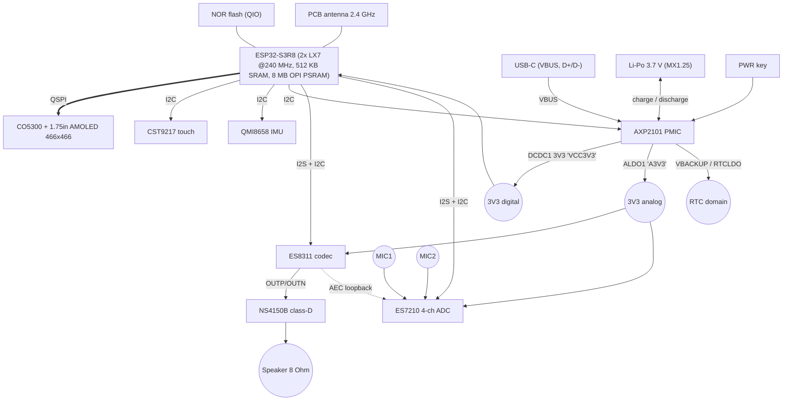
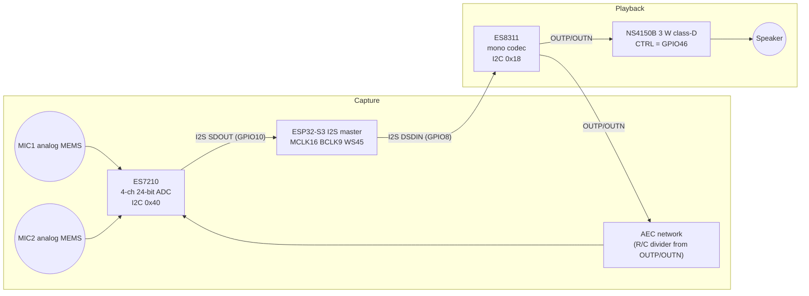
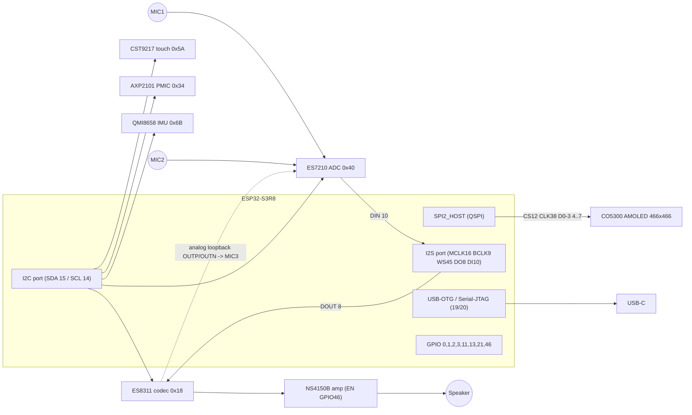

# Waveshare ESP32-S3-Touch-AMOLED-1.75C

| | |
| --- | --- |
| **Device ID (Homunculus)** | `ws-s3-amoled-175c` |
| **Vendor SKU** | 33691 (battery included), 33692 (no battery) |
| **Form factor** | Round "badge/pocket-watch" board in CNC-machined aluminium enclosure, battery bay |
| **Role in Homunculus** | Reference device (tier 1) - first supported target |
| **Status** | Documentation collected 2026-11-07 |


## 1. Summary

The ESP32-S3-Touch-AMOLED-1.75C combines an ESP32-S3R8 SoC with a 1.75" 466 x 466 round AMOLED touch display, a full audio front end (dual MEMS microphones -> ES7210 ADC with hardware echo-reference loopback, ES8311 codec -> NS4150B class-D amplifier -> onboard speaker), a QMI8658 6-axis IMU and an AXP2101 PMIC with Li-ion charging. It contains every peripheral Homunculus needs for a voice-driven, animated companion (mic array + AEC reference, speaker, high-quality display, touch, motion, battery) without additional hardware.

## 2. Key specifications

| Category | Specification |
| --- | --- |
| SoC | ESP32-S3R8 - Xtensa LX7 dual-core @ up to 240 MHz, vector (PIE) extensions for DSP/NN |
| On-chip memory | 512 KB SRAM, 384 KB ROM, 16 KB RTC SRAM |
| PSRAM | 8 MB Octal PSRAM, stacked in package (OPI, 80 MHz) |
| Flash | 32 MB external NOR flash, QIO 80 MHz (measured: GigaDevice, JEDEC `c8`/`4019`; schematic U2 is labelled XM25QH128DHIQT = 16 MB - see caveats) |
| Wireless | 2.4 GHz Wi-Fi 802.11 b/g/n, Bluetooth 5 LE; onboard PCB antenna |
| Display | 1.75" AMOLED, 466 x 466 px, 16.7 M colours (RGB565 used by BSP), round active area |
| Display driver | CO5300, QSPI interface (SPI2_HOST), tearing-effect (TE) line on GPIO13 |
| Touch | CST9217 (Hynitron) capacitive controller, I2C @ 0x5A, interrupt + reset |
| Audio ADC | ES7210 4-ch ADC (I2C 0x40); MIC1, MIC2 analog MEMS mics + MIC3 = speaker loopback (AEC reference) |
| Audio codec | ES8311 mono codec (I2C 0x18), DAC -> NS4150B 3 W class-D amp, enable on GPIO46 |
| Speaker | Onboard speaker (solder pads "SPK +/-"); 1511-type 8 ohm 1 W cavity speaker per schematic note |
| IMU | QMI8658 6-axis (3-axis accel + 3-axis gyro), I2C @ 0x6B, INT1 -> GPIO21 |
| Power management | AXP2101 PMIC (I2C 0x34): DCDC1 -> 3V3 system rail, ALDO1 -> analog 3V3 (A3V3), charger, fuel gauge, backup (RTC) battery charge |
| Battery | 3.7 V Li-Po via MX1.25 2-pin connector ("BAT +/-"); charge + discharge |
| USB | USB-C, native ESP32-S3 USB (GPIO19/20) - USB-Serial/JTAG for flashing, logging and debugging |
| Buttons | PWR (AXP2101 PWRON, state readable on GPIO3) and BOOT (GPIO0) - both programmable |
| Expansion | Test pads: GPIO17, 18, 39, 40, 41, 42, UART0 TX/RX, I2C SDA/SCL, 3V3, VBUS, GND |
| RTC | AXP2101 RTC LDO + VBACKUP keeps ESP32-S3 RTC domain alive; **no discrete RTC IC** on schematic |
| Dimensions | See [images/ESP32-S3-Touch-AMOLED-1.75C-details-size.webp](waveshare-esp32-s3-touch-amoled-1-75c/images/ESP32-S3-Touch-AMOLED-1.75C-details-size.webp) |

## 3. Document map

| Document | Content |
| --- | --- |
| [hardware.md](waveshare-esp32-s3-touch-amoled-1-75c.md) | Subsystem-level hardware description, block diagram, buses, power tree, audio path |
| [pinout.md](waveshare-esp32-s3-touch-amoled-1-75c.md) | Complete GPIO allocation, I2C address map, test pads, strapping notes |
| [software.md](waveshare-esp32-s3-touch-amoled-1-75c.md) | ESP-IDF toolchain, BSP, ESP-Brookesia support, vendor examples, flashing, sdkconfig baseline |
| [sources.md](waveshare-esp32-s3-touch-amoled-1-75c.md) | Origin and retrieval date of every artifact in this folder |
| [schematics/](waveshare-esp32-s3-touch-amoled-1-75c/schematics/) | Vendor schematic PDF + rendered PNGs and the GPIO allocation table |
| [datasheets/](waveshare-esp32-s3-touch-amoled-1-75c/datasheets/) | ESP32-S3, CO5300, ES7210, ES8311, QMI8658, AXP2101 |
| [reference/](waveshare-esp32-s3-touch-amoled-1-75c/reference/) | Snapshot of the vendor BSP (v3.0.0, Apache-2.0), Brookesia board YAMLs, vendor Brookesia example config |

## 4. Suitability assessment for Homunculus

| Requirement | Coverage | Notes |
| --- | --- | --- |
| Voice input | yes | 2 mics + hardware loopback -> ESP-SR AFE (AEC, NS, VAD, WakeNet) feasible on-device |
| Voice output | yes | ES8311 + NS4150B; small speaker - intelligibility good, bass limited |
| Barge-in (interrupt while speaking) | yes | Hardware AEC reference (MIC3 <- DAC output) makes this practical |
| Animated avatar | yes | 4662 AMOLED; full-frame RGB565 = 434 KB -> must live in PSRAM; QSPI bandwidth limits to ~25-30 fps full-screen, more with partial updates |
| Touch interaction | yes | Single-touch CST9217 (tap, swipe, long-press) |
| Motion / gestures | yes | QMI8658 - pick-up-to-wake, shake, orientation, tap |
| Battery operation | yes | AXP2101 charger + gauge; AMOLED black pixels are free - dark avatar UI saves power |
| Connectivity | warning | 2.4 GHz only; Wi-Fi + audio streaming needs PSRAM-backed LWIP buffers |
| On-device LLM | no | Not feasible - inference is server-side by design |

## 5. Known caveats

- **Flash size mismatch**: product page and vendor examples: 32 MB (`CONFIG_ESPTOOLPY_FLASHSIZE_32MB`). Schematic: XM25QH128DHIQT (128 Mbit = 16 MB). Upstream ESP-Brookesia board definition: 16 MB. Measured 2026-11-07 on one unit: GigaDevice `c8`/`4019`, 32 MB. Check each unit with `esptool.py flash_id`.
- **Mic layout in Brookesia**: the Brookesia board config records only one microphone plus reference (`MIC_LAYOUT="RMNN"`, 2 channels). Using both microphones for beam-forming requires a 3-channel layout ("MMR"-style) and AFE re-tuning - to be evaluated.
- **Display + touch reset**: LCD reset is GPIO1, touch reset GPIO2; the BSP comment states the touch reset is "shared with LCD reset" in one code path - keep reset sequencing as done in the BSP.
- **Touch mirroring**: touch coordinates must be mirrored on both axes (`mirror_x = mirror_y = 1`).
- **Display gap**: CO5300 column offset of 6 px (`esp_lcd_panel_set_gap(panel, 0x06, 0)`; CASET 0x0006-0x01D7).
- **LVGL stack**: Brookesia screen creation needs > 8 KB; vendor example uses a 40 KB LVGL task stack in PSRAM.
- **No SD card, no camera** on this board.

## Hardware Description - ESP32-S3-Touch-AMOLED-1.75C

Derived from the vendor schematic ([schematics/ESP32-S3-Touch-AMOLED-1.75C-schematic.pdf](waveshare-esp32-s3-touch-amoled-1-75c/schematics/ESP32-S3-Touch-AMOLED-1.75C-schematic.pdf), 3 pages: circuit, PCB top, PCB bottom), the vendor BSP and component datasheets in [datasheets/](waveshare-esp32-s3-touch-amoled-1-75c/datasheets/).

### 1. Block diagram



### 2. Processor and memory

| Item | Detail |
| --- | --- |
| SoC | ESP32-S3R8 (QFN56): 2 x Xtensa LX7 up to 240 MHz, ULP-RISC-V + ULP-FSM co-processors |
| SRAM | 512 KB (shared IRAM/DRAM) + 16 KB RTC SRAM |
| PSRAM | 8 MB Octal SPI, in-package, 80 MHz (`CONFIG_SPIRAM_MODE_OCT`) |
| Flash | External quad SPI NOR (see flash size caveat in [README.md](waveshare-esp32-s3-touch-amoled-1-75c.md)) |
| Clock | 40 MHz crystal X1 |
| AI acceleration | 128-bit SIMD (PIE) used by ESP-SR / ESP-NN / ESP-DSP |
| Security | Secure Boot v2, flash encryption, HMAC, digital signature peripheral, eFuse |

Memory budget implications for Homunculus:

- One full 466 x 466 RGB565 frame = **434,312 bytes** -> frame/draw buffers must be in PSRAM; internal SRAM is reserved for Wi-Fi/LWIP, DMA descriptors and the audio front end.
- ESP-SR AFE (AEC + NS + VAD + WakeNet) typically consumes ~ 1-1.5 MB PSRAM + ~ 50-100 KB internal RAM and ~ 1 core-equivalent at 16 kHz in high-perf mode.
- Opus encoder (16 kHz, mono, 60 ms frames) requires ~ 20-30 KB stack in its task and ~ 10-20 % of one core.

### 3. Power subsystem - AXP2101

| Rail / function | AXP2101 output | Board net | Consumers |
| --- | --- | --- | --- |
| Main 3.3 V | DCDC1 | VCC3V3 | ESP32-S3, flash, touch, IMU, logic |
| Analog 3.3 V | ALDO1 | A3V3 | ES8311, ES7210, mic bias |
| RTC backup | RTCLDO / VBACKUP | VCC-RTC / VBAT2 | AXP2101 RTC domain, IRQ pull-up |
| Charger | VBUS -> BAT | VBAT | Li-Po via J1 (MX1.25) |
| Power key | PWRON | PWRON | Key2 (PWR) |
| Reset out | PWROK | CHIP_PU (via RC) | ESP32-S3 enable |

Other AXP2101 outputs (DCDC2-4, ALDO2-4, BLDO1-2, CPUSLDO, DLDO) are not used on this board (schematic table lists their default capabilities only).

Notes:
- The AXP2101 **IRQ pin is not routed to an ESP32-S3 GPIO** (pulled up to VCC-RTC only). Battery/charger/PWR-key events must be **polled over I2C** (e.g. every 500 ms-1 s).
- Battery telemetry (voltage, percentage, charge state, VBUS presence, die temperature) is available via the AXP2101 fuel gauge - see vendor example `01_AXP2101` (XPowersLib port) and Brookesia `BROOKESIA_HAL_ADAPTOR_POWER_BATTERY_IMPL_AXP2101`.
- The battery TS (thermistor) input is configured via the schematic network; charge current should be limited to the battery's 0.5 C rating in firmware.

### 4. Display subsystem - CO5300 AMOLED

| Item | Detail |
| --- | --- |
| Panel | 1.75" round AMOLED, 466 x 466 |
| Driver IC | CO5300 (Chipone), on-panel, QSPI (4-line data) - datasheet [datasheets/Co5300_Datasheet.pdf](waveshare-esp32-s3-touch-amoled-1-75c/datasheets/Co5300_Datasheet.pdf) |
| Pixel format | RGB565 (16 bpp) via COLMOD 0x55; driver supports up to 24 bpp |
| Connector | J3, 31-pin 0.3 mm FPC (display + touch) |
| Brightness | Software, DCS command 0x51 (0-255). No backlight; black pixels draw ~ zero power |
| Tearing effect | TE output on GPIO13 |
| Driver component | `espressif/esp_lcd_co5300` |

Initialisation sequence used by the vendor BSP (CO5300 vendor commands, then standard DCS):

```text
FE 20 ; 19 10 ; 1C A0       // page 0x20 vendor settings
FE 00 ; C4 80 ; 3A 55        // page 0, SPI mode, COLMOD = RGB565
35 00 ; 53 20 ; 51 FF ; 63 FF   // TE on, brightness control, max brightness
2A 00 06 01 D7 ; 2B 00 00 01 D1  // column 6..471, row 0..465
11 (wait 600 ms) ; 29              // sleep out, display on
```

Throughput estimate: QSPI at 40-80 MHz -> 20-40 MB/s theoretical, ~ 50 % effective -> 25-45 full-frame updates/s. Avatar rendering should use partial (dirty-rect) updates; most of the avatar canvas can remain static black.

### 5. Touch subsystem - CST9217

| Item | Detail |
| --- | --- |
| Controller | Hynitron CST9217, single-touch with gesture reporting |
| Interface | I2C 0x5A, INT -> GPIO11, RST -> GPIO2 |
| Coordinates | 466 x 466, mirrored X and Y relative to display |
| Driver component | `waveshare/esp_lcd_touch_cst9217` |
| Datasheet | Not publicly available (vendor component is the reference) |

### 6. Audio subsystem

#### 6.1 Signal chain



#### 6.2 Components

| Component | Role | Key parameters |
| --- | --- | --- |
| ES7210 | Quad-channel audio ADC | 24-bit, up to 4 ch (TDM), 102 dB SNR, PGA 0-37.5 dB, mic bias; MIC1/MIC2 voice, MIC3 echo reference |
| ES8311 | Low-power mono codec | 24-bit DAC (110 dB SNR), headphone/line driver; only DAC path used on this board (its ADC is unused) |
| NS4150B | Class-D mono amplifier | Up to 3 W into 4 ohm (5 V), filterless; enable/standby via CTRL (GPIO46); BSP sets PA gain model 5 V / 6 dB |
| Microphones | 2 x analog MEMS | Differential into ES7210 MIC1P/N and MIC2P/N, located at opposite edges of the left side of the PCB |

#### 6.3 I2S configuration

- Single I2S controller in **full duplex**, ESP32-S3 is master, shared MCLK/BCLK/WS for both codecs.
- Vendor BSP default: Philips standard, 16-bit, mono, 22.05 kHz.
- Brookesia board config: 48 kHz, 16-bit data, stereo slots, MCLK = 256 x Fs for playback; recorder captured at 16 kHz / 32-bit / 2 ch (mic + reference) and resampled as needed.
- **Recommended for Homunculus**: capture 16 kHz (ESP-SR native rate), playback 16 kHz or 24 kHz; avoid run-time sample-rate switching while the AFE is running because the codecs share clocks.

#### 6.4 Acoustic echo cancellation

The board routes the amplifier input signal back into ES7210 MIC3 through an attenuating RC network ("AEC" block on the schematic). This gives a **sample-synchronous hardware echo reference**, which is the prerequisite for ESP-SR's AEC and therefore for **barge-in** (interrupting the companion while it talks).

### 7. Motion sensor - QMI8658

| Item | Detail |
| --- | --- |
| Type | 6-axis: 3-axis accelerometer (+/-2/4/8/16 g), 3-axis gyroscope (+/-16...+/-2048 dps) |
| Interface | I2C 0x6B (SA0 = GND), INT1 -> GPIO21 (INT2 not connected to MCU) |
| Features | Motion detect, tap/double-tap, pedometer, any/no-motion, wake-on-motion, FIFO |
| Orientation | Axis orientation printed on PCB silkscreen (X up, Y left, Z out of top side) |
| Homunculus use | Pick-up-to-wake, shake to dismiss/cancel, tilt-reactive avatar gaze, orientation |

### 8. Wireless

- 2.4 GHz Wi-Fi 4 (802.11 b/g/n, 20/40 MHz, up to 150 Mbps PHY), WPA3, Bluetooth 5 LE (2M PHY, Coded PHY long range).
- PCB antenna with pi-matching network (L1/L2/C9); the aluminium enclosure is **open at the antenna edge** - avoid metal mounting surfaces near it.
- Realistic sustained throughput for Homunculus traffic (<= 64 kbps audio each way + control) is far below limits; latency and power save mode (`WIFI_PS_MIN_MODEM`) are the relevant concerns.

### 9. Mechanical

- Round PCB with cut-outs for USB-C (bottom), PWR (upper right), BOOT (lower right); battery bay behind the PCB.
- Speaker soldered to SPK +/- pads (bottom side, left).
- Dimensions drawing: [images/ESP32-S3-Touch-AMOLED-1.75C-details-size.webp](waveshare-esp32-s3-touch-amoled-1-75c/images/ESP32-S3-Touch-AMOLED-1.75C-details-size.webp); component overview: [images/ESP32-S3-Touch-AMOLED-1.75C-details-intro.webp](waveshare-esp32-s3-touch-amoled-1-75c/images/ESP32-S3-Touch-AMOLED-1.75C-details-intro.webp).

### 10. Component reference

| Ref | Part | Datasheet |
| --- | --- | --- |
| U1 | ESP32-S3R8 | [esp32-s3_datasheet_en.pdf](waveshare-esp32-s3-touch-amoled-1-75c/datasheets/esp32-s3_datasheet_en.pdf), [TRM](waveshare-esp32-s3-touch-amoled-1-75c/datasheets/esp32-s3_technical_reference_manual_en.pdf) |
| U2 | Quad SPI NOR flash | - |
| U3 | QMI8658 | [QMI8658C.pdf](waveshare-esp32-s3-touch-amoled-1-75c/datasheets/QMI8658C.pdf) |
| U6 | ES8311 | [ES8311.DS.pdf](waveshare-esp32-s3-touch-amoled-1-75c/datasheets/ES8311.DS.pdf), [ES8311.user.Guide.pdf](waveshare-esp32-s3-touch-amoled-1-75c/datasheets/ES8311.user.Guide.pdf) |
| U7 | NS4150B | (generic, not included) |
| U8 | ES7210 | [ES7210_DS.pdf](waveshare-esp32-s3-touch-amoled-1-75c/datasheets/ES7210_DS.pdf) |
| UP1 | AXP2101 | [X-power-AXP2101_SWcharge_V1.0.pdf](waveshare-esp32-s3-touch-amoled-1-75c/datasheets/X-power-AXP2101_SWcharge_V1.0.pdf) |
| (panel) | CO5300 | [Co5300_Datasheet.pdf](waveshare-esp32-s3-touch-amoled-1-75c/datasheets/Co5300_Datasheet.pdf) |
| (panel) | CST9217 | not publicly available |

## Pinout - ESP32-S3-Touch-AMOLED-1.75C

Sources: vendor schematic GPIO allocation table ([schematics/gpio-allocation-table.png](waveshare-esp32-s3-touch-amoled-1-75c/schematics/gpio-allocation-table.png)), BSP `waveshare/esp32_s3_touch_amoled_1_75c` v3.0.0 ([reference/](waveshare-esp32-s3-touch-amoled-1-75c/reference/bsp-esp32_s3_touch_amoled_1_75c-3.0.0/include/bsp/esp32_s3_touch_amoled_1_75c.h)) and upstream ESP-Brookesia board YAML ([reference/brookesia-board-config/](waveshare-esp32-s3-touch-amoled-1-75c/reference/brookesia-board-config/)). All three agree.

### 1. GPIO allocation

| GPIO | Net name (schematic) | Function | Direction | Peripheral / notes |
| ---: | --- | --- | --- | --- |
| 0 | GPIO0 | BOOT button (Key1) | In | 10 kohm pull-up, 100 nF; strapping pin (low at reset -> download mode) |
| 1 | LCD_RESET | Display reset | Out | CO5300 RESX |
| 2 | TP_RESET | Touch reset | Out | CST9217 RST |
| 3 | SYS_OUT | PWR-key state | In | PWR key (Key2) drives AXP2101 PWRON and, via BSS138 (T1), pulls GPIO3 low; 10 kohm pull-up. Strapping pin (JTAG source select) |
| 4 | QSPI_SIO0 | Display data 0 | IO | SPI2 MOSI / D0 |
| 5 | QSPI_SI1 | Display data 1 | IO | SPI2 MISO / D1 |
| 6 | QSPI_SI2 | Display data 2 | IO | SPI2 WP / D2 |
| 7 | QSPI_SI3 | Display data 3 | IO | SPI2 HD / D3 |
| 8 | I2S_DSDIN | I2S data out (ESP -> ES8311) | Out | `BSP_I2S_DOUT` |
| 9 | I2S_SCLK | I2S bit clock | Out | `BSP_I2S_SCLK` (BCLK), shared ES8311 / ES7210 |
| 10 | I2S_ASDOUT | I2S data in (ES7210 -> ESP) | In | `BSP_I2S_DSIN` (ES7210 SDOUT1/TDMOUT) |
| 11 | TP_INT | Touch interrupt | In | CST9217 INT |
| 12 | LCD_CS | Display chip select | Out | CO5300 CSX |
| 13 | LCD_TE | Display tearing effect | In | CO5300 TE (not used by vendor BSP; usable for tear-free sync) |
| 14 | ESP32_SCL / TP_SCL | I2C SCL | Out | Shared system I2C bus, 400 kHz, 2.2 kohm pull-ups |
| 15 | ESP32_SDA / TP_SDA | I2C SDA | IO | Shared system I2C bus |
| 16 | I2S_MCLK | I2S master clock | Out | MCLK = 256 x Fs |
| 17 | GPIO17 | Free | - | Test pad TP13 |
| 18 | GPIO18 | Free | - | Test pad TP14 |
| 19 | USB_N | USB D- | - | Native USB (USB-Serial/JTAG / TinyUSB) |
| 20 | USB_P | USB D+ | - | Native USB |
| 21 | QMI_INT1 | IMU interrupt 1 | In | QMI8658 INT1 (INT2 not routed to MCU) |
| 38 | QSPI_SCL | Display clock | Out | SPI2 SCLK |
| 39 | GPIO39 | Free | - | Test pad TP15 (also MTCK - JTAG) |
| 40 | GPIO40 | Free | - | Test pad TP16 (MTDO) |
| 41 | GPIO41 | Free | - | Test pad TP9 (MTDI) |
| 42 | GPIO42 | Free | - | Test pad TP10 (MTMS) |
| 43 | U0TXD | UART0 TX | Out | Test pad TP6 |
| 44 | U0RXD | UART0 RX | In | Test pad TP5 |
| 45 | I2S_LRCK | I2S word select | Out | `BSP_I2S_LCLK`; strapping pin (VDD_SPI voltage) - keep default |
| 46 | PA_CTRL | Speaker amplifier enable | Out | NS4150B CTRL, active high; strapping pin |

GPIOs 26-37 are consumed by the in-package Octal PSRAM and flash and are not available.

### 2. Bus summary



### 3. I2C address map (single bus, SDA = GPIO15, SCL = GPIO14)

| Device | 7-bit address | 8-bit (W) | Function | Source |
| --- | --- | --- | --- | --- |
| ES8311 | 0x18 | 0x30 | Audio codec (DAC path) | BSP `ES8311_CODEC_DEFAULT_ADDR`, Brookesia YAML `0x30` |
| AXP2101 | 0x34 | 0x68 | PMIC | Brookesia YAML `i2c_addr: 0x34` |
| ES7210 | 0x40 | 0x80 | 4-ch audio ADC (A0 = A1 = 0) | BSP `ES7210_CODEC_DEFAULT_ADDR`, YAML `0x80` |
| CST9217 | 0x5A | 0xB4 | Touch controller | YAML `i2c_addr: [0xb4]` |
| QMI8658 | 0x6B | 0xD6 | IMU (SA0 = GND per schematic label "0X6B") | Schematic |

Bus speed: 400 kHz (BSP `CONFIG_BSP_I2C_CLK_SPEED_HZ`). The vendor BSP uses I2C port 1 by default (`CONFIG_BSP_I2C_NUM=1`), Brookesia uses port 0 - irrelevant electrically, but only one driver instance may own the bus.

### 4. Audio channel mapping

| ES7210 input | Source | Use |
| --- | --- | --- |
| MIC1 | MEMS mic MIC1 (board edge, upper left) | Voice |
| MIC2 | MEMS mic MIC2 (board edge, lower left) | Voice (second element; ~30 mm spacing) |
| MIC3 | ES8311 OUTP/OUTN through RC divider ("AEC" block) | Echo reference for AEC |
| MIC4 | - | Unused |

Brookesia's board config labels the ADC channels `['NA', 'RE', 'FR', 'FL']` with mask `0111` and a recorder layout `"RMNN"` (reference + one mic) at 16 kHz / 32-bit / 2 ch.

### 5. Display interface parameters

| Parameter | Value |
| --- | --- |
| Bus | SPI2_HOST, quad mode, SPI mode 0, 32-bit command phase (`CO5300_PANEL_IO_QSPI_CONFIG`) |
| Resolution | 466 x 466, RGB565 (`COLMOD 0x3A = 0x55`), RGB order |
| Column gap | 6 (`CASET 0x0006-0x01D7`, `RASET 0x0000-0x01D1`) |
| Brightness | DCS `0x51` (0x00-0xFF), no backlight GPIO (AMOLED) |
| Max transfer | BSP: full frame (466 x 466 x 2 B); Brookesia: 9320 B (10 lines) |
| TE | GPIO13 (available, unused by default) |

### 6. Test pads (bottom side)

| Pad | Signal | Pad | Signal |
| --- | --- | --- | --- |
| TP2 | VBUS | TP10 | GPIO42 |
| TP17 / TP19 / TP3 / TP21 | GND | TP9 | GPIO41 |
| TP8 | I2C SDA | TP16 | GPIO40 |
| TP7 | I2C SCL | TP15 | GPIO39 |
| TP6 | U0TXD (GPIO43) | TP14 | GPIO18 |
| TP5 | U0RXD (GPIO44) | TP13 | GPIO17 |
| TP4 / TP18 | 3V3 | P1 / P2 | USB DN / DP |

Front-side test points TP1 (GND) and TP11 (RST/CHIP_PU) allow forcing a reset. See [schematics/schematic-p3-pcb-bottom.png](waveshare-esp32-s3-touch-amoled-1-75c/schematics/schematic-p3-pcb-bottom.png).

### 7. Buttons

| Button | Electrical | Firmware access |
| --- | --- | --- |
| BOOT (Key1) | GPIO0 to GND, 10 kohm pull-up | `gpio_get_level(GPIO_NUM_0)`; hold at power-up for ROM download mode |
| PWR (Key2) | AXP2101 PWRON + BSS138 -> GPIO3 (SYS_OUT, active low) | Short press readable on GPIO3 and via AXP2101 IRQ status (PKEY short/long press). Long press = hardware power-off (AXP2101 config) |

## Software Support - ESP32-S3-Touch-AMOLED-1.75C

### 1. Toolchain

| Item | Value |
| --- | --- |
| Framework | ESP-IDF (Arduino-ESP32 3.3.x also supported by vendor, not used by Homunculus) |
| Vendor-tested IDF versions | v5.5.5, v6.0.2 |
| Target | `esp32s3` |
| Installer | Espressif Installation Manager (EIM) or `install.sh` from an IDF checkout; VS Code ESP-IDF extension >= 2.0 auto-detects |
| Flash / monitor | `idf.py -p /dev/ttyACM0 flash monitor` (native USB-Serial/JTAG enumerates as `ttyACM*`) |

Forced download mode: power off completely, hold **BOOT**, power on, flash, then power-cycle (the device does not leave download mode automatically).

### 2. Board Support Package

| | |
| --- | --- |
| Component | [`waveshare/esp32_s3_touch_amoled_1_75c`](https://components.espressif.com/components/waveshare/esp32_s3_touch_amoled_1_75c) v3.0.0 (Apache-2.0) |
| Requires | IDF >= 5.5, `espressif/esp_codec_dev ~1.5`, `espressif/esp_lcd_co5300`, `espressif/esp_lcd_panel_io_additions ^1`, `espressif/esp_lvgl_adapter ~0.6`, `waveshare/esp_lcd_touch_cst9217`, `lvgl/lvgl >=8,<10`, `espressif/usb ^1` (IDF >= 6.0) |
| Capabilities | `BSP_CAPS_DISPLAY`, `TOUCH`, `AUDIO`, `AUDIO_SPEAKER`, `AUDIO_MIC` = 1; `BUTTONS`, `SDCARD`, `IMU` = 0 |
| Snapshot | [reference/bsp-esp32_s3_touch_amoled_1_75c-3.0.0/](waveshare-esp32-s3-touch-amoled-1-75c/reference/bsp-esp32_s3_touch_amoled_1_75c-3.0.0/) |

Key API surface:

```c
esp_err_t              bsp_i2c_init(void);
lv_display_t          *bsp_display_start_with_config(const bsp_display_cfg_t *cfg);
esp_err_t              bsp_display_lock(int timeout_ms) / bsp_display_unlock(void);
esp_err_t              bsp_display_brightness_set(int percent);   // DCS 0x51
esp_err_t              bsp_audio_init(const i2s_std_config_t *cfg); // full-duplex I2S
esp_codec_dev_handle_t bsp_audio_codec_speaker_init(void);           // ES8311 + PA
esp_codec_dev_handle_t bsp_audio_codec_microphone_init(void);        // ES7210
```

The IMU (QMI8658) and PMIC (AXP2101) are **not** covered by the BSP; use `XPowersLib` (vendor example 01) or Brookesia's AXP2101 power implementation, and a QMI8658 driver component (e.g. `waveshare/qmi8658`) or the code in vendor example 04.

### 3. Vendor examples (ESP-IDF)

Repository: <https://github.com/waveshareteam/ESP32-S3-Touch-AMOLED-1.75C> (`examples/esp-idf`)

| Example | Content | Relevance for Homunculus |
| --- | --- | --- |
| 01_AXP2101 | XPowersLib port; prints battery/VBUS/charger telemetry | PMIC driver reference |
| 02_lvgl_demo_v9 | LVGL 9 demo on BSP | Display/LVGL baseline |
| 03_esp-brookesia | Brookesia **0.6.0-beta2** phone UI (vendored `brookesia_core`), SquareLine demo app; AI framework, anim player, speaker system **disabled** in sdkconfig | Starting point requested by project; see section 4 |
| 04_Immersive_block | QMI8658 accel -> LVGL shapes, level calibration | IMU driver reference |
| 05_Spec_Analyzer | ES7210 capture -> FFT -> 64-bar LVGL canvas | Audio capture + real-time canvas rendering reference |

Pre-built images: GitHub releases (`*-combined.zip`, flash with `flash_combined.sh /dev/ttyACM0`); factory image `firmware/ESP32-S3-Touch-AMOLED-1.75C_FactoryOnly_20260114.bin` (merged, flash at 0x0).

### 4. ESP-Brookesia support

ESP-Brookesia is Espressif's HMI/AIoT platform. Two generations are relevant:

| Generation | Where | IDF | Status | Notes |
| --- | --- | --- | --- | --- |
| `brookesia_core` 0.6.0-beta2 | Vendored in vendor example 03 | >= 5.3 | End of maintenance | Monolithic: `systems/phone`, `systems/speaker` (EchoEar "AI buddy"), `ai_framework/agent` (Coze, GMF audio, AFE), `ai_framework/expression` (emoji/icon anim players) |
| `release/v0.7` | [espressif/esp-brookesia](https://github.com/espressif/esp-brookesia) | 5.5 - 6.0 | Bug and security fixes only | Componentised via IDF Component Manager; **board definition for this device included** |
| `master` / 0.8.x | same | 6.0 - 6.2 | Active development; 0.8.x published on the component registry | HAL boards, service framework, agent manager, emote expression, MCP utils, multi-runtime; **board definition for this device included** |

#### 4.1 Upstream board definition

Path: `hal/brookesia_hal_boards/boards/waveshare/esp32_s3_touch_amoled_1_75c/` (present on `master` and `release/v0.7`). Snapshot in [reference/brookesia-board-config/](waveshare-esp32-s3-touch-amoled-1-75c/reference/brookesia-board-config/).

- `board_peripherals.yaml` - I2C (SDA 15/SCL 14), I2S (48 kHz, MCLK 16, BCLK 9, WS 45, DOUT 8, DIN 10), PA GPIO46, SPI2 QSPI (4/5/6/7, CLK 38).
- `board_devices.yaml` - ES8311 @0x30(8-bit), ES7210 @0x80, CO5300 (CS 12, RST 1, quad mode, 32-bit cmd), CST9217 @0xB4 (RST 2, INT 11, mirror X/Y), AXP2101 @0x34.
- `sdkconfig.defaults.board` - enables HAL adaptors for audio (codec player/recorder, AFE processor), display (LCD panel, touch, custom AMOLED brightness instead of LEDC), storage (NVS + LittleFS), power (AXP2101 battery), Wi-Fi, SNTP, HTTP client.

#### 4.2 Relevant upstream components (v0.8 naming)

| Component | Purpose |
| --- | --- |
| `brookesia_hal_boards`, `brookesia_hal_adaptor`, `brookesia_hal_interface` | Board description -> device instances (audio, display, touch, power, storage, Wi-Fi) |
| `brookesia_service_audio` | Recorder/player, AFE (AEC/NS/VAD/WakeNet), encoder/decoder (Opus, G.711, PCM) |
| `brookesia_agent_manager` | Agent lifecycle state machine; base class `agent::Base` with hooks `on_activate/on_startup/on_shutdown/on_sleep/on_wakeup/on_encoder_data_ready/on_interrupt_speaking`; helpers `feed_audio_decoder_data()`, `set_emote()`, `set_agent_speaking_text()`, `set_user_speaking_text()` |
| `brookesia_agent_xiaozhi` / `_openai` / `_coze` | Reference agent backends (XiaoZhi = WebSocket + Opus; OpenAI = Realtime) |
| `brookesia_expression_emote` | Emoji/animation/event-message rendering (`SetEmoji`, `SetAnimation`, `InsertAnimation`, `SetEventMessage`), built on `espressif2022/esp_emote_expression` |
| `brookesia_mcp_utils` | Exposes Brookesia service functions as MCP tools |
| `brookesia_service_wifi`, `_sntp`, `_http`, `_storage` | Connectivity and persistence |
| Example `examples/agent/chatbot` | End-to-end voice agent with emote integration - closest upstream analogue to Homunculus |

### 5. Recommended sdkconfig baseline (Homunculus)

Merged from the vendor example and the Brookesia board config:

```ini
CONFIG_IDF_TARGET="esp32s3"
CONFIG_ESPTOOLPY_FLASHMODE_QIO=y
CONFIG_ESPTOOLPY_FLASHFREQ_80M=y
CONFIG_ESPTOOLPY_FLASHSIZE_16MB=y          # raise to 32MB only after esptool flash_id confirms
CONFIG_PARTITION_TABLE_CUSTOM=y
CONFIG_SPIRAM=y
CONFIG_SPIRAM_MODE_OCT=y
CONFIG_SPIRAM_SPEED_80M=y
CONFIG_SPIRAM_FETCH_INSTRUCTIONS=y
CONFIG_SPIRAM_RODATA=y
CONFIG_SPIRAM_TRY_ALLOCATE_WIFI_LWIP=y
CONFIG_SPIRAM_ALLOW_BSS_SEG_EXTERNAL_MEMORY=y
CONFIG_ESP_DEFAULT_CPU_FREQ_MHZ_240=y
CONFIG_ESP32S3_DATA_CACHE_64KB=y
CONFIG_ESP32S3_DATA_CACHE_LINE_64B=y
CONFIG_ESP32S3_INSTRUCTION_CACHE_32KB=y
CONFIG_FREERTOS_HZ=1000
CONFIG_COMPILER_OPTIMIZATION_PERF=y
CONFIG_ESP_CONSOLE_USB_SERIAL_JTAG=y
CONFIG_LV_OS_FREERTOS=y
CONFIG_LV_DEF_REFR_PERIOD=15
CONFIG_LV_DRAW_SW_DRAW_UNIT_CNT=2
```

### 6. Partition layout proposal (16 MB)

| Name | Type | Size | Purpose |
| --- | --- | --- | --- |
| nvs | data/nvs | 24 KB | Wi-Fi creds, device token, settings |
| otadata | data/ota | 8 KB | OTA selector |
| phy_init | data/phy | 4 KB | RF calibration |
| ota_0 | app | 4 MB | Firmware slot A |
| ota_1 | app | 4 MB | Firmware slot B |
| model | data/spiffs | 2 MB | ESP-SR models (WakeNet, AFE) |
| assets | data/littlefs (or mmap assets) | ~ 5.9 MB | Avatar animations, sounds, fonts |

## Sources

All artifacts retrieved on **2026-11-07**.

| Artifact (this folder) | Origin |
| --- | --- |
| Product overview, features | <https://docs.waveshare.com/ESP32-S3-Touch-AMOLED-1.75C> |
| Resources list | <https://docs.waveshare.com/ESP32-S3-Touch-AMOLED-1.75C/Resources-And-Documents> |
| ESP-IDF guide, example descriptions | <https://docs.waveshare.com/ESP32-S3-Touch-AMOLED-1.75C/ESP-IDF> |
| FAQ, flashing | <https://docs.waveshare.com/ESP32-S3-Touch-AMOLED-1.75C/FAQ>, `/Firmware-Flashing` |
| `schematics/ESP32-S3-Touch-AMOLED-1.75C-schematic.pdf` | <https://github.com/waveshareteam/ESP32-S3-Touch-AMOLED-1.75C/tree/main/hardware/schematic> |
| `schematics/*.png` | Rendered from the schematic PDF (pdftoppm) |
| `images/esp32-s3-touch-amoled-1.75c.jpg` | Vendor repo `docs/images/` |
| `images/*-details-*.webp` | docs.waveshare.com asset images |
| `datasheets/esp32-s3_datasheet_en.pdf` | <https://documentation.espressif.com/esp32-s3_datasheet_en.pdf> |
| `datasheets/esp32-s3_technical_reference_manual_en.pdf` | <https://documentation.espressif.com/esp32-s3_technical_reference_manual_en.pdf> |
| `datasheets/ES8311.DS.pdf`, `ES8311.user.Guide.pdf` | <https://files.waveshare.com/wiki/common/> |
| `datasheets/ES7210_DS.pdf` | <https://files.waveshare.com/wiki/common/ES7210_DS.pdf> |
| `datasheets/QMI8658C.pdf` | <https://files.waveshare.com/wiki/common/QMI8658C.pdf> |
| `datasheets/X-power-AXP2101_SWcharge_V1.0.pdf` | <https://files.waveshare.com/wiki/common/X-power-AXP2101_SWcharge_V1.0.pdf> |
| `datasheets/Co5300_Datasheet.pdf` | <https://files.waveshare.com/wiki/common/Co5300_Datasheet.pdf> |
| `reference/bsp-esp32_s3_touch_amoled_1_75c-3.0.0/` | <https://components.espressif.com/components/waveshare/esp32_s3_touch_amoled_1_75c> (v3.0.0, Apache-2.0) |
| `reference/brookesia-board-config/` | <https://github.com/espressif/esp-brookesia/tree/master/hal/brookesia_hal_boards/boards/waveshare/esp32_s3_touch_amoled_1_75c> |
| `reference/03_esp-brookesia.*` | Vendor repo `examples/esp-idf/03_esp-brookesia` |

Not obtainable publicly: CST9217 datasheet, NS4150B datasheet (generic part), exact flash part number of shipping units.

### Community projects on this board (vendor-listed)

- Claude Desktop Buddy port - <https://github.com/vthinkxie/claude-desktop-buddy-esp32>
- Muse Gadgets (avatar + push-to-talk) - <https://github.com/facebookincubator/muse-gadget-sdk/blob/main/esp32/devices/README.md>
- Codex Island - <https://github.com/WildBeast114514/codex-island-waveshare>
- Falling-sand sim - <https://github.com/nurdism/esp_sand_sim>
- WaveStopwatch - <https://github.com/VolosR/WaveStopwatch>
