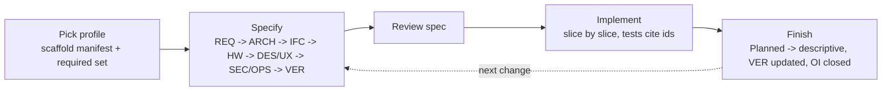

# Specification Framework

A framework for specifying a technical system and everything in it: apps, services, libraries, protocols, firmware and integrations. Every part is specified the same way. The specification is the source of truth: code implements the spec, and a change starts in the spec.

| Document | Content |
| --- | --- |
| [FW-profiles.md](FW-profiles.md) | The profiles (kinds of component) and the documents each requires |
| [templates/](templates/) | One template per document type, plus the workspace index ([workspace.md](templates/workspace.md)), the project index ([project.md](templates/project.md)), the component manifest ([component.md](templates/component.md)) and the agent notes ([agents.md](templates/agents.md)) |

## Terms

| Term | Meaning |
| --- | --- |
| **System** | The whole technical undertaking the framework is applied to: everything built and run together toward one purpose. It is specified with the `system` profile |
| **Workspace** | The repository (or set of repositories) that holds the system. Its root holds this framework and the system documents |
| **Project** | An independently developed codebase inside the system, with its own directory, tooling and owners. A project contains one or more components |
| **Component** | One thing that is specified, built and versioned as a unit: an app, service, library, protocol, device firmware or integration. A project may contain several, e.g. a device project with `firmware` and `gateway` |
| **Module** | A part of a component that needs an architecture of its own. It is described in named documents of the component or, once it has requirements or an interface of its own, as a nested component ([Modules](#modules)) |
| **Profile** | The kind of component. It fixes which document types the component must have (its *required set*) |
| **Document type** | A fixed kind of document with a code (`REQ`, `ARCH`, ...) and a template |
| **Manifest** | The component's `README.md`: front matter stating id, profile, status, dependencies and documents |
| **Item** | A numbered entry inside a document: requirement, decision, open item, interface message |

## Document types

| Code | Document | Answers | Template |
| --- | --- | --- | --- |
| `REQ` | Requirements | What and why | [REQ-requirements.md](templates/REQ-requirements.md) |
| `ARCH` | Architecture | What it is made of | [ARCH-architecture.md](templates/ARCH-architecture.md) |
| `IFC` | Interface contract | How others talk to it | [IFC-interface-contract.md](templates/IFC-interface-contract.md) |
| `DES` | Design | How it works inside | [DES-design.md](templates/DES-design.md) |
| `UX` | UI design | What the user sees and does | [UX-ui-design.md](templates/UX-ui-design.md) |
| `SEC` | Security and privacy | What can go wrong and how it is prevented | [SEC-security-and-privacy.md](templates/SEC-security-and-privacy.md) |
| `OPS` | Operations | How it is built, configured, deployed and observed | [OPS-operations.md](templates/OPS-operations.md) |
| `HW` | Hardware | What it runs on | [HW-hardware.md](templates/HW-hardware.md) |
| `VER` | Verification | How we know each requirement is met | [VER-verification.md](templates/VER-verification.md) |
| `DEV` | Development | How to work on it | [DEV-development.md](templates/DEV-development.md) |
| `INF` | Infrastructure | Which hosts and networks carry it | [INF-infrastructure.md](templates/INF-infrastructure.md) |
| `AD` | Decisions | Why it is this way | [AD-decisions.md](templates/AD-decisions.md) |
| `OI` | Open items | What is unresolved | [OI-open-items.md](templates/OI-open-items.md) |

The Document column is the default title of a document of that type, and the template's file name shows how the document's file is named ([Titles and file names](#titles-and-file-names)).

**Scope.** `REQ` to `VER` belong to a component and form the required sets ([profiles.md](FW-profiles.md)). The other four do not:

| Code | Belongs to | Lives in |
| --- | --- | --- |
| `DEV` | A project, because tooling is per project. Required for every project | `projects/<project>/docs/DEV-development.md`. Setup shared by the whole workspace is the system's `DEV` (`docs/architecture/DEV-development.md`) |
| `INF` | The system. Optional. A project adds its own only for infrastructure nothing else uses | `docs/architecture/INF-infrastructure.md`; `projects/<project>/docs/INF-infrastructure.md` |
| `AD`, `OI` | The system. They are logs of entries. A component keeps its own only for entries that affect nothing outside it | `docs/architecture/AD-decisions.md` and `OI-open-items.md`; `<component>/AD-decisions.md`, `<component>/OI-open-items.md` |

A component's `OPS` links to `INF` for hosts, networks and ports and to `DEV` for everyday commands; it never repeats them.

**Instances.** A document type is a kind, not a single file: an owner may have any number of documents of one type, each a complete document from the template with its own id, title and file. A type's only document carries the type's name (`REQ`, `REQ-requirements.md`). Further documents are named after their subject: a server with two interfaces has `IFC-http-api.md` and `IFC-event-api.md`; a design that outgrows one file continues in `DES-audio.md`. `IFC` and `HW` documents are always named, because a second interface or board is always possible. The manifest lists every document. The `AD` and `OI` logs are one per owner.

## Workspace layout

Every workspace that follows the framework has the same root. Code is grouped by project, not by kind, so a project's code and documents stay together.

```
<workspace>/
├── docs/                          framework + system only (L0, L1)
│   ├── README.md                  index of projects and their docs
│   ├── framework/                 this framework
│   └── architecture/              the system (profile: system), INF, AD, OI
├── projects/                      one folder per project
│   └── <project>/
│       ├── docs/                  (L2-L4)
│       │   ├── README.md          project index: its components, one line each
│       │   ├── <component>/       one folder per component
│       │   │   ├── README.md      manifest
│       │   │   ├── REQ-requirements.md IFC-http-api.md ...   its documents
│       │   │   └── <module>/      optional nested component, same structure
│       │   ├── DEV-development.md  how to work on the project
│       │   └── guides/            optional user documentation: how-tos, concepts, reference
│       ├── <component>/           code of one component
│       └── AGENTS.md              short, project-specific agent notes
├── packages/                      shared libraries used by several projects
│   └── <package>/
│       ├── docs/                  README.md (manifest)  REQ-requirements.md IFC-interface-contract.md ...
│       └── src/
├── tools/                         workspace tooling: scripts, generators, docs checks
├── AGENTS.md                      workspace-wide agent rules; points to docs/framework
└── <root config>                  build, workspace and toolchain files only
```

| Folder | Holds | Never holds |
| --- | --- | --- |
| `docs/` | The framework and the system documents | Documents of a single project or component |
| `projects/<project>/` | Everything one project owns: code, documents, project tooling | Code another project imports (that goes to `packages/`) |
| `packages/<package>/` | A library with consumers in more than one project; it is one component, with profile `library` | Applications or services |
| `tools/` | Scripts and generators for the whole workspace | Project-specific scripts (those stay in the project) |

**Naming.** A component's name is the name of its code folder: `gateway` has its code in `projects/sensor/gateway/`, its documents in `projects/sensor/docs/gateway/` and the id `home/sensor/gateway`. The name is unique within its project only; the full id makes it unique in the system, so it does not repeat the project. Components of one kind may share a grouping folder (`projects/sensor/adapters/<name>/` -> `adapter-<name>`). A package's name is its folder name. The manifest's `code` field is authoritative where a project deviates.

**Promotion.** When a second project needs code from a project, that code moves to `packages/` and becomes a `library` component with its own `IFC`. Projects never import from each other's folders.

## Where documents live

| Rule | Detail |
| --- | --- |
| Owner keeps it | A document lives in the project that owns the code it describes. A protocol lives with the project that defines it, e.g. `projects/sensor/docs/protocol/` |
| Single component | A project with one component may put the manifest and documents directly in `projects/<project>/docs/`. The manifest is then also the project index: L2 and L3 are one file and [project.md](templates/project.md) is not used |
| Root stays thin | `docs/` describes only what spans projects: goals, building blocks, integration, decisions, open items. It links to project documents and never repeats them |
| Reference, don't copy | A component using another's interface names its owner under `depends` in the manifest and links to that `IFC` across projects |
| User documentation | `guides/` explains the project to its users: how-tos, concepts, reference. It links to the spec and never specifies behaviour itself; where both speak, the spec wins |
| Same framework everywhere | Project docs follow this framework as it stands at the workspace root; they do not copy the templates or rules |

## Modules

A component's `ARCH` names its building blocks. A block that needs an architecture of its own is a module. It is specified in one of two ways:

| | Named documents | Nested component |
| --- | --- | --- |
| When | The module has internal structure only: the component's requirements cover its behaviour and it has no contract of its own | The module has requirements of its own, an interface to the other modules, or is verified on its own |
| What | Further documents of the component, named after the module: `ARCH-<module>`, `DES-<module>` | A component inside the component, with its own manifest, profile and required set |
| Id | `home/web/app/ARCH-editor` | `home/web/app/editor`; its documents `home/web/app/editor/ARCH`, ... |
| Folder | The component's folder | `<component folder>/<module>/` |
| Items | Owned by the component: `home/web/app/FR-012` | Owned by the module: `home/web/app/editor/FR-003` |
| Relation | `depends: [home/web/app/ARCH]` in the module's documents | `parent: home/web/app` in the module's manifest |

| Rule | Detail |
| --- | --- |
| Start small | Begin with named documents. Promote the module to a nested component when its first own requirement or interface appears: the named documents move into its folder, take the plain type name, and the references are updated in the same change |
| Any depth | A nested component may have modules of its own, in either form |
| Blocks point down | The Building blocks table of the parent's `ARCH` has a Specified in column naming the module's document or the nested component |
| Parent stays thin | The parent's `ARCH` says how the modules fit together: the blocks, the dependency rules and the flows between them. It does not describe the inside of a module |
| Requirements | A parent requirement is either verified at the parent or met by module requirements. In the second case its `VER` row has the method `trace` and names those requirements |
| Interfaces | Modules talk to each other through the `IFC` of the module that provides the interface. A module's manifest names the sibling modules it uses under `depends` |
| Code | A module's code is a subfolder of the component's code; its manifest's `code` field names it |
| One tree | `parent` is stored in the module only. Which modules a component has is derived |

## System documents

The system is a component with profile `system` and follows the same rules as every other component. Only these points are specific to it:

| Rule | Detail |
| --- | --- |
| Location | `docs/architecture/`. Its `README.md` is the manifest |
| Documents | `REQ` (purpose, goals, constraints), `ARCH` and named `ARCH` documents (building blocks, integration, repository layout), optionally `INF`, `DEV`, `SEC`, and the system-wide `AD` and `OI` logs. The manifest lists them in reading order |
| Planned work | One of its documents holds the overview of all planned changes ([Planned work](#planned-work)) |
| Framework | The framework files belong to the system too: `<system>/FW` and `<system>/FW-profiles`, type `FW` |
| Verification | System requirements are met by components: each is traced to the component requirements that implement it, and those have the `VER` rows. A system `VER` exists only for checks that span projects |

## Progressive disclosure

Each level says just enough to decide whether to open the next one. Readers, people or agents, stop at the first level that answers their question.

| Level | Document | Answers | Size |
| --- | --- | --- | --- |
| L0 | `docs/README.md` | Which projects exist, where their docs are | One screen |
| L1 | `docs/architecture/` | How the projects fit together | Few pages |
| L2 | `projects/<project>/docs/README.md` | Which components the project has | One table |
| L3 | `<component>/README.md` (manifest) | Profile, dependencies, which documents exist | One screen |
| L4 | `REQ`, `ARCH`, `IFC`, ... | The specification itself | As needed |

Every document except the `AD` and `OI` logs opens with a one-paragraph summary and keeps detail lower down. A document that grows too large continues in a further document of the same type (`DES-audio.md`).

## Identifiers

Every artifact has exactly one fully qualified id. It is a path from the system down, and it is the only form used to refer to the artifact, in front matter and in text.

| Artifact | Id | Example |
| --- | --- | --- |
| System | `<system>` | `home` |
| Project | `<system>/<project>` | `home/sensor` |
| Package | `<system>/packages/<package>` | `home/packages/storage` |
| Component | `<project id>/<component>`; a package is its own component | `home/sensor/gateway` |
| Nested component (module) | `<component id>/<module>`, to any depth | `home/web/app/editor` |
| Document | `<owner id>/<CODE>` for the only document of its type, `<owner id>/<CODE>-<title slug>` for a named one; the owner is a component, a project or the system | `home/sensor/gateway/REQ`, `home/sensor/gateway/IFC-http-api`, `home/sensor/DEV` |
| Framework file | `<system>/FW`, `<system>/FW-<title slug>` | `home/FW-profiles` |
| Item | `<owner id>/<item>`; the owner is the component, project or system whose document defines it | `home/web/app/FR-012`, `home/AD-14` |

Names of systems, projects, packages and components are lowercase kebab. In the templates, `<component-id>` stands for the component's full id.

| Item kind | Local form |
| --- | --- |
| Goal | `G-NN` |
| Functional requirement | `FR-NNN` |
| Operational requirement | `OR-NNN` |
| Interface message / endpoint | `MSG-NN` / `EP-NN` |
| Library function / command | `FN-NN` / `CMD-NN` |
| Conformance rule | `CF-NN` |
| Threat | `TH-NN` |
| Decision | `AD-NN` |
| Open item | `OI-NN` |
| Planned change | `P-NN` |

A document may define further kinds in the same form (`CH-NN` for channels, for example), in the place where it defines the items.

| Rule | Detail |
| --- | --- |
| Always qualified | A reference is the full id, also inside the artifact's own component: `home/web/app/FR-012`, never `FR-012` |
| Short form | Appears only where the artifact is defined or anchored in its own document: the id cell or heading that defines an item, a **Planned** marker, and labels inside diagrams. The `id` in the document's front matter supplies the rest |
| Links | A reference to a document is a link whose text is the id or the title |
| Never reused | A removed item keeps its row and is marked **Withdrawn** |

## Titles and file names

| Rule | Detail |
| --- | --- |
| Title | Every document has a `title` in its front matter. The only document of its type is titled with the type's name (`Requirements`). A named document's title is its subject (`HTTP API`, `Audio`). A manifest's or index's title is the name of what it describes |
| Heading | The H1 carries the title: `# <Component> - <title>` |
| File name | `<CODE>-<title slug>.md`. The slug is the title in lowercase, with every run of other characters replaced by `-`. For a named document that is exactly the last id segment |
| Examples | `home/web/app/REQ` is `REQ-requirements.md`; `home/sensor/gateway/IFC-http-api` is `IFC-http-api.md`; `home/ARCH-integration` is `ARCH-integration.md`; `home/web/app/AD` is `AD-decisions.md` |
| Folders | The folders give the rest of the id: `projects/<project>/docs/<component>/`, `packages/<package>/docs/`, `docs/architecture/` |
| Exceptions | Manifests and indexes are named `README.md`, so that their folder shows them. Agent notes are `AGENTS.md` and have no front matter |
| Renaming | Retitling a named document changes its file name and its id; the references are updated in the same change. Item ids are not affected: they belong to the owner, not to the document |

## Status

| Applies to | Values |
| --- | --- |
| Component (manifest) | `draft` -> `active` -> `deprecated` |
| Document (front matter) | `Draft` until its first review is accepted, then `Accepted`. Later changes are reviewed in their PR and do not change the status. An `Accepted` document may contain **Planned** sections |
| Section or item | Unmarked = implemented and true. **Planned** = specified and reviewed, not built yet. A section carries the marker on the line below its heading; a table row carries it in its id cell (`FR-014 **Planned** P-03`). Both name the planned change ([Planned work](#planned-work)) |

## Front matter

Every document starts with YAML front matter. It is the machine-readable part: it identifies the document and holds every relation to other documents, so that tools and agents find what is related or dependent without parsing the text.

| Field | In | Meaning |
| --- | --- | --- |
| `id` | Every document | The full id ([Identifiers](#identifiers)) |
| `title` | Every document | The title ([Titles and file names](#titles-and-file-names)) |
| `type` | Every document | The document type code (`REQ`, `IFC`, ...). Others: `manifest`, `index`, `FW` (a framework file) |
| `owner` | Every document | Full id of the component, project or system the document belongs to |
| `status` | Every document but indexes | `Draft` or `Accepted`; in a manifest `draft`, `active` or `deprecated` |
| `version` | `IFC` | The semantic version of the contract. It changes with the contract, not with the wording |
| `date` | Every document | Date of the last change to the content, `YYYY-MM-DD`. Not a history; the history is in version control |
| `depends` | Documents | Full ids of the documents this one is derived from. A change to one of them may require a change here, and they are read first |
| `related` | Documents | Full ids of documents worth reading alongside, with no derivation either way |
| `planned` | Documents | The planned changes the document specifies, with their dependencies ([Planned work](#planned-work)). `[]` when there are none |
| `profile`, `summary`, `code` | Manifest | Explained in [component.md](templates/component.md) |
| `documents` | Manifest | Full ids of the component's documents |
| `depends` | Manifest | Full ids of the components whose interface this one uses. Together the manifests give the component graph |
| `implements` | Manifest | Full ids of `IFC` documents owned by another component that this one implements (a protocol, a plugin API) |
| `parent` | Manifest of a nested component | Full id of the component it is a module of. The list of a component's modules is derived from it |

| Rule | Detail |
| --- | --- |
| Relations live here | A relation between documents or components is stated in front matter. The text may link to the other document but adds no relation of its own |
| One end only | An edge is stored at the dependent end. The reverse direction (who depends on me, who consumes or implements this interface) is derived by tools, never written down |
| Full ids | Every value that names an artifact is its full id |
| Items | Relations between items (a requirement and its goal, a module and the requirements it satisfies, a check and its requirement) stay in the tables that define them |

```yaml
---
id: home/sensor/gateway/DES
title: Design
type: DES
owner: home/sensor/gateway
status: Accepted
date: 2026-11-11
depends: [home/sensor/gateway/REQ, home/sensor/gateway/ARCH, home/sensor/protocol/IFC-protocol]
related: [home/sensor/firmware/DES]
planned:
  - id: home/sensor/gateway/P-02
    title: Batch upload
    depends: [home/P-01, home/packages/storage/P-03]
    done: [1]
---
```

## Writing rules

- **Descriptive.** Write what exists, what it does and what its contract is, in the present tense. Do not write task lists, journals or dated plan files. The one history kept in a document is the change table of an `IFC`.
- **One fact, one place.** Link to a fact; never restate it. Requirements belong in `REQ`, contracts in `IFC`, rationale in `AD`.
- **Testable.** Every requirement has an acceptance criterion and at least one row in `VER`. A requirement that modules meet together has a `trace` row naming their requirements ([Modules](#modules)). System requirements are traced to component requirements in the same way (see [System documents](#system-documents)).
- **EARS for requirements.** `The <component> shall <response>.` / `When <trigger>, the <component> shall <response>.` / `While <state>, ...` / `If <unwanted condition>, then ...`
- **Diagrams** are Mermaid, kept next to the text that explains them.
- **Plain ASCII text.** Use `-` for dashes and ranges (never em or en dashes), `->` for arrows, `...` for ellipses, `>=` / `<=` for comparisons, and words instead of symbols: "section 5.5", not the section sign. Footnote markers are `(1)`, not superscripts. Box-drawing characters in directory trees inside code blocks are the only exception.
- **Guidance comments.** Templates carry `<!-- ... -->` notes saying what belongs in each section. Delete them once the section is filled. A section that does not apply reads `Not applicable - <reason>.`; it is never left out.

## Workflow

The same steps for every component and every change. "PR" below means one reviewed change set, whatever tool carries it.



1. **New component.** Pick its profile in [profiles.md](FW-profiles.md). Copy [component.md](templates/component.md) to `projects/<project>/docs/<component>/README.md` (a package: `packages/<package>/docs/README.md`), copy the template of each document in the required set, and add a row to the project index. A new project also gets its index ([project.md](templates/project.md)), its `DEV` and its `AGENTS.md` ([agents.md](templates/agents.md)).
2. **Specify.** Fill the documents in this order: REQ -> ARCH -> IFC -> HW -> DES / UX -> SEC / OPS -> VER. A later document may refine an earlier one but never contradict it. If it has to, change the earlier document first.
3. **Change.** Edit the spec before the code. New behaviour goes into the document that will describe it, as a section marked **Planned**, declared under `planned` in the document's front matter ([Planned work](#planned-work)), with two subsections:
   - **Slices**: independently shippable steps, in order. Finished slices are recorded in the entry's `done` list.
   - **Done when**: observable checks, which become `VER` rows.

   Unresolved questions become `OI` entries and choices become `AD` entries.
4. **Review.** The spec change is reviewed on its own merits. A change that fits one PR is reviewed in that PR, together with the code. A larger change merges first, as a **Planned** section, and the code follows slice by slice.
5. **Implement.** Tests name the requirement they verify (the full id in a comment, or the local id `FR-012` in the test name). Each PR that implements a slice also carries the spec edits that slice makes true; code never lands ahead of its spec.
6. **Finish.** With the last slice, remove the **Planned** marker and rewrite the section descriptively. Set the `VER` rows to their test and status, and close the `OI` entries it resolved.

**Rule:** behaviour that no requirement covers is a defect, in the spec or in the code. Fix whichever is wrong.

## Planned work

Planned changes form a dependency graph, not a roadmap: there are no dates and no fixed order. The graph is held in front matter, so that tools can read it.

| Rule | Detail |
| --- | --- |
| Node | One planned change: an entry under `planned` in the front matter of the document that specifies it, plus the **Planned** section in that document with its slices. Its id is `<system>/P-NN` when it spans projects (it is then specified in the system documents) and `<component id>/P-NN` otherwise |
| Entry | `id` (full id), `title`, `depends`, and optionally `priority` (`must`, `should`, `could`) and `done` (the numbers of the finished slices) |
| Edge | `depends`: the full ids of the changes that must be done first, `[]` for none. Dependencies are stated there and nowhere else; the text does not repeat them |
| Anchor | The section carries `**Planned** P-03` on the line below its heading. A table row the change will build carries it in its id cell: `FR-014 **Planned** P-03` |
| State | Derived, never stored. *Done*: entry and marker removed. *In progress*: `done` is not empty. *Ready*: no id in `depends` is still an open entry. *Blocked*: anything else |
| Order | Any ready change may start |
| Overview | The system documents hold one table or Mermaid graph of all open changes. It is a view of the front matter: generated by `tools/` where a generator exists, kept by hand until then |
| Ids | Never reused. A finished change leaves the graph and is removed from the `depends` lists that named it; an id in `depends` that matches no entry is an error |
| Not in the graph | Intent that is not specified yet. It stays an `OI` entry until someone writes the **Planned** section |

## For agents

- Take work from the planned-work graph: only changes that are ready.
- Refer to every artifact by its full id.
- Go down the levels: project index -> component manifest -> documents. Load only what the task needs.
- Find what else to read from front matter: `depends` and `related` of the document, `depends` and `implements` of the manifest.
- A manifest with `parent` describes a module: read the parent's `ARCH` before the module's documents.
- The manifest lists the profile, the documents and the dependencies. Read `REQ` and the `IFC` of every dependency before reading or writing code.
- Never implement a **Planned** section partially without saying which slices are done.
- If the spec is silent or ambiguous, add an `OI` entry and ask; do not invent behaviour.
- When code and spec disagree, report it. Do not silently change either.
