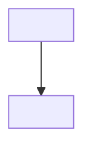
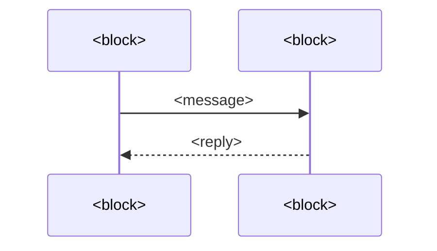

# <Component> - Architecture

<Summary: one paragraph saying what this document establishes and its main points.>

## 1 Context

<!-- C4 level 1: the component as a single box, with the people and systems around it. Name each interaction. -->

## 2 Building blocks

<!-- C4 level 2: processes, containers and major modules. One row per block. Internals of each block go in DES. -->

| Block | Responsibility | Technology | Code |
| --- | --- | --- | --- |
| <name> | <single responsibility> | <language / framework> | <path> |

## 3 Dependency rules

<!-- What may depend on what, and what must never. These rules are enforced in review or by tooling. -->

- <block A> may use <block B>; <block B> never imports <block A>.

## 4 Runtime scenarios

<!-- Sequence diagrams for the 2-5 interactions that matter most: the main flow, startup, and the main failure path. -->

### 4.1 <Scenario>

## 5 Deployment

<!-- Where each block runs: host, process, container or device. Details go in OPS. -->

| Block | Runs on | Instances | Talks to |
| --- | --- | --- | --- |
| <name> | <host / device> | <n> | <blocks, protocols> |

## 6 Cross-cutting concepts

<!-- Concerns that span blocks: error handling, configuration, logging, concurrency, persistence. One short subsection each, or `Not applicable - <reason>.` -->

## 7 Decisions

<!-- The AD entries that shaped this architecture, linked to the log that holds them: the system's log (<system>/AD), or this component's AD-decisions.md. Rationale lives in the AD entry, not here. -->

| Decision | Summary |
| --- | --- |
| [<system>/AD-NN](<relative path to the decisions log>) | <one line> |
