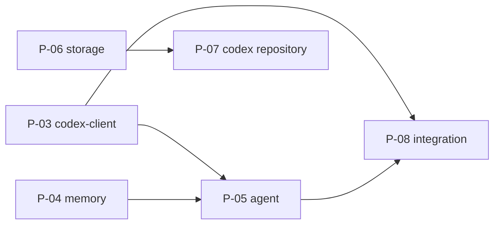

# Repository and Migration

This increment turns the three source repositories into the crucible monorepo: one workspace layout and toolchain, the shared packages that replace the duplicated parts, the codex function library in a repository of its own, and the integration channels between the applications.

## 1 Goal

Afterwards the system meets the goals in [crucible/requirements](../requirements.md) section 4: one monorepo with preserved history, one implementation each for memory, agent sessions, storage access and codex access, memory behind a generic interface, the codex function library in its own repository, defined channels between homunculus, alchemist and athanor, and descriptive documentation instead of dated plan and spec files.

## 2 Scope

| Feature | Change | Target |
| --- | --- | --- |
| Shared packages `codex-client`, `memory`, `agent`, `storage` | crucible/P-03, crucible/P-04, crucible/P-05, crucible/P-06 | crucible/packages/codex-client, crucible/packages/memory, crucible/packages/agent, crucible/packages/storage |
| Codex repository | crucible/P-07 | crucible/alchemist/runtime |
| Integration channels | crucible/P-08 | crucible/architecture/integration |

Already built: the monorepo itself, its tooling and CI, the history import, and the project documents restructured to Formulary ([crucible/architecture/repository-layout](../architecture/repository-layout.md), [crucible/development](../development.md)).

Out of scope: rewriting or merging the applications, and building the firmware in CI (crucible/requirements section 4).

## 3 Target state

### 3.1 Workspace layout

The workspace as it is: [crucible/architecture/repository-layout](../architecture/repository-layout.md). This increment adds:

| Path | Content | Change |
| --- | --- | --- |
| `packages/codex-client/`, `packages/memory/`, `packages/agent/`, `packages/storage/` | The shared packages, each with its own `docs/`, written with the change that builds the package. Until then the interface sketches of `agent` and `storage` stay in crucible/architecture/shared-packages | crucible/P-03, crucible/P-04, crucible/P-05, crucible/P-06 |
| `projects/alchemist/sdk/` | Codex entry SDK (Mix) | - |
| `projects/alchemist/functions/` | Kernel entries only; the general library moves to the codex repository (section 3.2) | crucible/P-07 |
| `projects/alchemist/sidecar/` | HTTP + SSE front-end (athanor, delegation) | - |
| `projects/athanor/ide/`, `projects/athanor/api/` | The IDE (today `App.tsx`, `src/client`, `src/nshde`) and the API (today `src/server.ts`, `src/lib`) as separate code folders | - |
| `tools/` | Workspace scripts | - |

### 3.2 Codex repository

**Planned** P-07

| Item | Value |
| --- | --- |
| Content | `functions/` (function library and agent-written entries), `components/` (athanor components), `services.json` (published-services manifest) |
| Stays in the monorepo | Kernel entries: `memory.*`, `codex.*`, `runtime.*`, `echo` |
| Moves out | General library: `fs`, `git`, `http`, `md`, `json`, `data`, `docker`, `github`, `text`, `sys`, `util`, `env`, `explore`, ...; `services/*`; `nshde/*` (split line: crucible/OI-01) |
| Loading | Overlay root (`AGENT_CODEX_DIR`): lookup overlay first, then the kernel root; `define` writes to the overlay; shadowing a kernel entry is refused |
| Sync | `codex.sync` entry: clone / pull, commit, push (from the existing alchemist deployment plan) |
| Contract | Depends on the codex entry SDK as a git dependency |
| Tests | Entry tests move with the entries; CI checks out crucible for the runtime |

### 3.3 `packages/codex-client`

**Planned** P-03

The TypeScript access to the codex runtime leaves `projects/alchemist/core/` and becomes the package `@crucible/codex-client`. Its target is specified in [crucible/packages/codex-client](../../packages/codex-client/docs/README.md): requirements, the library and command line contracts, design and verification. Alchemist is the only consumer in this change; homunculus starts using the package with crucible/CH-4 (crucible/P-08).

| Today | Target |
| --- | --- |
| `projects/alchemist/core/elixir-bridge.ts`, `core/protocol.ts` | `packages/codex-client/src/`; the runtime, functions and state directories are options instead of paths relative to the file |
| Result type imported from `@grok/agent-sdk` | `CodexResult`, defined by the package |
| `projects/alchemist/hosts/shared/codex-tools.ts`: the four tools mixed with host flags, result digest and the handoff tool | The four tools in the package; the alchemist file keeps the host flags, the result digest and the handoff tool and passes them in as hooks, until crucible/P-05 moves them |
| `projects/alchemist/scripts/cli.mjs` | The `codex` command of the package |
| "Node bridge behavior" in crucible/alchemist/codex-protocol/interfaces/codex-protocol | crucible/packages/codex-client/design |

#### Slices

1. Package scaffold (`@crucible/codex-client`, workspace member, typecheck and test scripts), protocol types and the client: the bridge moves with its tests, the `@grok/agent-sdk` import is removed, the three directories become options.
2. Tool set: `codexTools` with the four tools, the operation subset, the per-tool policy and the `prepareCall` and `presentResult` hooks.
3. Command line: the `codex` command; `scripts/cli.mjs` and `scripts/runtime-doctor.mjs` use the package.
4. Alchemist switched: every import of `core/elixir-bridge.ts` and `core/protocol.ts` names the package, `hosts/shared/codex-tools.ts` builds on `codexTools`, the two `core/` files are removed, and the bridge section of the codex protocol document moves to the package design.

#### Done when

- `pnpm typecheck` and `pnpm test` pass in the workspace, and no file under `projects/alchemist/` imports `core/elixir-bridge.ts` or `core/protocol.ts`.
- `packages/codex-client` has no dependency on `@grok/agent-sdk` and imports nothing from `projects/`.
- `pnpm exec codex '{"op":"call","name":"echo","args":{"hello":"world"}}'` run from `projects/alchemist` prints a result with `"ok":true`.
- The Claude, ACP and Cursor hosts and the terminal UI reach the codex as before: `pnpm run eval:acp` passes, and the Cursor host bundles the package (crucible/OI-21).
- Every row of crucible/packages/codex-client/verification has the status `pass`, and the **Planned** markers in the package documents are removed.

### 3.4 `packages/memory`

**Planned** P-04

Memory becomes the package `@crucible/memory`: a provider-independent interface (`recall`, `retain`, `forget`, provider tools, prompt section) and the minigraf provider as its first implementation (crucible/AD-03, crucible/AD-04, crucible/AD-08, crucible/AD-10). Alchemist and homunculus both use the minigraf provider, and each owns its own graph (crucible/AD-05). Its target is specified in [crucible/packages/memory](../../packages/memory/docs/README.md).

| Today | Target |
| --- | --- |
| `projects/alchemist/core/minigraf-memory.ts`, `core/minigraf-server.ts` | The minigraf provider and the line server of the package; `Runtime.Memory` starts the package's server. Profile `engineering`, one graph |
| `projects/homunculus/server/src/memory/temporal-reasoning.ts`: Python MCP child started with `uvx`, extraction through MCP sampling | The minigraf provider in the server process, profile `personal`, one graph per memory space; recall and extraction are native. The child, its client and the `uvx` dependency are removed |
| Homunculus memory tools `minigraf_query`, `minigraf_transact`, `minigraf_retract`, `minigraf_rule` with Datalog text arguments | The provider tools `memory_query`, `memory_transact`, `memory_retract`, `memory_overview` with JSON arguments |
| Homunculus `memory/prompt.ts`, `memory/sampler.ts` (extraction guide) | The prompt section and the extraction guide of the `personal` profile; the Claude sampler stays in homunculus and is injected |
| Homunculus wiki (`wiki.ts`, `search.ts`, `space.ts` git handling) | Stays in homunculus (crucible/AD-26) |
| crucible/alchemist/runtime/design/memory: facts, time, retract, rules, query, overview, errors | crucible/packages/memory/design/minigraf-provider; the runtime document keeps the process, the file and the codex entries |

#### Slices

1. Package scaffold (`@crucible/memory`, workspace member), the interface types, and the provider conformance suite, run against an in-memory provider that stores plain text and has no facts. It shows that the interface does not assume a fact graph (crucible/OI-17).
2. Minigraf provider with the `engineering` profile and the line server, moved from alchemist with their tests. `Runtime.Memory` starts the package's server; `core/minigraf-memory.ts` and `core/minigraf-server.ts` are removed. No behaviour change in alchemist.
3. `personal` profile: attribute set, person and place tags, prompt section, extraction guide.
4. Native `recall` (lexical index), `retain` of an exchange (extraction through the injected sampler) and `forget`.
5. Homunculus switched: the `Memory` facade opens the minigraf provider; the pipeline calls `recall` before and `retain` after a turn; the temporal-reasoning client, its test fixture and the `uvx` dependency are removed; graphs written by temporal-reasoning 0.9.0 are opened in place or migrated (crucible/V-01). crucible/homunculus/D-23 and crucible/homunculus/D-28 and the memory section of the server design are updated in the same change.
6. Line server operations `recall` and `forget`, and the codex entry `memory.recall`.

#### Done when

- `pnpm typecheck` and `pnpm test` pass in the workspace, and `mix test` passes in `projects/alchemist/runtime` with the memory path pointing at a graph the package's server opens.
- The conformance suite passes for the in-memory provider and for the minigraf provider with both profiles.
- A homunculus server started without `uvx` on `PATH` answers a question from a fact stated in an earlier session, and a stated fact appears in the graph after the turn.
- A graph written by the homunculus server before the switch is readable afterwards, in place or after the documented migration.
- No file under `projects/alchemist/` or `projects/homunculus/` imports the `minigraf` binding directly, and `packages/memory` imports nothing from `projects/`.
- Every row of crucible/packages/memory/verification has the status `pass`, and the **Planned** markers in the package documents are removed.

## 4 Planned work

The increment is a set of planned changes that form a dependency graph ([Formulary](https://github.com/0x1d/formulary#planned-work)). The dependencies are declared under `planned` in this document's front matter; the graph and the table are a view of them. There are no dates and no fixed order: a change may start when everything it depends on is done.

| Id | Content | Depends on | Behaviour change | State |
| --- | --- | --- | --- | --- |
| P-03 | `packages/codex-client` (section 3.3) | - | None | ready |
| P-04 | `packages/memory`: interface, minigraf provider; alchemist and homunculus switched (section 3.4) | - | Homunculus: memory tools take JSON arguments; recall and extraction run in the server process | ready |
| P-05 | `packages/agent`: interfaces, Claude backend, context policies; sidecar, TUI and homunculus switched; ACP backend | crucible/P-03, crucible/P-04 | None intended | blocked |
| P-06 | `packages/storage` + `AgentLib.Storage`; `fs.*` on mounts | entry SDK | `fs.*` restricted to mounts | blocked |
| P-07 | Codex repository split, overlay, `codex.sync` | crucible/P-06, entry SDK | Functions load from the overlay | blocked |
| P-08 | Integration crucible/CH-4, crucible/CH-6, then crucible/CH-5 + crucible/CH-7 | crucible/P-03, crucible/P-05 | New features | blocked |

crucible/P-07 may be needed early, if the athanor deployment requires it.
