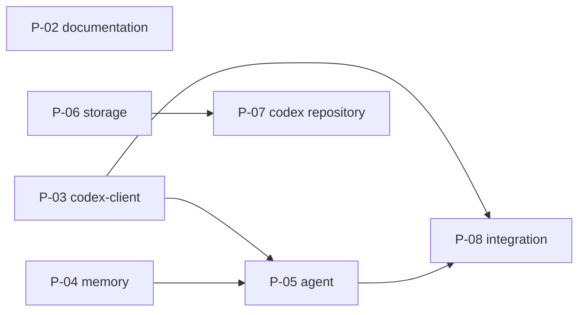

# Repository and Migration

This increment turns the three source repositories into the crucible monorepo: one workspace layout and toolchain, the shared packages that replace the duplicated parts, the codex function library in a repository of its own, the documentation restructured to Formulary, and the integration channels between the applications.

## 1 Goal

Afterwards the system meets the goals in [crucible/requirements](../requirements.md) section 4: one monorepo with preserved history, one implementation each for memory, agent sessions, storage access and codex access, memory behind a generic interface, the codex function library in its own repository, defined channels between homunculus, alchemist and athanor, and descriptive documentation instead of dated plan and spec files.

## 2 Scope

| Feature | Change | Target |
| --- | --- | --- |
| Documentation per Formulary | crucible/P-02 | the project and package documents |
| Shared packages `codex-client`, `memory`, `agent`, `storage` | crucible/P-03, crucible/P-04, crucible/P-05, crucible/P-06 | crucible/packages/codex-client, crucible/packages/memory, crucible/packages/agent, crucible/packages/storage |
| Codex repository | crucible/P-07 | crucible/alchemist/runtime |
| Integration channels | crucible/P-08 | crucible/architecture/integration |

Already built: the monorepo itself, its tooling and CI, and the history import ([crucible/architecture/repository-layout](../architecture/repository-layout.md), [crucible/development](../development.md)).

Out of scope: rewriting or merging the applications, and building the firmware in CI (crucible/requirements section 4).

## 3 Target state

### 3.1 Workspace layout

The workspace as it is: [crucible/architecture/repository-layout](../architecture/repository-layout.md). This increment adds:

| Path | Content | Change |
| --- | --- | --- |
| `packages/codex-client/`, `packages/memory/`, `packages/agent/`, `packages/storage/` | The shared packages, each with its own `docs/` | crucible/P-03, crucible/P-04, crucible/P-05, crucible/P-06 |
| `projects/alchemist/sdk/` | Codex entry SDK (Mix) | - |
| `projects/alchemist/functions/` | Kernel entries only; the general library moves to the codex repository (section 3.2) | crucible/P-07 |
| `projects/alchemist/sidecar/` | HTTP + SSE front-end (athanor, delegation) | - |
| `projects/athanor/ide/`, `projects/athanor/api/` | The IDE (today `App.tsx`, `src/client`, `src/nshde`) and the API (today `src/server.ts`, `src/lib`) as separate code folders | - |
| `tools/` | Workspace scripts | - |

### 3.2 Codex repository

**Planned** P-07

| Item | Value |
| --- | --- |
| Content | `functions/` (function library and agent-written entries), `components/` (athanor components), `services.json` (published-services manifest) |
| Stays in the monorepo | Kernel entries: `memory.*`, `codex.*`, `runtime.*`, `echo` |
| Moves out | General library: `fs`, `git`, `http`, `md`, `json`, `data`, `docker`, `github`, `text`, `sys`, `util`, `env`, `explore`, ...; `services/*`; `nshde/*` (split line: crucible/OI-01) |
| Loading | Overlay root (`AGENT_CODEX_DIR`): lookup overlay first, then the kernel root; `define` writes to the overlay; shadowing a kernel entry is refused |
| Sync | `codex.sync` entry: clone / pull, commit, push (from the existing alchemist deployment plan) |
| Contract | Depends on the codex entry SDK as a git dependency |
| Tests | Entry tests move with the entries; CI checks out crucible for the runtime |

### 3.3 Documentation migration

**Planned** P-02

Each project keeps its documents under `projects/<project>/docs/`, restructured per the [Formulary standard](https://github.com/0x1d/formulary). `docs/` keeps only the system documents.

Components and their [profiles](https://github.com/0x1d/formulary/blob/main/profiles.md):

| Component | Profile | Docs |
| --- | --- | --- |
| `crucible` | system | `docs/` |
| `crucible/homunculus/firmware` | device | `projects/homunculus/docs/firmware/` |
| `crucible/homunculus/server` | service | `projects/homunculus/docs/server/` |
| `crucible/homunculus/hdp` | protocol | `projects/homunculus/docs/hdp/` |
| `crucible/athanor/ide` | app | `projects/athanor/docs/ide/` |
| `crucible/athanor/api` | service | `projects/athanor/docs/api/` |
| `crucible/alchemist/runtime` | service | `projects/alchemist/docs/runtime/` |
| `crucible/alchemist/tui` | app | `projects/alchemist/docs/tui/` |
| `crucible/alchemist/host-<name>` (code `hosts/<name>/`) | integration | `projects/alchemist/docs/host-<name>/` |
| `crucible/alchemist/codex-protocol` | protocol | `projects/alchemist/docs/codex-protocol/` |
| `crucible/packages/<name>`: `agent`, `memory`, `storage`, `codex-client` | library | `packages/<name>/docs/` |

Moves:

| Source | Target |
| --- | --- |
| `homunculus/docs/specification/*` | `projects/homunculus/docs/{firmware,server,hdp}/`; decisions `D-NN` and open items keep their ids, prefixed `HOM-` |
| `homunculus/docs/devices/` | `projects/homunculus/docs/firmware/hardware/<board>.md` |
| `alchemist/docs/{concepts,reference}` | `projects/alchemist/docs/{runtime,codex-protocol}/` |
| `alchemist/docs/guides` | `projects/alchemist/docs/guides/` |
| `alchemist/docs/internal/{plans,specs}` - implemented | Content folded into the component documents; files removed |
| `alchemist/docs/internal/{plans,specs}` - proposed / planned | A **Planned** section in the component document, with an id and its dependencies; files removed |
| `athanor/docs/internal/plans/001-006` (done) | `projects/athanor/docs/ide/`; files removed |
| `athanor/docs/internal/plans/007-009`, crucible/alchemist/architecture/athanor-deployment | `projects/athanor/docs/api/` deployment and access-control sections marked **Planned**; cross-project decisions to `crucible/decisions` |
| `docs/architecture/shared-packages.md` interface details | `packages/<package>/docs/interfaces.md`; `crucible/architecture/shared-packages` keeps responsibilities and links |
| `AGENTS.md` per project | One root `AGENTS.md` plus short per-project files |

Removed files remain in git history.

## 4 Planned work

The increment is a set of planned changes that form a dependency graph ([Formulary](https://github.com/0x1d/formulary#planned-work)). The dependencies are declared under `planned` in this document's front matter; the graph and the table are a view of them. There are no dates and no fixed order: a change may start when everything it depends on is done.

| Id | Content | Depends on | Behaviour change | State |
| --- | --- | --- | --- | --- |
| P-02 | Documentation restructure (section 3.3) | - | None | ready |
| P-03 | `packages/codex-client` | - | None | ready |
| P-04 | `packages/memory`: interface, minigraf provider; alchemist and homunculus switched | - | Homunculus may keep the interim provider | ready |
| P-05 | `packages/agent`: interfaces, Claude backend, context policies; sidecar, TUI and homunculus switched; ACP backend | crucible/P-03, crucible/P-04 | None intended | blocked |
| P-06 | `packages/storage` + `AgentLib.Storage`; `fs.*` on mounts | entry SDK | `fs.*` restricted to mounts | blocked |
| P-07 | Codex repository split, overlay, `codex.sync` | crucible/P-06, entry SDK | Functions load from the overlay | blocked |
| P-08 | Integration crucible/CH-4, crucible/CH-6, then crucible/CH-5 + crucible/CH-7 | crucible/P-03, crucible/P-05 | New features | blocked |

crucible/P-07 may be needed early, if the athanor deployment requires it.
