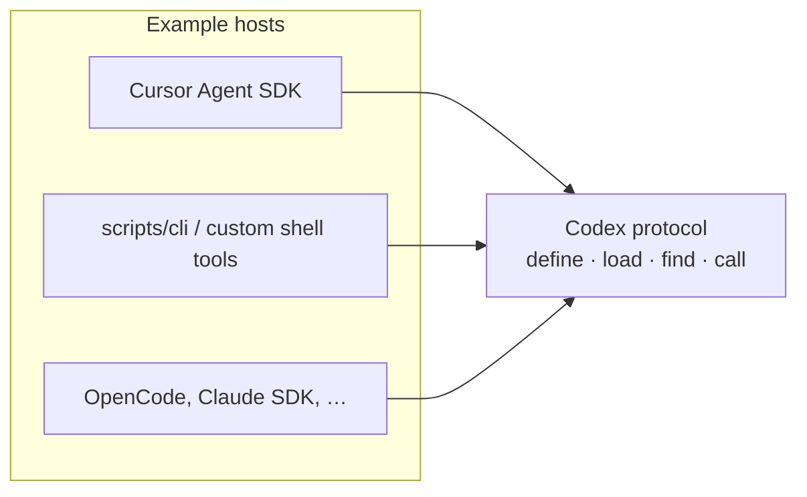

# Host adapters

A **host** runs the agent loop (inference, tool routing, channels). Alchemist
supplies a **codex** that stays the same across hosts: four JSON operations
implemented by the Mix control plane and reached through a thin adapter.

| Layer | Location | Responsibility |
| --- | --- | --- |
| Codex | `runtime/` + `functions/` | Define, load, find, call codex entries |
| Bridge | `core/elixir-bridge.ts` | Boot one long-lived BEAM; TCP JSON RPC to `Runtime.Server` |
| Host adapter | `bot/` (Cursor today) | Map harness tool calls to codex operations |

The model only needs four harness tools (`define-function`, `load-function`,
`find-function`, `call-function`). Any host that can invoke the codex JSON
through the bridge can use the same capability tree without `@grok/agent-sdk`.

## Adapter matrix

| Host | Repository support | Integration boundary | Credentials / billing | Maturity |
| --- | --- | --- | --- | --- |
| Cursor Agent SDK | Implemented (`bot/`, `@grok/agent-sdk`) | `bot/tools/*.ts` → `runCodexOp()` | Cursor / Agent SDK login (`CURSOR_API_KEY`, `agent-sdk login`) | Primary adapter in this repo |
| Host-agnostic CLI | Implemented (`scripts/cli.mjs`) | `runCodexOp()` from `core/elixir-bridge.ts` | None (local Elixir + Node) | Stable for scripting and custom hosts |
| OpenCode | Pattern only | Four tools calling `cli.mjs` or equivalent | OpenCode subscription | Community integration |
| Anthropic Claude SDK / API | Pattern only | Tool definitions invoking CLI or TCP shim | Anthropic API key | Community integration |
| Go multi-agent CLIs | Pattern only | Outer CLI; inner tools call codex JSON | Varies by wrapped CLI | Experimental community wrappers |

No single vendor SDK bills across Cursor, OpenCode, and Anthropic. Unify at the
[codex protocol](./protocol.md), not at the inference invoice layer.

## Cursor (this repository)

- **Package:** `@grok/agent-sdk` — playground, deploy, evals, Slack, and related channels.
- **Adapter:** `bot/tools/*.ts` maps harness tool names to [`core/protocol.ts`](../../core/protocol.ts) requests.
- **Bridge:** `core/elixir-bridge.ts` compiles `runtime/` when sources change, starts `elixir` with `Runtime.Server`, and sends length-prefixed JSON over TCP.

## OpenCode

- **Inference:** [OpenCode Go](https://opencode.ai/v2/docs/console/go/) routes compatible model traffic through an OpenCode subscription.
- **Agent loop:** OpenCode CLI with [ACP](https://github.com/ethpandaops/opencode-agent-sdk-go) or `opencode run` with JSON tools.
- **Codex:** Wire four MCP or shell tools that execute `node scripts/cli.mjs '<json>'`. Point at the same `functions/` tree; set `AGENT_FUNCTIONS_DIR` when the tree is not at the default path.

## Anthropic (direct)

- **API / Agent SDK:** [Claude Agent SDK](https://docs.anthropic.com/en/docs/agents) or Messages API with tool definitions.
- **Codex:** Same four operations. The live interface is a 4-byte length-prefixed JSON socket on `127.0.0.1` (see [Codex protocol](./protocol.md)). `scripts/cli.mjs` reaches it through the Node bridge. `Runtime.CLI.run_stdio/0` is a single-request debug helper, not the host interface.

## Go multi-agent wrappers (community)

Projects such as [go-agent-agnostic](https://github.com/j3ssie/go-agent-agnostic) and
[agent-wrapper](https://github.com/smallnest/agent-wrapper) drive existing agent
CLIs. They do not embed the Elixir codex directly; custom tools in the outer
agent typically call `scripts/cli.mjs` for the capability surface.

## Deployment considerations

1. Keep capability code in `functions/` so any host can share one tree.
2. Use the Cursor adapter when you want first-party channels, deploy, and evals from this repository.
3. Use `scripts/cli.mjs` (or equivalent) when another subscription or local loop should own inference while reusing the same entries.
4. Restrict who can invoke `define` in production; see [Security boundary](./security.md).
5. Plan for BEAM restarts when `runtime/` sources change; the bridge recompiles and boots a fresh VM when its source stamp changes.

## Related reading

- [Getting started](../guides/getting-started.md)
- [Architecture](../concepts/architecture.md)
- [Mix control-plane notes](../../runtime/README.md)
