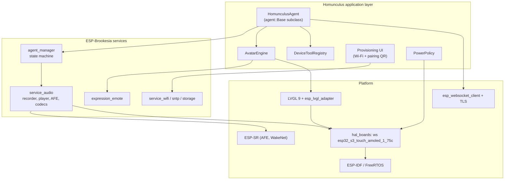
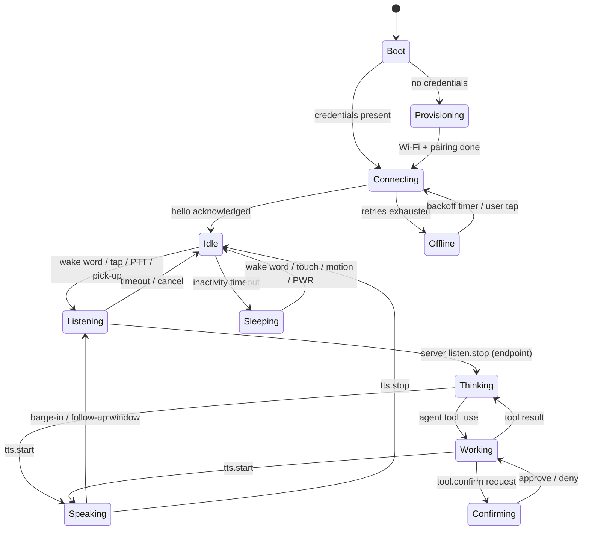

# 3. Device Firmware

| | |
| --- | --- |
| Document | HOM-SPEC-03 |
| Status | Draft 0.1 |
| Reference device | [Waveshare ESP32-S3-Touch-AMOLED-1.75C](../devices/waveshare-esp32-s3-touch-amoled-1.75c/README.md) |

## 3.1 Platform choice

| Layer | Choice |
| --- | --- |
| SDK | ESP-IDF 6.x (Brookesia 0.8 requires ≥ 6.0, ≤ 6.2) |
| Application framework | ESP-Brookesia 0.8.x, components from the ESP Component Registry (D-07) |
| GUI | LVGL 9.x via `esp_lvgl_adapter` |
| Audio | Brookesia audio service (ESP-GMF, ESP-SR AFE, `esp_audio_codec` Opus) |
| Language | C++17 (Brookesia API), C for drivers |

### Why upstream Brookesia rather than the vendored example

- Vendor example `03_esp-brookesia`: vendored `brookesia_core` 0.6.0-beta2 (end of maintenance), AI framework disabled, agent hard-wired to Coze. Used only as a hardware bring-up reference (display init, touch mirroring, LVGL stack size).
- Upstream ESP-Brookesia: componentised; board definition `hal/brookesia_hal_boards/boards/waveshare/esp32_s3_touch_amoled_1_75c`; `agent_manager` with pluggable `agent::Base`; audio service with AFE + Opus; `expression_emote`; `brookesia_mcp_utils` (0.8).
- Version policy: latest released Brookesia 0.8.x and a matching ESP-IDF 6.x (D-07).

Component versions (ESP Component Registry, 2026-11-07):

| Component | Version |
| --- | --- |
| `espressif/brookesia_hal_boards` | 0.8.1 |
| `espressif/brookesia_hal_adaptor` | 0.8.5 |
| `espressif/brookesia_service_device` | 0.8.3 |
| `espressif/brookesia_service_audio` | 0.8.2 |
| `espressif/brookesia_agent_manager` | 0.8.2 |
| `espressif/brookesia_expression_emote` | 0.8.2 |

## 3.2 Firmware architecture

### 3.2.1 `HomunculusAgent`

A custom agent registered with `brookesia_agent_manager`, modelled on `brookesia_agent_xiaozhi`. It implements the `agent::Base` hooks:

| Hook | Responsibility |
| --- | --- |
| `on_activate()` | Load device token + server URL from NVS; fail → provisioning flow |
| `on_startup()` | Open WSS connection, send `hello` with capability descriptor, await server `hello` |
| `on_encoder_data_ready(data, size)` | Wrap Opus frame in HDP binary frame, send over WS (only while listening) |
| `on_manual_start_listening()` / `on_manual_stop_listening()` | Push-to-talk → `listen.start` / `listen.stop` |
| `on_interrupt_speaking()` | Barge-in → stop decoder, send `abort` |
| `on_sleep()` / `on_wakeup()` | Close/keep connection per power policy; WakeNet remains armed |
| `on_shutdown()` | Close connection gracefully |

Incoming server messages are dispatched to `feed_audio_decoder_data()` (Opus downlink), `set_emote()`, `set_agent_speaking_text()` / `set_user_speaking_text()` (captions), and the device tool registry.

### 3.2.1.1 Phase 1 implementation (`firmware/components/homunculus_agent`)

Brookesia `agent_manager` 0.8 integration:

| Item | Implementation |
| --- | --- |
| Lifecycle | `app_main`: `SetTargetAgent`, `SetChatMode{RealTime}`, `TriggerGeneralAction{Activate}`, poll `GetGeneralState` until `Activated`, `TriggerGeneralAction{Start}`, poll until `Started`. Triggering an action while a transition runs makes `StateMachine::trigger_general_action()` read the front of an empty queue. |
| Chat mode | `RealTime` (also `CONFIG_BROOKESIA_AGENT_MANAGER_DEFAULT_CHAT_MODE_REAL_TIME`): Brookesia does not gate encoder data / decoder writes on the speaking / listening flags; the agent gates the uplink itself. |
| Wake word | `AudioEncoder` `AFEEventHappened` event subscription (`WakeStart`). Brookesia forwards `WakeStart` to `on_wakeup()` only when the agent is `Slept`. |
| Sleep | Not used. Encoder `afe_wake_start_timeout_ms` = `afe_wake_end_timeout_ms` = 0: no `WakeEnd`, so Brookesia never triggers `Sleep` (in `Slept` it drops encoder data and decoder writes). `on_sleep()` / `on_wakeup()` only acknowledge the state change. |
| Barge-in | `support_general_functions = {InterruptSpeaking}`; `set_speaking(true)` at `tts{start}`, `false` at end of playback / abort; `set_listening()` around the uplink. AFE `WakeStart` while speaking → `on_interrupt_speaking()`. `reset_interrupted_speaking()` at `tts{start}` (Brookesia drops decoder writes while interrupted). |
| Uplink encoder | Opus 16 kHz mono 60 ms, VBR 24 kbit/s (`EncoderExtraConfigOpus`; without it the encoder opens with bitrate 0 and fails), AFE on. |
| Downlink decoder | Opus 16 kHz mono 60 ms; `hello` offers only 16000 (D-31). Negotiated `frame_ms` is used for play-time accounting; Opus streams decode at any output rate. |

Turn handling:

| Event | Device action |
| --- | --- |
| Wake word / tap (Idle) | `listen{start, auto, trigger}` sent, then uplink enabled; stream id incremented; seq 0 flagged first |
| Wake word / tap (Thinking, Speaking) | `abort{wake_word \| barge_in}`, local playback flushed, new `listen{start}` |
| Wake word (Listening) | Ignored |
| Tap (Listening) | Next encoder frame flagged last; `listen{stop}` if no frame within 100 ms |
| Server `listen{stop}` | Next encoder frame flagged last (fallback 200 ms) → Thinking |
| `HOMUNCULUS_MAX_UTTERANCE_MS` | Same as tap while listening |
| `avatar{state: idle}` / `agent.status{done \| error}` / `error` while Thinking | Idle |
| No `tts{start}` within `HOMUNCULUS_THINKING_TIMEOUT_MS` | Idle |
| `tts{start}` while listening (uplink not ending) | Ignored |
| `confirm.request` | Confirmation card (spec 06 §6.6); tap right half of the lower screen approves, left half denies; denied on timeout (`timeout_ms` − 0.5 s), barge-in, turn end, disconnect, a second concurrent request, or no display |
| `tool.call` | Handler of the registered device tool runs on the worker thread: MCP text result (`isError` on failure); unknown tool → JSON-RPC error −32601 |
| Disconnect / Wi-Fi loss | Uplink stopped, deadlines cleared, playback flushed, Offline; Wi-Fi loss also closes the WebSocket |
| Reconnect | `hello.resume.session_id` = last session id; backoff reset on server `hello` |
| Non-`hello` first server message | Logged and ignored |

Downlink player: frames are queued (max 64, oldest dropped); playback starts after `HOMUNCULUS_JITTER_PREFILL_FRAMES` frames or when the stream is complete (last-flagged frame, `tts{stop}`), and re-prefills after an underrun. Estimated play end per fed frame: `max(now, play_end) + frame_ms`. `tts.played` is sent once per segment at the play end of its last frame; Speaking ends at the play end after `tts{stop}`.

Threads: worker (`hom_worker`, 8 KB stack in PSRAM, prio 6, core 0) owns turn state, HDP messages and the UI state callback (→ visualizer palette, spec 06); player (`hom_player`, 8 KB PSRAM, prio 7, core 0) feeds `feed_audio_decoder_data()`; the Brookesia encoder thread sends uplink frames (send outside the uplink lock); the WebSocket task (`hdp_ws`, 8 KB, prio 10, core 0) posts to the worker. Measured stack high-water marks: worker 4.2 KB free, player 6.1 KB free.

Kconfig (`Homunculus agent` menu):

| Option | Default | Meaning |
| --- | --- | --- |
| `HOMUNCULUS_WIFI_SSID`, `HOMUNCULUS_WIFI_PASSWORD` | empty | Station credentials (only in `firmware/sdkconfig.local`) |
| `HOMUNCULUS_SERVER_URL` | `ws://192.168.1.10:8443/hdp` | HDP endpoint for pairing when mDNS finds no server (§3.5) |
| `HOMUNCULUS_MDNS_TIMEOUT_MS` | 3000 | mDNS query timeout |
| `HOMUNCULUS_ALLOW_PLAIN_WS` | y | `ws://` URLs rejected when disabled |
| `HOMUNCULUS_JITTER_PREFILL_FRAMES` | 3 | Frames queued before playback starts |
| `HOMUNCULUS_MAX_UTTERANCE_MS` | 15000 | Device-side utterance limit |
| `HOMUNCULUS_THINKING_TIMEOUT_MS` | 90000 | Thinking → Idle without `tts{start}` |
| `HOMUNCULUS_DEVICE_ENDPOINT`, `_MIN_MS` | n, 1200 | Reserved (device-side VAD endpointing, not implemented) |
| `HOMUNCULUS_TURN_STATS` | y | Per-turn uplink / latency log |
| `HOMUNCULUS_SYSTEM_STATS_INTERVAL_S` | 5 | Per-core CPU load, heap, thread stack log interval (0 = off) |
| `HOMUNCULUS_DEV_CONSOLE` | y | USB-Serial-JTAG single-key console (`t` tap, `w` wake word, `s` stats, `h` internal heap detail, `l` heap leak trace start / stop + dump (only with `CONFIG_HEAP_TRACING_STANDALONE`), `r` HDP reconnect, `d` Wi-Fi disconnect, `p` Wi-Fi provisioning, `u` firmware update, `x` forget device token) |

### 3.2.2 Task and core layout

| Task | Core | Priority | Stack | Notes |
| --- | --- | --- | --- | --- |
| I²S read + AFE feed | 1 | high (22) | internal | Real-time, never blocks |
| AFE fetch (AEC/NS/VAD/WakeNet) | 1 | high (21) | PSRAM ok | ~ 60–70 % of core 1 |
| Opus encode | 0 | 18 | 24–32 KB | 60 ms frames |
| Opus decode + I²S write | 0 | 19 | 24–32 KB | Jitter buffer 120–240 ms |
| WebSocket / network | 0 | 10 | 8 KB | TLS buffers in PSRAM |
| Visualizer (`hom_vis`) | any | 4 | 6 KB (PSRAM) | Up to 20 fps while the ring moves; idle otherwise; must stay below the service manager workers (5), which complete downlink audio writes (spec 06 §6.3.4) |
| Housekeeping (PMU poll, IMU, battery) | 0 | 3 | 4 KB | 2 Hz PMU poll (no IRQ line) |

Measured idle CPU (1.75C, agent idle, `[stats] top tasks`, % of one core):

| Build | Core 0 / core 1 | `audio_recorder` | `afe_feed` | `afe_fetch` | Brookesia `SvcMgrMain0..2` + `SvcMgrSec0..1` | Internal free |
| --- | --- | --- | --- | --- | --- | --- |
| `-Og`, worker poll 5 ms (Brookesia default) | 64 / 45 % | 22 | 17–18 | 11 | 11 + 14 + 13 + 4 + 6 ≈ 45 | 67 KB |
| `-Og`, worker poll 10 ms | 60 / 36 % | 21 | 17 | 11 | 12 + 14 + 6 + 2 + 3 ≈ 37 | 67 KB |
| `-O2`, worker poll 10 ms | 54 / 36 % | 22 | 17 | 11 | 8 + 11 + 8 + 2 + 3 ≈ 32 | 72 KB |
| `-O2`, worker poll 5 ms (current, D-21) | 57 / 36 % | 21–23 | 17 | 10 | 8 + 10 + 8 + 3 + 5 ≈ 34 | 72 KB |

Service manager workers sleep for the poll interval only when their queue is empty (`TaskScheduler` worker loop, `io_context::poll()`); a task posted to a sleeping worker waits up to one interval. The remaining load is queued work. Kconfig range of the poll interval: 1–10 ms. Downlink audio writes complete on these workers (spec 06 §6.3.3), so the interval stays at the default 5 ms.

#### Internal RAM (1.75C, 2026-11-10)

Diagnostics: `[stats]` line (internal free, minimum, largest free block); console `h` prints free / allocated bytes and block counts, `heap_caps_print_heap_info(MALLOC_CAP_INTERNAL)` per region and the task stacks allocated from the internal heap; console `l` with a build that sets `CONFIG_HEAP_TRACING_STANDALONE` (record buffer 1500 entries in PSRAM, `CONFIG_HEAP_TRACING_STACK_DEPTH` 10) records allocations between two presses and dumps the internal ones still outstanding (`heap_trace_dump_caps`). `CONFIG_HEAP_TASK_TRACKING` hangs the firmware at boot (interrupt watchdog in `heap_caps_update_per_task_info_free`, called from `free()` in a Brookesia `TaskScheduler` thread).

| Point | Internal free |
| --- | --- |
| Boot (`app_main` start) | 236 KB |
| Agent started | 71 KB (min 66 KB) |
| HDP session, idle | 50–52 KB, largest free block 27 KB |
| Idle after turns, 24 kHz downlink | 38.5 KB after turn 1, unchanged (± 0.1 KB) over 10 turns, minimum 38.2 KB |
| Idle after turns, 16 kHz downlink (D-31) | 51.7 KB over 6 turns, minimum 51.3 KB |

Turn-1 allocation with a 24 kHz downlink (leak trace over one turn, 13 916 B in 12 allocations outstanding): `esp_ae_rate_cvt` in the feeder pipeline (24 → 16 kHz) allocates its FIR low-pass coefficient tables on the first `process` call, 2 × 6 436 B + 392 B, through `media_lib_caps_malloc_align` with internal-RAM caps (`esp_audio_effects` binary library); the pipeline stays open, the tables stay allocated. Remainder: 92 B lwIP per-thread select semaphores and Boost condition-variable mutexes, allocated once per thread.

Internal task stacks (heap-allocated, idle connected): 87.6 KB total — `main` 10 752, `hdp_ws` 8 192, `SvcMgrSec0` 8 192, `SvcMgrSec1` 8 192, `wifi` 6 656, `hom_ota` 6 152, `touch` 6 144, `prov_watch` 6 144, `console` 4 096, `esp_timer` 4 096, unnamed `TSK_…` 4 096, `tcpip` 3 584, `sys_evt` 3 584, `Tmr Svc` 2 048, `IDLE0` / `IDLE1` 1 536 each, `ipc0` / `ipc1` 1 280 each. `touch`, `prov_watch` and `console` use the `esp_pthread` default caps (internal).

### 3.2.3 Audio configuration (reference device)

| Parameter | Value |
| --- | --- |
| Capture | 16 kHz, 2–3 channels (MIC1, [MIC2], REF = MIC3), 32-bit from ES7210 |
| AFE | AEC on, NS on, AGC on, VAD on (mode 3), WakeNet on; `AFE_MODE_HIGH_PERF`, PSRAM allocation |
| Uplink codec | Opus, 16 kHz mono, 60 ms frames, VBR ~ 16–24 kbit/s, complexity 3–5 |
| Downlink codec | Opus, 16 kHz mono, 60 ms frames (D-31) |
| Playback | ES8311, I²S TX 16 kHz (same clock as capture); `av_processor` feeder pipeline `aud_dec → aud_ch_cvt → aud_bit_cvt → aud_rate_cvt` to the board rate; at 16 kHz input `aud_rate_cvt` is bypassed |
| Wake word | WakeNet9 stock model `wn9_computer_tts` ("Computer", see D-03); custom model optional later |

Open item: Brookesia's board config uses one mic + reference (`RMNN`). Enabling MIC2 for two-mic beamforming / DOA (`MMR` layout) must be evaluated for CPU headroom; DOA would let the avatar look towards the speaker.

### 3.2.4 Device state machine

## 3.3 Input handling

| Input | Gesture | Action |
| --- | --- | --- |
| Touch | Tap on avatar | Start listening (or stop speaking when speaking) |
| Touch | Long-press | Push-to-talk while held |
| Touch | Swipe down | Quick settings (volume, brightness, mute mic) |
| Touch | Swipe left/right | Captions / history view |
| BOOT key | Short press | Push-to-talk toggle |
| PWR key | Short press | Screen off/on, mic mute (configurable) |
| PWR key | Long press | Power off (AXP2101 hardware) |
| IMU | Pick-up / wrist-raise | Wake screen; optionally start listening |
| IMU | Shake | Cancel current turn |
| IMU | Tilt | Avatar gaze follows device tilt (idle liveliness) |

## 3.4 Device tools (exposed to the agent)

Device tools are declared in the `hello` message and bridged by the server into the agent's tool set (see [05-server.md](05-server.md#56-tool-hub)). Schema follows MCP `tools/list` conventions; invocation is JSON-RPC 2.0 over HDP.

| Tool | Parameters | Description |
| --- | --- | --- |
| `device.set_volume` | `level: 0–100` | Speaker volume (persisted by AudioPlayback, which stays bound from boot; default 85 %, `CONFIG_BROOKESIA_SERVICE_AUDIO_PLAYBACK_VOLUME_DEFAULT`) |
| `device.set_brightness` | `level: 0–100` | AMOLED brightness (DCS 0x51) |
| `device.show_text` | `text, duration_s` | Show a card on screen (e.g. a phone number) |
| `device.show_qr` | `data, caption` | QR code (Brookesia emote `SetQrcode`) |
| `device.show_image` | `url` or `asset_id` | Small image (server pre-scales to 466×466 JPEG/PNG) |
| `device.get_status` | — | Battery (HAL `PowerBattery`, AXP2101: %, mV, charge state, power source), uptime, free heap, Wi-Fi RSSI, firmware version, available update |
| `device.get_time` | — | Local date, time, zone abbreviation and UTC offset (Brookesia SNTP service; error before the first sync) |
| `device.set_timezone` | `posix_tz` | POSIX TZ string via SNTP `SetTimezone`, persisted by the service; default `CONFIG_BROOKESIA_SERVICE_SNTP_DEFAULT_TIMEZONE` = `CET-1CEST,M3.5.0,M10.5.0/3` |
| `device.update_firmware` | — | Starts an OTA install (§3.6); not in the server allow list, so confirmed on the device |
| `device.get_motion` | — | Orientation, last motion event |
| `device.set_timer` | `seconds, label` | Local timer with avatar alert |

## 3.5 Provisioning and pairing

Wi-Fi provisioning (Phase 3C-1, implemented) uses the Brookesia Wi-Fi service (`espressif/brookesia_service_wifi` 0.8.x; HAL adaptor `WiFi:*` interfaces):

| Item | Value |
| --- | --- |
| Credentials | Owned by the service (scan, saved access points persisted through the Storage service, auto-connect after `Start`). Kconfig `HOMUNCULUS_WIFI_SSID` / `_PASSWORD` are offered once (`SetConnectAp` + `Connect`) when no access point is saved; NVS flag `seeded` prevents re-seeding after a reset |
| Settings | NVS namespace `homunculus`: `url`, `token`, `server_id`, `seeded`, read once into RAM by `settings::init()` (flash access with the cache disabled asserts on tasks whose stack is in PSRAM, e.g. the agent worker, D-17) |
| Trigger | No saved access point at boot; saved access points without a connection for 90 s (setup AP runs beside retries, stops once connected); console key `p` (`ResetData` + provisioning) |
| Access point | SoftAP `Homunculus-XXXX` (last two MAC bytes), WPA2, password = last four MAC bytes in hex |
| Screen | QR card `WIFI:T:WPA;S:<ssid>;P:<password>;;` (phones join the AP by scanning) with SSID, password and `192.168.4.1` (spec 06 §6.6) |
| Setup page | Served by the HAL adaptor at `http://192.168.4.1/`: network scan list, manual SSID, password (`/api/wifi/scan`, `/api/wifi/connect`, `/api/wifi/status`); on success the service connects and saves the access point, the card disappears |
| Not covered | Server URL and token are not part of the page (pairing below) |

Pairing (Phase 3C-2, implemented; D-29; server side spec 05 §5.9):

| Item | Value |
| --- | --- |
| Trigger | No device token in NVS (Wi-Fi connected); HDP upgrade answered with 401 (token forgotten, pairing again); console key `x` |
| Discovery | mDNS PTR query `_homunculus._tcp` (`espressif/mdns`, initialised per query and freed after), TXT `path` (default `/hdp`), `tls` (`1`: `wss://`), `id` (server id); address in the station's subnet preferred; no answer: stored URL, else `CONFIG_HOMUNCULUS_SERVER_URL` |
| Request | `POST <origin>/pair` `{device_id, model, firmware}` → `{code, secret, approve_url, expires_in_s, poll_ms}`; origin = server URL with `ws` → `http`, `wss` → `https` |
| Screen | QR card "Scan to pair" with `approve_url` (`http://<server>/p/<code>`), caption `code 123 456` |
| Poll | `GET <origin>/pair/status?code=<code>`, header `X-Pair-Secret`, every `poll_ms` (2 s): `pending`; `approved` + `token`, `name` → NVS `url`, `token`, `server_id`, text card "Paired as <name>" (5 s), HDP connects; `rejected` → text card, new request after 30 s; 404 (expired, 5 min) → new request |
| Server unreachable | Text card "Pairing: server not reachable, retrying", new attempt after 10 s |
| Relocation | Paired device: every 5 HDP connection failures without a session, mDNS query for the stored server id; a new address is stored and the HDP connection reopened |
| Thread | `hom_pair`, 6 KB internal-RAM stack (NVS writes, D-17), priority 3; runs only while unpaired, after a 401 or while relocating |
| Token storage | NVS (plain; encrypted NVS when flash encryption is enabled) |

## 3.6 OTA

| Item | Value |
| --- | --- |
| Partitions | `otadata` 8 KB, `model` 1 MB at 0x20000, `ota_0` / `ota_1` 7 MB each (no factory slot, end at 0xF20000), `littlefs_data` 16 MB; `nvs` unchanged at 0x9000. App and model partitions are cache-mapped and must end below 16 MB (ESP32-S3 quad flash) |
| Image | `GET /ota/{model}/firmware.bin` on the HDP server host (scheme `ws` → `http`, `wss` → `https` with the certificate bundle), headers `Authorization: Bearer <token>`, `X-Device-Id`, `X-Device-Model`, `X-Firmware` |
| Client | ESP-IDF `esp_https_ota` (no Brookesia OTA service exists); thread `hom_ota`, 6 KB internal-RAM stack (flash writes, D-17) |
| Version | `esp_app_desc_t.version` (`git describe` at build time). An image is installed when its version differs from the running one and its project name is `homunculus` |
| Check | Image header only (download aborted after the app description): at every HDP session start (`CONFIG_HOMUNCULUS_OTA_CHECK_ON_CONNECT`) and every `CONFIG_HOMUNCULUS_OTA_CHECK_INTERVAL_H` hours (24) |
| Install | `device.update_firmware` (confirmed on the device) or console key `u`: text card with progress in 5 % steps, then restart |
| Rollback | `CONFIG_BOOTLOADER_APP_ROLLBACK_ENABLE`: a new image boots pending verification; the first HDP session marks it valid, otherwise the next reset returns to the previous image |
| Plain http | `CONFIG_ESP_HTTPS_OTA_ALLOW_HTTP` (development builds, as `HOMUNCULUS_ALLOW_PLAIN_WS`) |
| Not covered | Image signing and Secure Boot v2 (production builds) |
| Development flash | `flash-app.sh` writes `ota_data_initial.bin` with the app: the bootloader starts `ota_0` again after an OTA switched to `ota_1` |

## 3.7 Power policy (reference device)

| State | Display | Audio | Wi-Fi | Notes |
| --- | --- | --- | --- | --- |
| Active | 100 % / avatar 30 fps | AFE + codec on | active | |
| Idle | 40 %, 15 fps idle animation | AFE + WakeNet on | `WIFI_PS_MIN_MODEM` | |
| Dimmed | 10 %, mostly black, blink only | WakeNet on | min modem | AMOLED black = ~ 0 power |
| Sleeping | off | WakeNet on (optional) or off | max modem / off | Wake via PWR, touch INT, IMU INT1 |
| Off | AXP2101 shutdown | — | — | PWR long-press |

## 3.8 Multi-device portability

| Concern | Mechanism |
| --- | --- |
| Pins, codecs, display, touch | Brookesia board definition (`board_peripherals.yaml`, `board_devices.yaml`) per device |
| Device-specific extras (AMOLED brightness, PMIC) | `brookesia_hal_custom` per board |
| Avatar layout | Avatar engine scales to `display.width/height/shape` (round vs. rectangular) |
| Missing peripherals | Capability flags (`has_touch`, `has_imu`, `has_battery`, mic count, AEC reference) in `hello` |
| Build | One firmware project, board selected at build time (`idf.py -DBOARD=...` / Brookesia board selection), per-board sdkconfig fragments |
