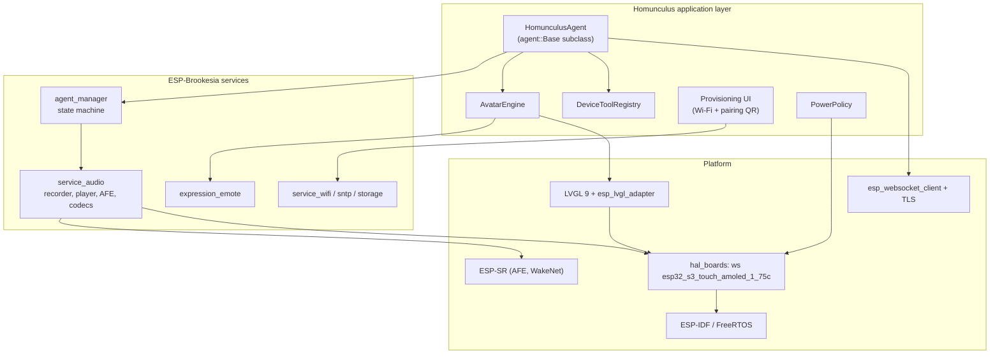
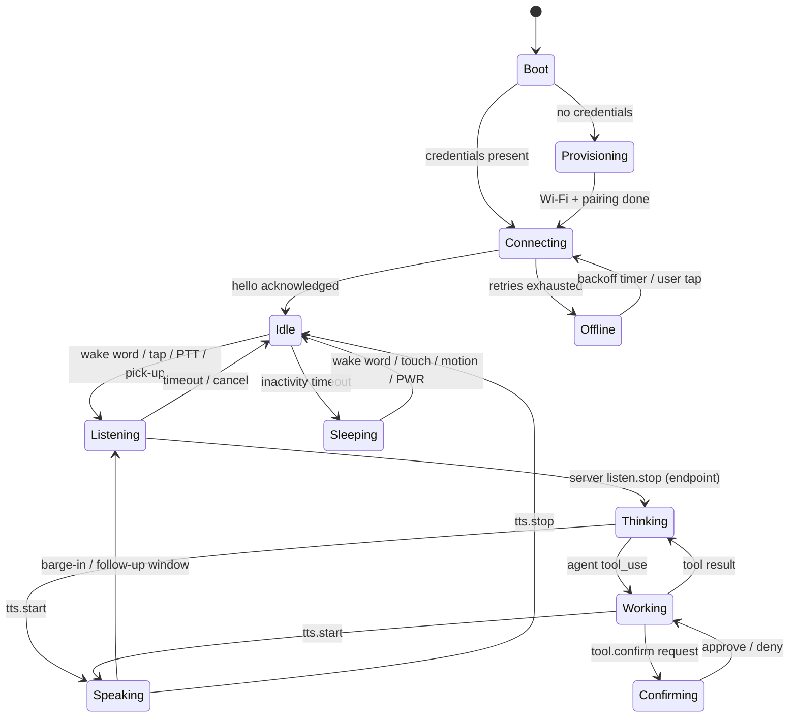

# 3. Device Firmware

| | |
| --- | --- |
| Document | HOM-SPEC-03 |
| Status | Draft 0.1 |
| Reference device | [Waveshare ESP32-S3-Touch-AMOLED-1.75C](../devices/waveshare-esp32-s3-touch-amoled-1.75c/README.md) |

## 3.1 Platform choice

| Layer | Choice |
| --- | --- |
| SDK | ESP-IDF v5.5.x (initial) → v6.x when moving to Brookesia v0.8 |
| Application framework | ESP-Brookesia, componentised (`release/v0.7` initially, tracking `master`/v0.8) |
| GUI | LVGL 9.x via `esp_lvgl_adapter` |
| Audio | Brookesia audio service (ESP-GMF, ESP-SR AFE, `esp_audio_codec` Opus) |
| Language | C++17 (Brookesia API), C for drivers |

### Why upstream Brookesia rather than the vendored example

The vendor example `03_esp-brookesia` vendors `brookesia_core` **0.6.0-beta2** (end of maintenance) with the AI framework disabled; its agent is hard-wired to Coze. Upstream ESP-Brookesia (v0.7/v0.8) is componentised, already contains a **board definition for the 1.75C** (`hal/brookesia_hal_boards/boards/waveshare/esp32_s3_touch_amoled_1_75c`), and provides an `agent_manager` with a pluggable agent base class, an audio service with AFE + Opus, and the `expression_emote` service. Homunculus uses the vendor example only as a **hardware bring-up reference** (display init, touch mirroring, LVGL stack size) and builds on upstream components.

Version policy: start on `release/v0.7` (IDF 5.5, matches vendor-tested IDF); evaluate migration to v0.8 once it is released stable, since v0.8 adds `brookesia_mcp_utils`, JSON UI and the unified service framework.

## 3.2 Firmware architecture

### 3.2.1 `HomunculusAgent`

A custom agent registered with `brookesia_agent_manager`, modelled on `brookesia_agent_xiaozhi`. It implements the `agent::Base` hooks:

| Hook | Responsibility |
| --- | --- |
| `on_activate()` | Load device token + server URL from NVS; fail → provisioning flow |
| `on_startup()` | Open WSS connection, send `hello` with capability descriptor, await server `hello` |
| `on_encoder_data_ready(data, size)` | Wrap Opus frame in HDP binary frame, send over WS (only while listening) |
| `on_manual_start_listening()` / `on_manual_stop_listening()` | Push-to-talk → `listen.start` / `listen.stop` |
| `on_interrupt_speaking()` | Barge-in → stop decoder, send `abort` |
| `on_sleep()` / `on_wakeup()` | Close/keep connection per power policy; WakeNet remains armed |
| `on_shutdown()` | Close connection gracefully |

Incoming server messages are dispatched to `feed_audio_decoder_data()` (Opus downlink), `set_emote()`, `set_agent_speaking_text()` / `set_user_speaking_text()` (captions), and the device tool registry.

### 3.2.2 Task and core layout

| Task | Core | Priority | Stack | Notes |
| --- | --- | --- | --- | --- |
| I²S read + AFE feed | 1 | high (22) | internal | Real-time, never blocks |
| AFE fetch (AEC/NS/VAD/WakeNet) | 1 | high (21) | PSRAM ok | ~ 60–70 % of core 1 |
| Opus encode | 0 | 18 | 24–32 KB | 60 ms frames |
| Opus decode + I²S write | 0 | 19 | 24–32 KB | Jitter buffer 120–240 ms |
| WebSocket / network | 0 | 10 | 8 KB | TLS buffers in PSRAM |
| LVGL / avatar | 0 | 5 | 40 KB (PSRAM) | 30 fps target; yields to audio |
| Housekeeping (PMU poll, IMU, battery) | 0 | 3 | 4 KB | 2 Hz PMU poll (no IRQ line) |

### 3.2.3 Audio configuration (reference device)

| Parameter | Value |
| --- | --- |
| Capture | 16 kHz, 2–3 channels (MIC1, [MIC2], REF = MIC3), 32-bit from ES7210 |
| AFE | AEC on, NS on, AGC on, VAD on (mode 3), WakeNet on; `AFE_MODE_HIGH_PERF`, PSRAM allocation |
| Uplink codec | Opus, 16 kHz mono, 60 ms frames, VBR ~ 16–24 kbit/s, complexity 3–5 |
| Downlink codec | Opus, 24 kHz mono (server-selected), 60 ms frames |
| Playback | ES8311 at 24 kHz (or resample to 16 kHz to keep a single I²S clock — to be measured) |
| Wake word | WakeNet9 stock model `wn9_computer_tts` ("Computer", see D-03); custom model optional later |

Open item: Brookesia's board config uses one mic + reference (`RMNN`). Enabling MIC2 for two-mic beamforming / DOA (`MMR` layout) must be evaluated for CPU headroom; DOA would let the avatar look towards the speaker.

### 3.2.4 Device state machine

## 3.3 Input handling

| Input | Gesture | Action |
| --- | --- | --- |
| Touch | Tap on avatar | Start listening (or stop speaking when speaking) |
| Touch | Long-press | Push-to-talk while held |
| Touch | Swipe down | Quick settings (volume, brightness, mute mic) |
| Touch | Swipe left/right | Captions / history view |
| BOOT key | Short press | Push-to-talk toggle |
| PWR key | Short press | Screen off/on, mic mute (configurable) |
| PWR key | Long press | Power off (AXP2101 hardware) |
| IMU | Pick-up / wrist-raise | Wake screen; optionally start listening |
| IMU | Shake | Cancel current turn |
| IMU | Tilt | Avatar gaze follows device tilt (idle liveliness) |

## 3.4 Device tools (exposed to the agent)

Device tools are declared in the `hello` message and bridged by the server into the agent's tool set (see [05-server.md](05-server.md#56-tool-hub)). Schema follows MCP `tools/list` conventions; invocation is JSON-RPC 2.0 over HDP.

| Tool | Parameters | Description |
| --- | --- | --- |
| `device.set_volume` | `level: 0–100` | Speaker volume |
| `device.set_brightness` | `level: 0–100` | AMOLED brightness (DCS 0x51) |
| `device.show_text` | `text, duration_s` | Show a card on screen (e.g. a phone number) |
| `device.show_qr` | `data, caption` | QR code (Brookesia emote `SetQrcode`) |
| `device.show_image` | `url` or `asset_id` | Small image (server pre-scales to 466×466 JPEG/PNG) |
| `device.get_status` | — | Battery %, charging, Wi-Fi RSSI, uptime |
| `device.get_motion` | — | Orientation, last motion event |
| `device.set_timer` | `seconds, label` | Local timer with avatar alert |

## 3.5 Provisioning and pairing

1. First boot: device starts SoftAP + BLE provisioning (`wifi_provisioning` component, ESP BLE Prov app) and shows a QR code containing provisioning info.
2. After Wi-Fi join, device discovers the server via mDNS or uses a provisioned URL.
3. Pairing: device shows a 6-digit code; user confirms it in the server admin UI/CLI → server issues a per-device token stored in NVS (encrypted NVS when flash encryption is enabled).

## 3.6 OTA

Dual OTA slots; server exposes firmware manifest per device model (`GET /ota/{model}/manifest`). Device checks on connect and on a daily timer; images are signed (Secure Boot v2 for production builds).

## 3.7 Power policy (reference device)

| State | Display | Audio | Wi-Fi | Notes |
| --- | --- | --- | --- | --- |
| Active | 100 % / avatar 30 fps | AFE + codec on | active | |
| Idle | 40 %, 15 fps idle animation | AFE + WakeNet on | `WIFI_PS_MIN_MODEM` | |
| Dimmed | 10 %, mostly black, blink only | WakeNet on | min modem | AMOLED black = ~ 0 power |
| Sleeping | off | WakeNet on (optional) or off | max modem / off | Wake via PWR, touch INT, IMU INT1 |
| Off | AXP2101 shutdown | — | — | PWR long-press |

## 3.8 Multi-device portability

| Concern | Mechanism |
| --- | --- |
| Pins, codecs, display, touch | Brookesia board definition (`board_peripherals.yaml`, `board_devices.yaml`) per device |
| Device-specific extras (AMOLED brightness, PMIC) | `brookesia_hal_custom` per board |
| Avatar layout | Avatar engine scales to `display.width/height/shape` (round vs. rectangular) |
| Missing peripherals | Capability flags (`has_touch`, `has_imu`, `has_battery`, mic count, AEC reference) in `hello` |
| Build | One firmware project, board selected at build time (`idf.py -DBOARD=...` / Brookesia board selection), per-board sdkconfig fragments |
