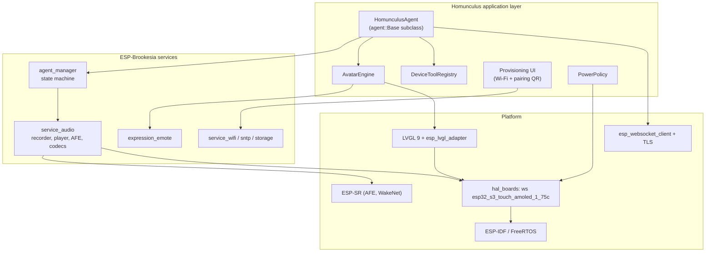
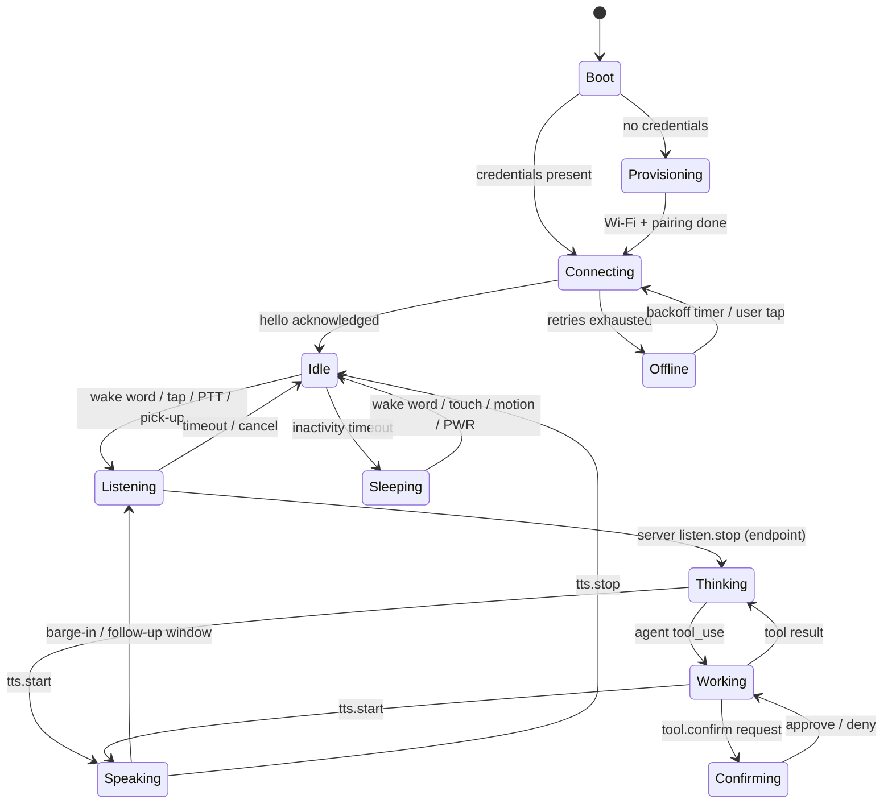

# 3. Device Firmware

| | |
| --- | --- |
| Document | HOM-SPEC-03 |
| Status | Draft 0.1 |
| Reference device | [Waveshare ESP32-S3-Touch-AMOLED-1.75C](../devices/waveshare-esp32-s3-touch-amoled-1.75c/README.md) |

## 3.1 Platform choice

| Layer | Choice |
| --- | --- |
| SDK | ESP-IDF 6.x (Brookesia 0.8 requires ≥ 6.0, ≤ 6.2) |
| Application framework | ESP-Brookesia 0.8.x, components from the ESP Component Registry (D-07) |
| GUI | LVGL 9.x via `esp_lvgl_adapter` |
| Audio | Brookesia audio service (ESP-GMF, ESP-SR AFE, `esp_audio_codec` Opus) |
| Language | C++17 (Brookesia API), C for drivers |

### Why upstream Brookesia rather than the vendored example

- Vendor example `03_esp-brookesia`: vendored `brookesia_core` 0.6.0-beta2 (end of maintenance), AI framework disabled, agent hard-wired to Coze. Used only as a hardware bring-up reference (display init, touch mirroring, LVGL stack size).
- Upstream ESP-Brookesia: componentised; board definition `hal/brookesia_hal_boards/boards/waveshare/esp32_s3_touch_amoled_1_75c`; `agent_manager` with pluggable `agent::Base`; audio service with AFE + Opus; `expression_emote`; `brookesia_mcp_utils` (0.8).
- Version policy: latest released Brookesia 0.8.x and a matching ESP-IDF 6.x (D-07).

Component versions (ESP Component Registry, 2026-11-07):

| Component | Version |
| --- | --- |
| `espressif/brookesia_hal_boards` | 0.8.1 |
| `espressif/brookesia_hal_adaptor` | 0.8.5 |
| `espressif/brookesia_service_device` | 0.8.3 |
| `espressif/brookesia_service_audio` | 0.8.2 |
| `espressif/brookesia_agent_manager` | 0.8.2 |
| `espressif/brookesia_expression_emote` | 0.8.2 |

## 3.2 Firmware architecture

### 3.2.1 `HomunculusAgent`

A custom agent registered with `brookesia_agent_manager`, modelled on `brookesia_agent_xiaozhi`. It implements the `agent::Base` hooks:

| Hook | Responsibility |
| --- | --- |
| `on_activate()` | Load device token + server URL from NVS; fail → provisioning flow |
| `on_startup()` | Open WSS connection, send `hello` with capability descriptor, await server `hello` |
| `on_encoder_data_ready(data, size)` | Wrap Opus frame in HDP binary frame, send over WS (only while listening) |
| `on_manual_start_listening()` / `on_manual_stop_listening()` | Push-to-talk → `listen.start` / `listen.stop` |
| `on_interrupt_speaking()` | Barge-in → stop decoder, send `abort` |
| `on_sleep()` / `on_wakeup()` | Close/keep connection per power policy; WakeNet remains armed |
| `on_shutdown()` | Close connection gracefully |

Incoming server messages are dispatched to `feed_audio_decoder_data()` (Opus downlink), `set_emote()`, `set_agent_speaking_text()` / `set_user_speaking_text()` (captions), and the device tool registry.

### 3.2.1.1 Phase 1 implementation (`firmware/components/homunculus_agent`)

Brookesia `agent_manager` 0.8 integration:

| Item | Implementation |
| --- | --- |
| Lifecycle | `app_main`: `SetTargetAgent`, `SetChatMode{RealTime}`, `TriggerGeneralAction{Activate}`, poll `GetGeneralState` until `Activated`, `TriggerGeneralAction{Start}`, poll until `Started`. Triggering an action while a transition runs makes `StateMachine::trigger_general_action()` read the front of an empty queue. |
| Chat mode | `RealTime` (also `CONFIG_BROOKESIA_AGENT_MANAGER_DEFAULT_CHAT_MODE_REAL_TIME`): Brookesia does not gate encoder data / decoder writes on the speaking / listening flags; the agent gates the uplink itself. |
| Wake word | `AudioEncoder` `AFEEventHappened` event subscription (`WakeStart`). Brookesia forwards `WakeStart` to `on_wakeup()` only when the agent is `Slept`. |
| Sleep | Not used. Encoder `afe_wake_start_timeout_ms` = `afe_wake_end_timeout_ms` = 0: no `WakeEnd`, so Brookesia never triggers `Sleep` (in `Slept` it drops encoder data and decoder writes). `on_sleep()` / `on_wakeup()` only acknowledge the state change. |
| Barge-in | `support_general_functions = {InterruptSpeaking}`; `set_speaking(true)` at `tts{start}`, `false` at end of playback / abort; `set_listening()` around the uplink. AFE `WakeStart` while speaking → `on_interrupt_speaking()`. `reset_interrupted_speaking()` at `tts{start}` (Brookesia drops decoder writes while interrupted). |
| Uplink encoder | Opus 16 kHz mono 60 ms, VBR 24 kbit/s (`EncoderExtraConfigOpus`; without it the encoder opens with bitrate 0 and fails), AFE on. |
| Downlink decoder | Opus 24 kHz mono 60 ms. Negotiated `frame_ms` is used for play-time accounting; Opus streams decode at any output rate. |

Turn handling:

| Event | Device action |
| --- | --- |
| Wake word / tap (Idle) | `listen{start, auto, trigger}` sent, then uplink enabled; stream id incremented; seq 0 flagged first |
| Wake word / tap (Thinking, Speaking) | `abort{wake_word \| barge_in}`, local playback flushed, new `listen{start}` |
| Wake word (Listening) | Ignored |
| Tap (Listening) | Next encoder frame flagged last; `listen{stop}` if no frame within 100 ms |
| Server `listen{stop}` | Next encoder frame flagged last (fallback 200 ms) → Thinking |
| `HOMUNCULUS_MAX_UTTERANCE_MS` | Same as tap while listening |
| `avatar{state: idle}` / `agent.status{done \| error}` / `error` while Thinking | Idle |
| No `tts{start}` within `HOMUNCULUS_THINKING_TIMEOUT_MS` | Idle |
| `tts{start}` while listening (uplink not ending) | Ignored |
| `confirm.request` | Confirmation card (spec 06 §6.6); tap right half of the lower screen approves, left half denies; denied on timeout (`timeout_ms` − 0.5 s), barge-in, turn end, disconnect, a second concurrent request, or no display |
| `tool.call` | Handler of the registered device tool runs on the worker thread: MCP text result (`isError` on failure); unknown tool → JSON-RPC error −32601 |
| Disconnect / Wi-Fi loss | Uplink stopped, deadlines cleared, playback flushed, Offline; Wi-Fi loss also closes the WebSocket |
| Reconnect | `hello.resume.session_id` = last session id; backoff reset on server `hello` |
| Non-`hello` first server message | Logged and ignored |

Downlink player: frames are queued (max 64, oldest dropped); playback starts after `HOMUNCULUS_JITTER_PREFILL_FRAMES` frames or when the stream is complete (last-flagged frame, `tts{stop}`), and re-prefills after an underrun. Estimated play end per fed frame: `max(now, play_end) + frame_ms`. `tts.played` is sent once per segment at the play end of its last frame; Speaking ends at the play end after `tts{stop}`.

Threads: worker (`hom_worker`, 8 KB stack in PSRAM, prio 6, core 0) owns turn state, HDP messages and the UI state callback (→ visualizer palette, spec 06); player (`hom_player`, 8 KB PSRAM, prio 7, core 0) feeds `feed_audio_decoder_data()`; the Brookesia encoder thread sends uplink frames (send outside the uplink lock); the WebSocket task (`hdp_ws`, 8 KB, prio 10, core 0) posts to the worker. Measured stack high-water marks: worker 4.2 KB free, player 6.1 KB free.

Kconfig (`Homunculus agent` menu):

| Option | Default | Meaning |
| --- | --- | --- |
| `HOMUNCULUS_WIFI_SSID`, `HOMUNCULUS_WIFI_PASSWORD` | empty | Station credentials (only in `firmware/sdkconfig.local`) |
| `HOMUNCULUS_SERVER_URL` | `ws://192.168.1.10:8443/hdp` | HDP endpoint |
| `HOMUNCULUS_DEVICE_TOKEN` | `dev` | Bearer token |
| `HOMUNCULUS_ALLOW_PLAIN_WS` | y | `ws://` URLs rejected when disabled |
| `HOMUNCULUS_JITTER_PREFILL_FRAMES` | 3 | Frames queued before playback starts |
| `HOMUNCULUS_MAX_UTTERANCE_MS` | 15000 | Device-side utterance limit |
| `HOMUNCULUS_THINKING_TIMEOUT_MS` | 90000 | Thinking → Idle without `tts{start}` |
| `HOMUNCULUS_DEVICE_ENDPOINT`, `_MIN_MS` | n, 1200 | Reserved (device-side VAD endpointing, not implemented) |
| `HOMUNCULUS_SPEAKER_VOLUME` | 85 | AudioPlayback `SetVolume` at boot (Brookesia default and persisted value: 75 %) |
| `HOMUNCULUS_TURN_STATS` | y | Per-turn uplink / latency log |
| `HOMUNCULUS_SYSTEM_STATS_INTERVAL_S` | 5 | Per-core CPU load, heap, thread stack log interval (0 = off) |
| `HOMUNCULUS_DEV_CONSOLE` | y | USB-Serial-JTAG single-key console (`t` tap, `w` wake word, `s` stats, `r` HDP reconnect, `d` Wi-Fi disconnect) |

### 3.2.2 Task and core layout

| Task | Core | Priority | Stack | Notes |
| --- | --- | --- | --- | --- |
| I²S read + AFE feed | 1 | high (22) | internal | Real-time, never blocks |
| AFE fetch (AEC/NS/VAD/WakeNet) | 1 | high (21) | PSRAM ok | ~ 60–70 % of core 1 |
| Opus encode | 0 | 18 | 24–32 KB | 60 ms frames |
| Opus decode + I²S write | 0 | 19 | 24–32 KB | Jitter buffer 120–240 ms |
| WebSocket / network | 0 | 10 | 8 KB | TLS buffers in PSRAM |
| Visualizer (`hom_vis`) | any | 4 | 6 KB (PSRAM) | Up to 20 fps while the ring moves; idle otherwise; must stay below the service manager workers (5), which complete downlink audio writes (spec 06 §6.3.4) |
| Housekeeping (PMU poll, IMU, battery) | 0 | 3 | 4 KB | 2 Hz PMU poll (no IRQ line) |

Measured idle CPU (1.75C, agent idle, `[stats] top tasks`, % of one core):

| Build | Core 0 / core 1 | `audio_recorder` | `afe_feed` | `afe_fetch` | Brookesia `SvcMgrMain0..2` + `SvcMgrSec0..1` | Internal free |
| --- | --- | --- | --- | --- | --- | --- |
| `-Og`, worker poll 5 ms (Brookesia default) | 64 / 45 % | 22 | 17–18 | 11 | 11 + 14 + 13 + 4 + 6 ≈ 45 | 67 KB |
| `-Og`, worker poll 10 ms | 60 / 36 % | 21 | 17 | 11 | 12 + 14 + 6 + 2 + 3 ≈ 37 | 67 KB |
| `-O2`, worker poll 10 ms | 54 / 36 % | 22 | 17 | 11 | 8 + 11 + 8 + 2 + 3 ≈ 32 | 72 KB |
| `-O2`, worker poll 5 ms (current, D-21) | 57 / 36 % | 21–23 | 17 | 10 | 8 + 10 + 8 + 3 + 5 ≈ 34 | 72 KB |

Service manager workers sleep for the poll interval only when their queue is empty (`TaskScheduler` worker loop, `io_context::poll()`); a task posted to a sleeping worker waits up to one interval. The remaining load is queued work. Kconfig range of the poll interval: 1–10 ms. Downlink audio writes complete on these workers (spec 06 §6.3.3), so the interval stays at the default 5 ms.

### 3.2.3 Audio configuration (reference device)

| Parameter | Value |
| --- | --- |
| Capture | 16 kHz, 2–3 channels (MIC1, [MIC2], REF = MIC3), 32-bit from ES7210 |
| AFE | AEC on, NS on, AGC on, VAD on (mode 3), WakeNet on; `AFE_MODE_HIGH_PERF`, PSRAM allocation |
| Uplink codec | Opus, 16 kHz mono, 60 ms frames, VBR ~ 16–24 kbit/s, complexity 3–5 |
| Downlink codec | Opus, 24 kHz mono (server-selected), 60 ms frames |
| Playback | ES8311 at 24 kHz (or resample to 16 kHz to keep a single I²S clock — to be measured) |
| Wake word | WakeNet9 stock model `wn9_computer_tts` ("Computer", see D-03); custom model optional later |

Open item: Brookesia's board config uses one mic + reference (`RMNN`). Enabling MIC2 for two-mic beamforming / DOA (`MMR` layout) must be evaluated for CPU headroom; DOA would let the avatar look towards the speaker.

### 3.2.4 Device state machine

## 3.3 Input handling

| Input | Gesture | Action |
| --- | --- | --- |
| Touch | Tap on avatar | Start listening (or stop speaking when speaking) |
| Touch | Long-press | Push-to-talk while held |
| Touch | Swipe down | Quick settings (volume, brightness, mute mic) |
| Touch | Swipe left/right | Captions / history view |
| BOOT key | Short press | Push-to-talk toggle |
| PWR key | Short press | Screen off/on, mic mute (configurable) |
| PWR key | Long press | Power off (AXP2101 hardware) |
| IMU | Pick-up / wrist-raise | Wake screen; optionally start listening |
| IMU | Shake | Cancel current turn |
| IMU | Tilt | Avatar gaze follows device tilt (idle liveliness) |

## 3.4 Device tools (exposed to the agent)

Device tools are declared in the `hello` message and bridged by the server into the agent's tool set (see [05-server.md](05-server.md#56-tool-hub)). Schema follows MCP `tools/list` conventions; invocation is JSON-RPC 2.0 over HDP.

| Tool | Parameters | Description |
| --- | --- | --- |
| `device.set_volume` | `level: 0–100` | Speaker volume |
| `device.set_brightness` | `level: 0–100` | AMOLED brightness (DCS 0x51) |
| `device.show_text` | `text, duration_s` | Show a card on screen (e.g. a phone number) |
| `device.show_qr` | `data, caption` | QR code (Brookesia emote `SetQrcode`) |
| `device.show_image` | `url` or `asset_id` | Small image (server pre-scales to 466×466 JPEG/PNG) |
| `device.get_status` | — | Battery %, charging, Wi-Fi RSSI, uptime |
| `device.get_motion` | — | Orientation, last motion event |
| `device.set_timer` | `seconds, label` | Local timer with avatar alert |

## 3.5 Provisioning and pairing

Wi-Fi provisioning (Phase 3C-1, implemented):

| Item | Value |
| --- | --- |
| Settings | NVS namespace `homunculus`: `ssid`, `pass`, `url`, `token`, read once into RAM by `settings::init()` (flash access with the cache disabled asserts on tasks whose stack is in PSRAM, e.g. the agent worker, D-17). A stored value wins over the Kconfig default; a stored empty `ssid` means provisioning requested (Kconfig credentials ignored) |
| Trigger | No credentials (stored, or Kconfig) at boot; stored credentials without a connection for 90 s (setup AP runs beside the station, stops once connected); console key `p` |
| Access point | SoftAP `Homunculus-XXXX` (last two MAC bytes), WPA2, password = last four MAC bytes in hex; both shown on a text card (spec 06 §6.6) |
| Setup page | `http://192.168.4.1/` (any other URL redirects): SSID (suggestions from a scan taken before the AP starts), Wi-Fi password, server URL (default: current), device token (optional) |
| Validation | SSID 1–32 bytes; password empty or 8–63; URL empty or `ws://` / `wss://` with host; token ≤ 128 printable ASCII without spaces |
| Save | Stores to NVS, answers, restarts after 1.5 s |

Planned (3C-2): server discovery via mDNS; pairing: device shows a 6-digit code, the user confirms it in the server CLI, the server issues a per-device token stored in NVS (encrypted NVS when flash encryption is enabled).

## 3.6 OTA

Dual OTA slots; server exposes firmware manifest per device model (`GET /ota/{model}/manifest`). Device checks on connect and on a daily timer; images are signed (Secure Boot v2 for production builds).

## 3.7 Power policy (reference device)

| State | Display | Audio | Wi-Fi | Notes |
| --- | --- | --- | --- | --- |
| Active | 100 % / avatar 30 fps | AFE + codec on | active | |
| Idle | 40 %, 15 fps idle animation | AFE + WakeNet on | `WIFI_PS_MIN_MODEM` | |
| Dimmed | 10 %, mostly black, blink only | WakeNet on | min modem | AMOLED black = ~ 0 power |
| Sleeping | off | WakeNet on (optional) or off | max modem / off | Wake via PWR, touch INT, IMU INT1 |
| Off | AXP2101 shutdown | — | — | PWR long-press |

## 3.8 Multi-device portability

| Concern | Mechanism |
| --- | --- |
| Pins, codecs, display, touch | Brookesia board definition (`board_peripherals.yaml`, `board_devices.yaml`) per device |
| Device-specific extras (AMOLED brightness, PMIC) | `brookesia_hal_custom` per board |
| Avatar layout | Avatar engine scales to `display.width/height/shape` (round vs. rectangular) |
| Missing peripherals | Capability flags (`has_touch`, `has_imu`, `has_battery`, mic count, AEC reference) in `hello` |
| Build | One firmware project, board selected at build time (`idf.py -DBOARD=...` / Brookesia board selection), per-board sdkconfig fragments |
