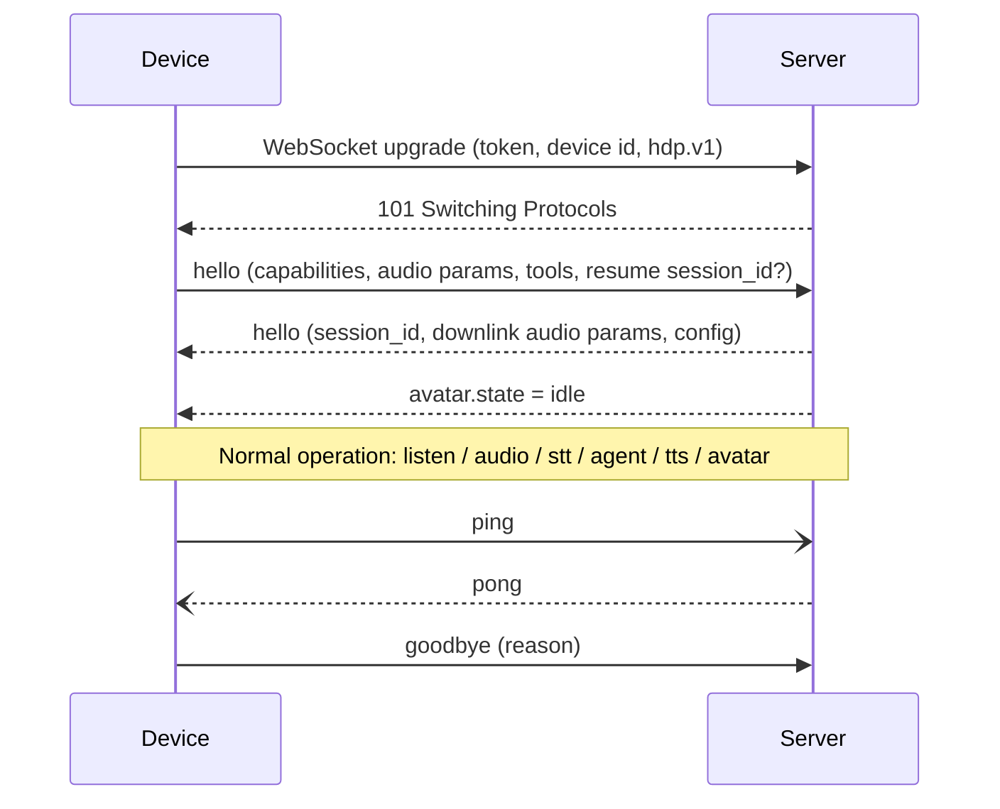

# 4. Homunculus Device Protocol (HDP)

| | |
| --- | --- |
| Document | HOM-SPEC-04 |
| Status | Draft 0.1 |
| Version | HDP/1 |

HDP is a WebSocket sub-protocol carrying **binary audio frames** and **JSON control messages** on a single connection. Its message vocabulary is intentionally close to the XiaoZhi WebSocket protocol (hello / listen / stt / tts / abort / mcp) — a proven design for ESP32 voice agents — and extends it with avatar, captions, agent status, tool confirmation and capability negotiation.

## 4.1 Transport

| Item | Value |
| --- | --- |
| URL | `wss://<server>:8443/hdp` (`ws://` allowed only in development builds) |
| Sub-protocol | `Sec-WebSocket-Protocol: hdp.v1` |
| Auth | `Authorization: Bearer <device-token>` |
| Headers | `X-Device-Id: <MAC>`, `X-Device-Model: ws-s3-amoled-175c`, `X-Firmware: <semver>` |
| Keep-alive | WebSocket ping every 20 s; server closes after 60 s silence |
| Reconnect | Exponential backoff 1 s → 60 s with jitter; session resumes via `session_id` |
| Text frames | UTF-8 JSON, one message per frame |
| Binary frames | Audio, see §4.3 |

## 4.2 Connection lifecycle



## 4.3 Binary audio frame

All multi-byte integers big-endian.

| Offset | Size | Field | Description |
| --- | --- | --- | --- |
| 0 | 1 | `type` | `0x01` = Opus uplink, `0x02` = Opus downlink, `0x03` = PCM16 (debug) |
| 1 | 1 | `flags` | bit0 = first frame of stream, bit1 = last frame of stream |
| 2 | 2 | `stream_id` | Uplink: utterance id; downlink: TTS segment id |
| 4 | 4 | `seq` | Frame sequence number within the stream |
| 8 | 2 | `payload_len` | Payload length in bytes |
| 10 | n | `payload` | One Opus packet (60 ms) |

10-byte header overhead per 60 ms frame ≈ 1.3 kbit/s.

## 4.4 Capability descriptor (device `hello`)

```json
{
  "type": "hello",
  "version": 1,
  "device": {
    "model": "ws-s3-amoled-175c",
    "firmware": "0.1.0",
    "board": "waveshare/esp32_s3_touch_amoled_1_75c"
  },
  "capabilities": {
    "display": { "width": 466, "height": 466, "shape": "round", "color_depth": 16 },
    "audio": {
      "input":  { "format": "opus", "sample_rate": 16000, "channels": 1, "frame_ms": 60 },
      "output": { "formats": ["opus"], "sample_rates": [16000, 24000] },
      "mics": 2, "aec": true, "wake_word": true
    },
    "input": ["touch", "button", "imu"],
    "power": { "battery": true },
    "avatar": { "engine": "homunculus-face/1", "emotes": ["neutral","happy","sad","surprised","curious","concerned","confused","excited","sleepy","love","angry"] }
  },
  "tools": [
    { "name": "device.set_volume", "description": "Set speaker volume", "inputSchema": { "type": "object", "properties": { "level": { "type": "integer", "minimum": 0, "maximum": 100 } }, "required": ["level"] } }
  ],
  "resume": { "session_id": "optional-previous-session" }
}
```

Server response:

```json
{
  "type": "hello",
  "session_id": "s_01J...",
  "audio": { "output": { "format": "opus", "sample_rate": 24000, "channels": 1, "frame_ms": 60 } },
  "config": { "follow_up_window_ms": 6000, "captions": true, "language": "en" }
}
```

## 4.5 Control messages

### Device → server

| `type` | Fields | Meaning |
| --- | --- | --- |
| `listen` | `state: start\|stop`, `mode: auto\|manual\|realtime`, `trigger: wake_word\|touch\|button\|motion\|follow_up`, `wake_word?` | Begin/end an utterance. `auto` = server endpointing; `manual` = push-to-talk |
| `abort` | `reason: barge_in\|user_cancel\|wake_word` | Interrupt current turn / playback |
| `tts.played` | `segment_id` | Segment fully played (for spoken-so-far tracking) |
| `tool.result` | JSON-RPC 2.0 response | Result of a device tool call |
| `confirm.result` | `request_id`, `approved: bool` | User answer to a confirmation request |
| `event` | `name: battery_low\|picked_up\|shake\|...`, `data` | Asynchronous device events |
| `goodbye` | `reason` | Graceful disconnect |

### Server → device

| `type` | Fields | Meaning |
| --- | --- | --- |
| `listen` | `state: stop` | Server-side endpoint detected; device stops uplink |
| `stt` | `text`, `final: bool` | User transcript (captions) |
| `agent.status` | `phase: thinking\|tool\|responding\|done\|error`, `tool?`, `detail?` | Agent progress (drives avatar "working" sub-states) |
| `tts` | `state: start\|segment_start\|segment_end\|stop`, `segment_id?`, `text?` | Speech output framing; `text` for captions |
| `avatar` | `state?`, `emote?`, `intensity?: 0–1`, `duration_ms?`, `gaze?` | Avatar control (see [06-avatar.md](06-avatar.md)) |
| `tool.call` | JSON-RPC 2.0 request (`method: tools/call`) | Invoke a device tool |
| `confirm.request` | `request_id`, `title`, `detail`, `timeout_ms` | Ask user to approve a risky agent action |
| `notify` | `text`, `level` | Proactive notification (timer done, reminder) |
| `config` | partial config | Runtime config update |
| `error` | `code`, `message` | Protocol / server errors |

## 4.6 Turn example

```text
D→S  {"type":"listen","state":"start","mode":"auto","trigger":"wake_word","wake_word":"computer"}
D→S  [bin 0x01 stream=7 seq=0 flags=first] ... [seq=n]
S→D  {"type":"stt","text":"what's the weather in","final":false}
S→D  {"type":"listen","state":"stop"}
S→D  {"type":"stt","text":"What's the weather in Vienna tomorrow?","final":true}
S→D  {"type":"avatar","state":"thinking"}
S→D  {"type":"agent.status","phase":"tool","tool":"web_search"}
S→D  {"type":"avatar","emote":"happy","intensity":0.6}
S→D  {"type":"tts","state":"start"}
S→D  {"type":"tts","state":"segment_start","segment_id":1,"text":"Tomorrow in Vienna it'll be sunny and around 14 degrees."}
S→D  [bin 0x02 stream=1 seq=0..k]
S→D  {"type":"tts","state":"segment_end","segment_id":1}
D→S  {"type":"tts.played","segment_id":1}
S→D  {"type":"tts","state":"stop"}
```

## 4.7 Compatibility note — XiaoZhi protocol

For an early spike, the server may additionally expose a **XiaoZhi-compatible endpoint** (hello with `audio_params`, `listen`/`stt`/`tts`/`llm{emotion}`/`abort`/`mcp`, binary protocol v3). This allows testing the server against unmodified `brookesia_agent_xiaozhi` or xiaozhi-esp32 firmware before the Homunculus agent component exists. Whether `brookesia_agent_xiaozhi` accepts a custom server URL without the XiaoZhi OTA activation flow must be verified (open item OI-04).

## 4.8 Versioning rules

- `hello.version` is the HDP major version; servers must reject unknown majors with `error{code:"unsupported_version"}`.
- Unknown message types and unknown fields must be ignored (forward compatibility).
- New capabilities are additive within a major version.
