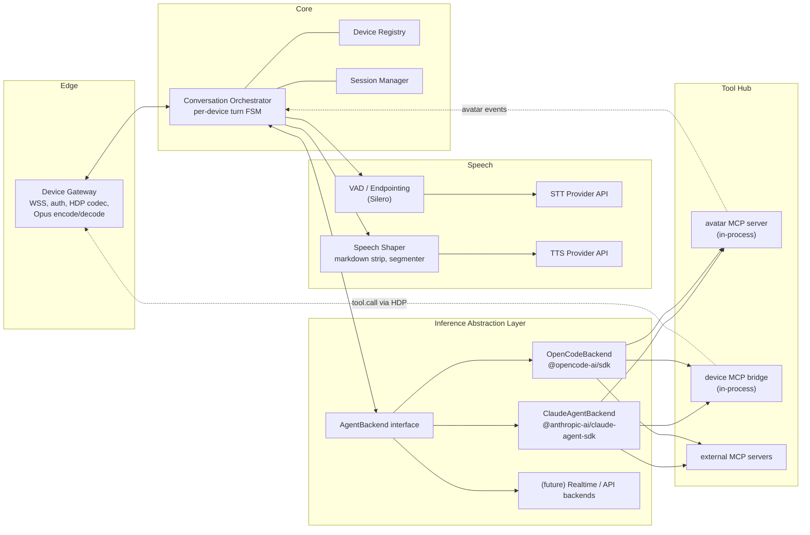
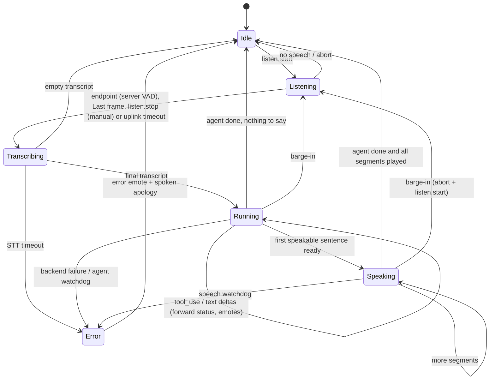
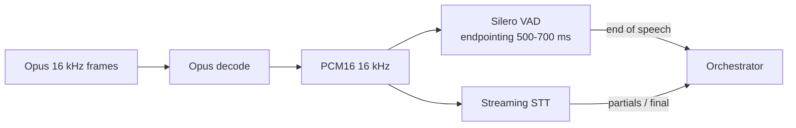
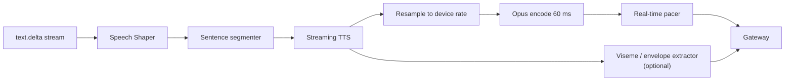

# 5. Server

| | |
| --- | --- |
| Document | HOM-SPEC-05 |
| Status | Draft 0.1 |
| Runtime | Node.js ≥ 22 (TypeScript), optional Python sidecars for local speech models |

## 5.1 Components



| Component | Responsibility |
| --- | --- |
| Device Gateway | Terminates WSS, authenticates devices, parses HDP, Opus ↔ PCM, back-pressure, per-connection jitter/pacing of downlink frames (real-time pacing at 60 ms) |
| Device Registry | Device identity, model, capabilities from `hello`, per-device profile (persona, voice, language, backend, tool policy) |
| Session Manager | Maps device ↔ agent session ids; persistence in SQLite; resume on reconnect |
| Conversation Orchestrator | Turn state machine; routes audio to STT, transcripts to agent, agent output to shaper/TTS; handles barge-in, cancellation, spoken-so-far tracking, avatar state derivation |
| Speech providers | Pluggable STT, TTS, VAD implementations behind small interfaces |
| Inference Abstraction Layer | Uniform streaming agent interface over different agent harnesses |
| Tool Hub | Assembles the tool set per device: avatar tool, device tools bridge, configured MCP servers, permission policy |

## 5.2 Orchestrator turn state machine



Turn pipelining: TTS of sentence *n* runs while the agent still generates sentence *n+1*; the downlink is streamed as soon as the first TTS chunk exists.

Implementation (`server/src/orchestrator/conversation.ts`):

| Rule | Behaviour |
| --- | --- |
| Uplink stream | Stream id latched from the first frame after `listen.start` with the First flag or `seq` 0; frames before it and frames of other stream ids are dropped (count logged as `dropped`) |
| Undecodable Opus packet | Replaced by 60 ms silence |
| Barge-in | `listen.start` or `abort` during a turn: agent interrupt, pacer cleared, `tts{stop}`. The next turn's agent send waits until all earlier agent streams have ended (chained), at most `interruptWaitMs`; then the agent session is reopened |
| Agent session recovery | Session reopened after an `error` event with `fatal` or `retryable: false`, an exception from `send`, an agent watchdog or an interrupt timeout. The first reopen resumes the last backend session id; a second consecutive failure opens a fresh session. A successful `done` resets the count |
| Error | `agent.status{error}`, avatar `error` + emote `concerned`, the shaper's buffered partial sentence, then the apology; then Idle |
| Speech watchdog | No TTS chunk or downlink frame for `speechIdleMs`: synthesis cancelled, pacer cleared, `tts{stop}`, avatar `error`, Idle |
| Avatar during tools | `tool.start` → `working` immediately if nothing is being spoken, otherwise once queued speech has been sent; the next answer segment → `speaking` |
| Filler | Enqueued on `tool.start` when nothing was enqueued for `fillerAfterMs` (1500 ms); excluded from `heardSoFar` and from the `first_sentence`, `tts_first_chunk`, `first_downlink` latency stages |
| Device reconnect | A second connection with the same device id closes the first (WebSocket close 4000 `replaced`); its agent session is closed before the new conversation resumes it |

Timeouts (wall clock):

| Timeout | Default | Env | Effect |
| --- | --- | --- | --- |
| `uplinkGapMs` | 2500 ms | `HOMUNCULUS_UPLINK_GAP_MS` | No uplink frame for this long while listening: endpoint (auto mode without speech: no speech → Idle) |
| max utterance | `maxUtteranceMs` + `uplinkGapMs` = 22.5 s | — | Endpoint |
| `sttFinalMs` | 20 000 ms | `HOMUNCULUS_STT_TIMEOUT_MS` | No final transcript after endpoint: Error |
| `agentIdleMs` | 90 000 ms | `HOMUNCULUS_AGENT_IDLE_TIMEOUT_MS` | No agent event (incl. session open): Error, session reopened |
| `speechIdleMs` | 20 000 ms | `HOMUNCULUS_SPEECH_IDLE_TIMEOUT_MS` | Speech watchdog |
| `interruptWaitMs` | 8000 ms | `HOMUNCULUS_INTERRUPT_WAIT_MS` | Session reopened |
| `playedTimeoutMs` | 1500 ms | — | Max wait for `tts.played` of the last segment before `tts{stop}` |
| whisper request | 15 000 ms | — | One `whisper-server` HTTP request |

## 5.3 Inference Abstraction Layer (IAL)

### 5.3.1 Interface

```typescript
export interface AgentBackend {
  readonly id: string;                         // "claude-agent-sdk" | "opencode" | ...
  capabilities(): BackendCapabilities;          // streaming text, tool events, interrupt, sessions
  openSession(ctx: SessionContext): Promise<AgentSession>;
}

export interface AgentSession {
  readonly sessionId: string;                   // backend-native id, persisted for resume
  send(input: AgentInput, signal: AbortSignal): AsyncIterable<AgentEvent>;
  interrupt(): Promise<void>;                   // barge-in
  close(): Promise<void>;
}

export interface SessionContext {
  device: DeviceProfile;                        // capabilities, persona, locale
  tools: ToolSet;                               // avatar + device bridge + MCP servers
  permissionPolicy: PermissionPolicy;           // allow / deny / ask-on-device
  resumeSessionId?: string;
  cwd?: string;                                 // per-device sandbox directory
}

export type AgentInput =
  | { kind: "utterance"; text: string; heardSoFar?: string }   // heardSoFar = truncated previous answer
  | { kind: "event"; name: string; data: unknown };             // e.g. timer fired, device picked up

export type AgentEvent =
  | { type: "status"; phase: "thinking" | "responding" }
  | { type: "text.delta"; text: string }
  | { type: "tool.start"; name: string; input?: unknown }
  | { type: "tool.end"; name: string; ok: boolean }
  | { type: "permission.request"; id: string; tool: string; summary: string }
  | { type: "done"; usage?: Usage }
  | { type: "error"; message: string; retryable: boolean; fatal?: boolean };  // fatal: session unusable
```

The orchestrator only consumes `AgentEvent`s; backends map their native streams onto this vocabulary.

`heardSoFar`: text of the interrupted answer's segments confirmed by `tts.played`, plus the segment playing at barge-in (the first started segment without `tts.played`); a `tts.played` for segment *n* marks all earlier segments played; filler and apology are excluded. Passed with the next utterance only; cleared when the interrupting utterance yields no turn (no speech or empty transcript).

### 5.3.2 Claude Agent SDK backend

| Aspect | Mapping |
| --- | --- |
| Package | `@anthropic-ai/claude-agent-sdk` (TypeScript) |
| Invocation | `query({ prompt: AsyncIterable<SDKUserMessage>, options })` — streaming-input mode keeps one long-lived query per device session; each utterance is pushed as a new user message |
| Streaming | `includePartialMessages: true` → partial assistant messages / stream events → `text.delta` |
| Tool events | Assistant `tool_use` content blocks → `tool.start`; tool results → `tool.end` |
| Interrupt | `Query.interrupt()` on barge-in |
| Sessions | `resume: <sessionId>` on reconnect; `forkSession` for experiments. Query ended or `next()` threw → `error{fatal: true}`; further sends on that session yield the same error |
| System prompt | `systemPrompt: { type: "preset", preset: "claude_code", append: <persona + voice style rules> }` or a fully custom prompt (preferred for a companion persona) |
| Tools | `allowedTools` e.g. `WebSearch`, `WebFetch`, selected MCP tools; `disallowedTools` for `Bash`/`Write` unless explicitly enabled per profile |
| Custom tools | `createSdkMcpServer({ name: "avatar", tools: [tool("express", ...)] })` and `createSdkMcpServer({ name: "device", tools: [...] })` generated from the device's `hello.tools` |
| Permissions | `canUseTool(request)` → policy check → optionally `confirm.request` to device, resolve on `confirm.result` |
| Working directory | Per-device sandbox directory (`cwd`) for file-producing tools: `server/.data/sandbox/devices/<id>-<hash>`, `<id>` = device id with characters outside `[A-Za-z0-9_-]` replaced by `_` (max 48), `<hash>` = first 8 hex digits of SHA-256(device id) |
| Settings | `settingSources: []` to avoid loading the host user's Claude Code settings implicitly |
| Model | Configurable per profile (e.g. `claude-sonnet-5-5` for quality, `claude-haiku-4-5` for latency) |
| Auth | `ANTHROPIC_API_KEY` if set; otherwise the host's logged-in Claude subscription (personal use only — Anthropic does not permit offering claude.ai login in third-party products) |
| Latency | `startup()` / `prewarm()` to keep a warm process per active device |

### 5.3.3 OpenCode SDK backend

| Aspect | Mapping |
| --- | --- |
| Package | `@opencode-ai/sdk` |
| Server | `createOpencode()` (spawns `opencode serve`) or `createOpencodeClient({ baseUrl })` for a sidecar |
| Session | `client.session.create({ body: { title } })`, id persisted |
| Prompt | `client.session.prompt({ path: { id }, body: { parts: [{ type: "text", text }], model: { providerID, modelID }, agent?, system? } })` |
| Streaming | `client.event.subscribe()` SSE stream — `message.part.updated` (text / tool parts) → `text.delta` / `tool.*`; `session.idle` → `done` |
| Interrupt | `client.session.abort({ path: { id } })` |
| Permissions | permission events → `permission.request`; reply via the session permission endpoint |
| Tools / MCP | OpenCode config (`opencode.json`) declares MCP servers; the avatar and device tools are exposed by the Homunculus server as a local **streamable-HTTP MCP endpoint** (`/mcp/{deviceId}`) since OpenCode runs out-of-process |
| Providers | Any OpenCode provider (Anthropic, OpenAI, local via Ollama/LM Studio, …) — enables local-only operation |

### 5.3.4 Backend selection

Per device profile (`backend: "claude-agent-sdk" | "opencode"`), switchable at runtime (applies to next session). A voice command ("switch to OpenCode") can be implemented as a server-side meta-tool.

## 5.4 Speech pipeline

### 5.4.1 Speech-in



```typescript
export interface SttProvider {
  open(opts: { language?: string; sampleRate: 16000 }): SttStream;
}
export interface SttStream {
  write(pcm: Int16Array): void;
  end(): void;
  results(): AsyncIterable<{ text: string; final: boolean }>;
}
```

| Candidate | Type | Notes |
| --- | --- | --- |
| faster-whisper (large-v3-turbo) | Local (GPU recommended) | High accuracy, multilingual; pseudo-streaming via chunked decoding |
| NVIDIA Parakeet / Canary | Local (GPU) | Very low latency; strong English, growing multilingual |
| whisper.cpp | Local (CPU/Metal) | Good for CPU-only hosts with small/turbo models |
| Deepgram / AssemblyAI / ElevenLabs Scribe | Cloud streaming | Lowest effort, true streaming, endpointing built in |
| OpenAI transcription API | Cloud | Simple, batch or streaming |

Initial selection (D-01): whisper.cpp on CPU, English. faster-whisper on a GPU host later.

whisper.cpp provider: `whisper-server` started with `-l <persona language>`; each request carries the stream's `language`. Partials (every `HOMUNCULUS_STT_PARTIAL_MS` = 1000 ms of new audio while VAD reports speech) run on their own abort signal, aborted at the endpoint, so the final request does not wait for a partial.

### 5.4.2 Speech-out



Speech Shaper rules (applied to agent output before TTS):

1. The agent is instructed (system prompt) to answer conversationally and briefly, no markdown, no lists unless asked, numbers spelled for speech.
2. Defensive post-processing: strip markdown syntax, code blocks (replaced by "I've put the code on the server"), URLs (replaced by domain names), emoji.
3. Segment on sentence boundaries; first segment emitted early to minimise time-to-first-audio: a first sentence of ≤ 8 words is one segment, a longer one is cut at its first clause boundary (`,` `;` `:` ` – `) after ≥ 3 words (`HOMUNCULUS_FIRST_MAX_WORDS`, `HOMUNCULUS_FIRST_MIN_WORDS`). Bare `am`, `pm`, `no` end sentences; `a.m.`, `p.m.` do not.
4. Long answers: speak a summary; full text is available as captions/history.

```typescript
export interface TtsProvider {
  synthesize(text: string, opts: { voice: string; sampleRate: number; signal: AbortSignal }): AsyncIterable<Int16Array>;
}
```

| Candidate | Type | Notes |
| --- | --- | --- |
| Kokoro (82M) | Local | High quality for size, runs on CPU, several voices/languages; runs in a child process (D-19) |
| Piper | Local | Very fast on CPU (incl. Raspberry Pi), many languages, more robotic |
| ElevenLabs / Cartesia | Cloud streaming | Lowest latency + most expressive; paid |
| OpenAI TTS | Cloud | Simple, streaming, steerable voice style |

Provider selection is configuration-driven; a profile may combine local STT with cloud TTS, etc.

Initial selection (D-02): Kokoro with a British female voice, English; Piper as fallback.

Kokoro measurements (kokoro-js 1.2.1, onnxruntime-node 1.21, CPU i7-1165G7 4C/8T, voice `bf_emma`, median of 3, `server/scripts/bench-tts.ts`; WER = whisper base.en transcript vs input):

| Words | fp32 synth ms | q8 synth ms | Audio ms | fp32 RTF | q8 RTF | WER fp32 / q8 |
| --- | --- | --- | --- | --- | --- | --- |
| 1 | 422 | 950 | 1148 | 0.37 | 0.85 | 0.00 / 0.00 |
| 4 | 631 | 1582 | 1220 | 0.52 | 1.30 | 0.00 / 0.00 |
| 6 | 1374 | 2320 | 2227 | 0.62 | 1.03 | 0.00 / 0.00 |
| 12 | 1724 | 3829 | 3922 | 0.44 | 0.98 | 0.00 / 0.00 |
| 22 | 3640 | 5754 | 6377 | 0.57 | 0.89 | 0.05 / 0.05 |

- fp32 synthesis ≈ 60 ms + 18 ms per phoneme token (≈ 5 tokens per word); phonemization 12–19 ms (first call ~140 ms).
- ONNX Runtime intra-op threads: default (0) 535 / 909 ms (4 / 6 words); 1: 1254 / 2156; 2: 738 / 1248; 4: 535 / 876; 8: 622 / 1522.
- kokoro-js `stream()` splits text into sentences (`TextSplitterStream`) and synthesises each sentence whole; with a string argument it does not terminate in 1.2.1. Not used.
- Default: fp32 (`HOMUNCULUS_KOKORO_DTYPE`), synthesis per shaper segment.

### 5.4.3 Persona

A persona is a configuration record, not code (D-04). It holds the name, personality / system-prompt text, TTS provider and voice, language, default emotional range for the avatar, and the wake word. The server loads persona definitions from configuration and each device profile references one. Only the wake word lives on the device (as a WakeNet model), so changing it requires a device-side model change.

The initial and only persona is **Claudia**: female, British voice, dark British humour.

## 5.5 Latency budget (target, simple question)

| Stage | Budget |
| --- | --- |
| End-of-speech detection (VAD hangover) | 500 ms |
| Final STT result after endpoint | 150–300 ms |
| Agent time-to-first-token (warm session) | 400–800 ms |
| First sentence complete + TTS first chunk | 200–300 ms |
| Network + device jitter buffer | 120–200 ms |
| **Total to first audio** | **≈ 1.4–2.1 s** |

Mitigations: prewarmed agent processes, speculative STT finalisation, early first segment, "acknowledgement" emote/earcon immediately at endpoint so perceived latency is near zero, filler phrase ("Let me check…") emitted by the orchestrator when a tool call starts and no speech has been produced for > 1.5 s.

Simulator measurements, first segment 3–8 words + short-first-sentence voice rule (2026-11-07, localhost, auto mode, Kokoro fp32, whisper base.en, `claude-opus-5-5` effort low; ms after end of speech, server `turn` log):

| Question | Endpoint | STT final | Agent first token | First sentence | First TTS chunk | First downlink | First segment |
| --- | --- | --- | --- | --- | --- | --- | --- |
| "What is the capital of Australia?" | 540 | 825 | 1549 | 1549 | 1902 | 1924 | "Canberra." |
| "Tell me a short joke." | 540 | 859 | 1559 | 2162 | 2981 | 3016 | "Why did the scarecrow win an award?" |
| "What time is it in Tokyo?" | 540 | 828 | 2493 | 2814 | 3345 | 3371 | "I can't see a clock," |
| "What is the capital of Australia?" | 537 | 1017 | 2422 | 2714 | 3847 | 3927 | "Canberra, actually." |
| "Tell me a short joke." | 539 | 886 | 2364 | 3122 | 3664 | 3688 | "Right, here's one." |
| "What's the weather in Vienna tomorrow?" (WebSearch) | 539 | 842 | 2266 | 3642 | 4554 | 4592 | "Let me look that up for you." |

Same setup with first segment 4–12 words and without the voice rule: first downlink 3132 / 5898 / 3565 ms (capital / joke / weather); first-segment TTS 555 / 1160 / 598 ms.

## 5.6 Tool Hub

| Tool source | Implementation | Exposure to backend |
| --- | --- | --- |
| Avatar | In-process: `avatar.express(emote, intensity?, duration_ms?)`, `avatar.gesture(name)` | Claude: in-process SDK MCP server; OpenCode: local HTTP MCP endpoint |
| Device bridge | Generated from `hello.tools`; calls forwarded as `tool.call` over HDP, awaiting `tool.result` (timeout 5 s) | as above |
| Built-ins | Claude: `WebSearch`, `WebFetch`, etc.; OpenCode: its built-in tools | backend-native |
| External MCP | Configured per profile (e.g. calendar, home automation, notes, memory) | backend-native MCP config |
| Server meta-tools | `homunculus.remember`, `homunculus.set_timer`, `homunculus.switch_backend` | as avatar |

### Permission policy

| Class | Examples | Default |
| --- | --- | --- |
| Safe read | web search/fetch, device status, avatar | allow |
| Device actuation | volume, brightness, show text | allow |
| External side effects | send message, create calendar event, home automation | **ask on device** (`confirm.request`) |
| Host access | shell, file write | deny (opt-in per profile, sandboxed `cwd`) |

## 5.7 Persistence

SQLite tables: `devices` (id, model, token hash, profile id, last seen), `profiles` (persona, voice, language, backend, model, tool policy), `sessions` (device id, backend, backend session id, created, last turn), `turns` (transcript, response text, heard-so-far, latency metrics, tool calls). Conversation content itself is owned by the backend session store (Claude SDK session files / OpenCode storage); Homunculus stores only what it needs for resume, captions and metrics.

## 5.8 Observability

- Structured logs per turn with timestamps for every pipeline stage (enables latency budget tracking). `turn` log fields `t_<stage>` in ms after end of speech: `listen_start`, `speech_start`, `endpoint`, `stt_final`, `agent_first_token`, `filler` (filler enqueued), `first_sentence`, `tts_first_chunk`, `first_audio` (first downlink frame incl. filler), `first_downlink` (first answer frame), `agent_done`, `turn_end`; durations `hangover_ms`, `stt_ms`, `agent_ttft_ms`, `agent_first_sentence_ms`, `tts_first_ms`.
- Metrics (Prometheus): turn latency histogram per stage, STT/TTS errors, active devices, backend token usage.
- Debug mode: record uplink/downlink audio per turn (opt-in, privacy).

## 5.9 Admin interface

CLI + minimal web UI: pair devices (confirm pairing code), edit profiles, select backend/model/voice, view turn history and latency, push OTA.
