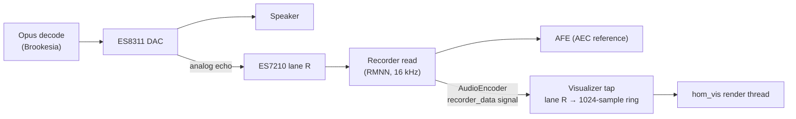

# 6. Avatar — Circular Audio Visualizer (Phase 2)

| | |
| --- | --- |
| Document | HOM-SPEC-06 |
| Status | Draft 0.2 (2026-11-08) |
| Supersedes | Procedural face for Phase 2 (D-20); face spec kept as [06-avatar-face-deferred.md](06-avatar-face-deferred.md) |

## 6.1 Scope

| In scope | Out of scope (deferred) |
| --- | --- |
| Ring waveform of the device's audio output (speaker) | Procedural face, emotes, `avatar.express` rendering |
| Colour per UI state (Offline, Idle, Listening, Thinking, Speaking) | Microphone input visualisation |
| Direct panel rendering, no LVGL | Captions, overlays, cards, QR codes |
| | HDP `avatar{emote}` handling; `hello.capabilities.avatar` is not sent |

Visual reference: the circular spectrum of `lv_demo_music` in the Waveshare 1.75 MusicPlayer firmware (`firmware/brookesia/components/MusicPlayer/gui_music/lv_demo_music_main.c`, mirrored radial bars, colour stops by radius). That example uses LVGL and precomputed spectrum tables; Homunculus renders a live waveform without LVGL.

## 6.2 Signal source

| Item | Value |
| --- | --- |
| Source | DAC echo lane of the raw recorder data (the AEC reference): the speaker signal after volume, in time with the speaker |
| Access | `service::AudioEncoder::get_instance(0)->connect_recorder_data()`; published only while the encoder runs (always, for WakeNet) |
| Format | 16 kHz; per sample frame `BITS / 16 × CHANNELS` int16 lanes (1.75C: 32 bit × 2 ch = 4 lanes, layout `RMNN`) |
| Lane | Index of `R` in `CONFIG_BROOKESIA_HAL_ADAPTOR_AUDIO_CODEC_RECORDER_MIC_LAYOUT`; no `R` → flat ring |
| Tap cost | Copy of one lane into a 1024-sample ring buffer in the recorder task |

## 6.3 Rendering

### 6.3.1 Geometry and signal mapping

| Parameter | Value |
| --- | --- |
| Base radius | 0.30 × min(w, h) (1.75C: 140 px) |
| Full-scale deflection | ± 0.16 × min(w, h) (± 75 px) |
| Points | 96 per half circle, top to bottom; left half mirrored (closed, seamless, symmetric) |
| Window | Last 480 samples (30 ms), DC removed; point k = mean of samples 5k…5k+4 |
| Normalisation | Divide by a peak envelope: instant attack, ×0.967 per frame release (~1 s at 30 fps), floor 1500 (int16) |
| Smoothing per point | Attack 0.6, release 0.25 per frame |
| Silence gate | RMS < `HOMUNCULUS_VIS_GATE_DBFS` (−55 dBFS): targets 0; below 0.01 deflection the ring snaps flat |
| Line | Soft round stamp, radius 3 px (solid core 1 px, falloff), every 1.5 px along each segment, max-blend |
| Colour index | 8 levels by \|deflection\| × 8 (base ring → largest deflection), interpolated along segments |

### 6.3.2 State palettes

Three colour stops (base → mid → peak deflection), scaled by brightness and by stamp intensity (64 levels).

| UI state | Stops (RGB) | Brightness |
| --- | --- | --- |
| Offline | `303030` → `606060` → `909090` | 0.6 |
| Idle | `00a050` → `40e080` → `c0ffd0` | 0.45 |
| Listening | `00c060` → `60ff90` → `e0ffe0` | 1.0 |
| Thinking | `1040e0` → `30a0ff` → `c0e8ff` | 1.0 |
| Speaking | `c020e0` → `6f8af6` → `e9dbfc` (mid/peak from `lv_demo_music`) | 1.0 |

The waveform is drawn in every state whenever the reference lane is above the gate (e.g. a late tail of speech after barge-in shows in the Listening palette).

### 6.3.3 Rasterisation and flush

- Only the right half is rasterised; stamps crossing the vertical axis are reflected.
- Per band of 10 rows (Brookesia max transfer: 10 lines × 466 px × 2 B = 9320 B): intensity plane and colour-index plane (233 × 10 B each, PSRAM), converted through a 8 × 64 LUT into byte-swapped RGB565 in one internal DMA buffer (9320 B), flushed with `draw_bitmap_sync` (100 ms timeout).
- Per band the flushed columns are the union of this frame's and the previous frame's drawn columns: one rectangle across the axis, or two (left and right arc). Bands with neither are skipped.
- CO5300: rectangle x start and width rounded to even.
- Frame rate `HOMUNCULUS_VIS_FPS` (30) while the ring is deflected or the state changed; otherwise the thread polls every 50 ms without drawing.
- Host measurement (`test/host/run.sh`, synthetic speech): 73 k px flushed per speech frame (34 % of 466²); flat ring: 17.6 k px.

### 6.3.4 Thread and memory

| Item | Value |
| --- | --- |
| Thread | `hom_vis`, prio 3, no core affinity, 6 KB stack in PSRAM |
| Internal RAM | 9320 B DMA buffer + 2 KB tap ring buffer |
| PSRAM | 2 × 2330 B planes, renderer state (~5 KB) |
| Ownership | After `Visualizer::start()` the render thread does all panel drawing; it clears the screen once at start |
| Fallback | Visualizer disabled or start failure (panel not 16 bpp or odd width, allocation failure): solid state colours (Phase 1 behaviour) |
| Stats | `[stats] visualizer N frames, avg X ms, max Y ms` with each system stats line |

## 6.4 Code

| Path | Content |
| --- | --- |
| `firmware/components/homunculus_avatar/src/ring_renderer.{hpp,cpp}` | Platform-independent rasteriser (signal mapping, palettes → LUT, bands, flush rectangles) |
| `firmware/components/homunculus_avatar/src/visualizer.cpp` | Reference-lane tap, render thread, state palettes, stats |
| `firmware/components/homunculus_avatar/test/host/` | Host test: flat ring geometry, mirror symmetry, rectangle alignment, erase on silence; optional PPM contact sheet |

Kconfig (`Homunculus visualizer` menu):

| Option | Default | Meaning |
| --- | --- | --- |
| `HOMUNCULUS_VISUALIZER` | y | Ring visualizer; n = solid state colours |
| `HOMUNCULUS_VIS_FPS` | 30 | Frame rate while the ring moves |
| `HOMUNCULUS_VIS_GATE_DBFS` | −55 | Silence gate (RMS of the reference lane) |

## 6.5 Phase 2 exit criteria

| Criterion | Status |
| --- | --- |
| Ring follows speaker output during agent speech, in time with the audio | Pending hardware |
| ≥ 25 fps during speech (`[stats] visualizer`) | Pending hardware |
| Palette changes with UI state | Pending hardware |
| No added downlink underruns or AFE overruns; CPU per core and internal heap minimum measured against p1d (§8.7) | Pending hardware |
| Reference lane carries the speaker signal (lane `R` of `RMNN`) | Pending hardware |
