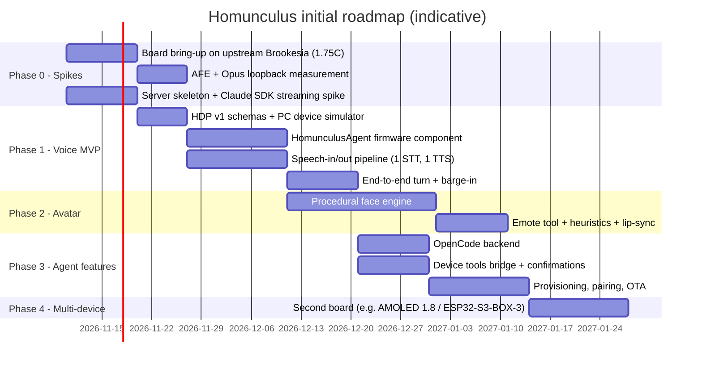

# 8. Implementation Roadmap, Risks and Open Items

| | |
| --- | --- |
| Document | HOM-SPEC-08 |
| Status | Draft 0.1 |

## 8.1 Proposed repository layout

```text
homunculus/
├── docs/                         # this documentation
├── firmware/                     # ESP-IDF project
│   ├── main/                     # app entry, wiring
│   ├── components/
│   │   ├── homunculus_agent/     # agent::Base subclass + HDP client
│   │   ├── homunculus_avatar/    # procedural face engine (LVGL)
│   │   ├── homunculus_tools/     # device tool registry
│   │   └── homunculus_boards/    # board extras / overrides (e.g. 1.75C flash size, mic layout)
│   ├── partitions/
│   └── sdkconfig.defaults.<board>
├── server/                       # TypeScript (Node.js ≥ 22)
│   ├── src/gateway/              # WSS, HDP codec, Opus
│   ├── src/orchestrator/
│   ├── src/inference/            # AgentBackend + claude/ + opencode/
│   ├── src/speech/               # stt/, tts/, vad/, shaper/
│   ├── src/tools/                # avatar MCP, device bridge, meta tools
│   └── src/admin/
├── protocol/                     # HDP JSON schemas, shared test vectors
└── tools/                        # device simulator (PC client speaking HDP), asset pipeline
```

## 8.2 Phases



| Phase | Exit criteria |
| --- | --- |
| 0 — Spikes | Display + touch + audio running on upstream Brookesia board def; measured AFE CPU load; Claude SDK partial streaming + interrupt verified |
| 1 — Voice MVP | Wake word → answer by voice with web search; barge-in works; latency measured per stage |
| 2 — Avatar | All states and emotes rendered ≥ 20 fps; lip-sync; agent drives emotions |
| 3 — Agent features | Backend switchable (Claude / OpenCode); device tools; confirmation flow; Wi-Fi provisioning + pairing; OTA |
| 4 — Multi-device | Second board with different display shape runs the same firmware and server unchanged |

## 8.3 Risks

| ID | Risk | Impact | Mitigation |
| --- | --- | --- | --- |
| R-01 | ESP32-S3 CPU/RAM insufficient for AFE + Opus + Wi-Fi + 30 fps avatar simultaneously | Choppy audio or animation | Measure in Phase 0; dirty-rect rendering; lower fps while listening; single-mic AFE mode |
| R-02 | Brookesia 0.8 API churn (master in active development) | Rework | Pin component versions; isolate Brookesia behind thin adapters |
| R-03 | End-to-end latency > 2.5 s with agent harness overhead | Poor UX | Prewarm, fast model profile, immediate acknowledgement emote/earcon, filler phrases |
| R-04 | Agent harness outputs are long / markdown-heavy | Unnatural speech | Persona system prompt + Speech Shaper + summary-first rule |
| R-05 | Prompt injection via web content leading to side effects | Security | Permission policy, on-device confirmation, default-deny host tools |
| R-06 | Small speaker + enclosure resonance degrade AEC | Barge-in false triggers (measured: 5 VAD starts in 19.6 s of playback at 100 % volume) | AEC tuning, ES8311 output gain limits, VAD thresholds during playback; barge-in via wake word or touch instead of VAD while speaking |
| R-07 | Flash size differs between units or batches (schematic: 16 MB part) | Partition errors | `esptool flash_id` per unit; upstream board definition sets 16 MB, Homunculus overrides to 32 MB (D-06) |
| R-08 | CPU-only STT on the development laptop (Whisper is not natively streaming) exceeds the latency budget | Slow turns during early phases | Small/turbo model with whisper.cpp; measure per stage; move STT to a GPU host later (D-01) |
| R-09 | "Computer" is a common word and may false-trigger during normal conversation or TV | Unwanted activations | Tune WakeNet threshold; optional server-side verification; custom "Hey Claudia" model as fallback (D-03) |

## 8.4 Open items

| ID | Question | Owner / next step |
| --- | --- | --- |
| OI-01 | Actual flash size on shipping 1.75C units (schematic: 16 MB part; vendor: 32 MB) | **Decided** → D-06 |
| OI-02 | Two-mic AFE (beamforming/DOA) feasibility and CPU cost on S3 | Single-mic AFE measured (research notes, p0b); two-mic layout not yet measured |
| OI-03 | Brookesia version: stay on v0.7 or go directly to v0.8 | **Decided** → D-07 |
| OI-04 | Can `brookesia_agent_xiaozhi` target a custom server without XiaoZhi OTA/activation? (would enable a protocol-compatible early spike) | **Answered**: yes, via `CONFIG_XIAOZHI_OTA_URL` + a server-side OTA stub (research notes) |
| OI-05 | STT/TTS default providers (local vs cloud) and target languages | **Decided** → D-01, D-02 |
| OI-06 | Custom wake word "Homunculus" (WakeNet custom model via Espressif) vs stock wake word | **Decided** → D-03 |
| OI-07 | Persona definition: name, voice, personality, default emotional range | **Decided** → D-04 (default emotional range still to be detailed in Phase 2) |
| OI-08 | Server hosting: LAN-only vs remote access (tunnel / reverse proxy) | **Decided** → D-05 |
| OI-09 | Memory: rely on backend session memory, or add long-term memory MCP server | Phase 3 |

## 8.5 Decisions

Product decisions taken on resolved open items. Decided 2026-11-07.

| ID | Decision | Notes |
| --- | --- | --- |
| D-01 | **STT: local Whisper** (whisper.cpp, CPU) | Server starts on a development laptop without a GPU. Move to faster-whisper on a GPU host later; provider stays configurable (§5.4.1). |
| D-02 | **TTS: local Kokoro**, provider configurable; **language: English** | Default voice a British female Kokoro voice (e.g. `bf_emma`; final pick by listening test). Piper remains the configured fallback. German is planned later. |
| D-03 | **Wake word: "Computer"** (stock WakeNet9 model `wn9_computer_tts`) | No custom model for now. A custom "Hey Claudia" (Espressif TTS-trained model or microWakeWord) remains an option if false triggers are a problem (R-09). |
| D-04 | **Persona: "Claudia"**: female, British voice, dark British humour | Exactly one persona for now, but personas must be **data, not code**: a persona definition (name, system prompt / personality, TTS provider + voice, language, emotional range, wake word) is loaded by the server and referenced from the device profile (§5.7), so more personas can be added later without code changes. The wake word is the only device-side persona attribute (model on device). |
| D-05 | **Hosting: LAN only** | Remote access (tunnel / reverse proxy) is deferred. Keep the server URL configurable, not hard-wired to mDNS, so remote access can be added later. |
| D-06 | **Flash: 32 MB** | Measured 2026-11-07 (`esptool flash_id`): ESP32-S3 (QFN56) rev v0.2, 8 MB embedded PSRAM, flash GigaDevice JEDEC `c8`/`4019`, 32 MB. Upstream board definition sets 16 MB; Homunculus overrides flash size and partition table. |
| D-07 | **ESP-Brookesia 0.8.x + ESP-IDF 6.x** | Latest released versions. Brookesia 0.8 requires IDF ≥ 6.0, ≤ 6.2 on ESP32-S3. Component versions pinned in §3.1. |
| D-08 | **Latency target (interim): ≤ 3 s to first spoken sentence** | Replaces the §5.5 budget until Phase 1 measurements. |
| D-09 | **Web lookups are announced** | Persona voice rule: one short sentence ("Let me look that up") before any web search/fetch. Measured: first sentence 3.2 s instead of 26.6 s. Orchestrator filler (§5.5) remains the fallback. |
