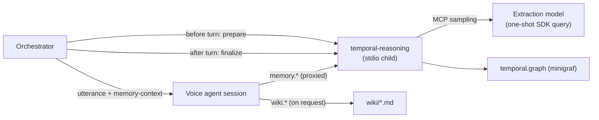

# 10. Long-term Memory

| | |
| --- | --- |
| Document | HOM-SPEC-10 |
| Status | Draft 0.3 · 2026-11-08 (implemented) |
| Phase | 3D (spec 08 §8.2) |
| Decision | D-23 (revised 2026-11-08) |

## 10.1 Components

| Component | Content | Storage | Written by |
| --- | --- | --- | --- |
| Temporal graph (primary memory) | Bi-temporal facts about the user: preferences, decisions, personal facts, with valid time and transaction time | `temporal.graph` (minigraf), fact index `temporal.graph.fts.sqlite3` | Per-turn extraction (§10.4.3); voice agent via `memory` tools |
| temporal-reasoning MCP server | Datalog query / transact / retract over the graph, per-turn prepare / finalize | Python stdio child of the backend (`uvx temporal-reasoning==0.9.0`) | — |
| Wiki | Entities and concepts the user explicitly asks to keep ("who / what is X") | Markdown pages under `wiki/` | Voice agent via `wiki` tools, on the user's request |
| Memory tools | `memory` (proxied temporal-reasoning tools), `wiki` | In-process MCP servers of each agent session | — |

Claude Code memory is not used: agent sessions run with `settingSources: []`, `autoMemoryEnabled: false` and `CLAUDE_CODE_DISABLE_AUTO_MEMORY=1` (no CLAUDE.md, no auto-memory directory).



## 10.2 Memory space

| Item | Value |
| --- | --- |
| Scope | One memory space per profile (`profiles.memory_space`, default `default`); devices sharing a profile share memory |
| Selection (no profiles table yet, spec 05 §5.7) | `HOMUNCULUS_MEMORY_SPACE` (default `default`), one space for all devices |
| Space name | `[a-z0-9-]{1,64}` |
| Root | `${HOMUNCULUS_MEMORY_DIR}/<space>/` (default `server/.data/memory`) |
| Versioning | Root is a git repository; one commit per wiki change (message = change, e.g. `wrote entity max`); `*.graph*` excluded via `.gitignore` (bi-temporal history of its own); committer `homunculus <homunculus@localhost>` |
| Enable | `HOMUNCULUS_MEMORY=1` (default on); `0` → no MCP child, no tools, no prepare / finalize |
| Timezone | `HOMUNCULUS_TIMEZONE` (IANA; default host zone): prompt time, extraction date resolution |

Layout:

```text
<space>/
├── temporal.graph                 # minigraf graph (§10.4)
├── temporal.graph.fts.sqlite3     # temporal-reasoning fact index (prepare retrieval)
├── wiki/
│   ├── entities/<slug>.md         # people, places, pets, organisations, projects, devices
│   └── concepts/<slug>.md         # topics, interests, routines
└── .gitignore                     # *.graph*
```

## 10.3 Wiki

### 10.3.1 Page format

```markdown
---
type: entity            # entity | concept
kind: person            # [a-z][a-z0-9-]{0,31}
title: Max
aliases: [brother, Max]
summary: The user's brother and housemate, a carpenter who loves sailing.   # ≤ 120 chars
created: 2026-11-08     # set by the server
updated: 2026-11-08     # set by the server
sources: []
facts: [:constraint/brother-max]                                           # related graph idents
---

## Summary
## Details        (H2 sections; any)
## Related        [[slug]] links
```

| Rule | Value |
| --- | --- |
| Slug | `[a-z0-9-]{1,64}`, unique across `entities/` and `concepts/` |
| Size | ≤ 8 KB per page |
| Written | Only when the user asks for something to be kept in the wiki (system prompt rule, §10.5) |
| Manual edits | Picked up by a file watcher (search index rebuilt) |

### 10.3.2 Search

In-memory BM25 over pages (field weights: title, slug and aliases 3; summary and H2 headings 2; body 1); results list the H2 sections containing a query term.

## 10.4 Temporal graph

| Item | Value |
| --- | --- |
| Server | temporal-reasoning 0.9.0 (PyPI, MIT; github.com/project-minigraf/temporal_reasoning), minigraf engine |
| Process | One stdio child per memory space, started at backend start, owned by the backend; restarted on the next call after it exits |
| Command | `uvx temporal-reasoning==0.9.0` (override `HOMUNCULUS_MEMORY_MCP`); `uv` from the nix `server` shell; `PYTHON*` variables removed from the child environment; cwd = space root |
| Child environment | `MINIGRAF_GRAPH_PATH=<space>/temporal.graph`, `MINIGRAF_NO_AUTO_INGEST=1`, `MINIGRAF_EXTRACTION_STRATEGY=agent` |
| Startup | ≈ 0.4 s (package in uv cache; `make memory-mcp`, part of `make setup`) |
| Call timeout | 30 s; finalize 120 s |

### 10.4.1 Fact model

| Item | Value |
| --- | --- |
| Fact | Triple `[entity attribute value]` with valid time (`valid_at` on transact / retract) and transaction time |
| Entity namespaces accepted | `:preference/` (likes, dislikes, name, how to be addressed), `:decision/` (choices, plans), `:constraint/` (other lasting personal facts: people, places, routines, appointments, restrictions), `:dependency/` (devices, services) |
| Attributes accepted | `:description` (required), `:rationale`, `:alias`; `:date` on `:decision/` only; `:entity-type` |
| Rejected | Other namespaces (e.g. `:person/`) and attributes: the whole transact fails with a schema violation |
| Dates and times | Absolute date in the description ("on Tuesday 10 November 2026 at 10:00") |
| Change | Retract (mode `close`: valid window ends, history kept) then transact the new value |
| Error / forget | Retract with mode `correct` (removed from valid-time history; visible to `:as-of` only) |

### 10.4.2 Agent tools (`memory` server)

Proxies of the server's tools (names, descriptions, schemas as listed by the server); policy `allow`.

| Tool | Use |
| --- | --- |
| `minigraf_query` | Datalog; `:valid-at`, `:as-of`, `:any-valid-time`, `:db/valid-from` / `:db/valid-to` window binding |
| `minigraf_transact` | Store facts (`facts`, `reason`, optional `valid_at`) |
| `minigraf_retract` | Close or correct facts (`facts`, `reason`, `mode`, optional `valid_at`) |
| `minigraf_rule` | Register a Datalog rule (server session lifetime) |

Not exposed: `minigraf_ingest_git`, `minigraf_ingest_status`, `minigraf_audit`, `minigraf_report_issue`, `memory_prepare_turn`, `memory_finalize_turn`.

### 10.4.3 Per-turn hooks

Host-side equivalents of temporal-reasoning's Claude Code hooks (`UserPromptSubmit`, `Stop`).

| Hook | When | Call | Effect |
| --- | --- | --- | --- |
| Prepare | User utterance final, before the agent send (in parallel with the agent session wait) | `memory_prepare_turn(user_message)` | Result (one line per matching entity, historical facts with their window) sent as `<memory-context>` before the utterance; skipped after 800 ms or on error |
| Finalize | After each completed or interrupted turn with a reply (`Conversation.onTurn`) | `memory_finalize_turn("User: …\nAssistant: …")`; interrupted reply = heard part + `(interrupted)` | Server sends an MCP sampling request (extraction prompt with existing entities); answer transacted. Calls queued in turn order, not awaited by the turn |

Sampling answer:

| Item | Value |
| --- | --- |
| Model | `HOMUNCULUS_MEMORY_MODEL` (default `claude-sonnet-5-5`) |
| Call | One-shot Agent SDK `query()`: no tools, `maxTurns: 1`, thinking disabled, no settings / auto-memory; returns on the first assistant message (≈ 5–8 s) |
| System prompt | Personal-assistant mapping of the allowed namespaces (§10.4.1); store only what the user said or confirmed; output only the block; ambiguous details stored as said; one triple per vector; absolute dates; current local date and timezone |
| Normalisation | Block taken from a code fence or surrounding prose; vectors with several attribute / value pairs split into triples; `; valid-at:` line kept |

## 10.5 Session prompt

Appended to the persona system prompt at each agent session open:

| Part | Content |
| --- | --- |
| Time | Local date and time (`HOMUNCULUS_TIMEZONE`) and ISO UTC |
| Memory rules | `<memory-context>` use; facts the user states (including "remember …") are stored by finalize: the agent acknowledges and does not write them; the agent writes only to change, correct or forget a fact; tools are not announced |
| Fact rules | Namespaces, attributes, idents (lowercase, hyphens), entity reuse lookup, query examples (current, `:valid-at`, history with windows), retract modes |
| Wiki rules | Write only on the user's explicit request; facts still go to the graph |
| Wiki pages | Index lines (≤ 40) |

## 10.6 Wiki tools (`wiki` server)

| Tool | Args | Policy |
| --- | --- | --- |
| `index` | `type?`, `kind?` | allow |
| `search` | `query`, `limit?` (≤ 20) | allow |
| `read` | `slug`, `section?` | allow |
| `write_page` | `slug`, `meta` (type, kind, title, aliases, summary, facts), `body` (≤ 8000 chars) | allow |
| `patch_section` | `slug`, `heading`, `content`, `mode?` (`replace` / `append`) | allow |
| `rename` | `from`, `to` (rewrites `[[links]]`) | allow |
| `merge` | `from`, `into` (aliases, facts, sections; rewrites links; deletes `from`) | allow |
| `delete` | `slug` | ask (device confirmation) |

`memory` and `wiki` tool calls do not trigger the filler phrase (`quietTool`).

## 10.7 Privacy and control

| Item | Value |
| --- | --- |
| Location | All memory files local to the server host (D-05) |
| Content sent off-host | Memory context, tool results and the wiki index as part of agent prompts; each exchange to the extraction model (finalize) |
| Package fetch | `uvx` downloads temporal-reasoning and its dependencies from PyPI once (uv cache) |
| Forget | Agent retracts with mode `correct` |
| Erase | `pnpm memory erase [space]` (deletes the space directory; server stopped) |
| Inspect | `pnpm memory query '<datalog>' [space]` (server stopped) |

## 10.8 Server layout

| Path | Content |
| --- | --- |
| `server/src/memory/space.ts` | Memory space resolution, directory layout, git commit |
| `server/src/memory/memory.ts` | Space facade: wiki, search, temporal-reasoning client, wiki commits |
| `server/src/memory/temporal-reasoning.ts` | MCP stdio client: child start / restart, tool proxies, prepare, finalize queue, sampling handler |
| `server/src/memory/sampler.ts` | Sampling answer (one-shot SDK query), extraction guide, block normalisation |
| `server/src/memory/prompt.ts` | Memory section of the system prompt |
| `server/src/memory/tools.ts` | `wiki` MCP server tools |
| `server/src/memory/wiki.ts` | Page parse / validate / write, index lines, link rewrite |
| `server/src/memory/search.ts` | BM25 index |
| `server/src/memory/cli.ts` | Admin CLI (`pnpm memory <query|erase> [space]`) |
| `server/test/fixtures/fake-temporal-mcp.mjs` | Test stand-in for the temporal-reasoning server (same tool names, sampling on finalize) |

## 10.9 Open items

| ID | Question | Next step |
| --- | --- | --- |
| OI-14 | Proactive reminders for appointments (server-initiated speech, HDP message) | Specify with timers (`device.set_timer`) |
| OI-15 | Speaker identification for multi-person households | Defer; facts are about the primary user unless named |
| OI-16 | minigraf native addon inside the nix dev shell | **Resolved** 2026-11-08 (addon no longer used in-process; minigraf runs inside the temporal-reasoning child) |
| OI-17 | No person / place namespace in temporal-reasoning's schema; personal facts stored under `:constraint/` | Revisit when the server schema allows custom types |
