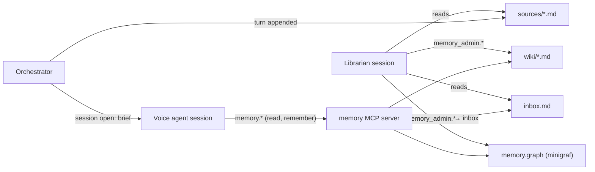

# 10. Long-term Memory

| | |
| --- | --- |
| Document | HOM-SPEC-10 |
| Status | Draft 0.2 · 2026-11-08 (implemented) |
| Phase | 3D (spec 08 §8.2) |
| Decision | D-23 |

## 10.1 Components

| Component | Content | Storage | Written by |
| --- | --- | --- | --- |
| Source log | Verbatim turns (transcript, response text, tool calls) per session | `sources/YYYY-MM-DD/<session-id>.md`, append-only | Orchestrator, after each turn |
| Wiki | Entities and concepts: descriptive knowledge ("who / what is X") | Markdown pages under `wiki/` | Librarian |
| Temporal store | Decisions, preferences, events with valid time and transaction time ("what was true / decided, when") | minigraf `.graph` file | Librarian |
| Brief | Compact summary loaded into every agent session | `wiki/brief.md` | Librarian |
| Memory tools | Read access for the voice agent; write access for the librarian | In-process MCP servers `memory`, `memory_admin` | — |
| Librarian | Background agent: ingest, curate, lint | Separate Claude Agent SDK session | — |



## 10.2 Memory space

| Item | Value |
| --- | --- |
| Scope | One memory space per profile (`profiles.memory_space`, default `default`); devices sharing a profile share memory |
| Selection (no profiles table yet, spec 05 §5.7) | `HOMUNCULUS_MEMORY_SPACE` (default `default`), one space for all devices |
| Space name | `[a-z0-9-]{1,64}` |
| Root | `${HOMUNCULUS_MEMORY_DIR}/<space>/` (default `server/.data/memory`) |
| Versioning | Root is a git repository; one commit per librarian run (message = run id + run type, `(failed)` suffix on failure); `memory.graph*` excluded via `.gitignore` (own history); committer `homunculus <homunculus@localhost>` |
| Enable | `HOMUNCULUS_MEMORY=1` (default on); `0` → no tools, no brief, no source log |
| Timezone | `HOMUNCULUS_TIMEZONE` (IANA; default host zone): brief, event times, librarian prompt |

Layout:

```text
<space>/
├── sources/YYYY-MM-DD/<session-id>.md   # turn log (append-only; redaction only)
├── inbox.md                             # pending memory.remember / memory.forget notes
├── wiki/
│   ├── SCHEMA.md                        # page conventions for the librarian (data, editable)
│   ├── index.md                         # one line per page: [[slug]] — summary
│   ├── brief.md                         # session brief (§10.5)
│   ├── log.md                           # append-only librarian run log
│   ├── entities/<slug>.md               # people, places, devices, pets, organisations, projects
│   └── concepts/<slug>.md               # topics, interests, routines, recurring themes
└── memory.graph                         # temporal store (§10.4)
```

Source log:

| Item | Value |
| --- | --- |
| Session id | `HHMMSS-<6 hex>` (UTC start time), one per device connection; file under the UTC start date |
| Turn ref | `YYYY-MM-DD/<session-id>#t<n>`, n from 1 |
| Turn | `## t<n> · <ISO>`, then one line each: `**User:**`, `**Assistant:**`, `**Tools:**` (tool names), `**Interrupted; heard:**`, `**Error:**`; whitespace collapsed to one line |
| Written | After each completed or interrupted turn with a non-empty transcript (`Conversation.onTurn`) |
| Redacted turn | Content lines replaced by `**Redacted:** <ISO>` |

## 10.3 Wiki

### 10.3.1 Page format

```markdown
---
type: entity | concept
kind: person | place | pet | organisation | project | device | topic | routine | …
title: Alice
aliases: [Ali, my sister]
summary: User's younger sister; lives in Graz.        # ≤ 120 chars, copied to index.md
created: 2026-11-08
updated: 2026-11-08
sources: [2026-11-08/3f2a…#t4]                         # source log refs (session#turn)
facts: [pref:9c1e…, event:77ab…]                       # temporal store entity ids
---

## Summary
## Details        (H2 sections; any)
## Related        [[slug]] links
```

| Rule | Value |
| --- | --- |
| Slug | `[a-z0-9-]{1,64}`, unique across `entities/` and `concepts/` |
| Links | `[[slug]]`; unresolved links allowed (lint lists them) |
| Size | Page ≤ 8 KB; larger → split into sub-pages |
| Time-varying statements | Not stored as prose; stored in the temporal store and referenced in `facts` |
| `index.md` | Generated: one line per page `- [[slug]] (kind) — summary`, grouped by type, sorted by slug |
| `created` / `updated` | Set by the server on write (`created` kept) |
| Frontmatter arrays | YAML flow sequences |
| Malformed page | Skipped at load |

### 10.3.2 Search

| Item | Value |
| --- | --- |
| Index | In-memory BM25 (k1 1.2, b 0.75) over title, aliases, summary, headings, body; field weights by repetition: title + slug + aliases ×3, summary + headings ×2, body ×1; English stop words dropped; built at startup, updated on page write, rebuilt on manual edit (recursive `fs.watch`, 200 ms debounce) |
| Result | slug, title, kind, summary, matching section headings, score |
| Limit | 8 results default, 20 max |

## 10.4 Temporal store

| Item | Value |
| --- | --- |
| Engine | minigraf 2.0.11 (Rust, napi-rs native addon `minigraf`; `@minigraf/linux-x64-gnu`); MIT OR Apache-2.0; native addon loads in the nix `server` shell (OI-16) |
| Model | Bi-temporal EAV datoms: transaction time (tx counter, recorded-at) + valid time (`:valid-from` / `:valid-to`, ISO 8601 UTC) |
| Query | Datalog (EDN); `:as-of` (tx time, ISO), `:valid-at` (valid time), `:any-valid-time`; default valid time = now |
| Transaction time | Wall clock, millisecond resolution |
| Entity ids in results | UUIDs derived from the entity keyword; keyword not returned |
| Valid window in queries | Not bindable in patterns; mirrored as attributes `:fact/valid-from`, `:fact/valid-to` |
| String predicates | `starts-with?`, `ends-with?`, `contains?`, `matches?`; comparison on strings (`<`, `>=`) |
| File | `memory.graph`; one handle per process (minigraf constraint) — opened once by the server, `checkpoint()` after each librarian run, `close()` on shutdown |
| Fact size | ≤ 4080 serialised bytes per fact (file-backed limit) |
| Version pin | Exact `2.0.11`; v3.0.0 changes the file format (#371 fix) → migration by export/re-import |

### 10.4.1 Fact kinds

All entities are keywords `:<ns>/<uuid>`, ns `pref`, `decision`, `event`; fact id `<ns>:<uuid>`. Common attributes on every entity:

| Attribute | Type | Content |
| --- | --- | --- |
| `:fact/id` | string | Fact id `<ns>:<uuid>` |
| `:fact/kind` | keyword | `:preference`, `:decision`, `:event` |
| `:fact/subject` | string | Wiki slug the fact is about (`user` for the primary user) |
| `:fact/text` | string | One-sentence statement, speakable |
| `:fact/source` | string | Source log ref `YYYY-MM-DD/<session>#t<n>` |
| `:fact/stated-at` | string | ISO timestamp of the source turn |
| `:fact/confidence` | keyword | `:stated` (explicit), `:inferred` |
| `:fact/valid-from` | string | Valid-time start (mirror) |
| `:fact/valid-to` | string | Valid-time end (mirror); absent = open-ended |

| Kind | Attributes | Valid time |
| --- | --- | --- |
| Preference | `:pref/holder` (slug), `:pref/topic` (string, normalised, e.g. `coffee.milk`), `:pref/value` (string), `:pref/polarity` (`:likes` / `:dislikes` / `:neutral`) | From statement time (or stated start) until superseded |
| Decision | `:decision/topic`, `:decision/choice`, `:decision/reason`, `:decision/by` (slug) | From decision time until revised |
| Event | `:event/title`, `:event/where` (slug or string), `:event/with` (slug, one fact per value), `:event/recurrence` (RFC 5545 RRULE string, optional), `:event/remind` (bool) | Event interval (start, end); point event: end = start + 1 s |

### 10.4.2 Write rules

| Operation | Datalog | Notes |
| --- | --- | --- |
| Assert | `(transact {:valid-from "<t>" [:valid-to "<t2>"]} [[:pref/<uuid> :pref/value "oat milk"] …])` | One value per (entity, attribute) per transaction (#371): multi-valued `:event/with` values in further transactions; validated with zod; default valid-from = `stated_at` |
| Supersede | 1. `(retract …)` all datoms of the open-ended fact; 2. re-assert them with `:valid-to "<t>"`; 3. assert new entity with `:valid-from "<t>"` | Separate transactions; re-asserting with a new window does not replace the old one (#435); `t` > old valid-from; same kind |
| Correct (was recorded wrong) | Retract + assert with the original window | Transaction time keeps the wrong version (`:as-of`) |
| Forget | Retract all datoms of the entity | Remains visible under `:as-of`; full erase = rebuild file without it (§10.8) |

### 10.4.3 Query shapes (server-built)

| Question | Query |
| --- | --- |
| Current preferences of X on topic T | `:valid-at "<now>"`, `:fact/kind :preference`, `:pref/holder X`, `:pref/topic` prefix T |
| Preference history | `:any-valid-time`, same pattern, ordered by `:valid-from` |
| What did we believe at time T | `:as-of "<T>"` |
| Decisions on topic | `:fact/kind :decision`, `:decision/topic`, `:valid-at` or `:any-valid-time` |
| Upcoming events | `:fact/kind :event`, `:any-valid-time`; occurrences overlapping [now, now + N days]; recurring events expanded server-side from RRULE |

Built as one query per call, `[:find ?e ?a ?v <temporal> :where [?e :fact/kind _] [?e ?a ?v]]`, grouped by entity; subject, holder and topic filtered in process. Current facts (no temporal clause) cached until the next write.

RRULE subset: `FREQ` (DAILY, WEEKLY, MONTHLY, YEARLY), `INTERVAL`, `COUNT`, `UNTIL`, `BYDAY` (WEEKLY only); expanded in UTC from valid-from; occurrence duration = valid-to − valid-from.

## 10.5 Session brief

| Item | Value |
| --- | --- |
| Content | `### User` (page `user`: title, summary, sections except Related; ≤ 900 chars), `### Preferences` (current, top 20 by valid-from), `### Recent decisions` (current, valid-from in the last 30 days, ≤ 15), `### Upcoming events` (next 7 days, ≤ 15), `### Key pages` (10 most-referenced pages: inbound links + fact subjects; `user` excluded) |
| Size | ≤ 6000 chars (≈ 1500 tokens), truncated |
| Producer | Server, deterministically, at the end of each librarian run (`wiki/brief.md`); event section regenerated at session open (time-dependent) |
| Injection | Appended to the persona system prompt at every agent session open (including reopen after errors), after a `## Memory` heading, with the current date/time and the tool usage rule (§10.6); brief failure → persona prompt only |
| Per-turn injection | None |

## 10.6 Voice-agent tools (`memory` MCP server)

| Tool | Input | Output | Policy |
| --- | --- | --- | --- |
| `memory.index` | `type?`, `kind?` | `index.md` lines (filtered), ≤ 200 lines | allow |
| `memory.search` | `query`, `limit?` | Search results (§10.3.2) + matching facts (term overlap with text, subject, attribute values; all valid times) | allow |
| `memory.read` | `slug`, `section?` | Page frontmatter + body, or one H2 section; linked facts resolved to `:fact/text` + valid window | allow |
| `memory.facts` | `kind?`, `subject?`, `topic?` (key prefix or words), `at?` (ISO), `as_of?` (ISO), `history?` (bool), `from?`/`to?` (events; default to = from + 30 days) | Facts: id, kind, text, valid-from, valid-to, source; ≤ 100; without `at`/`as_of`/`history` also ≤ 20 superseded versions | allow |
| `memory.remember` | `text`, `kind_hint?` | Ack; note appended to `inbox.md`; librarian run scheduled (§10.7) | allow |
| `memory.forget` | `text` (what to forget) | Ack; forget request appended to `inbox.md` | ask on device (`confirm.request`) |

- Progressive disclosure order: brief (in prompt) → `memory.search` / `memory.facts` → `memory.read` (section first, full page if needed) → `memory.index`.
- Voice rule (persona prompt): use memory tools only when the answer depends on personal history; no announcement sentence (local, < 50 ms) — distinct from D-09.
- Replaces server meta-tool `homunculus.remember` (spec 05 §5.6).
- Agent-facing names: in-process MCP server `memory`, tools `index`, `search`, `read`, `facts`, `remember`, `forget` (`mcp__memory__<name>`); one tool set per device connection.
- Inbox line: `- <ISO> <remember|forget> [<kind_hint>] (<source ref>): <text>`; source ref = the turn in progress.
- Latency target: each read tool ≤ 50 ms server-side.

## 10.7 Librarian

| Item | Value |
| --- | --- |
| Backend | Claude Agent SDK, separate one-shot `query()` per run; not the device session |
| Model | `HOMUNCULUS_LIBRARIAN_MODEL` (default `claude-sonnet-5-5`) |
| Tools | `memory` read tools (`index`, `search`, `read`, `facts`) + `memory_admin`; no built-in tools (`tools: []`); permission mode `dontAsk`; `maxTurns` 80 |
| Instructions | Base prompt + `wiki/SCHEMA.md` (system prompt); run-type prompt with current time and user timezone |
| Concurrency | One run per memory space at a time; queued triggers coalesced |
| Run output | Wiki edits, temporal facts, regenerated `index.md` and `brief.md`, `log.md` entry, git commit, graph checkpoint |
| Skip | Ingest with no pending turns and empty inbox, lint with no findings: no agent run |
| Failure | Agent result not `success`: cursor and inbox unchanged (retried on next trigger); edits made so far committed; log entry `(failed)` |

`memory_admin` tools (librarian only; agent-facing names with `_` for `.`, e.g. `wiki_write_page`):

| Tool | Effect |
| --- | --- |
| `wiki.write_page` | Create / replace page (frontmatter validated, slug rule, size limit) |
| `wiki.patch_section` | Replace or append one H2 section |
| `wiki.rename` / `wiki.merge` | Rename slug or merge two pages; rewrites `[[links]]`, aliases, fact `:fact/subject` |
| `wiki.delete` | Delete page; links left unresolved |
| `facts.assert` | Assert a fact (§10.4.1 schema, zod-validated) |
| `facts.supersede` | Supersede procedure (§10.4.2) |
| `facts.retract` | Retract entity |
| `facts.query` | Raw Datalog query (read only; `:max-results 500`) |
| `sources.read` | Turns since cursor not yet returned in this run (≤ 40 000 chars per call, "more remain" marker), or one session |
| `sources.redact` | Redact one source turn by ref (forget) |
| `inbox.take` | Read inbox entries; removed from `inbox.md` when the run succeeds (entries added meanwhile stay) |

Run types:

| Run | Trigger | Steps |
| --- | --- | --- |
| Ingest | Session idle ≥ `HOMUNCULUS_LIBRARIAN_IDLE_MS` (default 600 000 ms) after its last turn; `memory.remember` / `memory.forget` (debounce 30 s) | Read new source turns + inbox → extract entities, concepts, preferences, decisions, events → update pages / assert or supersede facts → index, brief |
| Lint | Daily 04:00 local; after 20 ingests | Server report (orphans, unresolved links, duplicate titles/aliases, several open facts per kind + holder + topic, pages > 8 KB, past non-recurring events without valid-to, fact subjects without page, facts not listed on their subject page) → agent fixes or records in `log.md` |
| Rebuild | Admin CLI | Reload pages; rebuild `index.md`, search index, brief; no agent run |

Source cursor and run counters in `wiki/log.md` frontmatter:

| Key | Content |
| --- | --- |
| `ingested_before` | Date; sessions in earlier date directories are fully ingested |
| `ingested` | Last ingested `YYYY-MM-DD/<session>#t<n>` per session (later dates) |
| `ingests_since_lint` | Ingest runs since the last lint |
| `last_lint` | ISO time of the last lint |

`ingested_before` = min(today − 7 days, date of the oldest still-pending turn).

Queue: one run at a time per space; pending run types held as a set (ingest before lint before rebuild); idle timer per source session, inbox debounce timer; timers cleared on shutdown, running agent aborted.

## 10.8 Privacy and control

| Item | Value |
| --- | --- |
| Location | All memory files local to the server host (D-05) |
| Content sent off-host | Memory tool results and brief, as part of agent prompts to the model provider |
| Excluded from source log | Tool results (only tool names are logged); per-device recording switch: not implemented |
| Forget | `memory.forget` (confirmed on device) → librarian removes page content and retracts facts; source log lines redacted |
| Erase | Admin CLI `pnpm memory erase <space>` (deletes the space directory); `pnpm memory compact <space>` rewrites `memory.graph` from all current datoms at any valid time (retracted datoms and transaction-time history dropped) and squashes git history to one commit; server stopped |
| Manual edit | Pages are plain markdown; admin edits are picked up by the search index (file watcher) and respected by the librarian |

## 10.9 Server layout

| Path | Content |
| --- | --- |
| `server/src/memory/space.ts` | Memory space resolution, directory layout, git commit, history squash |
| `server/src/memory/memory.ts` | Space facade: wiki, search, temporal store, source log, inbox, `log.md` state |
| `server/src/memory/schema.ts` | Default `SCHEMA.md` |
| `server/src/memory/rrule.ts` | RRULE expansion |
| `server/src/memory/cli.ts` | Admin CLI (`pnpm memory <brief|ingest|lint|rebuild|compact|erase> [space]`) |
| `server/src/memory/source-log.ts` | Turn append (called by orchestrator after `done`) |
| `server/src/memory/wiki.ts` | Page parse/validate/write, index generation, link rewrite |
| `server/src/memory/search.ts` | BM25 index |
| `server/src/memory/temporal.ts` | minigraf handle, fact schema, query builders, supersede procedure |
| `server/src/memory/brief.ts` | Brief assembly (event section at session open) |
| `server/src/memory/tools.ts` | `memory` and `memory_admin` MCP servers |
| `server/src/memory/librarian.ts` | Triggers, run queue, SDK query |

## 10.10 Open items

| ID | Question | Next step |
| --- | --- | --- |
| OI-14 | Proactive reminders from `:event/remind` facts (server-initiated speech, HDP message) | Specify with timers (`device.set_timer`) |
| OI-15 | Speaker identification for multi-person households (`:pref/holder` other than `user`) | Defer; holder = `user` unless named in the utterance |
| OI-16 | minigraf native addon inside the nix dev shell (glibc / prebuilt binary) | **Resolved** 2026-11-08: `@minigraf/linux-x64-gnu` 2.0.11 loads in the nix `server` shell |
