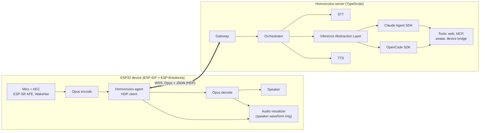

# Homunculus — Initial Specification

Draft 0.1 · 2026-11-07

| # | Document | Content |
| --- | --- | --- |
| 01 | [Overview and Requirements](01-overview.md) | Vision, scope, goals, functional and non-functional requirements, terminology |
| 02 | [System Architecture](02-system-architecture.md) | Context, responsibility split, containers, turn and barge-in sequences, deployment, architectural decisions |
| 03 | [Device Firmware](03-device-firmware.md) | ESP-IDF + ESP-Brookesia architecture, agent component, tasks, audio config, state machine, inputs, device tools, provisioning, OTA, power, portability |
| 04 | [Device Protocol (HDP)](04-device-protocol.md) | WebSocket transport, binary audio frames, capability negotiation, control messages |
| 05 | [Server](05-server.md) | Gateway, orchestrator, inference abstraction layer (Claude Agent SDK, OpenCode SDK), speech pipeline, tool hub, latency budget |
| 06 | [Avatar — Audio Visualizer](06-avatar.md) | Phase 2: circular waveform of the speaker output, state palettes, banded panel rendering |
| 06F | [Avatar — Procedural Face (Deferred)](06-avatar-face-deferred.md) | Layered avatar model, procedural face, states, emotion vocabulary, lip-sync |
| 07 | [Security and Privacy](07-security-and-privacy.md) | Threat model, privacy principles, authentication |
| 08 | [Roadmap and Open Items](08-roadmap-and-open-items.md) | Repo layout, phases, risks, open questions |
| 09 | [Apps and Launcher](09-apps-and-launcher.md) | Brookesia system/app stack, current usage, launcher plan, open items |
| — | [Research Notes](research-notes.md) | Background research on Brookesia, XiaoZhi, Agent SDKs, speech |

## Architecture at a glance

