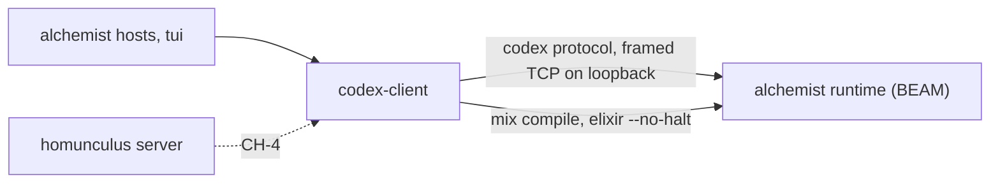

# Codex Client

**Planned** crucible/P-03

The package `@crucible/codex-client` is the one TypeScript way to reach the codex runtime. It starts or reuses the long-lived BEAM, sends the four codex operations to it, and offers them as a set of agent tools and as a command. The alchemist hosts and terminal UI use it; homunculus uses it for crucible/CH-4. It runs on Node, inside the consuming process.

Nothing in this package is built yet. The code it is extracted from is `projects/alchemist/core/elixir-bridge.ts`, `core/protocol.ts`, `hosts/shared/codex-tools.ts` and `scripts/cli.mjs`; the change is specified in [crucible/increments/repository-and-migration](../../../docs/increments/repository-and-migration.md) section 3.3.

| Document | Title |
| --- | --- |
| [crucible/packages/codex-client/requirements](requirements.md) | Requirements |
| [crucible/packages/codex-client/interfaces](interfaces.md) | Interfaces: library API and command line |
| [crucible/packages/codex-client/design](design.md) | Design |
| [crucible/packages/codex-client/verification](verification.md) | Verification |

## At a glance

## Dependencies

| Component | Uses | Interface |
| --- | --- | --- |
| crucible/alchemist/codex-protocol | The four operations and their wire form | [IFC](../../../projects/alchemist/docs/codex-protocol/interfaces.md) |
| crucible/alchemist/runtime | The Mix project it compiles and the process it starts | [Manifest](../../../projects/alchemist/docs/runtime/README.md) |
