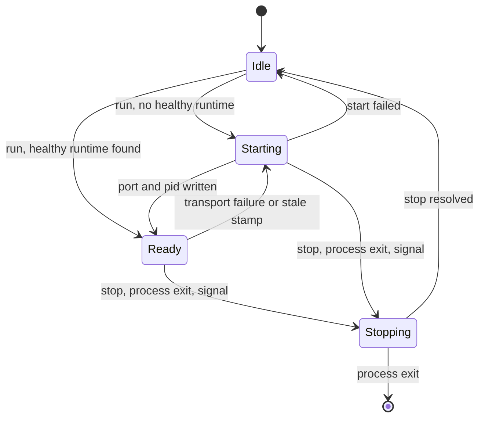
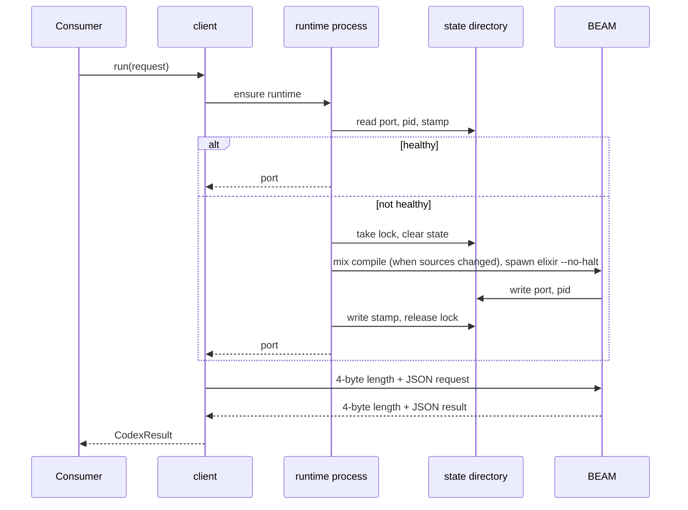

# Design

**Planned** crucible/P-03

The client keeps one runtime per state directory alive and talks to it over loopback TCP. The state directory is the shared record: any process that knows it finds the running BEAM, and a file lock makes starting it exclusive. The tool set and the command are thin layers over `run`. The mechanism is the one of `projects/alchemist/core/elixir-bridge.ts`; what changes is that the directories are options and that state is held per client instead of per module.

## 1 Module structure

| Module | Path | Responsibility | Satisfies |
| --- | --- | --- | --- |
| protocol | `packages/codex-client/src/protocol.ts` | `CodexRequest`, `CodexResult`, `CODEX_OPS`, `CODEX_TOOL_NAMES` | crucible/packages/codex-client/FR-001 |
| client | `packages/codex-client/src/client.ts` | `createCodexClient`: option resolution, `run`, `stop`, retry | crucible/packages/codex-client/FR-001, crucible/packages/codex-client/FR-004, crucible/packages/codex-client/FR-005, crucible/packages/codex-client/FR-006, crucible/packages/codex-client/FR-008 |
| runtime process | `packages/codex-client/src/runtime-process.ts` | Compile, start, wait, stop, state files, lock, attached lifecycle | crucible/packages/codex-client/FR-002, crucible/packages/codex-client/FR-003, crucible/packages/codex-client/FR-007 |
| rpc | `packages/codex-client/src/rpc.ts` | One framed request and response on a socket; limits | crucible/packages/codex-client/FR-001, crucible/packages/codex-client/OR-003 |
| tools | `packages/codex-client/src/tools.ts` | `codexTools`: schemas, policies, hooks | crucible/packages/codex-client/FR-009, crucible/packages/codex-client/FR-010, crucible/packages/codex-client/FR-011 |
| cli | `packages/codex-client/src/cli.ts` | The `codex` command | crucible/packages/codex-client/FR-012 |
| index | `packages/codex-client/src/index.ts` | The exports of the contract | - |

The package is `"type": "module"`, exports `./src/index.ts`, and is loaded as TypeScript source by its consumers, like `@homunculus/protocol`. Tests are `node:test` files beside the modules.

## 2 Data model

The state directory holds everything that identifies a runtime. No other state is persisted.

| File | Written by | Content |
| --- | --- | --- |
| `port`, `pid` | The runtime, when it accepts requests | Loopback port and BEAM pid |
| `stamp` | The client, after a successful start | Hash of the runtime sources (`mix.exs`, `mix.lock`, `lib/**/*.ex`: path, mtime, size), the memory path and the functions directory |
| `boot.log` | The runtime's standard error during start | Read for start errors |
| `lock` | The client, while starting | Exclusive-create file; a lock older than 30 s is taken over |
| build stamp | The client, after `mix compile` | The source hash the build in `_build/dev` belongs to |

A runtime is **healthy** when `port` and `pid` exist, the pid is alive and `stamp` equals the stamp the client computes. A changed source file, memory path or functions directory therefore replaces the runtime on the next request.

## 3 State and behaviour

| Rule | Detail |
| --- | --- |
| One start at a time | Inside a process, concurrent `run` calls share one start promise. Across processes, the lock file serialises starts; the second starter finds the healthy runtime and reuses it |
| Start | Take the lock; stop the runtime the state directory records (detached) or every runtime BEAM using this state directory (attached); clear the state files; compile when the source hash differs from the build stamp; spawn `elixir --no-halt` with the `ebin` paths of `_build/dev/lib` and `Application.ensure_all_started(:runtime, :permanent)`; wait for `port` and `pid`; write `stamp` |
| Spawn environment | The process environment plus `AGENT_FUNCTIONS_DIR` and `ALCHEMIST_STATE_DIR` set to the resolved directories; `MIX_ENV` removed; `ALCHEMIST_OWNER_PID` set to the consumer's pid when attached, removed when detached |
| Own session | The BEAM is spawned in its own session, so a terminal interrupt does not reach it |
| Attached lifecycle | The first client created in a process registers handlers for `exit`, `SIGINT` and `SIGTERM`. The first signal sends `SIGTERM` to the runtime, the second sends `SIGKILL` and exits the process with code 130. The runtime also exits by itself when `ALCHEMIST_OWNER_PID` is gone. `ALCHEMIST_RUNTIME_NO_SHUTDOWN_HOOK=1` suppresses the handlers |
| Shared runtime | An attached runtime belongs to the process that started it. Another process may use it; when the owner exits, the other process's next request fails at the transport and starts a new one (crucible/packages/codex-client/FR-004). A long-lived consumer such as the homunculus server runs detached or with its own state directory |
| Retry | A transport failure (connection refused, reset, closed without a response) discards the start promise and sends the request once more on a fresh runtime. Timeouts and results with `ok: false` are not retried |

## 4 Key flows

`call_function` in the tool set: `prepareCall(input)` -> `client.run({ op: "call", ... })` -> `presentResult(result, input)`, or the result as JSON text when no hook is given. The other three tools map their input to the request and return the result as JSON text.

## 5 Configuration

| Key | Type | Default | Meaning |
| --- | --- | --- | --- |
| `runtimeDir` / `ALCHEMIST_RUNTIME_DIR` | path | `projects/alchemist/runtime` in the workspace that contains the package | The runtime's Mix project |
| `functionsDir` / `AGENT_FUNCTIONS_DIR` | path | `functions` beside `runtimeDir` | Root of the codex entries |
| `stateDir` / `ALCHEMIST_STATE_DIR` | path | `.alchemist` inside `runtimeDir` | State directory |
| `detached` / `ALCHEMIST_RUNTIME_DETACHED` | boolean (`1`, `true`, `0`, `false`) | `true` when `NODE_ENV=production`, otherwise `false` | Whether the runtime outlives the process |
| `ALCHEMIST_RUNTIME_NO_SHUTDOWN_HOOK` | `1` | unset | Do not register the attached exit handlers |
| `AGENT_MEMORY_PATH` | path | unset | Read by the runtime, not by the client; it is part of the stamp, so changing it replaces the runtime |

An option wins over its environment variable, which wins over the default. `ALCHEMIST_RUNTIME_DIR` is new; the other variables exist today. Today the bridge always passes the repository `functions/` directory to the runtime and ignores `AGENT_FUNCTIONS_DIR` from the environment for that; the package honours the variable.

Fixed limits: start timeout 120 s, request timeout 120 s, response size 10 MB, lock takeover after 30 s.

## 6 Error handling

| Failure | Detected by | Response |
| --- | --- | --- |
| `elixir` or `mix` not found | Spawn error | `ok: false` with the spawn error and a hint to use the dev shell |
| Compile error | `mix compile` exit status | `ok: false` with the compiler output |
| Runtime exits during start | Child exit before `port` appears | `ok: false` with the tail of `boot.log` |
| Start timeout | 120 s without `port` | `ok: false`; the child is terminated |
| Lock held by a dead starter | Lock older than 30 s | The lock is removed and taken |
| Transport failure | Socket error or close before a full response | One restart and retry, then `ok: false` |
| Request timeout, oversized or invalid response | Socket timeout, length prefix, JSON parse | `ok: false`; no retry |
| Request while stopping | Stop counter | `ok: false`, `runtime is shutting down` |
| Hook throws | `try` around `prepareCall` and `presentResult` | Tool output with `ok: false` and the error text |

## 7 Extension points

| Point | How |
| --- | --- |
| Call hooks | `prepareCall` and `presentResult` of `codexTools`. Alchemist passes its host flags, default byte limits and result digest through them; they move to `packages/agent` with crucible/P-05 |
| Additional tools | A consumer appends its own tools to the array `codexTools` returns. The alchemist handoff tool is such a tool and stays in alchemist |
| Operation subset and policy | `operations` and `policy` of `codexTools`; homunculus leaves out `define` or sets it to `ask` (crucible/AD-21) |
