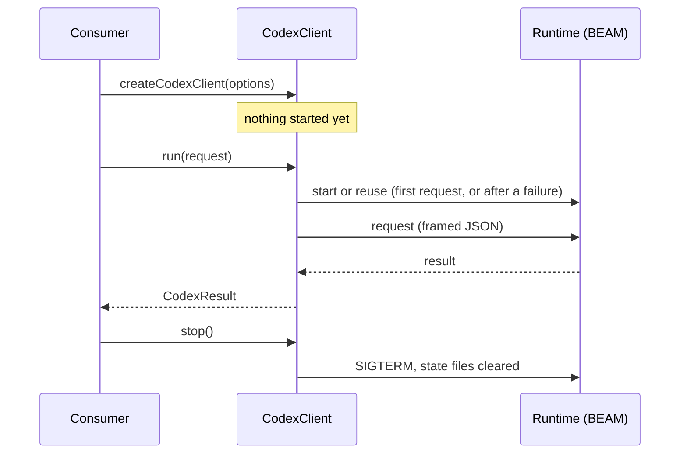

# Library API

**Planned** crucible/P-03

The exports of `@crucible/codex-client`: a client bound to one runtime, the codex request and result types, and the four operations as tools. Anything not exported from the package root is not part of the contract.

## 1 Overview

| Item | Value |
| --- | --- |
| Kind | library API |
| Transport | In-process; the client talks to the runtime over loopback TCP |
| Encoding | TypeScript types; JSON values in requests and results |
| Import | `import { createCodexClient, codexTools } from "@crucible/codex-client"` |

## 2 Versioning and compatibility

The contract version is the `version` of this document. Removing or renaming an export, a field or a tool name, or narrowing an accepted input, is breaking. Adding an optional option or field is not. Consumers are in the workspace and are updated in the change that breaks them.

## 3 Connection and lifecycle



A client is cheap to create and starts nothing. Clients with the same state directory share one runtime, across processes. An attached client stops the runtime when its process exits; `stop()` is needed only to stop it earlier.

## 4 Operations

### FN-01 `createCodexClient`

```typescript
function createCodexClient(options?: CodexClientOptions): CodexClient;
```

| Field | Type | Required | Meaning |
| --- | --- | --- | --- |
| `runtimeDir` | string | no | Directory of the runtime's Mix project |
| `functionsDir` | string | no | Root of the codex entries the runtime serves |
| `stateDir` | string | no | State directory that identifies the runtime |
| `detached` | boolean | no | `true`: the runtime outlives the process. `false`: it stops with it |

Defaults and the matching environment variables: [crucible/packages/codex-client/design](../design.md) section 5. Relative paths are resolved against the current working directory.

### FN-02 `CodexClient.run`

```typescript
run(request: CodexRequest): Promise<CodexResult>;
```

Sends one request. Starts or replaces the runtime when needed. Never rejects: every failure is a result with `ok: false` (section 6). Requests may run concurrently.

### FN-03 `CodexClient.stop`

```typescript
stop(): Promise<void>;
```

Stops the runtime recorded in the state directory and clears the state files. Requests sent while stopping return `ok: false`. After `stop()` resolves, the next `run` starts a new runtime. It is used before the memory path of the runtime changes, and to recover from a locked graph.

### FN-04 `CodexClient.paths`

```typescript
readonly paths: { runtimeDir: string; functionsDir: string; stateDir: string };
```

The resolved absolute directories.

### FN-05 `codexTools`

```typescript
function codexTools(client: CodexClient, options?: CodexToolsOptions): CodexTool[];
```

Returns one tool per operation, in the order `find`, `define`, `load`, `call`.

| Field | Type | Required | Meaning |
| --- | --- | --- | --- |
| `operations` | `CodexOp[]` | no | The operations to include. Default: all four |
| `policy` | `Partial<Record<CodexOp, "allow" \| "ask">>` | no | Policy per operation. Default: `allow` for all |
| `prepareCall` | `(input: { name: string; args?: Record<string, unknown> }) => { name: string; args?: Record<string, unknown> }` | no | Rewrites the input of `call_function` before the request |
| `presentResult` | `(result: CodexResult, input: { name: string; args?: Record<string, unknown> }) => CodexToolOutput \| Promise<CodexToolOutput>` | no | Turns the result of `call_function` into the tool output. Default: the result as JSON text |

| Tool | Operation | Input | Annotations |
| --- | --- | --- | --- |
| `find_function` | `find` | `query` (non-empty string), `limit` (1-40, optional), `detail` (boolean, optional) | read-only |
| `define_function` | `define` | `name`, `source`, `description` (optional) | - |
| `load_function` | `load` | `name` | idempotent |
| `call_function` | `call` | `name`, `args` (object, optional) | - |

A tool's `call` returns `{ ok, text }`: `text` is the result as JSON, `ok` is `false` when the result has `ok: false`.

## 5 Data types

```typescript
export const CODEX_OPS = ["define", "load", "find", "call"] as const;
export type CodexOp = (typeof CODEX_OPS)[number];

export type CodexRequest =
  | { op: "define"; name: string; source: string; description?: string }
  | { op: "load"; name: string }
  | { op: "find"; query?: string; limit?: number; detail?: boolean }
  | { op: "call"; name: string; args?: Record<string, unknown> };

export type CodexResult =
  | ({ ok: true } & Record<string, unknown>)
  | { ok: false; error: string };

export const CODEX_TOOL_NAMES = {
  define: "define_function",
  load: "load_function",
  find: "find_function",
  call: "call_function",
} as const;

export type CodexToolOutput = { ok: boolean; text: string };

export interface CodexTool {
  name: string;
  description: string;
  /** JSON Schema of the arguments (object). Normative. */
  inputSchema: Record<string, unknown>;
  /** The same constraints as a zod raw shape, for consumers that register tools with zod. */
  shape: Record<string, unknown>;
  policy: "allow" | "ask";
  annotations?: { readOnlyHint?: boolean; idempotentHint?: boolean };
  call(args: unknown, signal?: AbortSignal): Promise<CodexToolOutput>;
}
```

`CodexTool` has the structure of the tool shape in [crucible/architecture/shared-packages](../../../../docs/architecture/shared-packages.md) section 2.2, plus `shape` and `annotations` (crucible/OI-20).

## 6 Errors

| Code | Meaning | Sent when | Consumer should |
| --- | --- | --- | --- |
| `ok: false`, error from the runtime | The operation failed in the runtime | The runtime answered with `ok: false` | Surface to the agent or user |
| `ok: false`, `runtime is shutting down` | The client is stopping | `run` during `stop()` or process exit | Abort |
| `ok: false`, start error with the tail of `boot.log` | The runtime did not start | Elixir missing, compile error, start timeout | Surface; fix the environment |
| `ok: false`, `runtime request timed out` | No answer in 120 s | Long-running entry | Surface; the entry keeps running in the runtime |
| `ok: false`, `runtime response exceeds 10MB` | Response refused | Oversized result | Narrow the call |
| `ok: false`, `invalid JSON from runtime: ...` | The response was not JSON | Runtime defect | Surface |

## 7 Mapping (integration profile only)

Not applicable - the package is a library.

## 8 Conformance

Not applicable - the contract has one implementation.

## 9 Changes

| Version | Change | Breaking | Consumer action |
| --- | --- | --- | --- |
| 0.1.0 | Initial contract. Against `projects/alchemist/core`: `runCodexOp(request)` becomes `client.run(request)`, `stopRuntime()` becomes `client.stop()`, `HOST_TOOL_NAMES` becomes `CODEX_TOOL_NAMES`, the result type is `CodexResult`, `repoRoot` is replaced by `client.paths`, a tool's `run` returning `{ text, isError }` becomes `call` returning `{ ok, text }` | - | - |
