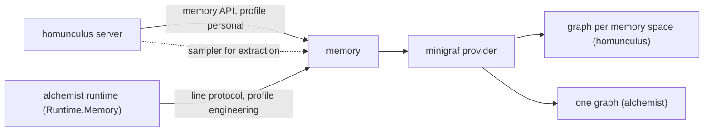

# Memory

**Planned** crucible/P-04

The package `@crucible/memory` gives an application a long-term memory for its agent behind one interface: `recall` before a turn, `retain` after it, `forget` on request, plus the tools and the prompt section the provider contributes. The first provider is minigraf, a bi-temporal fact graph in a local file. Alchemist and homunculus both use it, each with its own graph and its own schema profile. The package runs inside the consuming Node process; for alchemist's BEAM it also runs as a line server on stdio.

Nothing in this package is built yet. The code it is extracted from is `projects/alchemist/core/minigraf-memory.ts`, `core/minigraf-server.ts` and parts of `projects/homunculus/server/src/memory/`; the change is specified in [crucible/increments/repository-and-migration](../../../docs/increments/repository-and-migration.md) section 3.4.

| Document | Title |
| --- | --- |
| [crucible/packages/memory/requirements](requirements.md) | Requirements |
| [crucible/packages/memory/interfaces](interfaces.md) | Interfaces: memory API and line protocol |
| [crucible/packages/memory/design](design.md) | Design, with the minigraf provider as a sub-document |
| [crucible/packages/memory/verification](verification.md) | Verification |

## At a glance

## Dependencies

The package uses no interface of another component. The minigraf provider is built on the external `minigraf` npm binding.
