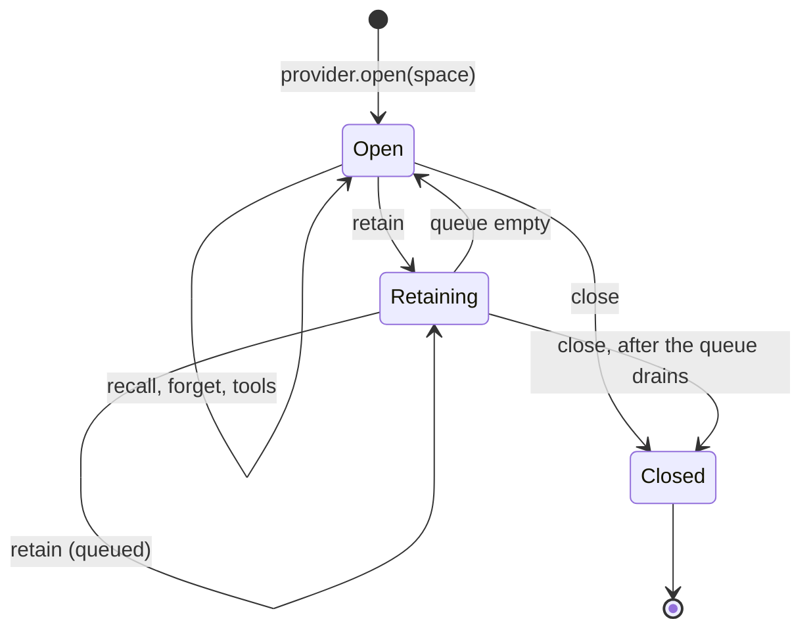

# Design

**Planned** crucible/P-04

The package has a small generic core and one provider. The core holds the interface types, the provider registry, the queue that orders `retain` calls, and the conformance suite. Everything that knows about facts, Datalog, time windows, profiles, retrieval and extraction is inside the minigraf provider. The line server is a thin stdio front of that provider. Applications differ only in configuration: which provider, which profile, where the graph is.

| Sub-document | Content |
| --- | --- |
| [crucible/packages/memory/design/minigraf-provider](design/minigraf-provider.md) | Graph file, profiles, item mapping, fact operations and tools, recall index, extraction, forget |

## 1 Module structure

| Module | Path | Responsibility | Satisfies |
| --- | --- | --- | --- |
| types | `packages/memory/src/types.ts` | `MemoryProvider`, `MemorySpace`, `MemoryItem`, `RetainResult`, `Sampler`, `MemoryTool`, `MemoryError` | crucible/packages/memory/FR-001 |
| registry | `packages/memory/src/registry.ts` | `createMemoryProvider`: provider id -> factory | crucible/packages/memory/FR-002 |
| queue | `packages/memory/src/queue.ts` | Serial execution of `retain` per space; `close` waits for it | crucible/packages/memory/FR-009 |
| minigraf provider | `packages/memory/src/minigraf/` | The provider: [crucible/packages/memory/design/minigraf-provider](design/minigraf-provider.md) | crucible/packages/memory/FR-003 to crucible/packages/memory/FR-014 |
| line server | `packages/memory/src/line-server.ts` | The line protocol over one open graph | crucible/packages/memory/FR-015, crucible/packages/memory/FR-016 |
| testing | `packages/memory/src/testing/` | `providerConformance`, `inMemoryProvider` | crucible/packages/memory/FR-001 |
| index | `packages/memory/src/index.ts` | The exports of the contract | - |

The package is `"type": "module"`, exports `./src/index.ts` and `./testing`, and is loaded as TypeScript source by its consumers. Tests are `node:test` files beside the modules.

## 2 Data model

The generic core persists nothing. A space's data is the provider's; for minigraf it is one graph file and its transaction counter ([crucible/packages/memory/design/minigraf-provider](design/minigraf-provider.md) section 1).

| Application | Provider | Profile | Spaces | Graph location |
| --- | --- | --- | --- | --- |
| alchemist | minigraf, through the line server | `engineering` | One | `AGENT_MEMORY_PATH`, or `memory/minigraf.graph` ([crucible/alchemist/runtime/design/memory](../../../projects/alchemist/docs/runtime/design/memory.md)) |
| homunculus | minigraf, in the server process | `personal` | One per memory space of the device profiles | `<memory root>/<space>/temporal.graph`, beside the space's wiki |

No graph is opened by both applications (crucible/AD-05).

## 3 State and behaviour



| Rule | Detail |
| --- | --- |
| Ordering | `retain` calls on a space are queued and run one at a time in call order. `recall` and tool calls are not queued behind extraction: they see the state before a pending `retain` finishes |
| Single handle | One space object per graph in a process. All reads and writes, including those of the agent tools, go through it, so the recall index and the graph cannot diverge |
| Turn path | An application awaits `recall` before the turn and does not await `retain` after it (crucible/C-04). A failed `retain` is reported through `log` and the returned promise |
| Capabilities | A space reports `extraction: true` only when it was opened with a sampler |

## 4 Key flows

```mermaid
sequenceDiagram
    participant A as Application
    participant S as MemorySpace
    participant X as Sampler (application)
    participant G as Store
    A->>S: recall(user text)
    S->>G: search
    G-->>S: items
    S-->>A: items
    Note over A: turn runs; the agent may call tools()
    A-)S: retain({ exchange })
    S->>G: search for existing items the exchange touches
    S->>X: extraction prompt
    X-->>S: model text
    S->>S: parse and validate items
    S->>G: store, replacing changed items
    S--)A: RetainResult
```

Homunculus formats the recalled items into the `<memory-context>` block it places before the user's words, and passes `User: ...` and `Assistant: ...` as the exchange. Alchemist's hosts reach memory through the `memory.*` codex entries; automatic recall and retain around a turn come with `packages/agent` (crucible/P-05).

## 5 Configuration

| Key | Type | Default | Meaning |
| --- | --- | --- | --- |
| `provider` | string | - | Provider id; `minigraf` |
| Provider options | - | - | [crucible/packages/memory/design/minigraf-provider](design/minigraf-provider.md) section 5 |

The package reads no environment variable. Applications map their own configuration to `MemoryProviderConfig`.

## 6 Error handling

| Failure | Detected by | Response |
| --- | --- | --- |
| Invalid input to an operation | Provider validation | `MemoryError` with the message; nothing is written |
| One invalid item among several | Provider validation per item | The item is listed in `rejected`; the others are stored |
| Sampler rejects or times out | Rejected promise | `retain` rejects with the sampler's error; nothing is written; the queue continues with the next call |
| Unparseable extraction output | Parser | `retain` resolves with nothing stored and one `rejected` entry carrying the reason; logged |
| Store cannot be opened | Provider | `open` rejects; the application decides whether to run without memory |
| Operation after `close` | Space state | `MemoryError`, `memory space is closed` |

## 7 Extension points

| Point | How |
| --- | --- |
| Provider | Implement `MemoryProvider` and `MemorySpace`, pass `providerConformance`, register the factory in `registry.ts` under its id |
| Profile | A minigraf profile is a data object ([crucible/packages/memory/design/minigraf-provider](design/minigraf-provider.md) section 2); a new one is added beside `engineering` and `personal` |
| Sampler | The application supplies the model call. Homunculus keeps its one-shot Claude query (`claudeSampler`) and injects it |
