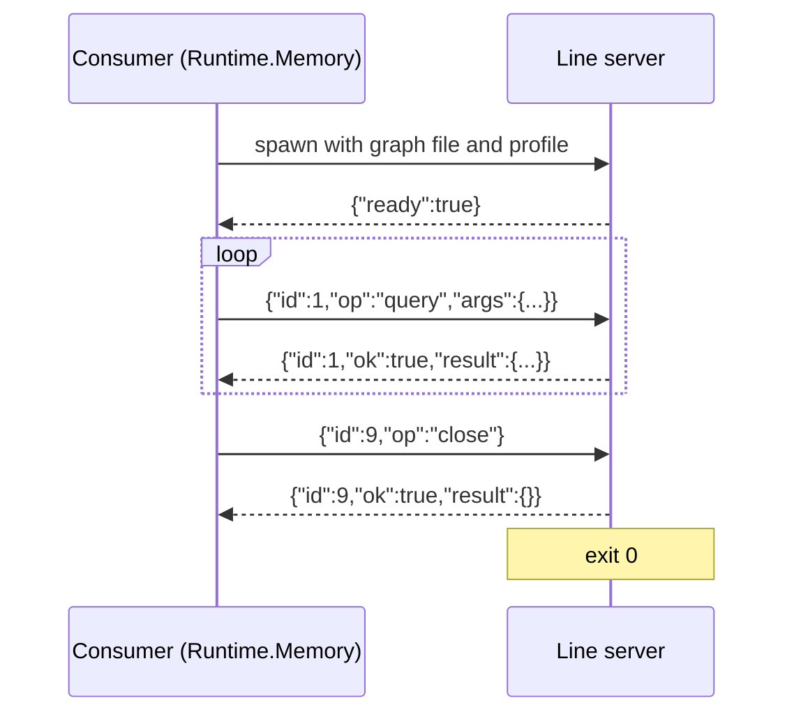

# Line Protocol

**Planned** crucible/P-04

The line server is a Node process that opens one minigraf graph and serves it on stdio: one JSON request per line in, one JSON response per line out. It lets a consumer that is not TypeScript own a graph through a child process. Alchemist's `Runtime.Memory` is that consumer; the protocol is the one it speaks to `projects/alchemist/core/minigraf-server.ts` today, plus the profile argument and the two generic operations.

## 1 Overview

| Item | Value |
| --- | --- |
| Kind | stdio protocol |
| Transport | Standard input and output of a child process; diagnostics on standard error |
| Encoding | One JSON object per line, UTF-8 |
| Start | `node <package>/src/line-server.ts <graph file> [--profile engineering|personal]`; the profile defaults to `engineering` |

## 2 Versioning and compatibility

The contract version is the `version` of this document. Removing an operation or a field, or changing a result shape, is breaking. Adding an operation is not. The server and its one consumer are in the workspace and change together.

## 3 Connection and lifecycle



The server holds the only open handle to the graph file (crucible/C-02). It handles requests in the order they arrive, one at a time. If the graph cannot be opened, it prints `{"ok":false,"error":"..."}` and exits with code 1. When the consumer closes standard input, the server closes the graph and exits.

## 4 Operations

Every request is `{ "id": number, "op": string, "args"?: object }`. Every response is `{ "id": number, "ok": true, "result": object }` or `{ "id": number, "ok": false, "error": string }`.

### MSG-01 `ready`

| Field | Value |
| --- | --- |
| Direction | server -> consumer |
| When | Once, after the graph is open |
| Response | none |

```json
{ "ready": true }
```

### MSG-02 `transact`, `retract`, `query`, `overview`

| Field | Value |
| --- | --- |
| Direction | consumer -> server |
| When | A `memory.*` codex entry runs |
| Response | The operation's result object |

`args` and `result` are those of the provider's fact operations: [crucible/packages/memory/design/minigraf-provider](../design/minigraf-provider.md) section 3.

### MSG-03 `recall`

**Planned** crucible/P-04 slice 6

| Field | Value |
| --- | --- |
| Direction | consumer -> server |
| When | The `memory.recall` codex entry runs |
| Response | `{ "items": MemoryItem[] }` |

```json
{ "id": 4, "op": "recall", "args": { "query": "redis cache", "limit": 8, "at": "2026-11-01" } }
```

| Field | Type | Required | Meaning |
| --- | --- | --- | --- |
| `query` | string | yes | Free text |
| `limit` | integer | no | 1 to 50, default 8 |
| `at` | string | no | Instant the items must be valid at |

### MSG-04 `forget`

**Planned** crucible/P-04 slice 6

| Field | Value |
| --- | --- |
| Direction | consumer -> server |
| When | A consumer forgets a whole item |
| Response | `{}` |

```json
{ "id": 5, "op": "forget", "args": { "ref": "decision/redis-cache", "mode": "close" } }
```

### MSG-05 `reset`

| Field | Value |
| --- | --- |
| Direction | consumer -> server |
| When | The consumer switches to another graph file (tests, `Runtime.Memory.reset!/1`) |
| Response | `{}` |

```json
{ "id": 6, "op": "reset", "path": "/tmp/other.graph" }
```

The server closes the current graph and opens `path`. If that fails, it reopens the previous graph and answers with the error.

### MSG-06 `close`

| Field | Value |
| --- | --- |
| Direction | consumer -> server |
| When | The consumer stops |
| Response | `{}`, then the server exits with code 0 |

## 5 Data types

`MemoryItem`: [crucible/packages/memory/interfaces/memory-api](memory-api.md) section 5. Fact, clause and result shapes: [crucible/packages/memory/design/minigraf-provider](../design/minigraf-provider.md) section 3.

## 6 Errors

| Code | Meaning | Sent when | Consumer should |
| --- | --- | --- | --- |
| `memory path is required` | No graph file argument | Start | Fix the start command |
| Open error, exit 1 | The graph could not be opened | Start | Surface; another process may hold the file |
| `unknown memory op` | The operation is not defined | Request | Fix the request |
| `memory request failed` | The line was not valid JSON or the operation threw a non-memory error | Request | Surface |
| Provider message | The provider rejected the arguments | Request | Return it to the caller of the codex entry |

## 7 Mapping (integration profile only)

Not applicable - the package is a library.

## 8 Conformance

Not applicable - the contract has one implementation.

## 9 Changes

| Version | Change | Breaking | Consumer action |
| --- | --- | --- | --- |
| 0.1.0 | Initial contract: the protocol of `projects/alchemist/core/minigraf-server.ts`, plus `--profile`, `recall` and `forget` | - | `Runtime.Memory` starts `packages/memory/src/line-server.ts` |
