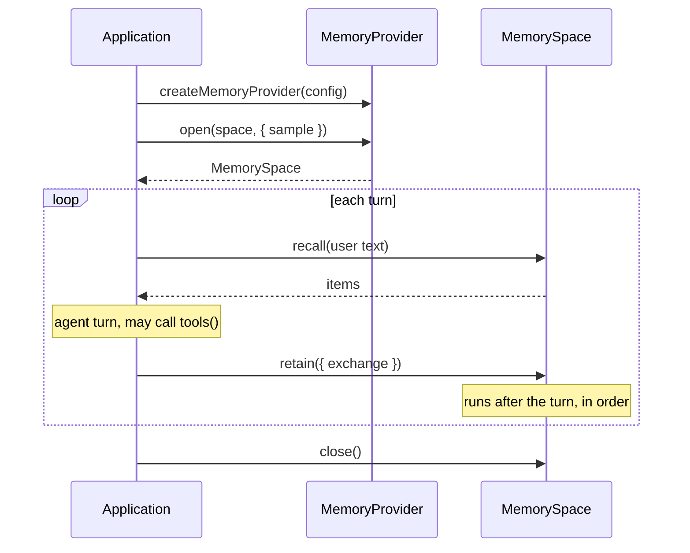

# Memory API

**Planned** crucible/P-04

The provider-independent contract of `@crucible/memory`. An application creates a provider from its configuration, opens a space, and from then on uses only the space: `recall`, `retain`, `forget`, `tools`, `promptSection`, `close`. Nothing in the contract names a fact, a graph or a query language; a provider's own power reaches the agent through its tools and prompt section.

## 1 Overview

| Item | Value |
| --- | --- |
| Kind | library API |
| Transport | In-process |
| Encoding | TypeScript types |
| Import | `import { createMemoryProvider } from "@crucible/memory"`; the conformance suite from `@crucible/memory/testing` |

## 2 Versioning and compatibility

The contract version is the `version` of this document. Removing or renaming an export, a method or a field, or changing the meaning of an operation, is breaking. Adding an optional field, a capability or a provider is not. A provider states the contract version it implements by passing the conformance suite of that version.

## 3 Connection and lifecycle



A space is opened once per process and closed when the application stops. `close` waits for the `retain` calls already made.

## 4 Operations

### FN-01 `createMemoryProvider`

```typescript
function createMemoryProvider(config: MemoryProviderConfig): MemoryProvider;
```

Returns the provider named by `config.provider`. The remaining fields are that provider's options; for `minigraf` see [crucible/packages/memory/design/minigraf-provider](../design/minigraf-provider.md) section 5. An unknown id throws `MemoryError` with `unknown memory provider`.

### FN-02 `MemoryProvider.open`

```typescript
open(space: string, deps?: { sample?: Sampler; log?: MemoryLog }): Promise<MemorySpace>;
```

Opens the space with that name, creating it when it does not exist. `space` matches `^[a-z0-9-]{1,64}$`. `sample` enables extraction (crucible/packages/memory/interfaces/memory-api/FN-05). `log` receives the provider's events.

### FN-03 `MemoryProvider.capabilities`

```typescript
capabilities(): { facts: boolean; temporal: boolean; extraction: boolean };
```

| Capability | Meaning |
| --- | --- |
| `facts` | Items have structured attributes and the provider contributes fact tools |
| `temporal` | Items have validity windows; `recall` honours `at`; `forget` with `close` keeps history |
| `extraction` | The provider can extract items from an exchange. A space has it only when it was opened with a sampler |

### FN-04 `MemorySpace.recall`

```typescript
recall(query: string, opts?: { limit?: number; at?: string }): Promise<MemoryItem[]>;
```

Returns the items relevant to `query`, best first, each with a `score`. `limit` is 1 to 50, default 8. `at` is an instant; a provider without `temporal` ignores it. An empty or blank query returns no items. Recall only reads.

### FN-05 `MemorySpace.retain`

```typescript
retain(
  input: { exchange: string } | { items: MemoryItem[] },
  meta?: { session?: string; reason?: string; now?: string; timeZone?: string },
): Promise<RetainResult>;
```

| Input | Behaviour |
| --- | --- |
| `items` | Stores the given items. 1 to 100 items |
| `exchange` | Extracts items from the text of one finished turn through the sampler, then stores them. Rejects with `extraction is not available` when the space has no sampler |

An item that replaces a current item with the same reference ends the old one; an item equal to a current one is skipped and reported as stored. `meta.reason` and `meta.session` are recorded where the provider can record them. `meta.now` and `meta.timeZone` let extraction resolve relative dates; default is the system clock and UTC. Calls on one space run one at a time in call order; the promise resolves when the call's items are stored. A call never stores part of an item.

### FN-06 `MemorySpace.forget`

```typescript
forget(ref: string, mode: "close" | "erase"): Promise<void>;
```

| Mode | Meaning |
| --- | --- |
| `close` | The item stopped being true. It leaves current recall; a temporal provider keeps it for earlier instants |
| `erase` | The item should not be remembered. It leaves recall at every instant. Whether the bytes are physically removed is the provider's property and is stated in its design |

An unknown reference rejects with `unknown reference`.

### FN-07 `MemorySpace.tools`

```typescript
tools(): MemoryTool[];
```

The provider's agent tools for this space. The application registers them with its agent under a server name of its choice and does not interpret them. A provider without tools returns an empty array.

### FN-08 `MemorySpace.promptSection`

```typescript
promptSection(ctx?: { toolName?: (name: string) => string }): string;
```

The provider's usage rules for the agent's system prompt, as Markdown without a top-level heading. `toolName` maps a tool name to the name the agent sees, for example `mcp__memory__memory_query`.

### FN-09 `MemorySpace.close`

```typescript
close(): Promise<void>;
```

Waits for pending `retain` calls, then releases the store. Operations after `close` reject with `memory space is closed`.

### FN-10 `providerConformance`

```typescript
// @crucible/memory/testing
function providerConformance(name: string, make: () => Promise<MemoryProvider>): void;
```

Registers the conformance tests of section 8 as `node:test` tests for the given provider. The package also exports `inMemoryProvider()` from the same entry point: a provider without facts, time or tools, used by the suite and by application tests.

## 5 Data types

```typescript
export interface MemoryProviderConfig {
  provider: string;                       // "minigraf" | ...
  [option: string]: unknown;              // provider options
}

export interface MemoryProvider {
  readonly id: string;
  capabilities(): { facts: boolean; temporal: boolean; extraction: boolean };
  open(space: string, deps?: { sample?: Sampler; log?: MemoryLog }): Promise<MemorySpace>;
}

export interface MemorySpace {
  readonly name: string;
  capabilities(): { facts: boolean; temporal: boolean; extraction: boolean };
  recall(query: string, opts?: { limit?: number; at?: string }): Promise<MemoryItem[]>;
  retain(
    input: { exchange: string } | { items: MemoryItem[] },
    meta?: { session?: string; reason?: string; now?: string; timeZone?: string },
  ): Promise<RetainResult>;
  forget(ref: string, mode: "close" | "erase"): Promise<void>;
  tools(): MemoryTool[];
  promptSection(ctx?: { toolName?: (name: string) => string }): string;
  close(): Promise<void>;
}

export interface MemoryItem {
  /** The provider's stable name for the item. Set on results; optional on input. */
  ref?: string;
  /** The provider's category. Minigraf: the entity kind, e.g. "preference". */
  kind?: string;
  /** The statement in plain language. The only field every provider fills. */
  text: string;
  /** Provider-specific structured part. Minigraf: further attributes of the entity. */
  attributes?: Record<string, string | string[]>;
  /** Validity window, ISO 8601. Present only with the `temporal` capability. */
  validFrom?: string;
  validTo?: string;
  /** Relevance, higher is better. Set by `recall` only. */
  score?: number;
}

export interface RetainResult {
  stored: MemoryItem[];
  rejected: { item: MemoryItem; reason: string }[];
}

/** Answers an extraction prompt with model text. */
export type Sampler = (prompt: string, maxTokens: number) => Promise<string>;

export type MemoryLog = (event: string, data?: Record<string, unknown>) => void;

export interface MemoryTool {
  name: string;
  description: string;
  /** JSON Schema of the arguments (object). */
  inputSchema: Record<string, unknown>;
  policy: "allow" | "ask";
  call(args: unknown, signal?: AbortSignal): Promise<{ ok: boolean; text: string }>;
}

export class MemoryError extends Error {}
```

`MemoryTool` has the structure of the tool shape in [crucible/architecture/shared-packages](../../../../docs/architecture/shared-packages.md) section 2.2 (crucible/OI-20).

## 6 Errors

Operations reject with `MemoryError`. A tool's `call` never rejects; it returns `ok: false` with the message as text.

| Code | Meaning | Sent when | Consumer should |
| --- | --- | --- | --- |
| `unknown memory provider` | No provider has that id | `createMemoryProvider` | Fix the configuration |
| `invalid memory space name` | The name does not match the pattern | `open` | Fix the configuration |
| `memory space is already open` | Another handle holds the store | `open` | Reuse the open space |
| `memory space is closed` | The space was closed | Any operation after `close` | Abort |
| `extraction is not available` | No sampler | `retain({ exchange })` | Open the space with a sampler |
| `unknown reference` | No item has that reference | `forget` | Surface |
| Provider message | The provider rejected an input | Any operation | Surface; per item, the reason is in `RetainResult.rejected` instead |

## 7 Mapping (integration profile only)

Not applicable - the package is a library. How the minigraf provider maps items to facts is in [crucible/packages/memory/design/minigraf-provider](../design/minigraf-provider.md) section 2.

## 8 Conformance

A provider conforms when `providerConformance` passes for it.

| Id | Rule |
| --- | --- |
| CF-01 | A provider shall return from `recall` an item it retained, for a query containing a word of its text, with `ref`, `text` and `score` set. |
| CF-02 | A provider shall return at most `limit` items from `recall`, ordered by descending `score`, and none for a blank query. |
| CF-03 | A provider shall report every input item of `retain({ items })` exactly once, in `stored` or in `rejected` with a reason. |
| CF-04 | A provider shall not return an item from current `recall` after `forget` with `close` or `erase`. |
| CF-05 | A provider with `temporal` shall return a closed item for an `at` inside its validity window, and shall not return an erased item for any `at`. |
| CF-06 | A provider shall reject `retain({ exchange })` with `extraction is not available` when the space has no sampler, and shall report `extraction: false` for that space. |
| CF-07 | A provider shall complete overlapping `retain` calls in call order. |
| CF-08 | A provider shall keep the items of one space invisible to every other space. |
| CF-09 | A provider shall reject every operation after `close` with `memory space is closed`, after completing the `retain` calls made before it. |
| CF-10 | A provider shall return tools whose `call` resolves to `{ ok, text }` and never rejects. |

## 9 Changes

| Version | Change | Breaking | Consumer action |
| --- | --- | --- | --- |
| 0.1.0 | Initial contract | - | - |
