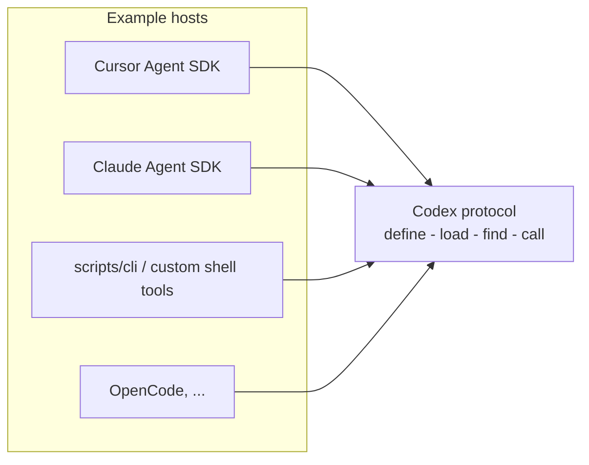

# Host Adapters

A **host** runs the agent loop (inference, tool routing, channels).
Every host reaches the same codex: four JSON operations served by the Alchemist runtime on a long-lived BEAM, through a thin adapter.

| Layer | Location | Responsibility |
| --- | --- | --- |
| Runtime | `runtime/` (OTP app source) | Serve codex operations over TCP and own memory |
| Capability tree | `functions/` | Codex entry source and `meta.json` |
| Bridge | `core/elixir-bridge.ts` | `mix compile` when needed; boot one long-lived BEAM; TCP JSON RPC |
| Host adapter | `hosts/cursor/` (Cursor) and `hosts/claude/` (Claude Agent SDK) | Map codex tool calls to codex operations |

The model only needs four codex tools (`define_function`, `load_function`,
`find_function`, `call_function`). Any host that can invoke the codex JSON
through the bridge can use the same capability tree without `@grok/agent-sdk`.

## Adapter matrix

| Host | Repository support | Integration boundary | Credentials / billing | Maturity |
| --- | --- | --- | --- | --- |
| Cursor Agent SDK | Implemented (`hosts/cursor/`, `@grok/agent-sdk`) | `hosts/cursor/bot/tools/*.ts` -> `runCodexOp()` | Cursor / Agent SDK login (`CURSOR_API_KEY`, `agent-sdk login`) | Primary adapter in this repo |
| Host-agnostic CLI | Implemented (`scripts/cli.mjs`) | `runCodexOp()` from `core/elixir-bridge.ts` | None (local Elixir + Node) | Stable for scripting and custom hosts |
| OpenCode | Pattern only | Four tools calling `cli.mjs` or equivalent | OpenCode subscription | Community integration |
| Claude Agent SDK | Implemented (`hosts/claude/`, `@anthropic-ai/claude-agent-sdk`) | `hosts/claude/codex.ts` -> `runCodexOp()` through an in-process MCP server | Claude Code login or `ANTHROPIC_API_KEY` | Example host with chat loop and evals |
| athanor sidecar | Implemented (`hosts/nshde/`) | `hosts/nshde/sidecar.ts`: Claude host options behind `POST /sessions` (SSE) | Same as the Claude Agent SDK host | Agent for the athanor web IDE |
| Anthropic Messages API | Pattern only | Tool definitions invoking CLI or TCP shim | Anthropic API key | Community integration |
| Go multi-agent CLIs | Pattern only | Outer CLI; inner tools call codex JSON | Varies by wrapped CLI | Experimental community wrappers |

No single vendor SDK bills across Cursor, OpenCode, and Anthropic. Unify at the
[codex protocol](../codex-protocol/interfaces/codex-protocol.md), not at the inference invoice layer.

## Cursor (this repository)

- **Package:** `@grok/agent-sdk` - playground, deploy, evals, Slack, and related channels.
- **Adapter:** `hosts/cursor/bot/tools/*.ts` maps codex tool names to [`core/protocol.ts`](../../core/protocol.ts) requests.
- **Tool surface:** `hosts/cursor/bot/agent.ts` sets `tools: ["mcp"]`.
  That allowlist is the MCP family only: the `custom-user-tools` server and the four codex tools.
  Native tools such as read, edit, and shell stay off.
  `local.cwd` is `.sessions`, so each session workspace is `hosts/cursor/.sessions/<sessionId>`.
  That directory is gitignored.
  Each workspace is its own git root, so turns do not load this repository's `AGENTS.md` or ambient MCP servers.
- **Bridge:** `core/elixir-bridge.ts` compiles `runtime/` when sources change, starts `elixir --no-halt` with `Application.ensure_all_started(:runtime, :permanent)`, and sends length-prefixed JSON over TCP.
- **Terminal UI:** `pnpm run tui` runs this host in the terminal UI under `tui/`. See [Terminal UI](../guides/tui.md).
- **Session-trace memory:** Factory Q&A evals and playground replay use a committed MiniGraf fixture.
  Default graph: `hosts/cursor/.eval-memory/session-trace.graph`.
  Commands: `pnpm run seed:session-trace`, `pnpm run dev:session-trace`, `pnpm run eval:session-trace`.
  See [Memory - Session-trace fixture](../runtime/design/memory.md#session-trace-fixture-cursor-host).

## OpenCode

- **Inference:** [OpenCode Go](https://opencode.ai/v2/docs/console/go/) routes compatible model traffic through an OpenCode subscription.
- **Agent loop:** OpenCode CLI with [ACP](https://github.com/ethpandaops/opencode-agent-sdk-go) or `opencode run` with JSON tools.
- **Codex:** Wire four MCP or shell tools that execute `node scripts/cli.mjs '<json>'`. Point at the same `functions/` tree; set `AGENT_FUNCTIONS_DIR` when the tree is not at the default path.

## Claude Agent SDK (this repository)

- **Package:** `@anthropic-ai/claude-agent-sdk` - the Claude Code harness as a library.
- **Adapter:** `hosts/claude/codex.ts` registers the four codex tools on an in-process MCP server and builds the `query()` options.
- **Prompt:** `hosts/claude/instructions.md` replaces the Claude Code system prompt. Built-in tools are removed with `tools: []`.
- **Chat and evals:** `pnpm run chat:claude` and `pnpm run eval:claude`. See the [host README](../../hosts/claude/README.md).
- **Terminal UI:** `pnpm run tui` runs this host in the terminal UI under `tui/`. See [Terminal UI](../guides/tui.md).

## athanor sidecar (this repository)

- **Process:** `pnpm run serve:nshde` starts `hosts/nshde/sidecar.ts`, a Node HTTP server for the [athanor](https://github.com/0x1d/athanor) web IDE.
- **Session:** `POST /sessions` runs one turn with `alchemistOptions()` from `hosts/claude/codex.ts` and streams it as server-sent events.
- **Prompt:** `hosts/claude/instructions.md`, then `hosts/nshde/instructions.md`, then the role athanor chose.
- **Services:** components call `services.*` entries through `Runtime.ServiceGateway`. See the [host README](../../hosts/nshde/README.md).

## Agent Client Protocol (this repository)

- **Package:** `@agentclientprotocol/sdk`. Alchemist is the ACP client, and the selected CLI process is the ACP agent.
- **Adapter:** `hosts/acp/connection.ts` owns the subprocess and connection, and `tui/adapters/acp.ts` maps session updates to TUI events.
- **Codex:** `hosts/shared/alchemist-mcp-tools.ts` serves the codex tools to the agent through MCP-over-ACP.
- **Terminal UI:** ACP agents appear in the TUI host dialog. The `serve` channel does not route to them. See the [host README](../../hosts/acp/README.md).

## Anthropic Messages API (direct)

- **API:** Messages API with tool definitions.
- **Codex:** Same four operations. The live interface is a 4-byte length-prefixed JSON socket on `127.0.0.1` (see [Codex protocol](../codex-protocol/interfaces/codex-protocol.md)). `scripts/cli.mjs` reaches it through the Node bridge. `Runtime.CLI.run_stdio/0` is a single-request debug helper, not the host interface.

## Go multi-agent wrappers (community)

Projects such as [go-agent-agnostic](https://github.com/j3ssie/go-agent-agnostic) and
[agent-wrapper](https://github.com/smallnest/agent-wrapper) drive existing agent
CLIs. They do not embed the Elixir codex directly; custom tools in the outer
agent typically call `scripts/cli.mjs` for the capability surface.

## Deployment considerations

1. Keep capability code in `functions/` so any host can share one tree.
2. Use the Cursor adapter when you want first-party channels, deploy, and evals from this repository.
3. Use `scripts/cli.mjs` (or equivalent) when another subscription or local loop should own inference while reusing the same entries.
4. Restrict who can invoke `define` in production; see [Security boundary](../security.md).
5. Plan for BEAM restarts when `runtime/` sources change; the bridge recompiles and boots a fresh VM when its source stamp changes.

## Related reading

- [Getting started](../guides/getting-started.md)
- [Architecture](../architecture.md)
- [Runtime notes](../../runtime/README.md)
