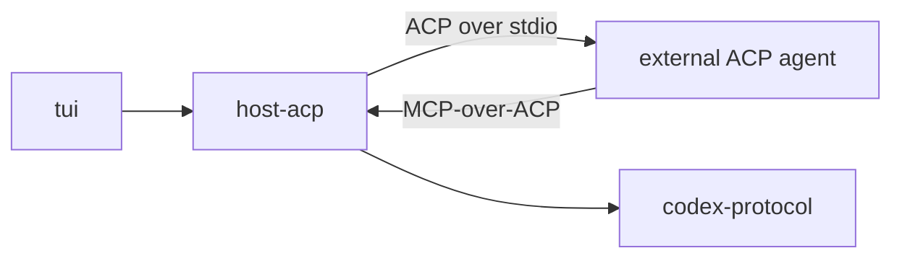

# ACP Host

Runs external Agent Client Protocol agents as Alchemist hosts, with Alchemist as the ACP client. It runs in the terminal UI and gives agents that support MCP-over-ACP the codex tools. Host adapters in general are described in [crucible/alchemist/architecture/host-adapters](../architecture/host-adapters.md); usage is in the [host README](../../hosts/acp/README.md).

| Document | Title |
| --- | --- |
| [crucible/alchemist/host-acp/requirements](requirements.md) | Requirements |
| [crucible/alchemist/host-acp/interfaces](interfaces.md) | Interfaces: the ACP contract and its mapping |
| [crucible/alchemist/host-acp/design](design.md) | Design |
| [crucible/alchemist/host-acp/verification](verification.md) | Verification |
| [crucible/alchemist/host-acp/decisions](decisions.md) | Decisions |

## At a glance

## Dependencies

| Component | Uses | Interface |
| --- | --- | --- |
| crucible/alchemist/codex-protocol | Codex operations behind the tools | [IFC](../codex-protocol/interfaces.md) |
| crucible/alchemist/tui | `HostAdapter` and host events | [Manifest](../tui/README.md) |
