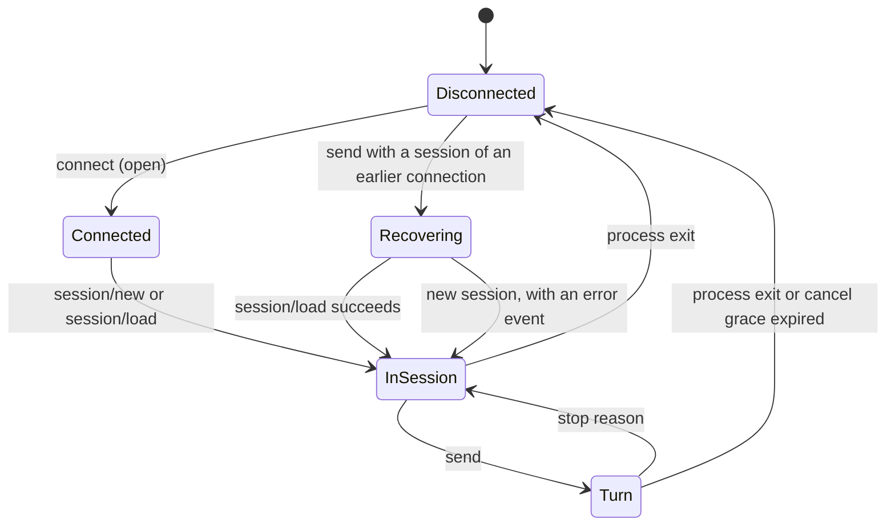

# Design

The ACP host has two layers. `hosts/acp/` holds the protocol side: discovery, probing, spawning, the file harness and `AcpAgentConnection`, which owns one agent process and its ACP connection. `tui/adapters/acp.ts` holds `AcpClientAdapter`, which implements the terminal UI's `HostAdapter` on top of a connection: it maps session updates to host events, keeps the session index, recovers after an agent restart and routes handoff forks. The codex tools come from `hosts/shared/`, the same definitions the Claude host uses, served to the agent through MCP-over-ACP.

## 1 Module structure

| Module | Path | Responsibility | Satisfies |
| --- | --- | --- | --- |
| Registry | `hosts/acp/registry.json` | The agents shipped with the repository | crucible/alchemist/host-acp/FR-001 |
| Discovery | `hosts/acp/discovery.ts` | Loads the registry and the user config, merges them by id, resolves spawn specs | crucible/alchemist/host-acp/FR-001, crucible/alchemist/host-acp/FR-002 |
| Probe | `hosts/acp/probe.ts`, `probe-cli.ts` | Runs `initialize` against each agent with a timeout; formats the result for the picker | crucible/alchemist/host-acp/FR-003, crucible/alchemist/host-acp/OR-001 |
| Spawn | `hosts/acp/spawn.ts` | Starts the subprocess, turns start failure and exit into one `ended` reason, sends stderr to `console.error` | crucible/alchemist/host-acp/FR-021, crucible/alchemist/host-acp/FR-024 |
| Harness | `hosts/acp/harness.ts` | `AcpHarnessFs`: serves `fs/*` inside the allowed roots | crucible/alchemist/host-acp/FR-010 |
| Connection | `hosts/acp/connection.ts` | `AcpAgentConnection`: one process and connection; sessions, prompt turns, cancel, permissions, MCP-over-ACP registration, teardown; `denyPermission` | crucible/alchemist/host-acp/FR-011, crucible/alchemist/host-acp/FR-012, crucible/alchemist/host-acp/FR-013, crucible/alchemist/host-acp/FR-017, crucible/alchemist/host-acp/OR-002 |
| Codex tools | `hosts/acp/alchemist-mcp.ts`, `hosts/shared/alchemist-mcp-tools.ts`, `hosts/shared/codex-tools.ts` | The `alchemist` MCP server; tool definitions shared with the Claude host | crucible/alchemist/host-acp/FR-013, crucible/alchemist/host-acp/FR-014, crucible/alchemist/host-acp/FR-015 |
| Adapter | `tui/adapters/acp.ts` | `AcpEventMapper`, `AcpSessionIndex`, `AcpClientAdapter` | crucible/alchemist/host-acp/FR-005 to crucible/alchemist/host-acp/FR-009, crucible/alchemist/host-acp/FR-016 to crucible/alchemist/host-acp/FR-023 |
| Picker | `tui/acp-host-picker.ts`, `tui/main.ts` | Lists probed agents in the host dialog, refuses failed ones, shows the permission dialog | crucible/alchemist/host-acp/FR-004, crucible/alchemist/host-acp/FR-011 |
| Example agents | `hosts/acp/agent.ts`, `hosts/acp/mcp-over-acp-agent.ts` | A plain agent, and a scripted agent with MCP-over-ACP and `loadSession`, used by tests and the eval | - |

## 2 Data model

| Data | Location | Shape |
| --- | --- | --- |
| Registry agent | `hosts/acp/registry.json` | `{ agents: [{ id, label, spawn: { command, args?, cwd? }, probe?: { timeoutMs? } }] }` |
| User agent | `~/.config/alchemist/acp-agents.json` | `{ agents: { "<label>": { command, args?, cwd? } } }`; the id is the label in lowercase with every run of other characters replaced by `-`, at most 64 characters |
| Discovered agent | memory | A registry agent plus `source: "registry" | "user"`; sorted by label |
| Session index | `hosts/acp/.agent-serve/agents/<agent-id>/sessions.json` | Array of `{ id, title, cwd, updatedAt }`; the most recently touched entry last |
| Harness folder | `hosts/acp/.sessions/<uuid>/` | The session's cwd; the uuid is the host's own, not the agent's session id |
| Host flags | `hosts/acp/.agent-serve/host-flags.json` | Shared host flags for host id `acp` (`historyReclaim`, context budget, ...), managed with `/flags` |

The title of an indexed session is the first prompt sent in it and does not change.

## 3 State and behaviour

### Connection

`AcpAgentConnection.open` spawns the process, connects the client, and sends `initialize`, racing it against the process ending. If the agent declares MCP-over-ACP, it builds the codex tools and registers the `alchemist` server on the connection before any session exists, because an agent may call tools while it creates the session. A failure during open closes the connection and kills the process.

The connection keeps:

- the session listeners, one per session that a turn or a load is reading;
- the set of harness folders used on it, which together with the repository root are the file roots;
- the signal of the running turn, so that a permission request of a stopped turn is answered `cancelled`.

### Adapter

The adapter holds at most one live connection and replaces it when it closes. It records which connection owns the current session; a turn on a different connection first recovers the session.

### Turn

`prompt` sends `session/prompt` and yields the session's updates in order until the stop reason arrives. Aborting the signal sends `session/cancel` and starts the grace timer; the turn still ends with the agent's `cancelled` stop. A connection error during the turn ends it with that error, which the adapter reports unless the user stopped the turn.

## 4 Key flows

### Handoff fork

The adapter routes each prompt with `routeTurn` from `tui/adapters/handoff.ts`, the same routing the other hosts use. The route applies only when the connection has MCP-over-ACP and `handoffFork` is on; otherwise every prompt is a plain turn.

1. Over the context budget without a handoff, the adapter first runs the handoff request as a turn. A `tool_result` that is ok and contains `Wrote handoff.md` marks the handoff as done.
2. If no handoff was written, the turn ends with "Handoff did not complete".
3. A fork reads `handoff.md` from the repository root, drops the session id, and runs the seed message (handoff plus the user's prompt) as the first turn of a new session. The fork is recorded with `recordFork`.

### Session recovery

When a turn runs on a connection that does not own the session, the adapter loads the session from the index's cwd if the agent supports `loadSession`. If that fails, or the agent cannot load, it starts a new session and yields an error saying the prompt starts a new one.

### Model and effort

`configOptions` from `session/new` or `session/load` give the current model (`category: model`) and effort (`category: thought_level`). `setModel` queues `session/set_config_option` calls for the changed values, and the next turn waits for the queue.

## 5 Configuration

| Key | Type | Default | Meaning |
| --- | --- | --- | --- |
| `spawn.command` | string | - | Program to start |
| `spawn.args` | string[] | `[]` | Arguments; `${workspace}` is replaced |
| `spawn.cwd` | string | repository root | Working directory of the process; `${workspace}` is replaced, an absolute path is used as is |
| `probe.timeoutMs` | number | 8000 | Probe timeout (registry entries only) |
| `historyReclaim` | host flag | `handoffFork` | `handoffFork` turns on the handoff tool and the fork route |
| context budget | host flag | host default | Token count above which a turn is routed to a handoff |

The workspace is the repository root in the terminal UI.

## 6 Error handling

| Failure | Detected by | Response |
| --- | --- | --- |
| Binary missing or not executable | `error` event of the child | `ended` resolves with "cannot start ..."; probe `failed`, or session open rejects |
| No `initialize` answer | Probe timer | Probe `failed` with "initialize timed out" |
| Process exits | `exit` event | Connection closes; a running turn ends with an error; the next turn reconnects and recovers |
| Agent ignores cancel | Grace timer, 10 s | Connection closed, process killed |
| File request outside the roots | `AcpHarnessFs.resolve` | `invalid params` to the agent |
| Session cannot be loaded | `loadSession` missing or `session/load` fails | On open: error to the user. On recovery: new session and an error event |
| Model change refused | `session/set_config_option` rejects | Logged to the terminal UI log; the turn continues |
| Stop reason other than `end_turn` and `cancelled` | Prompt response | Error event naming the reason |

## 7 Extension points

- A new agent is a registry entry or a user config entry; no code changes.
- The permission policy is the `requestPermission` handler passed to the adapter; `denyPermission` is the default when none is given.
- Another transport would replace `spawnAcpAgent` and the stream passed to `connect` in `AcpAgentConnection.open` (crucible/alchemist/OI-05).
