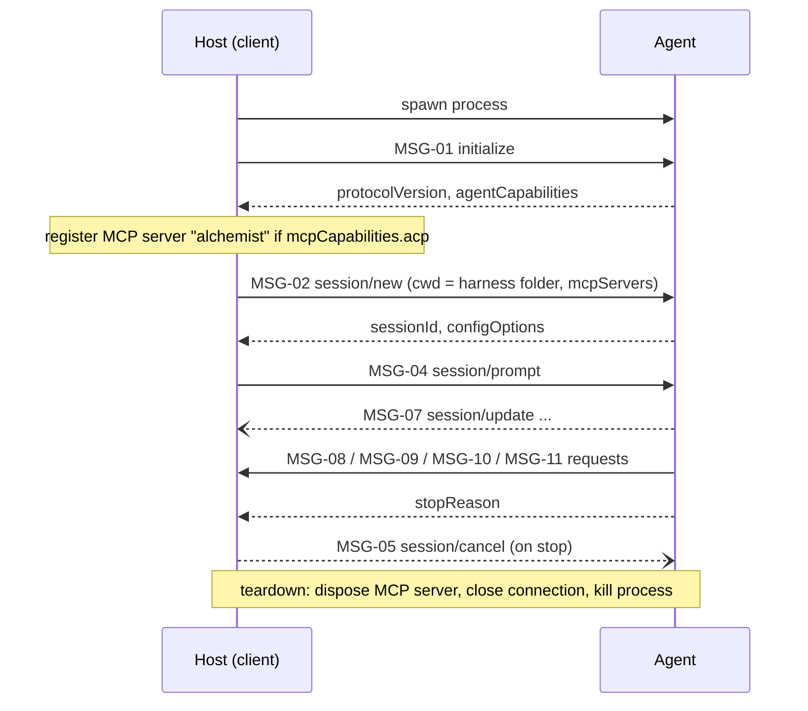

# Agent Client Protocol

This contract says which part of ACP v1 the host uses as the client: the requests it sends, the requests and notifications it serves, and how each maps onto host events and codex tools. The wire format is ACP's own, as implemented by `@agentclientprotocol/sdk` 2.4.0; this document does not restate it. What is not listed here is not used, and the host does not advertise it in `initialize`.

## 1 Overview

| Item | Value |
| --- | --- |
| Kind | Client side of the [Agent Client Protocol](https://agentclientprotocol.com/protocol/v1/overview), plus MCP-over-ACP |
| Transport | stdio of the agent subprocess, newline-delimited JSON (`ndJsonStream`) |
| Encoding | JSON-RPC 2.0 |
| Client info | `name: "alchemist"`, `version: "1.0.0"`; the probe uses `name: "alchemist-acp-probe"` |
| Client capabilities | `fs.readTextFile: true`, `fs.writeTextFile: true`; nothing else |

## 2 Versioning and compatibility

The host sends the SDK's `PROTOCOL_VERSION` (ACP v1) in `initialize` and accepts the version the agent answers; the probe shows it. MCP-over-ACP comes from the SDK's unstable entry and may change between SDK versions, so the SDK is pinned (crucible/alchemist/host-acp/AD-02). This contract's version changes when the set of used messages or the mapping changes.

## 3 Connection and lifecycle

One agent process carries one connection, and the connection may carry many sessions. A probe is a separate, short-lived process that only sends `initialize`.

The connection ends when the process exits, when the host closes it, or when a cancelled turn is not answered within the grace period ([crucible/alchemist/host-acp/OR-002](../requirements.md)). A new turn after that opens a new process and reloads the session with MSG-03.

## 4 Operations

### MSG-01 `initialize`

| Field | Value |
| --- | --- |
| Direction | client -> agent |
| When | Right after the process starts, for a probe and for a connection |
| Response | `protocolVersion`, `agentCapabilities`, `agentInfo` |

The host reads `agentCapabilities.mcpCapabilities.acp` (MCP-over-ACP support), `agentCapabilities.loadSession` (MSG-03 support) and `agentInfo.name`.

### MSG-02 `session/new`

| Field | Value |
| --- | --- |
| Direction | client -> agent |
| When | A session opens without an id, or the first turn runs without a session, or a handoff fork starts |
| Response | `sessionId`, `configOptions` |

`cwd` is a new harness folder. `mcpServers` holds the `alchemist` server declaration when MCP-over-ACP is on, and is empty otherwise.

### MSG-03 `session/load`

| Field | Value |
| --- | --- |
| Direction | client -> agent |
| When | The user opens an indexed session, or a turn runs on a new process for a session of an earlier one |
| Response | `configOptions` |

Sent only when `loadSession` is declared. `cwd` is the session's harness folder from the index, `mcpServers` as in MSG-02. The agent replays the history as MSG-07 before it answers.

### MSG-04 `session/prompt`

| Field | Value |
| --- | --- |
| Direction | client -> agent |
| When | Each turn |
| Response | `stopReason` |

`prompt` is one text block. One turn runs at a time per connection.

### MSG-05 `session/cancel`

| Field | Value |
| --- | --- |
| Direction | client -> agent, notification |
| When | The user stops the turn |
| Response | none; the agent ends MSG-04 with `cancelled` |

### MSG-06 `session/set_config_option`

| Field | Value |
| --- | --- |
| Direction | client -> agent |
| When | The user changes model or effort |
| Response | updated config options (ignored) |

Sent for the option whose `category` is `model` or `thought_level`, before the next turn starts.

### MSG-07 `session/update`

| Field | Value |
| --- | --- |
| Direction | agent -> client, notification |
| When | During MSG-04 and MSG-03 |
| Response | none |

Mapped as in section 7. Updates for a session no turn or load is listening to are dropped.

### MSG-08 `session/request_permission`

| Field | Value |
| --- | --- |
| Direction | agent -> client |
| When | The agent wants consent for a tool call |
| Response | `outcome`: `selected` with an `optionId`, or `cancelled` |

Passed to the permission handler with a signal that aborts when the request or the turn is cancelled. Answered `cancelled` without asking when the turn is already stopped. Without a handler, the host picks `reject_once`, else `reject_always`, else answers `cancelled`.

### MSG-09 `fs/read_text_file`

| Field | Value |
| --- | --- |
| Direction | agent -> client |
| When | The agent reads a file |
| Response | `content` |

`path` must be absolute. `line` is 1-based; `line` and `limit` select a line range. Allowed roots: the repository root and every harness folder used on the connection, with symlinks resolved.

### MSG-10 `fs/write_text_file`

| Field | Value |
| --- | --- |
| Direction | agent -> client |
| When | The agent writes a file |
| Response | empty |

Same path rules as MSG-09. Missing parent folders are created.

### MSG-11 MCP-over-ACP message

| Field | Value |
| --- | --- |
| Direction | agent -> client |
| When | The agent calls the `alchemist` MCP server declared in MSG-02 or MSG-03 |
| Response | the MCP response |

The SDK method `methods.client.mcp.message` of the unstable entry, served by `McpOverAcpProvider`. The server offers the codex tools of [crucible/alchemist/codex-protocol/interfaces/codex-protocol](../../codex-protocol/interfaces/codex-protocol.md) under the names of `HOST_TOOL_NAMES` (`find_function`, `define_function`, `load_function`, `call_function`) and, while `historyReclaim` is `handoffFork`, `handoff`. Each tool returns one text block with the JSON result and sets `isError` when the result has `ok: false`.

## 5 Data types

The types are those of the SDK (`InitializeResponse`, `SessionUpdate`, `RequestPermissionRequest`, `SessionConfigOption`, ...). The host-side types are `HostEvent` and `HostAdapter` in `tui/adapters/types.ts`.

## 6 Errors

| Code | Meaning | Sent when | Consumer should |
| --- | --- | --- | --- |
| invalid params | A file path is relative or outside the allowed roots | MSG-09, MSG-10 | Use an absolute path inside the session folder or the repository |
| resource not found | The file does not exist | MSG-09 | Treat as missing |
| connection closed | The process exited or the host dropped it | Any time | The host reports an error and reconnects on the next turn |

## 7 Mapping

| External | Ours | Notes |
| --- | --- | --- |
| `agent_message_chunk` | `text` event | Text blocks only; other content is dropped |
| `agent_thought_chunk` | `reasoning` event | Text blocks only |
| `user_message_chunk` | `user` event | Only in a replay; chunks of one message are joined |
| `tool_call`, `tool_call_update` | `tool` event, then `tool_result` event | `tool` on the first sight of an id; `tool_result` once, on `completed` (ok) or `failed`. Output: text and diff content, else `rawOutput` |
| `usage_update` | `usage` event | `used` -> `contextTokens`, `size` -> `contextWindow`; `cost` only when in USD |
| `notice` with severity `error` | `error` event | Other severities are dropped |
| Other updates (plans, modes, commands) | - | Not supported; dropped |
| `stopReason: end_turn` | `done` event | |
| `stopReason: cancelled` | - | The terminal UI reports the stop itself |
| Other stop reasons | `error` event | Names the reason |
| Config option category `model` / `thought_level` | Model and effort choices | Select options only; not persisted across sessions |
| Agent `sessionId` | `HostAdapter.sessionId` | The harness folder has its own id, because the agent assigns the session id after it receives the cwd |
| Terminals (`terminal/*`) | - | Not advertised, not supported |
| Images, audio, resources in prompts | - | Prompts are text only |

## 8 Conformance

Rules an agent must meet to work with the host.

| Id | Rule |
| --- | --- |
| CF-01 | An agent shall speak ACP over stdio with newline-delimited JSON and answer `initialize` within its probe timeout |
| CF-02 | An agent that declares `mcpCapabilities.acp` shall reach the `alchemist` server only through the declaration it received in MSG-02 or MSG-03 |
| CF-03 | An agent that declares `loadSession` shall replay a loaded session as MSG-07 before it answers MSG-03 |
| CF-04 | An agent shall end a cancelled MSG-04 with `stopReason: cancelled` |

## 9 Changes

| Version | Change | Breaking | Consumer action |
| --- | --- | --- | --- |
| 0.1.0 | Initial contract | - | - |
