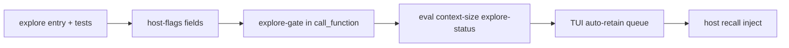

# Explore and Memory Automation

**Planned** P-05.

**Date:** 2026-11-05  
**Builds on:** [Context enforcement](context-enforcement.md), [Cursor host context](context-growth.md), `pipeline.run`, TUI `/remember`.

## Problem

Agents still pay one MCP round-trip per probe (`memory.overview`, `git.status`, `fs.rg`, `find_function`, ...). Each result is stored in the transcript. Chains multiply context growth and violate the "orchestration in Elixir" rule already in `instructions.md`.

Memory recall is manual (`memory.query` / overview) and retain is manual (`/remember` or explicit `memory.remember`). Nothing ties recall to exploration or caps exploration fan-out.

## Goals

1. **`explore` codex entry** - one `call_function` that runs a fixed or parameterized pipeline and returns **essentials only** (counts, short lists, markdown summary).
2. **Host flags** - configure automatic memory retain every *N* assistant turns and optional **recall-before-explore** (inject or require memory slice before repo/code probes).
3. **Enforcement** - when enabled, block or warn on "raw probe" slugs until `explore` (or a named-path `fs.read`) runs this turn.
4. **Compose in Elixir** - prefer static modules like `demo.report` and `explore`; use `pipeline.run` only for ad-hoc graphs.

## Non-goals

- Replacing `find_function` for slug discovery when editing codex entries.
- Injecting full MiniGraf into the system prompt (still query-driven).
- Native Cursor tool gating (MCP-only host).

---

## 1. Codex: `explore`

**Slug:** `explore`  
**Module:** `AgentFn.Explore`

### Args

| Field | Role |
| --- | --- |
| `profile` | `status` \| `memory` \| `repo` \| `code` \| `custom` (default `status`) |
| `goal` | Free-text intent (logged in result; used for future routing) |
| `repo` / `cwd` | Git/fs root (default parent of runtime cwd) |
| `query` | For `code` profile: ripgrep pattern |
| `paths` | Optional pathspecs for git/fs |
| `limit` | Cap list lengths (default 12) |
| `steps` | For `custom`: non-empty list passed to `pipeline.run` after recall seed |
| `recall_memory` | When true (default), include compact memory recall block |

### Profiles

| Profile | Internal pipeline (Elixir) | Output shape |
| --- | --- | --- |
| `status` | recall -> `git.status` (compact) -> oneline log -> optional `handoff.md` head | `{ summary_md, memory, git, log, handoff? }` |
| `memory` | `memory.overview` -> `memory.query` descriptions | `{ entities: [{id, description}], count }` |
| `repo` | `git.status` compact + oneline log | `{ branch, counts, paths_sample, log_lines }` |
| `code` | `fs.rg` with low `max_matches` | `{ matches: [{path, line, text}], count }` |
| `custom` | recall seed in ctx -> `pipeline.run` | `{ result, steps, ok }` trimmed |

**Compact git:** branch, upstream, ahead/behind, `counts`, and at most `limit` paths per bucket - not full `entries`.

**Essentials contract:** JSON serialized size target <= 8 KiB before host digest; long fields become `{ truncated, head, tail, total }` inside Elixir when possible.

### Enforcement surface (codex)

Document in `@moduledoc`: agents should call `explore` before exploratory `fs.*`, `sys.cmd`, `git.*`, and bulk `find_function` when the host flag `requireExploreBeforeProbe` is on.

---

## 2. Host flags (`host-flags.json`)

Extend `HostConfigFile` (numeric + boolean; env overrides optional later):

| Key | Type | Default | Meaning |
| --- | --- | --- | --- |
| `memoryAutoRetain` | boolean | `false` | Queue a retain pass on interval |
| `memoryRetainEveryTurns` | integer | `0` | Interval; `0` disables even if auto true |
| `memoryRecallBeforeExplore` | boolean | `true` | `explore` includes recall; host may inject recall snippet on user turn |
| `requireExploreBeforeProbe` | boolean | `false` | Gate raw probe slugs in `call_function` |

Env mirrors (optional): `ALCHEMIST_HOST_FLAG_MEMORY_AUTO_RETAIN`, `ALCHEMIST_HOST_FLAG_MEMORY_RETAIN_EVERY_TURNS`, etc.

**Recall-before-explore (host):** On each user message when `memoryRecallBeforeExplore` and not a named-path read turn, prepend a short system or user appendix built by a codex call `explore` profile `memory` with `limit: 8` (host-side, not model-initiated). *Phase 2* - avoids an extra model turn while keeping graph fresh.

**Auto retain:** After turn `N` where `N % memoryRetainEveryTurns == 0`, enqueue the same prompt as TUI `/remember` (`tui/remember.ts`) as a **follow-up user message** or internal agent message. *Phase 2* in TUI adapter + HTTP serve; flag stored in Phase 1.

---

## 3. Host enforcement (`call_function`)

When `requireExploreBeforeProbe` is true, maintain per-turn session state (in MCP tool ctx or serve workspace `.agent-serve/explore-gate.json`):

- **Allowed without explore:** `explore`, `memory.*`, `define_function`, `load_function`, `handoff`, single-shot `fs.read` when args include explicit `path` and user message matched named-path heuristic.
- **Gated:** `fs.list`, `fs.glob`, `fs.rg`, `sys.cmd`, `git.status`, `git.diff`, `git.log`, `http.get`, `find_function` (discovery).

Return `{ ok: false, error: "requireExploreBeforeProbe: call explore first (profile status|repo|code)" }` without hitting runtime.

Reset gate when a new user message arrives.

Set `exploreGateSatisfied` when `call_function` name is `explore` or allowed `fs.read`.

---

## 4. Instructions / skills

When `requireExploreBeforeProbe` default becomes true:

- Add row: **Explore repo/memory** -> `explore` with `profile`.
- Shorten "discover domain entries" to: use `explore` profile `code` or `find_function` only when defining tools.
- Memory skill unchanged; link `decision/minimal-status-probe` -> `explore` profile `status`.

---

## 5. Rollout

1. **Phase 1:** `explore` entry, flag schema, gate in `call_function`, tests, proposal doc. yes
2. **Phase 2:** `hooks/explore-gate.ts` resets gate on `message.received` (shared `sessionHarnessDir` key); TUI `completedTurns` + `shouldAutoRetain` queues `/remember`; `hooks/auto-memory-retain.ts` queues `/remember` on serve when reminders are enabled; instructions + memory skill mention `explore`; `context-size/explore-status` eval; `channels/http.ts` `onMessage` + TUI send prepend for `memoryRecallBeforeExplore`; auto-retain KV seeded from `events.ndjson` on `message.received`. (pending) Flip `requireExploreBeforeProbe` default after `explore-status` eval is green.
3. **Phase 3:** Default `requireExploreBeforeProbe: true` after evals; shrink instructions.

---

## 6. Verification

| Check | Command |
| --- | --- |
| Explore status | `call_function explore profile=status` -> <= 8 KiB JSON |
| Gate | Unit test: gated slug blocked until explore |
| Flags merge | `host-flags.test.ts` defaults for new keys |
| Memory | `mix test` memory + explore if added |
| Context eval | `pnpm run eval:cursor -- context-size` |

---

## 7. Decision log

| Id | Decision |
| --- | --- |
| X1 | Fixed profiles in Elixir, not LLM-chosen step lists, for predictable size |
| X2 | Gate in host MCP layer, not runtime - fail fast, no BEAM round-trip |
| X3 | Auto retain reuses `/remember` prompt, not silent `memory.remember` from host |
| X4 | `pipeline.run` stays for `custom` profile only |
| X5 | Recall-before-explore defaults true in config but inject deferred to Phase 2 |
