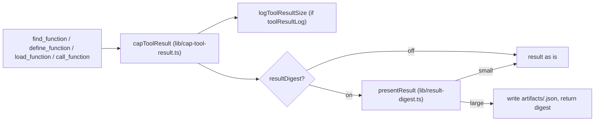

# Tool Results

The Cursor agent store is append-only: every tool result stays in the transcript and is sent again on every later turn. The host therefore shrinks large results when they are emitted, before they enter the store. All four codex tools pass their result through one wrapper, `capToolResult`, which logs its size, replaces a large result with a digest, and stores the full result in the session workspace. Default read caps and agent-safe codex defaults keep results small in the first place.

## 1 Emit path

| Tool | Label in the log |
| --- | --- |
| `call_function` | the slug |
| `find_function` | `find_function` |
| `define_function` | `define_function` |
| `load_function` | `load_function` |

The full result is written to `hosts/cursor/.sessions/<session>/artifacts/<id>.json`, where `<id>` is the tool call id with every character other than letters, digits, `_` and `-` removed, at most 48 characters, or `result`.

## 2 Digest rules

`presentResult` decides from the serialized JSON of the result.

| Rule | Value |
| --- | --- |
| A result at or under `DIGEST_MIN_CHARS` stays whole | 8,000 characters |
| A single document body at or under `FILE_BODY_INLINE_MAX` stays whole | 32,768 characters |
| An array is bulky from `BULKY_ARRAY_CHARS` serialized | 4,000 characters |
| A bulky array becomes its length, its field names and `ARRAY_SAMPLE_COUNT` samples | 2 samples |
| An oversized string becomes its size and a head and tail | `STRING_HEAD` 400 and `STRING_TAIL` 200 characters |

A digested result is `{ truncated: true, bytes, path, digest, head, tail }`, where `path` is the stored full result. The digest is used only when it is shorter than the original. Otherwise a result over 32,768 characters becomes `{ truncated: true, bytes, path, head, tail }` with plain slices, and a smaller one stays whole.

The model reads more of a digested result with `fs.read` or `fs.rg` on `path`.

## 3 Default caps

While `defaultMaxBytes` is on, `call_function` adds `max_bytes: 65536` (`DEFAULT_READ_HTTP_MAX_BYTES`) to `fs.read` and `http.get` calls that do not set `max_bytes`. The cap is a second guard for when the digest is off; with the digest on it changes little (crucible/alchemist/host-cursor/AD-09).

## 4 Codex defaults

Some codex entries default to agent-sized output. These defaults belong to the entries, and are listed here because the host relies on them:

| Entry | Default | Larger output |
| --- | --- | --- |
| `git.log` | `limit` 8, no `--numstat` | `limit` up to 500, `numstat: true` |
| `docker.ps_report`, `docker.overview` | Counts by state, Compose project and image, plus published ports; no container list | `docker.ps` |
| `find_function` | Slim search hits: name, summary, run/1 `@spec` | `detail: true` with an exact slug |

## 5 Tool result log

While `toolResultLog` is on, one tab-separated line with the time, the label and the UTF-8 size of each tool result is appended to `hosts/cursor/.agent-serve/context-tool-sizes.log` (`lib/tool-result-log.ts`), before the digest. The log is for finding entries whose results grow.
