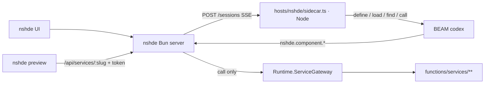

# nshde host

The nshde host makes Alchemist the agent of [nshde](https://github.com/0x1d/nshde), a web IDE.
It writes frontend components to nshde storage and backend services as codex entries.
Components call published services through a call-only gateway.



## Sidecar

`hosts/nshde/sidecar.ts` is a Node HTTP server.
It never runs under Bun.
`POST /sessions` takes `{ "prompt", "sessionId"?, "agent"? }` and answers with `text/event-stream`.
Each event's name is its `type`: `session`, `text`, `tool`, `tool_result`, `component`, `done`, or `error`.
A session is one Claude Agent SDK `query` with the Claude host's options (`alchemistOptions()` in `hosts/claude/codex.ts`): the codex tools, no built-in tools, and no local settings.
`sessionId` resumes an earlier session.
A successful `nshde.component.write` call adds a `component` event with the written path.
The system prompt is `hosts/claude/instructions.md` followed by `hosts/nshde/instructions.md`.

```bash
pnpm run serve:nshde
```

| Variable | Default | Meaning |
| --- | --- | --- |
| `NSHDE_SIDECAR_HOST` | `127.0.0.1` | Listen address |
| `NSHDE_SIDECAR_PORT` | `43124` | Listen port |
| `NSHDE_API_URL` | `http://127.0.0.1:43123` | nshde base URL for the `nshde.component.*` entries |
| `NSHDE_AGENT_MODEL` | SDK default | Model id |

The bridge starts the BEAM with the sidecar's environment, so a BEAM that is already running keeps the `NSHDE_API_URL` it started with.
nshde reaches the sidecar through `NSHDE_AGENT_URL`.

## Component entries

| Slug | Does |
| --- | --- |
| `nshde.component.write` | Checks the source, then writes `components/<slug>.nsh.tsx` |
| `nshde.component.read` | Reads a component's source |
| `nshde.component.list` | Lists the paths under `components/` |
| `nshde.component.check` | Compiles a source or stored component with Sucrase on the nshde side (`POST /api/modules/check`) |

The entries share `AgentLib.Nshde` in `functions/lib/agent_lib/nshde.ex`, an HTTP client for the nshde API.

## Services

A service is the codex entry `services.<name>` in `functions/services/<name>/`.
Its `meta.json` carries `service.input_schema` and `service.output_schema` (JSON Schema).
`services.greeting` is an example.

`Runtime.ServiceGateway` is a second listener on `127.0.0.1` beside `Runtime.Server`, with the same 4-byte length-prefixed JSON frames.
It accepts only `{"op":"call","name":"<name>","args":{...}}`.
`name` is the service name without the `services.` prefix, so the gateway reaches nothing outside `functions/services/`.
A call runs only when the manifest lists the name with the SHA-256 of the entry's current `tool.ex`.
The gateway validates the input and the result against the schemas.
`run/1` runs in a task under `Runtime.ServiceGateway.Tasks` with a timeout and a `max_heap_size`.

The manifest is `services.json` in the state directory:

```json
{ "services": [{ "slug": "greeting", "source_sha256": "<hex>" }] }
```

nshde writes it when a user publishes a service, and the gateway reads it on every call.
The gateway writes its port to `gateway_port` in the state directory.

| Variable | Default |
| --- | --- |
| `ALCHEMIST_GATEWAY_PORT` | `0` (ephemeral) |
| `ALCHEMIST_SERVICE_MANIFEST` | `<state dir>/services.json` |
| `ALCHEMIST_SERVICE_TIMEOUT_MS` | `5000` |
| `ALCHEMIST_SERVICE_MAX_HEAP_WORDS` | `4000000` |

`Runtime.ServiceGateway` is a supervisor and the last child of `Runtime.Application`, after the acceptor.
It supervises `Runtime.ServiceGateway.Tasks` and `Runtime.ServiceGateway.Listener`.

`define` keeps the `service` key of an existing `meta.json`, and `load` keeps every key, so a service's schemas survive recompiles.
