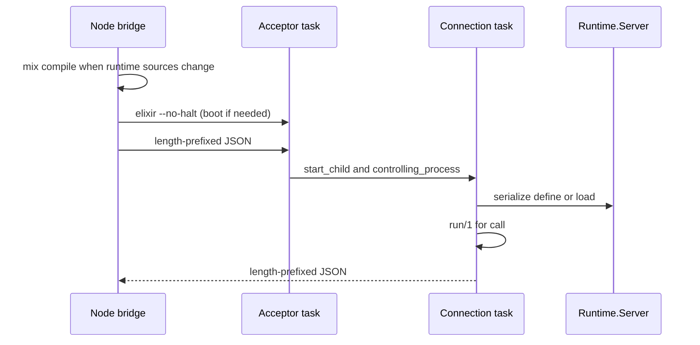

# Runtime

The Alchemist **runtime** is the `:runtime` OTP application.
It validates slugs, compiles codex entry trees into the live BEAM, maintains `meta.json`, invokes `run/1`, and owns memory.
Hosts never call these modules directly.
They send length-prefixed JSON to the acceptor on `127.0.0.1` through the Node bridge or an equivalent TCP client.

The sources live in the `runtime/` **Mix project**. The Node bridge runs `mix compile`
there when those sources change; **Mix does not serve codex requests**. The bridge
boots a **long-lived BEAM** with `elixir --no-halt` and
`Application.ensure_all_started(:runtime, :permanent)`. Compiled entry modules stay
loaded in that node until it restarts.

## Supervision

`Runtime.Application` starts a `one_for_one` supervisor (3 restarts in 5
seconds). Children, in start order:

| Child | Restart | Owns | Role |
| --- | --- | --- | --- |
| `Runtime.Memory` | permanent | MiniGraf database | Opens `memory/minigraf.graph` in one Node process |
| `Runtime.TaskSupervisor` | supervisor | connection tasks | One temporary task per client |
| `Runtime.Server` | permanent | no sockets | Serializes `define` and `load` |
| `Runtime.CodexWarmup` | permanent | — | Compiles every codex entry before the acceptor listens |
| `Runtime.Acceptor` | permanent task | listen socket | `Runtime.Server.accept/0` |

The acceptor calls `Task.Supervisor.start_child/2` and then
`:gen_tcp.controlling_process/2`. The connection task decodes one
length-prefixed JSON request and encodes the response. `call` runs `run/1` in
that task. Accept errors exit the acceptor instead of retrying in place. A
connection crash closes its socket and leaves the acceptor up. If the
supervisor gives up, the permanent application exits the VM.

## Module responsibilities

| Module | Responsibility |
| --- | --- |
| `Runtime.Application` | Supervisor for memory, the task supervisor, serializer, warm load, and acceptor |
| `Runtime.Memory` | Memory GenServer. Owns the Node process that holds the MiniGraf handle |
| `Runtime.Server` | Compile serialization (GenServer); `accept/0` runs in the acceptor task |
| `Runtime.CLI` | Operation dispatch for `define`, `load`, `find`, `call` |
| `Runtime.Engine` | Orchestrates compile, metadata refresh, search, and `run/1` invocation |
| `Runtime.Compiler` | Compiles `functions/lib` and per-slug `.ex` trees; validates entry module |
| `Runtime.Codex` | Slug sanitization, paths, `meta.json`, discovery walk, `write_definition` |
| `Runtime.Metadata` | Extracts `@moduledoc` and `@spec` for metadata files |
| `Runtime.Result` | Maps exceptions and throws to codex JSON error envelopes |
| `AgentFn.Codex` | Dynamic dispatch helper (`call/2`, `list/0`) used from entry code |
| `AgentFn.Tool` | Behaviour marker for entry modules |

## Lifecycle



## Source and metadata layout

| Path | Content |
| --- | --- |
| `functions/<slug-path>/tool.ex` | Entry module source (`define` default target) |
| `functions/<slug-path>/**/*.ex` | Deep modules for the entry |
| `functions/<slug-path>/meta.json` | Discovery record (`find`); updated on load/define |
| `functions/lib/**/*.ex` | Shared `AgentLib.*` modules |

Default functions root is `../functions` relative to this Mix project.

## Development

```bash
mix deps.get
mix test
```

`mix test` starts memory, which needs `node` and the `minigraf` package installed at the repository root.

From the repository root:

```bash
(cd runtime && mix test)
node --test core/minigraf-memory.test.ts
node scripts/cli.mjs '{"op":"call","name":"echo","args":{}}'
```

## Environment variables

| Variable | Effect |
| --- | --- |
| `AGENT_FUNCTIONS_DIR` | Path to the capability tree (set by the Node bridge for codex calls) |
| `AGENT_MEMORY_PATH` | MiniGraf database path. Default is `memory/minigraf.graph` beside the parent of the functions root |
| `ALCHEMIST_STATE_DIR` | Live node files (`port`, `pid`) and the bridge's `stamp` (default `runtime/.alchemist`) |
| `ALCHEMIST_RUNTIME_DETACHED` | `1`/`0` overrides VM lifecycle: detached (survives host exit) vs attached (stop on dev exit). Default: detached when `NODE_ENV=production` |

## Troubleshooting

Only one long-lived BEAM should open a given `AGENT_MEMORY_PATH`.
MiniGraf takes an exclusive lock on the graph file (`STG-026`).
Extra VMs from eval loops, `mix run`, or an old shell leave the lock held.
In attached mode, a boot that needs a new VM stops any runtime BEAM already using that state directory.
That includes a leftover whose pid file is gone.
`mix run` is not one of those VMs, so it can still hold the lock and the next boot fails.
The Node bridge may then surface a cryptic `elixir_config` / `:terminating` line instead of the lock message.

From the repository root (inside `nix develop`):

```bash
node scripts/runtime-doctor.mjs
node scripts/cli.mjs '{"op":"call","name":"echo","args":{"msg":"hello"}}'
```

Local `pnpm run dev` stops the BEAM when you Ctrl+C (attached lifecycle).
The VM runs in its own session.
Ctrl+C is handled by the Node host.
The first Ctrl+C asks the VM to stop and refuses to boot another one.
A second Ctrl+C kills the VM and exits the host.
`agent-sdk dev` ignores that second signal while it drains turns.
If the Node process is killed outright, the VM exits once that process is gone.
Hosted production keeps a detached VM (`NODE_ENV=production` or `ALCHEMIST_RUNTIME_DETACHED=1`).

Do not start a second `:runtime` with `mix run` while the bridge VM is up unless `AGENT_MEMORY_PATH` points at a different file.

## Limitations

- One BEAM node per bridge state directory.
- A stale pid is replaced on the next boot.
- In attached mode, a live VM for that directory is stopped before a new one starts, even when its pid file is already gone.
- The acceptor restarts on the same port when it can. A dead node is replaced by the bridge.
- `"loaded"` in `meta.json` is disk bookkeeping; live code lives in the BEAM until restart.
- No sandbox: compilation and `run/1` use the host OS identity. See
  [Security boundary](../docs/security.md).
- Operation contract: [Codex protocol](../docs/codex-protocol/interfaces/codex-protocol.md).

## Related reading

- [Architecture](../docs/architecture.md)
- [Host adapters](../docs/architecture/host-adapters.md)
- [Memory](../docs/runtime/design/memory.md)
- [Domain language](../docs/architecture/domain-language.md)
