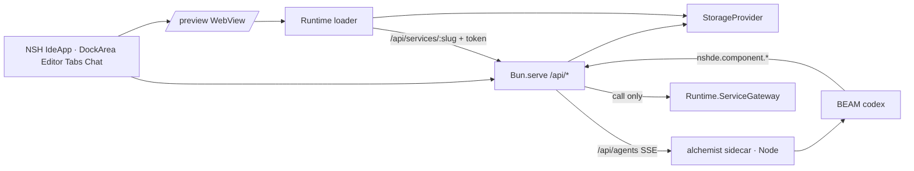

# nshde context

Living map of domain language and architecture. Update this when behavior or vocabulary changes.

## Product

**nshde** is a recursive web IDE: agents write modules, storage persists them, the runtime hot-mounts them in the preview pane.

## Domain terms

| Term | Meaning |
|------|---------|
| **NSH shell component** | TSX module (`.nsh.tsx`) meant to run in the sandboxed runtime, NSH-style |
| **Object tree** | NSH UI listing stored paths under `components/` |
| **Agent** | The alchemist Claude host, run as a sidecar. The role (Architect, Implementer, Reviewer) shapes its system prompt |
| **Sidecar** | alchemist `hosts/nshde/sidecar.ts`, a Node process; `POST /sessions` streams a session as SSE. `NSHDE_AGENT_URL` points at it |
| **Service** | Alchemist codex entry `services.<name>` (Elixir). `meta.json` carries `service.input_schema` and `service.output_schema` |
| **Publish** | Explorer action that writes `{ slug, source_sha256 }` to the service manifest. A changed source needs publishing again |
| **Service gateway** | `Runtime.ServiceGateway`, a call-only BEAM listener that runs published services |
| **Capabilities** | `export const capabilities = ["service:<name>"]` in a component; scopes its service token |
| **Storage backend** | `fs` (`.nshde-data/`), `memory`, or `s3` — where module files live |
| **Runtime loader** | React sandbox in `/preview` (classic script, Sucrase + optional WASM). A same-origin WebView is an opaque sandbox and refuses module scripts. IDE chrome is NSH (`App.tsx`) |
| **Mount / run** | Load a module path into the runtime preview WebView |

## Runtime stack

## UI stack

- **Shell**: NSH TSX entry `App.tsx` → `IdeApp`. Flat workspace: a title toolbar of `Button`s, activity rails, `DockArea`, status bar. This `nsh` 0.3.0 build exports `DockArea`, `Collapsible`, `Editor`, `Tabs`, and `TextView`. `Toolbar` and `Toggle` are on nsh.dev but not in this binary, so the bars are rows of `Button`s with `selected`.
- **Docks**: Agents on the left (Sessions beside the conversation). Explorer is a 248-point column beside the editor, and Runtime is a 220-point pane under the editor. A tab group can leave only when another group sits beside it, which is why those two are in the center split rather than alone in a dock. Editor tabs use a top edge on the active tab; a dirty file's title and Save button use the warn color. `mod+b` toggles agents, `mod+j` toggles runtime, `mod+s` saves.
- **Collapse**: An open dock cannot be shorter than 100 points, so closing agents leaves the robot rail. Explorer hides in place (the tree rail stays). Runtime hides in place and leaves one tab strip, only as wide as the editor column, and panels on the bottom of that column keep a gap so the strip does not cover them. The runtime tab carries a play mark. The panel-collapse glyph sits at the right of that tab row, outside the tab. Rail icons are white when closed and brand when open.
- **Phone**: Below 600 points the shell does not mount `DockArea`. That width is DockArea's compact presentation, where the agents dock would be a drawer as wide as its 520-point pane and the center tab bar would mix files with Explorer and Runtime. A bottom bar switches Editor, Agents, Files, and Run, each a full screen. Agents open as the session list, then the conversation. File tabs scroll, and close stays on the tab. At 600 points and wider, the dock layout is unchanged.
- **Tabs**: Sessions, Explorer, and Runtime can be dragged into any other tab group, including beside the code editor. File, settings, and conversation tabs close, including the last editor tab.
- **Agent dock**: A horizontal split. The session list is the gallery chat sidebar (new session, then the list). Each session is a tab in the conversation group. The composer is the gallery field with suggestion chips; the role is a menu at the bottom left of the field.
- **API bridge**: `host.js` + `src/nshde/api.ts` (`host.call` or `fetch` to port 43123).
- **Dev**: `bun run dev:api` + `nsh run App.tsx --target web`.
- **Production / Koyeb**: root `Dockerfile` (Bun 1.4+, matches `bun.lock` v2) installs `nsh`, runs `nsh package . --target web`, then `bun src/server.ts` serves the IDE and `/api/*` on `PORT`; use Dockerfile builder on Koyeb (not Node buildpacks).

## API surface

- `GET/POST/DELETE /api/storage` — read/write/tree/delete module files
- `GET /api/agents` — list roles
- `POST /api/agents` — `{ prompt, agentId?, sessionId? }`; proxies one turn to the sidecar and streams its SSE (`session`, `text`, `tool`, `tool_result`, `component`, `done`, `error`). A `component` event hot-mounts that file
- `POST /api/modules/check` — `{ source }` or `{ path }`; Sucrase compile, allowed imports, default export, declared capabilities
- `GET /api/services` — services from the alchemist tree (read-only) with `published` and `stale`
- `POST /api/service-manifest` — `{ slug, published }`; publish or unpublish, then regenerate `components/services.d.ts`
- `GET /api/service-types` — `@nshde/services` declarations from the schemas
- `POST /api/service-tokens` — `{ path }`; a 10-minute token scoped to that component's capabilities
- `POST /api/services/:slug` — body is the args; needs `Authorization: Bearer <token>`; forwards `call` to the gateway
- `GET /api/config` — active storage backend and options
- `GET /preview` — React sandbox iframe for mounted modules

## Services in the preview

- The loader resolves `react` and the virtual module `@nshde/services` (`call(slug, args)`, `useService(slug, args)`), scoped to the module's own `capabilities`.
- The IDE mints a token when it builds the preview URL and puts it in the fragment (`#token=`). The preview sends it as a bearer token.
- Origins: service calls accept the IDE origins and `null` (the preview WebView is an opaque sandbox). Minting and publishing accept only the IDE origins. A refused origin gets 403 before anything runs. `NSHDE_IDE_ORIGIN` (comma-separated) sets the IDE origins; otherwise the server's own origin and, outside production, localhost.

## Configuration

| Variable | Meaning |
|----------|---------|
| `NSHDE_AGENT_URL` | Sidecar base URL. Without it `POST /api/agents` answers 503 |
| `ALCHEMIST_DIR` | Alchemist checkout; gives the functions dir, state dir, manifest, and gateway port file |
| `AGENT_FUNCTIONS_DIR`, `ALCHEMIST_STATE_DIR`, `ALCHEMIST_SERVICE_MANIFEST`, `ALCHEMIST_GATEWAY_PORT` | Overrides, same names as the alchemist runtime |
| `NSHDE_SERVICE_SECRET` | HMAC key for service tokens (random per process otherwise) |
| `NSHDE_IDE_ORIGIN` | Allowed IDE origins for the service routes |

## Out of scope (today)

Signed packages, real S3 SDK wiring, running services on a separate BEAM node, dynamic NSH compilation of user modules in-process (preview still uses the React sandbox).
