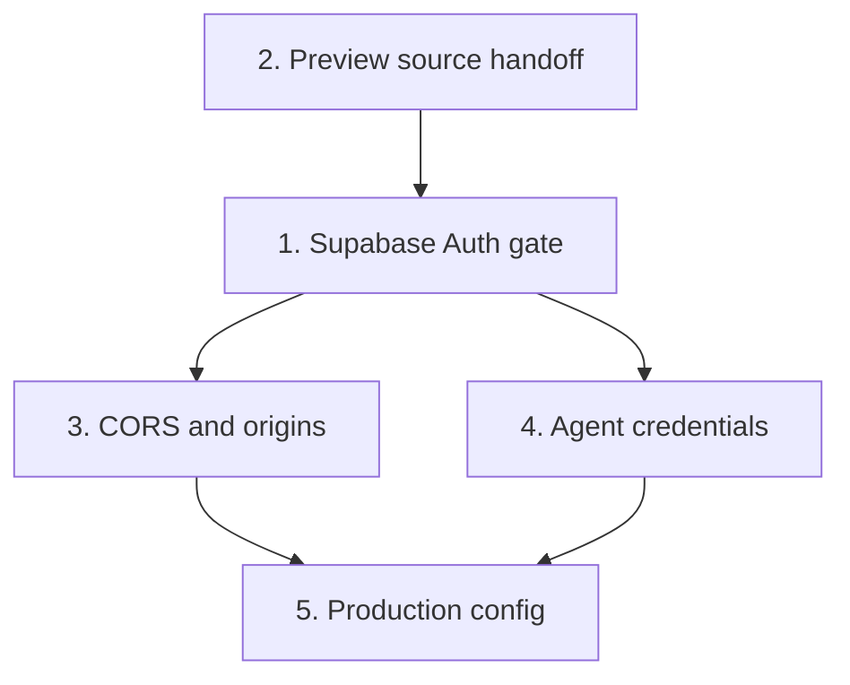

# Access Control

**Planned** P-07.

The deployed instance is open: every `/api` route works without credentials and most send `Access-Control-Allow-Origin: *`.
Anyone with the URL can read, write and delete storage, switch the storage backend, and start agent turns on the owner's Claude credentials.

This plan puts Supabase Auth in front of the API and keeps the preview sandbox as the boundary for agent-written code.
The deployment it assumes (UI on Vercel, API on Koyeb, data on Supabase) is `crucible/athanor/api/P-09`.

## Shape

```mermaid
flowchart LR
  UI[IDE - Vercel origin] -->|sign in| Auth[(Supabase Auth)]
  UI -->|Authorization: Bearer access token| Gate{Gate - Koyeb API}
  Gate --> API[/api/*]
  Preview[/preview iframe - origin null/] -->|Bearer service token| Services[/api/services/:slug/]
  UI -.->|postMessage: module source| Preview
  Agent[alchemist sidecar] -->|Bearer agent token| Gate
```

## Threat model

| Actor | Has | Must not |
| --- | --- | --- |
| Anonymous internet | The URLs | Call any `/api` route except a token-checked service call |
| Other Supabase users | A valid access token of their own | Pass the gate (allowlist) |
| Other websites in the owner's browser | Nothing: the access token is not a cookie | Make the API act |
| Agent-written module in the preview | Opaque origin, its service token | Read or write storage, mint tokens, publish, start agent turns |
| Agent sidecar | Agent token | Anything beyond the component entries' routes |

One owner. Several users and roles are out of scope, but the allowlist makes adding a second person a config change.

## Dependency graph



Slice 2 lands before or with slice 1: once the gate is on, the preview can no longer read `/api/storage`.

## Slices

### 1. Supabase Auth gate

**Client (IDE):**
- `@supabase/supabase-js` with the project URL and the publishable (anon) key, both public, set at build time (`NSHDE_SUPABASE_URL`, `NSHDE_SUPABASE_ANON_KEY`).
- Sign in with GitHub OAuth (primary) or an email magic link. No passwords stored by athanor.
- Without a session the IDE shows only a sign-in screen. With one, `src/nshde/api.ts` adds `Authorization: Bearer <access_token>` to every API request and refreshes through supabase-js. On a 401 it signs out to the sign-in screen.
- The token lives where supabase-js keeps it (browser storage on the Vercel origin). It is not a cookie, so cross-site requests never carry it (no CSRF).

**Supabase project settings:**
- Disable new sign-ups after the owner's first sign-in (or allow only GitHub with signups off).
- Redirect URLs: the Vercel production URL and `http://localhost:8790`.

**Server (Koyeb API), at the top of `Bun.serve` before routes and static files:**
- Verify the JWT with the project's JWKS (`<NSHDE_SUPABASE_URL>/auth/v1/.well-known/jwks.json`, cached, refetched on an unknown `kid`) using `jose`. Check `iss`, `aud = authenticated`, `exp`.
- Projects still on the legacy shared JWT secret: verify HS256 with `SUPABASE_JWT_SECRET` instead. Prefer migrating to signing keys.
- **Allowlist**: `NSHDE_ALLOWED_USERS`, a comma-separated list of Supabase user ids (`sub`). A valid token for anyone else gets 403. Required in production.
- **Enabled** when `NSHDE_SUPABASE_URL` is set. Unset means open (local dev, tests). In `NODE_ENV=production` the server refuses to start without it unless `NSHDE_AUTH=off` is set explicitly.
- Unauthenticated: `401 { "error": "unauthorized" }`.
- **Exempt paths**:
  - `GET /healthz` (new: `200 ok`, no data)
  - `POST/OPTIONS /api/services/:slug`: already needs a scoped service token
  - `OPTIONS` preflights on every route (answered by slice 3 without running a handler)
- `/preview*` and the IDE bundle move to Vercel (`crucible/athanor/api/P-09`). While Koyeb still serves them, they are exempt too: static, no user data.

### 2. Preview source handoff

The preview stops fetching `/api/storage`. The IDE gives it the module instead.

- The IDE reads the module (it already does, for the editor) and posts it to the preview `WebView`: `{ type: "nshde.mount", path, source | wasm, serviceToken?, apiBase }`.
  - `.nsh.tsx`: `source` as a string. `.wasm`: `wasm` as a transferred `ArrayBuffer`.
- The preview (`src/preview/main.tsx`) accepts only `event.source === window.parent` and a well-formed `nshde.mount`. The opaque frame cannot check the parent's origin, so the check is on the window. The payload is code to run in the sandbox, which the preview runs anyway.
- The preview posts `{ type: "nshde.ready" }` when loaded; the IDE sends after that, and again on every save and **run**.
- The service token moves from the URL fragment into this message.
- If the NSH `WebView` gives no handle to the frame's `contentWindow` on the web target, fall back to a one-module read token: `POST /api/preview-tokens { path }` (gated) returns a token for that path (10-minute TTL), and `GET /api/preview-source?path=...` with `Authorization: Bearer <token>` is exempt from the gate. Check the `WebView` API first and record here which path was taken.

### 3. CORS and origins

- Every route uses the policy in `src/lib/api/origin.ts`. Remove the `*` headers in `src/server.ts` and `json()` in `src/lib/api/http.ts`.
- Allowed origins: `NSHDE_IDE_ORIGIN` (comma-separated: the Vercel production URL, any custom domain). Outside production also `http://localhost:*` / `127.0.0.1:*`.
- `Origin: null` only on `/api/services/:slug` (current rule).
- A `POST`/`DELETE` with a present, disallowed `Origin` gets 403 before the handler, on every route.
- `Access-Control-Allow-Headers: Content-Type, Authorization`. No `Allow-Credentials`: nothing uses cookies.
- `POST /api/storage { backend }` is refused in production unless `NSHDE_ALLOW_BACKEND_SWITCH=1`.
- Response headers: `X-Content-Type-Options: nosniff`, `Referrer-Policy: no-referrer`, `Strict-Transport-Security: max-age=31536000`.

### 4. Agent credentials

The sidecar calls back into athanor (`nshde.component.*`), and athanor calls the sidecar. Neither may be open.

- **Agent -> athanor**: `NSHDE_AGENT_API_TOKEN` (32+ random bytes), on both sides. athanor accepts `Authorization: Bearer <it>` in place of a Supabase token, only on:
  - `GET /api/storage?path=components/...` and `?tree=1`
  - `POST /api/storage` with a `path` under `components/` (no `backend`)
  - `POST /api/modules/check`
  Anything else with the agent token: 403.
- **athanor -> sidecar**: `NSHDE_SIDECAR_TOKEN`. `openSidecarStream` sends it; the sidecar refuses requests without it.
- alchemist side: the alchemist planned change `crucible/alchemist/P-01`.
- All comparisons with `timingSafeEqual`.

### 5. Production config

Koyeb (API):

| Variable | Kind | Value |
| --- | --- | --- |
| `NSHDE_SUPABASE_URL` | Plain | `https://<ref>.supabase.co` |
| `NSHDE_ALLOWED_USERS` | Plain | The owner's Supabase user id |
| `NSHDE_IDE_ORIGIN` | Plain | `https://<project>.vercel.app` |
| `NSHDE_SERVICE_SECRET` | Secret | 32 random bytes, base64 |
| `NSHDE_AGENT_API_TOKEN` | Secret | 32 random bytes, base64 |
| `NSHDE_SIDECAR_TOKEN` | Secret | 32 random bytes, base64 |

Vercel (UI build): `NSHDE_SUPABASE_URL`, `NSHDE_SUPABASE_ANON_KEY`, `NSHDE_API_URL` (the Koyeb URL). All public by design.

The Koyeb health check moves to `/healthz`.

## Tests

- Gate: exempt paths answer without a token; every other route answers 401; a valid allowlisted token passes; expired, wrong-issuer, wrong-audience, tampered, and non-allowlisted tokens fail; JWKS key rotation (unknown `kid` triggers one refetch).
- Agent token: allowed on the listed routes only.
- CORS: a foreign `Origin` POST is refused on every route; `null` only on service calls; no `*` anywhere.
- Preview: mounts from `nshde.mount`; ignores messages not from `window.parent`; makes no `/api/storage` request.
- Production boot without auth config fails unless `NSHDE_AUTH=off`.

## Done when

- An anonymous `curl` of `/api/storage?tree=1` and `POST /api/agents` on Koyeb gets 401.
- Signed in as the owner, the IDE works as before: edit, save, run, agent turn, service call from a mounted component. Signed in as anyone else: 403.
- A component in the preview cannot read `/api/storage` or call any route but its scoped services.
- CONTEXT.md and README describe the gate, exempt paths, and variables.
