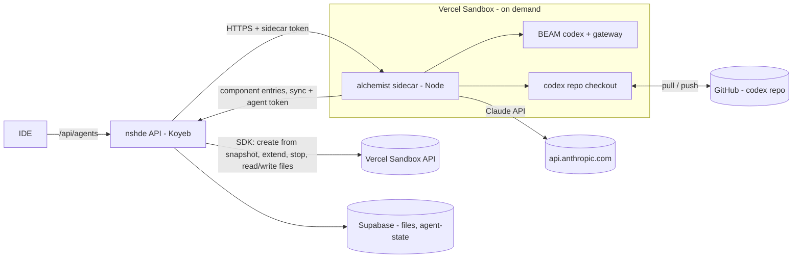
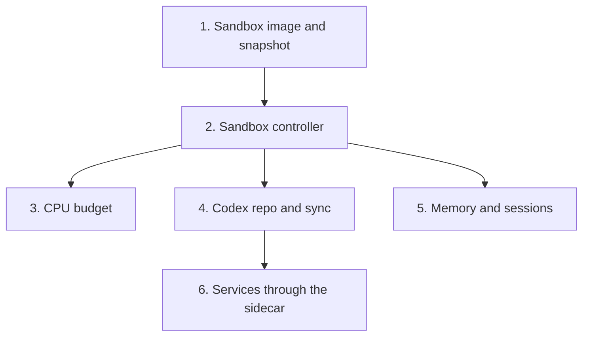

# Agent Sandbox

**Planned** P-08.

nshde runs on Koyeb; the agent (alchemist sidecar + BEAM) has no deployment yet.
This plan runs the agent on demand in a [Vercel Sandbox](https://vercel.com/docs/vercel-sandbox) on the Hobby plan, started by the nshde API, and keeps it inside the free allowance.
The agent's work lives in a separate **codex repo** on GitHub (components and the functions they use) and in Supabase (memory, sessions).

Depends on `crucible/nshde/api/P-07` (tokens) and `crucible/nshde/api/P-09` (Supabase storage). The alchemist side is the alchemist planned change `crucible/alchemist/P-01`.

## Why a sandbox, not Koyeb

- `define` runs any Elixir with the BEAM's privileges. Next to the API it could read every secret (Claude key, Supabase service key). The Koyeb free tier allows one service, so the agent cannot get its own container there.
- The free Koyeb instance is too small for Bun, Node, the Claude Code process and a BEAM together, and it sleeps, which kills the BEAM.
- The agent is idle most of the time; a sandbox that exists only while someone prompts costs nothing in between.

Fallback if the spike in slice 1 fails, or on a paid Koyeb plan: a second, private Koyeb service running the sidecar, with the same tokens and the same codex-repo and memory sync.

## Hobby limits that shape the design

From Vercel's sandbox pricing page (verify at implementation time):

| Limit | Hobby |
| --- | --- |
| Active CPU | 5 hours / month |
| Memory | 420 GB-hours / month |
| Sandbox creations | 5,000 / month |
| Max lifetime of one sandbox | 45 minutes |
| Concurrent sandboxes | 10 |
| Overage | None: sandboxes stop until the allowance resets |

- No surprise bill; the risk is the agent being off for the rest of the month.
- Active CPU counts only time the CPU works. A turn mostly waits on the Claude API; installing, compiling and idle spinning are what cost.
- Nothing in a sandbox survives it.

## Shape



## Codex repo

One repo per nshde workspace, separate from alchemist (e.g. `0x1d/nshde-codex`):

```
components/        <slug>.nsh.tsx, .wasm - the UI modules
functions/         alchemist codex entries the agent wrote
  services/<name>/ tool.ex, meta.json - backend services
  ...                any other entry the agent defines
services.json      published services: [{ slug, source_sha256 }]
README.md
```

- `functions/` is an **overlay** on alchemist's own entries (alchemist plan). Alchemist's shipped entries and `functions/lib` stay in alchemist.
- `components/services.d.ts` is generated from the schemas and gitignored.
- Publishing a service is a commit to `services.json`, so every published version has a reviewable diff.
- Supabase `files` (`crucible/nshde/api/P-09`) is the IDE's **working copy** of `components/` and `services.json`: always available, even with no sandbox. Git is the history and the source of truth between syncs.

### Sync

Alchemist does the git work, inside the sandbox, through a `codex.sync` entry the sidecar also exposes as `POST /sync`.

**When:**

| Trigger | Who starts it |
| --- | --- |
| Agent start | Controller, before the first turn |
| New or changed functions or components after a turn | Sidecar, at turn end, when anything changed |
| Publish / unpublish a service | nshde API, then sync |
| User asks | **Sync** button in the explorer -> `POST /api/codex/sync` -> starts a sandbox if none is up (charged to the budget) -> `POST /sync` |

**What one sync does:**

1. `git pull --rebase` the checkout.
2. **Components and manifest, nshde <-> repo.** For each file under `components/` and `services.json`, compare three versions by git blob sha: the repo's, nshde's working copy, and `base_sha` (the sha both had at the last sync, stored per file in `files`).
   - Only the repo changed: write it to nshde.
   - Only nshde changed: write it to the checkout.
   - Both changed to different contents: keep nshde's in place, write the repo's next to it as `<name>.remote.nsh.tsx`, report a conflict. Never overwrite silently.
   - Deleted on one side and unchanged on the other: delete on both.
3. `functions/` changes come only from the agent (the IDE lists services but does not edit Elixir), so they are committed as they are.
4. Commit: one commit per sync, message `codex: <summary>` listing the components and entries changed and the session id. `codex.commit_uncommitted` can still be used for per-function commits when the user asks.
5. `git push`. If rejected, pull and retry once, then report.
6. Update `base_sha` in nshde for every synced file.

nshde exposes the working-copy side to the sidecar through the agent token (`crucible/nshde/api/P-07` slice 4, extended): `GET /api/codex/files` (paths with content sha and `base_sha`), `GET/POST /api/storage` under `components/` and `services.json`, `POST /api/codex/base` (set `base_sha`s).

**Credentials:** a fine-grained GitHub token with *Contents: read and write* on the codex repo only (`CODEX_GITHUB_TOKEN`), passed to the sidecar's environment and used through a git credential helper, not written into the remote URL. Agent-written code can reach it; the damage is limited to that one repo, whose history shows every change.

## Dependency graph



## Slices

### 1. Sandbox image and snapshot (spike first)

A snapshot from which the sidecar is ready in seconds, with no install or compile at start.

- Base: the Node 24 sandbox runtime. Erlang/OTP and Elixir matching alchemist's `flake.nix` (distro packages if versions fit, else prebuilt tarballs; not Nix).
- Clone alchemist at a pinned commit, `npm ci`, `mix deps.get && mix compile` in `runtime/`.
- No codex repo, no secrets in the snapshot: they arrive at start.
- `bun run agent:snapshot` (`scripts/agent-snapshot.ts`) builds it through the SDK and prints the id (`NSHDE_AGENT_SNAPSHOT`). Run by hand per alchemist upgrade; charged to the budget.
- Record here: versions, snapshot size, cold start (create -> sidecar listening), snapshot retention.

Exit criteria: from the snapshot, the sidecar answers within 15 s and a turn writes a component back to a local nshde. Otherwise take the fallback.

### 2. Sandbox controller

`src/lib/agents/sandbox.ts`, used by `/api/agents` when `NSHDE_AGENT_MODE=vercel` (else `NSHDE_AGENT_URL` as today).

- Vercel SDK with `VERCEL_TOKEN`, `VERCEL_TEAM_ID`, `VERCEL_PROJECT_ID`.
- **One sandbox at a time**; `{ id, url, startedAt, lastTurnAt }` kept in memory and in storage (`.nshde/agent-sandbox.json`) so an API restart or Koyeb wake reattaches.
- **Start**: create from the snapshot, smallest size, port `43124`, `timeout` = idle window. Restore memory and sessions (slice 5). Start the sidecar detached with `NSHDE_SIDECAR_HOST=0.0.0.0`, `NSHDE_SIDECAR_TOKEN`, `NSHDE_API_URL`, `NSHDE_AGENT_API_TOKEN`, `ANTHROPIC_API_KEY`, `NSHDE_AGENT_MODEL`, `CODEX_REPO`, `CODEX_GITHUB_TOKEN`, and `ELIXIR_ERL_OPTIONS="+S 2:2 +sbwt none +sbwtdcpu none +sbwtdio none"` (no scheduler busy-wait while idle). The sidecar clones the codex repo and syncs (slice 4) before it reports ready. Concurrent first turns share the start.
- **Idle stop** after `NSHDE_AGENT_IDLE_MIN` (5): final budget sample, sync if dirty, save memory and sessions, stop. Vercel's timeout is the backstop.
- **Lifetime cap** `NSHDE_AGENT_MAX_LIFETIME_MIN` (40, under 45): no turn starts that would cross it; stop and start fresh instead.
- **Turn cap** `NSHDE_AGENT_TURN_MAX_MIN` (10): abort and send `error`.
- New SSE event `status` (`starting agent...`, `syncing...`) for the panel.
- Egress, if the sandbox network policy allows: `api.anthropic.com`, `github.com`, the nshde API host.

### 3. CPU budget

- Budget `NSHDE_AGENT_CPU_BUDGET_MIN` (240 of 300). Period resets on `NSHDE_AGENT_BUDGET_RESET_DAY` (1, UTC) to match the billing cycle.
- Measure inside the sandbox from `/proc/stat` (`cpu` line: user + nice + system + irq + softirq, `USER_HZ`): baseline at start, sample at each turn end and before stop, charge the deltas.
- A sandbox lost before its last sample is charged wall time since the last sample x vCPUs.
- Snapshot builds are charged the same way.
- Ledger `.nshde/agent-usage.json`: `{ period, cpuSeconds, wallSeconds, sandboxes, turns }`; `GET /api/agents/usage`.
- >= 80 %: warning in the panel. >= 100 %: `429` until the reset date, no sandbox started. A user-requested sync is refused too; the working copy keeps the edits until the next sync.
- Claude spend: `NSHDE_AGENT_MAX_TURNS_PER_DAY` (50) in the same ledger.
- Reconcile against Vercel's usage page; tune the budget if they differ by more than 20 %.

### 4. Codex repo and sync

- Implement the sync above: alchemist `codex.sync` entry and sidecar `POST /sync` (alchemist plan); nshde `/api/codex/*` routes, `base_sha` column on `files`, the **Sync** button, and conflict reporting in the explorer (a `.remote` file shows as a conflict with *keep mine* / *take theirs*).
- `CODEX_REPO` (`owner/name`) configures the repo. Bootstrapping: an empty repo is initialized with the layout and a README on the first sync.
- Components written by the agent through `nshde.component.write` land in the working copy as today and reach git at turn-end sync.

### 5. Memory and sessions

The memory graph is one MiniGraf database file (`AGENT_MEMORY_PATH`) plus a `.tx` counter file. `Runtime.Memory` is the only writer, writes happen only during turns, and MiniGraf checkpoints after every write, so between turns the file on disk is complete.

- **Where**: Supabase Storage, private bucket `agent-state`. Objects are files, so the graph is stored as it is, not converted to rows:

  ```
  memory/<generation>/minigraf.graph
  memory/<generation>/minigraf.graph.tx
  memory/current.json   { generation, sha256, bytes, at }
  sessions/<session-id>.jsonl
  ```

- **Save** (controller, at turn end when the graph's sha changed, and before stop): read both files out of the sandbox with the SDK, upload them under a new generation, then rewrite `current.json`. Keep the last 10 generations; older ones are deleted. A crash mid-upload leaves `current.json` on the previous complete generation.
- **Restore** (controller, at start, before the sidecar and BEAM start): download the generation in `current.json` and write it to `AGENT_MEMORY_PATH`. No generation yet: start empty.
- The `.tx` file is reconciled against the graph on open, so a mismatched pair still opens correctly.
- The Supabase key stays on Koyeb; the sandbox never sees it.
- A crash during a turn loses that turn's memory writes, nothing earlier.
- Not in git: memory is per-user agent state with frequent binary rewrites. Facts already reach git as the memory notes in `codex.commit_uncommitted` messages.
- **Sessions**: the Agent SDK's transcript for each nshde session (`~/.claude/projects/<cwd>/<id>.jsonl` in the sandbox) is saved and restored the same way, so `sessionId` resumes across sandboxes. If the transcript layout makes this impractical, v1 resumes only within one sandbox and the panel starts a new session after a restart; record which.

### 6. Services through the sidecar

- **Listing**: nshde's service registry reads `functions/services/**` from the codex repo through the GitHub contents API (cached, refreshed after each sync), instead of a local `ALCHEMIST_DIR`. Schemas, `source_sha256` and stale detection are unchanged.
- **Publish**: nshde writes `services.json` in the working copy, then syncs. The gateway reads the manifest from the checkout.
- **Calls**: the sidecar adds `POST /services/:name` (sidecar token), forwarding to the local `Runtime.ServiceGateway`. `handleServiceCall` uses it when `NSHDE_AGENT_MODE=vercel`.
- **No sandbox up**: `503 gateway_down`, "start the agent to run services". Starting one for a service call is a follow-up, behind the budget.

## Configuration (Koyeb)

| Variable | Kind | Default |
| --- | --- | --- |
| `NSHDE_AGENT_MODE` | Plain | `url` (`vercel` for this plan) |
| `VERCEL_TOKEN` | Secret | |
| `VERCEL_TEAM_ID`, `VERCEL_PROJECT_ID` | Plain | |
| `NSHDE_AGENT_SNAPSHOT` | Plain | |
| `ANTHROPIC_API_KEY` | Secret | |
| `CODEX_REPO` | Plain | |
| `CODEX_GITHUB_TOKEN` | Secret | |
| `NSHDE_SIDECAR_TOKEN`, `NSHDE_AGENT_API_TOKEN` | Secret | (`crucible/nshde/api/P-07`) |
| `NSHDE_AGENT_IDLE_MIN` | Plain | `5` |
| `NSHDE_AGENT_MAX_LIFETIME_MIN` | Plain | `40` |
| `NSHDE_AGENT_TURN_MAX_MIN` | Plain | `10` |
| `NSHDE_AGENT_CPU_BUDGET_MIN` | Plain | `240` |
| `NSHDE_AGENT_BUDGET_RESET_DAY` | Plain | `1` |
| `NSHDE_AGENT_MAX_TURNS_PER_DAY` | Plain | `50` |

## Tests

- Controller with a fake SDK: one sandbox for concurrent turns; reattach after restart; idle stop runs sample, sync, save, stop in that order; lifetime and turn caps.
- Budget: deltas add up; lost sandbox charged conservatively; 80 % warns; 100 % refuses before starting a sandbox; rollover.
- Sync (three-way): each case of repo-only, nshde-only, both-changed, delete; push rejected then retried; `base_sha` updated.
- Memory: save creates a generation and moves `current.json`; restore writes it back; an interrupted save keeps the old pointer; pruning keeps 10.
- Services: listing from the repo; calls through the sidecar route; no sandbox -> 503.

## Done when

- From the Koyeb IDE, a prompt starts a sandbox, writes a component and a service, and the next commit in the codex repo contains both.
- The sandbox stops on its own; a second prompt gets a fresh sandbox that remembers earlier facts and sees earlier functions.
- An edit made in the IDE while no sandbox runs reaches the repo on the next sync; an edit made on GitHub reaches the IDE.
- A turn past the budget is refused without starting a sandbox.

## Open questions

- Is Koyeb on the free tier? It decides whether the fallback fits.
- Vercel snapshot retention: if snapshots expire, the controller must say so rather than rebuild silently.
- Does the sandbox's public port keep a long SSE stream open for a whole turn? Check in the spike.
- Alternative kept in reserve: nshde (on Koyeb) does the git work through the GitHub API instead of alchemist. User-requested syncs would then not need a sandbox, and the GitHub token would stay out of it. Chosen against for now: alchemist owns its codex and already has the git tooling.
