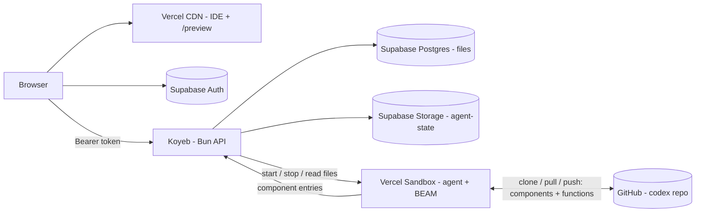
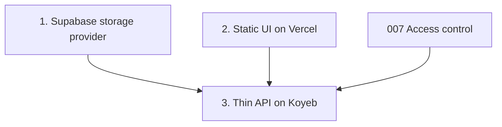

# Free-tier Deployment

**Planned** P-09.

athanor on free tiers of Vercel, Supabase and Koyeb, plus a GitHub repo for the agent's code.
Only the Claude API costs money.

## Layout



| What | Where | Plan |
| --- | --- | --- |
| IDE bundle and preview files | Vercel static hosting | this, slice 2 |
| Sign-in | Supabase Auth | 007 |
| API, sandbox controller | Koyeb | this, slice 3 |
| Components, codex functions, published-services manifest (history, source of truth) | GitHub codex repo | 008, alchemist plan |
| Working copy of components and manifest, generated types, usage ledger | Supabase Postgres (`files`) | this, slice 1 |
| Memory graph, session transcripts | Supabase Storage (`agent-state` bucket) | 008 |
| Agent + BEAM, service gateway | Vercel Sandbox, on demand | 008 |

Why the API stays on Koyeb and not on Vercel Functions: agent turns stream for minutes, the sandbox controller keeps state between requests, the current `Bun.serve` routes run unchanged, and the API does not draw on the same Vercel CPU allowance as the agent.

## Free-tier constraints (check current terms)

- **Supabase** pauses a free project after about a week without activity. Normal use keeps it awake; otherwise a weekly request to `/healthz` that touches the database.
- **Koyeb** free instances are small and sleep when idle; the first request after a sleep is slow. The API holds no state that matters across a sleep (the sandbox record is in storage, `crucible/athanor/api/P-08`).
- **Vercel Hobby** is for non-commercial use. Sandbox CPU is budgeted in `crucible/athanor/api/P-08`.

## Dependency graph



## Slices

### 1. Supabase storage provider

A fourth backend beside `fs`, `memory` and `s3`: `NSHDE_STORAGE=supabase`.

- Table:

  ```sql
  create table public.files (
    path text primary key,
    content text,
    bytes bytea,
    base_sha text,  -- git blob sha at the last codex sync (`crucible/athanor/api/P-08`); null if never synced
    updated_at timestamptz not null default now(),
    check ((content is null) <> (bytes is null))
  );
  alter table public.files enable row level security;
  -- no policies: only the service role (the API) can read or write
  ```

- `.nsh.tsx`, `.json`, `.d.ts` go in `content`; `.wasm` in `bytes`.
- `tree` is one `select path from files order by path`, folded into `TreeNode`s.
- Client: `@supabase/supabase-js` on the server with `SUPABASE_SERVICE_ROLE_KEY` (Koyeb secret). The key never reaches the browser or the sandbox.
- Seeding: on an empty table, write the same demo files the `memory` backend seeds.
- Migration: `bun run storage:copy --from fs --to supabase` for existing `.nshde-data/`.
- The SQL lives in `supabase/migrations/` so the Supabase CLI can apply it.

### 2. Static UI on Vercel

- Vercel project from this repo, framework preset *Other*.
  - Install: `curl -fsSL https://nsh.dev/install.sh | sh && bun install`
  - Build: `nsh package . --target web && bun run build:preview`
  - Output: `.nsh/out/nshde`
- `build:preview` writes the preview bundle (today built in memory by `buildPreviewBundle()` at server start) to `preview/index.html`, `preview/runtime.js`, `preview/runtime.css` inside the output.
- The IDE's API base comes from `NSHDE_API_URL` at build time; `defaultBase()` keeps its localhost rules for dev.
- `vercel.json`: `cleanUrls`, no-cache on `/preview/*` and `index.html`, long cache on hashed assets, and the security headers from `crucible/athanor/api/P-07` slice 3.
- The preview iframe loads from the Vercel origin; its service calls go to `apiBase` from the `nshde.mount` message.

### 3. Thin API on Koyeb

- The Docker image drops the NSH CLI and `nsh package`; it runs `bun src/server.ts` only. Faster builds, smaller image.
- `NSHDE_WEB_DIR` unset: the API serves `/api/*` and `/healthz` only. `/` answers a short text with the UI URL.
- Storage `supabase`, auth per `crucible/athanor/api/P-07`, agent per `crucible/athanor/api/P-08`.
- `/healthz` runs `select 1` against Supabase, so the health check also keeps the Supabase project awake.

## Configuration

| Where | Variable | Kind |
| --- | --- | --- |
| Koyeb | `NSHDE_STORAGE=supabase` | Plain |
| Koyeb | `NSHDE_SUPABASE_URL` | Plain |
| Koyeb | `SUPABASE_SERVICE_ROLE_KEY` | Secret |
| Koyeb | `crucible/athanor/api/P-07` and 008 variables | |
| Vercel | `NSHDE_API_URL`, `NSHDE_SUPABASE_URL`, `NSHDE_SUPABASE_ANON_KEY` | Plain (public) |

## Tests

- Supabase provider against a local Supabase (`supabase start`) or a fake: read, write, delete, tree, wasm round trip, seeding on empty.
- `build:preview` output loads in the existing preview test.
- The API boots without a web bundle and answers `/healthz`.

## Done when

- The IDE loads from `*.vercel.app`, signs in with Supabase, and edits components stored in Supabase through the Koyeb API.
- A Koyeb redeploy loses nothing.
- README documents the three services, their settings, and the variables.
