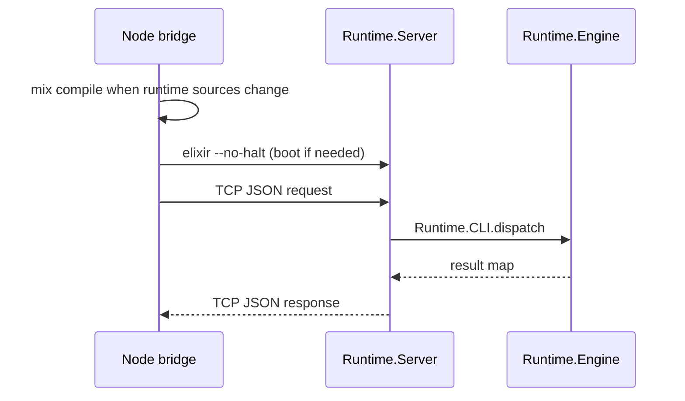

# Mix control plane

The `runtime/` Mix project is Alchemist's **Mix control plane**: it validates slugs,
compiles registry entry trees, maintains `meta.json`, and invokes `run/1`. Hosts
never call these modules directly; they send JSON to `Runtime.Server` through the
Node bridge or an equivalent TCP client.

The bridge boots a **long-lived BEAM** running `Runtime.Server` on `127.0.0.1`.
Compiled entry modules stay loaded in that VM until it restarts.

## Module responsibilities

| Module | Responsibility |
| --- | --- |
| `Runtime.Server` | TCP listener; dispatches requests to `Runtime.CLI` inside the BEAM |
| `Runtime.CLI` | Operation dispatch for `define`, `load`, `find`, `call` |
| `Runtime.Engine` | Orchestrates compile, metadata refresh, search, and `run/1` invocation |
| `Runtime.Compiler` | Compiles `functions/lib` and per-slug `.ex` trees; validates entry module |
| `Runtime.Registry` | Slug sanitization, paths, `meta.json`, discovery walk, `write_definition` |
| `Runtime.Metadata` | Extracts `@moduledoc` and `@spec` for metadata files |
| `AgentFn.Registry` | Dynamic dispatch helper (`call/2`, `list/0`) used from entry code |
| `AgentFn.Tool` | Behaviour marker for entry modules |

## Lifecycle



## Source and metadata layout

| Path | Content |
| --- | --- |
| `functions/<slug-path>/tool.ex` | Entry module source (`define` default target) |
| `functions/<slug-path>/**/*.ex` | Deep modules for the entry |
| `functions/<slug-path>/meta.json` | Discovery record (`find`); updated on load/define |
| `functions/lib/**/*.ex` | Shared `AgentLib.*` modules |

Default functions root is `../functions` relative to this project.

## Development

```bash
mix deps.get
mix test
```

From the repository root:

```bash
(cd runtime && mix test)
node scripts/registry-cli.mjs '{"op":"call","name":"echo","args":{}}'
```

## Environment variables

| Variable | Effect |
| --- | --- |
| `AGENT_FUNCTIONS_DIR` | Path to the capability tree (set by the Node bridge for registry calls) |
| `ALCHEMIST_STATE_DIR` | Bridge/server state (`port`, `pid`, `stamp`; default `runtime/.alchemist`) |

## Limitations

- One BEAM per bridge state directory; stale PIDs are replaced on the next boot.
- `"loaded"` in `meta.json` is disk bookkeeping; live code lives in the BEAM until restart.
- No sandbox: compilation and `run/1` use the host OS identity. See
  [Security boundary](../docs/reference/security.md).
- Operation contract: [Registry protocol](../docs/reference/protocol.md).

## Related reading

- [Architecture](../docs/concepts/architecture.md)
- [Host adapters](../docs/reference/hosts.md)
- [Domain language](../docs/concepts/domain-language.md)
